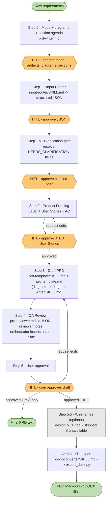

# Automated PRD Writing Pipeline Guide

This document explains how to use the PRD Writer workflow and how the end-to-end process operates. It is intended to help new contributors understand the system and interact with it in a consistent way.

---

## Product First: What the PRD Covers

The PRD hands over the **rules, the logic, and the core value** of a feature so that **PO, BA, Dev, and QC** understand them the same way, without a meeting to explain the document. It describes **WHAT** the feature does and **WHY** — never **HOW** it is built.

Why: whoever writes the PRD (a person or an AI) rarely has the full technical context — the company's tech stack, engineering rules, internal systems, SaaS tools, and existing configuration. Technical detail written without that context is guesswork: it misleads Dev, nobody else can check it, and it buries the business rules that actually matter. The Dev team owns the technical design in its own document, linked from the PRD's References.

| The PRD contains | The PRD leaves to the Dev team's technical design |
|------------------|---------------------------------------------------|
| Problem, value, goals, and how success is measured | Architecture, services, and components |
| Scope: what is in and what is explicitly out | APIs, endpoints, payloads, status and error codes |
| Shared glossary of business terms, statuses, and roles | Database tables, fields, and data formats |
| Business rules with concrete values and worked examples | Configuration keys and how values are configured |
| Statuses and transitions, roles and permissions | Infrastructure, caching, queues, scheduled jobs |
| User stories with observable `Done when` acceptance criteria | Code or pseudo-code |
| Use cases with exception flows, written as what the user sees | |
| Business-level quality expectations, screens, and user-facing messages | |
| Dependencies on partners, teams, and existing features; impacted areas | |
| Technical decisions as **Open Questions** owned by Dev / Tech Lead | |

All wording rules, including a technical-to-product translation table, live in [`knowledge-base/product-language/SKILL.md`](./knowledge-base/product-language/SKILL.md). Every pipeline step applies it.

**PRD structure**

| # | Section | Main reader |
|---|---------|-------------|
| 1 | Document Info — version history, references, how to read this PRD *(always included)* | All |
| 2.1 | Summary — the feature at a glance *(always included)* | All |
| 2.2–2.4 | Problem Statement, JTBD, Goals & Success Metrics | PO |
| 2.5–2.6 | Scope, Glossary | All |
| 3.1 | Feature Epics & User Stories with acceptance criteria | BA, QC |
| 3.2 | Business Rules — rules, statuses & transitions, roles & permissions | BA, Dev, QC |
| 3.3 | Process Diagrams — business-level only | BA, Dev |
| 3.4 | Use Case Specifications | BA, Dev, QC |
| 3.5 | Functional and Non-Functional Requirements | Dev, QC |
| 3.6 | UI/UX Specifications and user-facing messages | Dev, QC |
| 3.7 | Dependencies & Impacted Areas | PO, Dev, QC |
| 4 | Assumptions & Open Questions | All |

---

## 0. Prerequisites

Before running the full IDE pipeline, ensure your environment meets the following requirements. These requirements are not needed when running in chat text-only mode.

**Pandoc** (required only for DOCX export)

Install via your OS package manager:

```bash
# macOS
brew install pandoc

# Ubuntu / Debian
sudo apt-get install pandoc

# Windows
winget install JohnMacFarlane.Pandoc
```

Verify: `pandoc --version`

**pypandoc-binary** (Python binding; includes a Pandoc binary)

```bash
pip install pypandoc-binary
```

`pypandoc-binary` bundles its own Pandoc binary, so you can use this instead of the OS-level install above. Do not install both in the same environment unless you intentionally manage the PATH.

**Python 3.9+**

```bash
python --version
```

**File system write access** (IDE full pipeline only)

The pipeline writes to `domain-knowledge/[Domain_Name]/` relative to the project root. Make sure your agent IDE has write access to the project root.

**Smoke test**

After setup, run the local smoke test to verify the schema and helper scripts:

```bash
python knowledge-base/scripts/smoke_test.py
```

---

## 1. Process Overview

The PRD workflow is orchestrated by the **Master PRD Writer** in [`prd-writer.md`](./prd-writer.md). It transforms raw product requirements into a complete PRD, routes the draft through review and approval, and can either return text in chat or create Markdown/DOCX files in an IDE workspace.

**BPMN warning:** BPMN output is token-heavy and usually produces only a basic result because coordinates must be estimated manually.

There are two ways to run the same pipeline:

| How | For whom | Output |
|-----|----------|--------|
| `IDE_FULL_PIPELINE` | Users of Claude Code or another agent IDE working inside this repo | Files under `domain-knowledge/`, optional DOCX export |
| `CHAT_TEXT_ONLY` | Chat-agent sessions where no files should be created | Structured text returned in chat |

The process runs through the steps below, with human approval gates at the key decision points.



### Step 0: Delivery Mode, Diagram & Section Agenda Confirmation

- The system first determines whether the user wants `IDE_FULL_PIPELINE` or `CHAT_TEXT_ONLY`.
- In IDE mode, the system confirms whether final artifacts should include Markdown only or Markdown plus DOCX.
- The system checks whether the feature needs any diagrams: BPMN, Activity Diagram, or Sequence Diagram.
- The system presents the fourteen optional PRD sections as a numbered agenda and asks the user to confirm which apply. Document Info and the Summary are always included. Excluded sections are skipped during drafting; the default is all sections active.
- If the user has not specified mode, diagram needs, or the section agenda, the system must pause and ask before planning the rest of the workflow.

### Step 1: Data Pre-processing (Input Router)

- The raw request is passed through the `input-router` skill and normalized into a structured JSON object.
- The JSON must validate against `knowledge-base/input-router/resources/output_schema.json`.
- The JSON includes delivery mode, output artifacts, domain name, scope (in and out), glossary, story candidates, user flow, business rules, requirements, success metrics, dependencies, known constraints, and missing information — all in business language. Technical wording in the input is translated into its business meaning.
- In IDE mode, if the domain folder does not exist yet, the system creates it before persisting the JSON file.
- Domain creation is run with `python knowledge-base/scripts/create_domain.py --domain_name [Domain_Name]`, so the output is anchored to this project root.
- In IDE mode, the draft JSON is stored under `domain-knowledge/[Domain_Name]/inputs/`.
- In text-only mode, the JSON is shown in chat but not written to disk.
- The user must review and approve this JSON before product framing begins.

### Step 1.5: Clarification Gate (Critical Pause)

- The system reviews the approved JSON and asks one consolidated batch of business questions for every `[NEEDS_CLARIFICATION]` field. It does not ask technical implementation questions; those become Open Questions for Dev / Tech Lead in the PRD.
- Fields the user cannot answer stay as `[NEEDS_CLARIFICATION]` and surface as `TBD` in the PRD — the system never invents missing details.
- If the JSON has no gaps, the system asks for a single confirmation and moves on.
- `Clarification_Confirmed` is set to `true` only after the user explicitly approves the clarified brief. Framing cannot start before that.

### Step 2: Product Framing Approval (JTBD + User Stories)

- In IDE mode, the system reads `domain-knowledge/[Domain_Name]/rules.md` and any existing PRDs, framing files, or prior inputs in the same domain.
- In text-only mode, the system uses only the approved JSON and context pasted into chat.
- The system generates the Product Framing Pack with `knowledge-base/product-framing/SKILL.md`, which applies standards from:
  - `knowledge-base/knowledge/jobs-to-be-done/SKILL.md`
  - `knowledge-base/knowledge/user-story-skill/SKILL.md`
- The output is a Product Framing Pack containing single-sentence JTBD job stories (`When [situation], I want to [motivation], so I can [expected outcome].`), research status, Epics, INVEST-standard User Stories, `Done when` acceptance criteria, traceability notes, and open questions.
- In IDE mode, the Product Framing Pack is saved under `domain-knowledge/[Domain_Name]/inputs/[Feature_File_Name]_framing.md`.
- In text-only mode, the Product Framing Pack is shown in chat but not written to disk.
- The user must review and approve this Product Framing Pack before drafting begins.

### Step 3: Drafting

- The approved JSON from Step 1 and the approved Product Framing Pack from Step 2 are rendered into a full PRD using the standard PRD template.
- The Product Framing Pack is the source of truth for JTBD and User Stories in the PRD.
- In IDE mode, the draft is stored under `domain-knowledge/[Domain_Name]/PRDs/[Feature_File_Name]_PRD.md`.
- In text-only mode, the full Markdown PRD draft is returned in chat.
- Diagrams are generated by `diagram-writer/SKILL.md` only. No other file contains diagram generation rules.

### Step 4: Quality Assurance (PRD Reviewer)

- The draft is reviewed by the `prd-reviewer`.
- The reviewer returns a structured JSON array of reviewer notes; each note has a `section`, `risk`, `fix_a`, and `fix_b`.
- The orchestrator inserts each note inline, directly below the affected section, using the `> [!WARNING] REVIEWER'S NOTE` callout format.
- In IDE mode, notes are inserted into the Markdown file. In text-only mode, notes are inserted into the in-chat draft.
- Reviewer output is capped at 10 high-risk notes per pass.
- The reviewer validates business logic, business-level edge cases, scope, JTBD alignment, `Done when` acceptance criteria coverage, and traceability between rules and criteria.
- The reviewer also flags **technical leakage** (endpoints, status codes, database fields, internal services, code) and wording that PO, BA, Dev, and QC could read differently, and proposes a business-language rewrite.

### Step 5: User Approval (Critical Pause)

- The system must pause here for user review.
- The user can request edits, add information, or approve the PRD.
- The process stays in this step until the user explicitly approves the draft.
- Substantive edits return to Step 4 for re-review before the draft is shown again. Cosmetic edits may skip re-review.
- In text-only mode, approval completes the workflow and the final PRD remains in chat.

### Step 5.5: Optional Wireframe/UI Creation (Design MCP Tool)

- This step runs only in IDE full pipeline mode.
- After the PRD is approved, the system may generate wireframes based on the `UI/UX Specifications` section.
- This step should run only if a wireframe-capable design MCP tool (for example Stitch or Figma) is available in the environment.
- If no design tool is available, the workflow should continue to export without blocking.

### Step 6: File Export (DOCX)

- This step runs only in IDE full pipeline mode.
- If the user requested Markdown only, the workflow skips DOCX export and returns the Markdown path.
- If the user requested DOCX, the final Markdown PRD is exported to `.docx` using `export_docx.py` with `pypandoc`.
- The output file must be stored inside `domain-knowledge/[Domain_Name]/PRDs/`.
- Prefer file-based export with `--input_path` and `--output_path` so long PRDs do not hit command-line length limits.
- Reviewer-note callouts are stripped from DOCX exports by default so unresolved notes do not appear as ordinary content.
- PlantUML and BPMN/XML blocks are preserved as source text in DOCX unless pre-rendered image links are provided.
- If a hosted export wrapper is unavailable, the workflow calls the local export script directly instead of failing the pipeline.

---

## 2. Recommended Input Structure

The quality of the Step 1 input strongly affects the quality of the generated PRD. To reduce follow-up questions and avoid `[NEEDS_CLARIFICATION]` placeholders, users should provide at least the following:

1. **Delivery mode:** IDE full pipeline with files, or chat text-only output.
2. **Desired artifacts:** Markdown only, Markdown plus DOCX, or text response only.
3. **Feature name and objective:** What is the feature, and what business or user value should it create?
4. **Problem context:** What is broken or missing today?
5. **Target user or actor:** Who is the main person or role using this feature?
6. **Scope:** What is included, and what is explicitly out of scope for this release?
7. **Basic user flow:** What does the happy path look like from start to finish?
8. **Business rules and edge cases:** Concrete values (amounts, limits, time windows, who may do what) and what should happen when something goes wrong — seat already taken, payment failed, partner not responding, user leaves mid-way.
9. **Quality expectations:** How fast it should feel, when it must be available, who may see which information.
10. **Dependencies and known constraints:** Partners, teams, or existing features involved. If your team already knows a constraint (for example "must reuse the current payment partner"), state it — it is recorded as stated under Known Constraints, not expanded into technical detail.
11. **Success metrics:** How will the team know the feature worked, and how is each metric counted?
12. **Diagram needs:** State whether you want BPMN, Activity Diagram, Sequence Diagram, or no diagrams. Diagrams stay business-level: actors, the system as one participant, and partners.

There is no need to describe APIs, databases, or architecture: the PRD does not carry them. If you do mention technical details, the pipeline translates them into business meaning.

**Example of a strong input**

> "Run this in IDE full pipeline mode and export Markdown plus DOCX. Create a Group Lucky Money feature for Lunar New Year. Objective: increase user engagement and seasonal transaction volume. Target users: existing wallet users in group chat. User flow: open feature from home screen, enter greeting, enter total amount of 200k, choose random split for 10 recipients, send, and share the claim link into the group chat. Edge cases: if an 11th user clicks, show 'All envelopes have been claimed'; if the sender has insufficient balance, block sending and show a deposit prompt. Generate a Sequence Diagram."

The clearer the input, the more accurate and complete the PRD will be.

---

## 3. When Not to Use the Full IDE Flow

The full IDE workflow is best for medium to large features, epics, or cross-functional product initiatives where the team wants persistent Markdown/DOCX artifacts.

Use `CHAT_TEXT_ONLY` when:

- The user is running the skill inside a chat agent.
- The user does not want files created.
- The user only needs a reviewed PRD draft as text.

If the user only needs a lightweight artifact, it is usually faster to skip the full PRD flow and call a focused skill directly. Examples:

- A handful of Jira-ready user stories
- A JTBD analysis only
- A narrow requirements note without full PRD depth

In those cases, use:

- `knowledge-base/knowledge/jobs-to-be-done/SKILL.md` for JTBD work
- `knowledge-base/knowledge/user-story-skill/SKILL.md` for INVEST-standard user stories

This keeps the workflow lean and uses effort only where it adds real value.

---

## 4. Repository Structure

```
├── README.md                          ← this guide
├── prd-writer.md                      ← master orchestrator (all pipeline steps & gates)
└── knowledge-base/
    ├── product-language/              ← product-first wording rules applied by every step
    ├── input-router/                  ← Step 1: raw notes → structured JSON brief (+ schema)
    ├── product-framing/               ← Step 2: JTBD job stories + INVEST user stories + AC
    ├── prd-template/                  ← Step 3: PRD template renderer
    │   ├── resources/prd-template.md  ← the standard PRD template
    │   └── diagram-writer/            ← the only source of diagram-generation rules
    ├── prd-reviewer.md                ← Step 4: independent QA reviewer contract
    ├── docx-converter/                ← Step 6: DOCX export skill (+ tool schema)
    ├── knowledge/                     ← optional deep-dive skills (JTBD research, user stories)
    └── scripts/
        ├── create_domain.py           ← initializes domain-knowledge/<domain>/
        ├── export_docx.py             ← Markdown → DOCX via pypandoc
        └── smoke_test.py              ← 6-check consistency gate (schema, sections, scripts)
```

Consistency rules for contributors:

- CI (GitHub Actions) runs `smoke_test.py` on every pull request and on every push to `main` — a red check blocks the merge.
- `output_schema.json` is the Step 1 contract; if you change its `required` list or enums, update `smoke_test.py` in the same commit.
- Diagram rules live only in `prd-template/diagram-writer/SKILL.md`; never duplicate them elsewhere.
- Product-first wording rules live only in `product-language/SKILL.md`; other skills reference it instead of restating it.
- `Active_Sections` values must stay identical between `output_schema.json` and the mapping table in `prd-template/SKILL.md` — `smoke_test.py` checks both.
