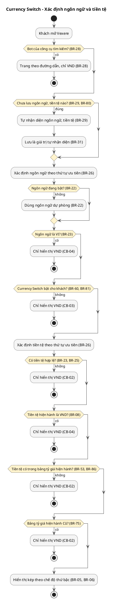
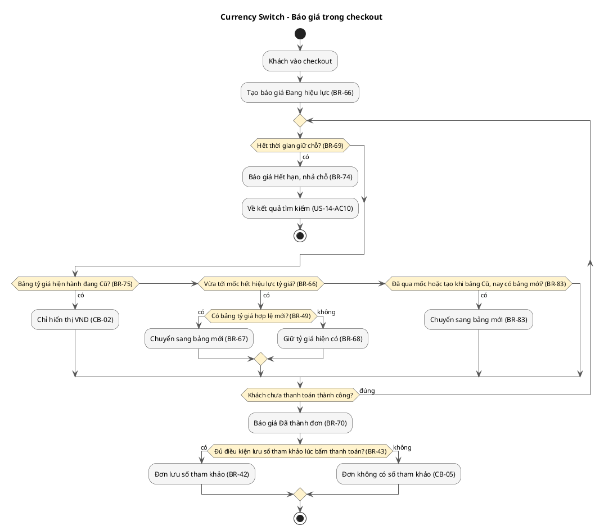
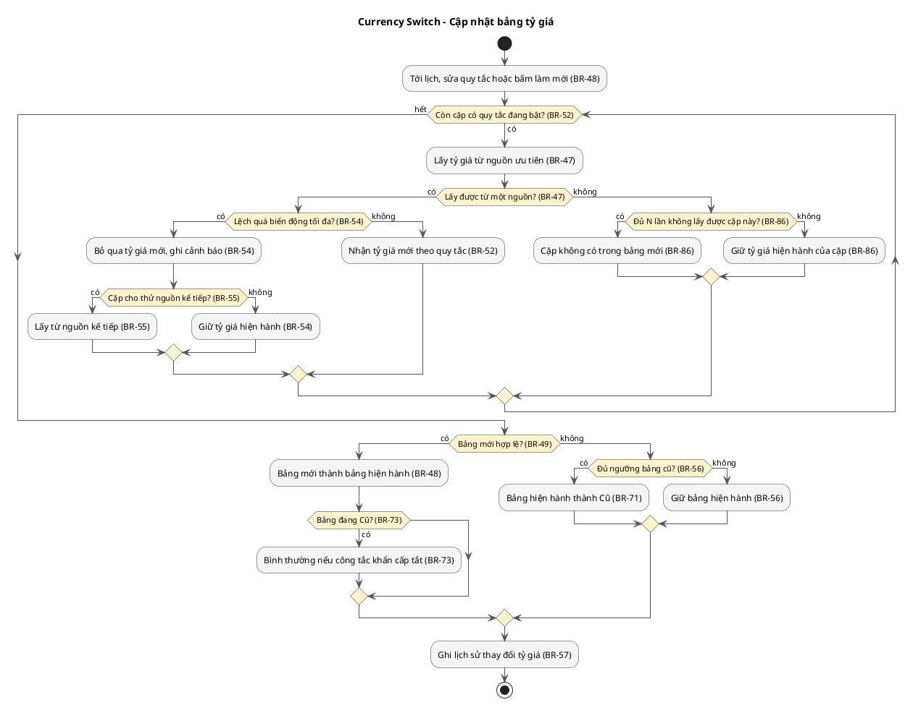

# Vexere - Currency Switch PRD

---

## 1. Document Info

### 1.1 Version History

| Version | Last Updated | Modified By | Change Summary |
|---------|--------------|-------------|----------------|

### 1.2 References

| Document | Link | PIC |
|----------|------|-----|
| Jira Epic | | |
| Figma (master file) | | |
| Technical design (Dev) | | |
| Tracking plan (Data) | | |
| BRD - Currency Switch (Multi-currency Display & Settlement) | | |
| Timeline Dev | | |
| PRD - Currency Switch v0.1 (bản gốc, 09 Oct 2026) | | Nguyễn Đức Anh Tuấn (PO) |

### 1.3 How to Read This PRD

| Người đọc | Bắt đầu từ | Dùng để |
|-----------|------------|---------|
| PO | 2. Feature Overview, 2.5 Scope | Xác nhận giá trị, mục tiêu và những gì nằm trong hay ngoài phạm vi |
| BA | 3.1 Business Rules, 3.3 User Stories, 3.4 Use Cases, 3.5 Traceability Matrix | Kiểm tra mọi rule và luồng đã đầy đủ, nhất quán |
| Dev | 3.1 Business Rules, 3.3 Acceptance Criteria và Rules applied, 3.6 Screens và Messages, 3.7 Dependencies | Hiểu logic cần xây, rồi thiết kế giải pháp kỹ thuật trong tài liệu Technical design |
| QC | 3.1 Business Rules, 3.3 Acceptance Criteria và Common Behaviors, 3.5 Traceability Matrix, 3.6 Messages | Viết test case và truy mỗi case về một acceptance criterion hoặc rule |

Mỗi thông tin chỉ xuất hiện một lần; nơi khác trích ID của nó: `JTBD-` job, `US-` story, `US-01-AC2` acceptance criterion, `CB-` common behavior, `BR-` business rule, `MSG-` message, `SCR-` screen, `UC-` use case, `SM-` success metric, `NFR-` quality target, `DEP-` dependency, `A-` giả định, `Q-` câu hỏi mở. Số story giữ đúng số của PRD v0.1 (US-04 không còn áp dụng; US-23 là story mới). Cột Notes của mỗi rule ghi mã gốc trong PRD v0.1, ví dụ "Gốc: BR-D06, CR-08", để đối chiếu.

---

## 2. Feature Overview

### 2.1 Summary

| | |
|-|-|
| **What** | Hiển thị số tham khảo bằng tiền tệ của khách bên cạnh giá VND trên UI ngoại ngữ của Vexere, trong khi khách luôn thanh toán bằng VND (BR-01). Ra mắt cho vertical Bus trước (BR-60). |
| **For whom** | Khách quốc tế dùng UI ngoại ngữ trên web và app; cùng CSKH, kế toán, PO, BU và nhân viên vận hành tỷ giá. |
| **Why** | Khách quốc tế phải tự quy đổi giá VND, gặp địa danh tiếng Việt có dấu, và dễ bất ngờ khi số tiền bị trừ trên sao kê khác số họ nghĩ. |
| **Core value** | Khách hiểu giá và tự đặt vé bằng ngôn ngữ, tiền tệ của mình; Vexere có thêm đơn từ khách quốc tế mà không thêm rủi ro pháp lý, tài chính hay khiếu nại. |
| **Success looks like** | Đạt target của SM-01 mà không vượt giới hạn của các guardrail SM-03, SM-04 và SM-05 (2.4). |

---

### 2.2 Problem Statement / Context

**Context**

- Current behavior: khách dùng UI ngoại ngữ chỉ thấy giá bằng VND, và địa danh vẫn là tiếng Việt có dấu (suy ra từ mục tiêu của PRD v0.1, A-02).
- Existing gap: không có số tham khảo theo tiền tệ của khách; cách viết số tiền chưa thống nhất giữa các trang và platform; tìm điểm đón trả cần gõ tiếng Việt; khách chưa được báo rõ rằng mình bị trừ bằng VND và ngân hàng có thể áp tỷ giá, phí riêng.
- Business motivation: tăng tỷ lệ hoàn thành đơn và conversion của khách quốc tế (SM-01, SM-02) mà không phát sinh rủi ro pháp lý, tài chính hay khiếu nại mới (SM-04, SM-05) và không làm giảm kết quả của UI tiếng Việt (SM-03).

**Problem Statement**

- **User problem:** Khách quốc tế (inbound) dùng UI ngoại ngữ của Vexere phải tự quy đổi giá VND sang tiền nước mình, gặp địa danh và nội dung tiếng Việt có dấu, nên khó đọc giá, khó tìm điểm đón trả và dễ bất ngờ khi số tiền bị trừ trên sao kê khác với số họ nghĩ.
- **Business problem:** Vexere muốn tăng tỷ lệ hoàn thành đơn và conversion của khách quốc tế trên UI ngoại ngữ, nhưng việc hiển thị ngoại tệ không được phát sinh rủi ro pháp lý, tài chính hay khiếu nại mới (khiếu nại "giá khác số bị trừ", hoàn tiền, chargeback) và không được làm giảm conversion của UI tiếng Việt.

---

### 2.3 Job to Be Done (JTBD)

**JTBD-01 - Khách inbound xem giá** — Status: hypothesized, needs validation

Khi xem giá chuyến xe tại Việt Nam trên UI ngoại ngữ, tôi muốn thấy giá bằng tiền tệ của mình bên cạnh VND, để tôi có thể ước lượng chi phí mà không phải tự quy đổi.

**JTBD-02 - Khách inbound sắp thanh toán** — Status: hypothesized, needs validation

Khi sắp thanh toán, tôi muốn biết chính xác số VND sẽ bị trừ và việc ngân hàng có thể áp tỷ giá, phí riêng, để tôi có thể xem sao kê ngân hàng mà không bị bất ngờ.

**JTBD-03 - Khách inbound không đọc được tiếng Việt** — Status: hypothesized, needs validation

Khi tìm và đặt vé mà không đọc được tiếng Việt, tôi muốn đọc toàn bộ trang và địa danh bằng ngôn ngữ của mình hoặc chữ Latin không dấu, để tôi có thể tự tìm chuyến và đặt vé mà không cần hỏi ai.

**JTBD-04 - Khách quay lại hoặc khách mở link chia sẻ** — Status: hypothesized, needs validation

Khi quay lại Vexere hoặc mở một link được chia sẻ, tôi muốn thấy ngay ngôn ngữ và tiền tệ phù hợp mà không phải chọn lại, để tôi có thể xem giá ngay.

**JTBD-05 - Người chia sẻ link Vexere (marketing, affiliate)** — Status: hypothesized, needs validation

Khi chia sẻ link Vexere cho khách của một thị trường, tôi muốn link mở trang bằng ngôn ngữ và tiền tệ tôi chỉ định, để tôi có thể cho người nhận thấy đúng thông tin tôi muốn.

**JTBD-06 - Nhân viên CSKH** — Status: hypothesized, needs validation

Khi khách khiếu nại "giá khác số bị trừ", tôi muốn xem đúng những gì khách đã thấy trên đơn, để tôi có thể xử lý khiếu nại bằng bằng chứng.

**JTBD-07 - Kế toán và Finance analyst** — Status: hypothesized, needs validation

Khi xuất hoá đơn và lập báo cáo doanh thu, tôi muốn mọi số liệu được ghi nhận bằng VND, để tôi có thể báo cáo mà không bị lẫn số tham khảo.

**JTBD-08 - PO** — Status: hypothesized, needs validation

Khi mở thêm thị trường hoặc khi có sự cố, tôi muốn bật ngôn ngữ, tiền tệ và tắt tính năng mà không cần phát hành bản mới, để tôi có thể mở rộng an toàn và dừng ngay khi có rủi ro.

**JTBD-09 - Nhân viên vận hành tỷ giá** — Status: hypothesized, needs validation

Khi thêm cặp tiền hoặc khi có sự cố về tỷ giá, tôi muốn quản lý quy tắc tỷ giá và nguồn tỷ giá mà không cần Dev, để tôi có thể giữ số tham khảo dựa trên tỷ giá đúng và ổn định.

---

### 2.4 Goals & Success Metrics

**Goals:**

1. Khách quốc tế hoàn thành đơn nhiều hơn trên UI ngoại ngữ (SM-01), với tỷ lệ chuyển tốt hơn ở từng bước của funnel (SM-02).
2. Khách quốc tế thấy số tham khảo kèm VND trên các bề mặt có giá thuộc phạm vi BR-05, trừ các bề mặt đang chờ kết luận của Legal (BR-65), nên tự đặt vé được mà không phải quy đổi (SM-01, SM-02).
3. Không phát sinh rủi ro pháp lý, tài chính hay khiếu nại mới từ việc hiển thị ngôn ngữ và ngoại tệ (SM-04, SM-05), và không làm giảm kết quả của UI tiếng Việt (SM-03).

**Success Metrics:**

| ID | Type | Metric | How it is measured | Baseline | Target | Owner |
|----|------|--------|--------------------|----------|--------|-------|
| SM-01 | Primary | Tỷ lệ hoàn thành đơn trên UI ngoại ngữ (North-star) | Số đơn thanh toán thành công chia cho số phiên có xem kết quả tìm kiếm trên UI ngoại ngữ, vertical Bus, tính theo tuần (định nghĩa phiên: BR-26) | Trung bình 4 tuần trước khi bật tính năng cho Bus | Tăng so với baseline; mức cụ thể TBD (Q-01) | PO |
| SM-02 | Secondary | Conversion UI ngoại ngữ | Tỷ lệ chuyển giữa các bước trên UI ngoại ngữ, vertical Bus, theo tuần: kết quả tìm kiếm → chọn chuyến và chỗ → checkout → thanh toán thành công | Trung bình 4 tuần trước khi bật tính năng cho Bus | Tăng so với baseline ở từng bước; mức cụ thể TBD (Q-01) | PO |
| SM-03 | Guardrail | Tỷ lệ hoàn thành đơn trên UI VI | Số đơn thanh toán thành công chia cho số phiên có xem kết quả tìm kiếm trên UI tiếng Việt, vertical Bus, tính theo tuần (định nghĩa phiên: BR-26) | Trung bình 4 tuần trước khi bật tính năng cho Bus | Không giảm | PO |
| SM-04 | Guardrail | Ticket CSKH "giá khác số bị trừ" | Số ticket CSKH phân loại "giá khác số bị trừ" trên 1,000 đơn UI ngoại ngữ, theo tuần | Trung bình 4 tuần trước khi bật tính năng cho Bus | Không tăng | Trưởng nhóm CSKH |
| SM-05 | Guardrail | Tỷ lệ hoàn và chargeback đơn UI ngoại ngữ | Số đơn UI ngoại ngữ bị hoàn tiền hoặc chargeback chia cho số đơn UI ngoại ngữ thanh toán thành công, theo tháng | Trung bình 3 tháng trước khi bật tính năng cho Bus | Không tăng | Finance |

---

### 2.5 Scope

> [!WARNING] REVIEWER'S NOTE (RN-14)
> **Risk:** 2.5 loại payment promotion “không gồm các dòng giảm giá trên breakdown của đơn”, nhưng dòng Glossary mới “Dòng giảm giá” chỉ gồm voucher và khuyến mãi và ghi không nhầm với payment promotion, còn A-13, nơi các vế ngoại lệ mới của 2.5 được trích, vẫn ghi ranh giới cũ không có ngoại lệ, nên với khoản giảm theo phương thức thanh toán đã áp vào đơn và hiện trên breakdown (SCR-05), Dev và QC không biết dòng đó có quy đổi, gánh phần chênh do làm tròn (BR-17) và lấy VND làm số chính (BR-20) hay không.
> **Option A:** Trong 2.6, đổi cột Meaning của dòng “Dòng giảm giá” thành “Mọi dòng mang giá trị âm trên breakdown của đơn: voucher, khuyến mãi, kể cả khoản giảm theo phương thức thanh toán đã áp vào đơn (BR-17, BR-20)” và cột Not to be confused with thành “Bề mặt giới thiệu payment promotion ngoài breakdown (ngoài phạm vi, A-13)”. Trong 4 Assumptions, đổi cột Assumption của A-13 thành “Các bề mặt CMS, coupon/campaign, landing page do CMS tạo, trip card và bề mặt giới thiệu payment promotion nằm ngoài phạm vi đợt này vì chưa có estimate; Trang SEO landing (SCR-11), các dòng giảm giá trên breakdown của đơn (BR-17, BR-20) và mục tỷ giá tham khảo của Điều khoản (SCR-20) vẫn trong phạm vi; user chưa chắc chắn.”, và thêm SCR-05 vào cột Affects của A-13.
> **Option B:** Thêm vào 4 Open Questions: `| Q-33 | Khoản giảm theo phương thức thanh toán đã áp vào đơn và hiện trên breakdown (SCR-05) là dòng giảm giá theo BR-17, BR-20, hay thuộc payment promotion ngoài phạm vi? | BR-17, BR-20, A-13, SCR-05 | PO: trả lời trước khi chốt phạm vi |`. Trong 2.6, đổi cột Not to be confused with của dòng “Dòng giảm giá” thành “Payment promotion (ngoài phạm vi, A-13); khoản giảm theo phương thức thanh toán trên breakdown: TBD (Q-33)”. Trong 4 Assumptions, đổi cột Assumption của A-13 thành “Các bề mặt CMS, coupon/campaign, landing page do CMS tạo, trip card, payment promotion nằm ngoài phạm vi đợt này vì chưa có estimate; Trang SEO landing (SCR-11), các dòng giảm giá trên breakdown của đơn (BR-17, BR-20) và mục tỷ giá tham khảo của Điều khoản (SCR-20) vẫn trong phạm vi; user chưa chắc chắn.”

**In scope**

- Ra mắt cho vertical Bus trước, trên web desktop, mobile web và app (BR-60, NFR-04).
- Epic 1 Nền tảng: cách viết số tiền thống nhất (US-01), địa danh không dấu trên UI ngoại ngữ (US-02), search widget đa ngôn ngữ (US-03), gợi ý nhập tên hành khách bằng chữ Latin (US-23).
- Epic 2 Chọn ngôn ngữ và tiền tệ: chọn ngôn ngữ (US-05), tiền tệ theo ngôn ngữ (US-06), lưu lựa chọn (US-07), tự nhận diện cho khách mới (US-08), chỉ định qua link (US-09).
- Epic 3 Hiển thị kép: số tham khảo và số VND ở mọi bước (US-10), breakdown cộng khớp total (US-11), lọc chuyến theo tiền tệ tham khảo (US-12).
- Epic 4 Checkout: thông báo thanh toán bằng VND (US-13), làm mới tỷ giá khi quá hạn (US-14).
- Epic 5 Sau khi đặt: đơn giữ số tham khảo lúc đặt (US-15), hoàn tiền theo tỷ giá ngày mua (US-16), thông tin tiền tệ của đơn cho CSKH (US-17), hoá đơn và báo cáo doanh thu theo VND (US-18).
- Epic 6 Vận hành: bảng tỷ giá thống nhất (US-19), thêm ngôn ngữ, tiền tệ bằng cấu hình (US-20), bật tắt và ramp (US-21), cấu hình tỷ giá trên công cụ (US-22).

**Out of scope**

- Thanh toán (settlement) bằng ngoại tệ; có thể xem lại khi công ty có pháp nhân ở nước ngoài (BR-01).
- Tên bản địa theo từng ngôn ngữ cho Top 50 điểm đến (BR-37).
- UI ngoại ngữ không còn nội dung tiếng Việt: banner, promo, popup, ToS, Privacy Policy, thông báo CSKH (US-04); mục tỷ giá tham khảo của Điều khoản (SCR-20, MSG-15) vẫn trong phạm vi.
- Các vertical khác Bus trong đợt này (BR-60).
- Các bề mặt CMS, coupon/campaign, landing page do CMS tạo (không gồm Trang SEO landing, SCR-11), trip card, payment promotion (không gồm các dòng giảm giá trên breakdown của đơn, BR-17, BR-20) (assumed, A-13).

---

### 2.6 Glossary

> See RN-14

| Term | Meaning in this PRD | Not to be confused with |
|------|---------------------|-------------------------|
| Khách inbound | Khách quốc tế dùng UI ngoại ngữ của Vexere | Việt kiều dùng UI VI ở nước ngoài (BR-30) |
| UI ngoại ngữ | Giao diện Vexere ở bất kỳ ngôn ngữ nào khác tiếng Việt | — |
| Tiền thanh toán (settlement) | Đơn vị tiền thật sự bị trừ khi thanh toán (BR-01) | Tiền tệ tham khảo |
| Tiền tệ tham khảo | Tiền tệ khách chọn để xem giá quy đổi; chỉ để tham khảo | Tiền thanh toán |
| Số tham khảo | Số tiền quy đổi sang tiền tệ tham khảo (BR-15) | Số tiền ngân hàng thực trừ hoặc hoàn vào thẻ (MSG-08, MSG-14) |
| Tổng tham khảo | Số tham khảo của tổng tiền đơn (BR-15) | Tổng các dòng breakdown quy đổi riêng (BR-17, BR-18) |
| Hiển thị kép | Số VND và số tham khảo trên cùng một dòng, dạng "số chính : số phụ" (BR-05) | — |
| Số chính / số phụ | Số được nhấn mạnh và số đi kèm trong hiển thị kép (BR-05) | — |
| Chế độ thứ bậc hiển thị | Cài đặt quyết định số nào là số chính (BR-06) | — |
| Nhóm Browse / nhóm Pay | Hai nhóm bề mặt của chế độ thứ bậc theo nhóm (BR-06) | — |
| Ngôn ngữ hiện hành / tiền tệ hiện hành | Ngôn ngữ, tiền tệ đang dùng để hiển thị, xác định theo thứ tự ưu tiên (BR-26) | Ngôn ngữ đặt vé |
| Phạm vi tiền tệ của ngôn ngữ | Các tiền tệ một ngôn ngữ khai báo, kèm một tiền tệ chính (BR-23) | Danh sách tiền tệ chọn được |
| Danh sách tiền tệ chọn được | Các tiền tệ khách chọn được trên picker của ngôn ngữ hiện hành (BR-23) | Phạm vi tiền tệ của ngôn ngữ |
| Tiền tệ chính của ngôn ngữ | Tiền tệ mặc định khai báo cho một ngôn ngữ (BR-23, BR-25) | Tiền tệ của quốc gia nơi khách truy cập |
| Tiền tệ mặc định | Tiền tệ dùng khi các bước trước của thứ tự ưu tiên chưa cho tiền tệ nào (BR-25) | — |
| Ngôn ngữ dự phòng | Ngôn ngữ dùng khi ngôn ngữ cần dùng chưa được bật (BR-22) | — |
| Lựa chọn chủ động | Ngôn ngữ hoặc tiền tệ khách tự chọn trên picker (BR-31) | Giá trị tự nhận diện |
| Giá trị tự nhận diện | Ngôn ngữ, tiền tệ Vexere tự xác định cho khách mới (BR-29, BR-80) | Lựa chọn chủ động |
| Tham số trên link | Ngôn ngữ, tiền tệ chỉ định trong link web hoặc deep link app, chỉ cho phiên đó (BR-26, BR-31) | Ngôn ngữ trong đường dẫn |
| Ngôn ngữ trong đường dẫn | Phần ngôn ngữ trong địa chỉ trang web, ví dụ /en-US/ (BR-28) | Tham số trên link |
| Phiên | Khoảng thời gian khách dùng Vexere liên tục (BR-26) | — |
| Bảng tỷ giá | Tập tỷ giá của mọi cặp tiền tạo ra trong một lần cập nhật (BR-48) | Quy tắc tỷ giá |
| Bảng tỷ giá hiện hành | Bảng tỷ giá hợp lệ mới nhất (BR-48, BR-49); trạng thái Bình thường hoặc Cũ (BR-71 đến BR-75, BR-84) | Bảng tỷ giá của báo giá (BR-66) |
| Cũ (stale) | Trạng thái của bảng tỷ giá hiện hành khi quá lâu không cập nhật được, hoặc khi bật công tắc tắt khẩn cấp (BR-71, BR-72) | Bảng tỷ giá không hợp lệ (BR-49) |
| Ngưỡng bảng cũ (N) | Số lần cập nhật định kỳ lỗi liên tiếp để bảng tỷ giá hiện hành thành Cũ (BR-56) | — |
| Quy tắc tỷ giá | Cấu hình tỷ giá cho một cặp tiền XXX/VND (BR-52) | Bảng tỷ giá |
| Tỷ giá gốc / tỷ giá theo quy tắc | Tỷ giá lấy từ nguồn / tỷ giá sau buffer và làm tròn (BR-52) | — |
| Buffer | Phần trăm cộng thêm vào tỷ giá gốc (BR-52, BR-14) | Phí quy đổi, Vexere không thu (BR-02) |
| Nguồn chính / nguồn dự phòng | Nguồn tỷ giá dùng trước / dùng khi nguồn trước lỗi (BR-47) | — |
| Biến động tối đa/ngày | Mức lệch tối đa giữa tỷ giá gốc mới và tỷ giá gốc hiện hành mà quy tắc chấp nhận (BR-54) | — |
| Báo giá | Bản chốt giá tạo khi khách vào checkout; trạng thái Đang hiệu lực, Hết hạn, Đã thành đơn (BR-66 đến BR-70, BR-74, BR-83) | Bảng tỷ giá |
| Mốc hết hiệu lực tỷ giá của báo giá | Thời điểm tỷ giá của báo giá cần làm mới (BR-66) | Mốc hết giữ chỗ |
| Thời gian giữ chỗ | Khoảng thời gian chỗ được giữ trong lúc thanh toán, theo tính năng giữ chỗ hiện có (DEP-11) | — |
| Ngôn ngữ đặt vé | Ngôn ngữ UI lúc thanh toán, lưu trên đơn (BR-46) | Ngôn ngữ hiện hành |
| Disclaimer | Câu lưu ý giá tham khảo chỉ để tham khảo (MSG-01) | Payment Notice |
| Payment Notice | Thông báo số VND chính xác sẽ bị trừ: bản đầy đủ ở checkout, bản rút gọn ở màn thanh toán (MSG-08, MSG-09) | Disclaimer |
| Địa danh không dấu | Tên địa danh đã bỏ dấu tiếng Việt (BR-37, BR-38) | Tên bản địa theo từng ngôn ngữ (ngoài phạm vi) |
| Currency Switch | Tính năng này; bật tắt theo vertical × platform (BR-60, BR-61) | Công tắc tắt khẩn cấp |
| Công tắc tắt khẩn cấp | Cách đưa mọi bề mặt về chỉ VND bằng cách chuyển bảng tỷ giá hiện hành sang Cũ (BR-72, BR-84) | Tắt Currency Switch (BR-61) |
| Nhóm bật / nhóm tắt | Hai nhóm khách khi Currency Switch bật ở tỷ lệ traffic dưới 100% (BR-81) | — |
| Vertical | Ngành hàng của Vexere, ví dụ Bus | — |
| Platform | Kênh sử dụng: web desktop, mobile web, app (NFR-04) | — |
| Mã ISO | Mã tiền tệ 3 chữ cái theo ISO 4217 (BR-11) | Ký hiệu tiền tệ như $, ¥ |
| BU | Bộ phận kinh doanh cấu hình ngôn ngữ, tiền tệ được bật (BR-22, DEP-14) | — |
| Nhân viên vận hành tỷ giá | Người quản lý quy tắc tỷ giá trên công cụ cấu hình tỷ giá (BR-78) | — |
| Công cụ cấu hình tỷ giá | Màn "Cấu hình tỷ giá" trên công cụ cấu hình nội bộ VEX-CONFIG (SCR-16, SCR-17, DEP-02) | — |
| Trang SEO landing | Trang đích từ công cụ tìm kiếm, có giá hiển thị kép (SCR-11, BR-05) | Landing page do CMS tạo (ngoài phạm vi, A-13) |
| Dòng giảm giá | Dòng voucher hoặc khuyến mãi mang giá trị âm trên breakdown của đơn (BR-17, BR-20) | Payment promotion (ngoài phạm vi, A-13) |
| Currency Switch bật cho khách | Vertical × platform khách dùng đang bật Currency Switch (BR-60) và, khi tỷ lệ traffic dưới 100%, khách thuộc nhóm bật (BR-81) | Nhóm tắt, hoặc vertical × platform đang tắt (CB-03) |

---

## 3. Feature Specifications

### 3.1 Business Rules

> [!WARNING] REVIEWER'S NOTE (RN-11)
> **Risk:** Câu mới cuối BR-75 nói khi bảng trở lại Bình thường (BR-73, BR-84) thì “trang đang mở”, mà câu ngay trước vừa nêu là gồm cả checkout, chỉ hiện lại số tham khảo khi khách mở hoặc tải lại trang, trong khi BR-83 và US-14-AC14 cho báo giá trong checkout chuyển ngay sang bảng mới và hiển thị theo bảng đó; câu này trích A-42 nhưng A-42 không nêu giả định đó, còn US-19-AC11 và US-21-AC9 không nói trang đang mở có phải tải lại không, nên Dev và QC sẽ hiểu khác nhau về checkout và trang kết quả tìm kiếm đang mở khi bảng tỷ giá hết Cũ.
> **Option A:** Trong 3.1 BR-75, thay câu “Khi bảng trở lại Bình thường (BR-73, BR-84), trang đang mở hiện lại số tham khảo khi khách mở hoặc tải lại trang (BR-48) (assumed, A-42).” bằng “Khi bảng trở lại Bình thường (BR-73, BR-84), trang khách đang mở hiện lại số tham khảo khi khách mở hoặc tải lại trang (BR-48), trừ checkout, bước nhập thông tin hành khách và màn thanh toán (SCR-05 đến SCR-07): các trang này hiện lại số tham khảo ngay, theo bảng tỷ giá của báo giá (BR-66, BR-83) (assumed, A-42).” Thêm vào cuối cột Assumption của A-42: “Khi bảng trở lại Bình thường, trang đang mở ngoài checkout chỉ hiện lại số tham khảo khi khách mở hoặc tải lại trang (BR-48), còn checkout đang mở hiện lại ngay theo báo giá (BR-83), để khách đang thanh toán không phải tải lại trang (US-14-AC4).”, và thêm BR-73, BR-84, US-14, US-19 vào cột Affects của A-42. Đổi US-19-AC11 thành “AC11 (Alternative) Done when: Nếu bảng tỷ giá hiện hành chuyển từ Cũ sang Bình thường (BR-73), trang có giá khách mở hoặc tải lại sau đó hiện lại số tham khảo, còn trang kết quả tìm kiếm khách đang mở vẫn chỉ hiển thị VND tới khi khách tải lại (BR-75).” và US-21-AC9 thành “AC9 (Alternative) Done when: Nếu công tắc tắt khẩn cấp được tắt khi chưa đủ ngưỡng bảng cũ (BR-84), các bề mặt có giá hiện lại số tham khảo theo BR-75 mà không cần phát hành bản mới.” (Rules applied của US-19 và US-21 đã có BR-75.) Ở Traceability Matrix, thêm US-19-AC11, US-21-AC9 vào dòng BR-75, và thêm “via BR-75” vào dòng BR-66 và dòng BR-83.
> **Option B:** Trong 3.1 BR-75, thay câu “Khi bảng trở lại Bình thường (BR-73, BR-84), trang đang mở hiện lại số tham khảo khi khách mở hoặc tải lại trang (BR-48) (assumed, A-42).” bằng “Khi bảng trở lại Bình thường (BR-73, BR-84), trang khách đang mở cũng hiện lại số tham khảo trong thời gian NFR-06, không chờ khách tải lại trang; checkout, bước nhập thông tin hành khách và màn thanh toán hiển thị theo bảng tỷ giá của báo giá (BR-66, BR-83) (assumed, A-42).” Trong 3.5 NFR-06, thêm “ hoặc trở lại Bình thường (BR-73, BR-84)” ngay sau “chuyển sang Cũ (BR-71, BR-72)”. Thêm vào cuối cột Assumption của A-42: “Khi bảng trở lại Bình thường, trang khách đang mở cũng hiện lại số tham khảo ngay, để hai chiều xử lý giống nhau và khớp với báo giá trong checkout (BR-83).”, và thêm BR-73, BR-84, US-19 vào cột Affects của A-42. Thêm vào trước dấu chấm cuối của US-19-AC11 và của US-21-AC9 vế “, kể cả trên trang khách đang mở, trong thời gian NFR-06 mà khách không phải tải lại trang (BR-75)”, và vào trước dấu chấm cuối của US-19-AC15 vế “, trừ khi bảng tỷ giá hiện hành vừa trở lại Bình thường (BR-75)”. (Rules applied của US-19 và US-21 đã có BR-75.) Ở Traceability Matrix, thêm US-19-AC11, US-19-AC15, US-21-AC9 vào dòng BR-75, và thêm “via BR-75” vào dòng BR-66 và dòng BR-83.

Quy ước cho cột Example: số viết như trên UI EN (dấu phẩy ngăn nghìn, dấu chấm thập phân); tỷ giá là số VND cho 1 đơn vị ngoại tệ (A-03). Ngôn ngữ, tiền tệ trong ví dụ là giá trị mẫu; danh sách ngôn ngữ, tiền tệ được bật theo cấu hình của BU (BR-22, A-08). Lúc ra mắt VND là số chính trên mọi bề mặt (BR-06), nên ví dụ hiển thị viết dạng "467,000 VND : ~USD 17.92".

**Formulas, Policies & Limits**

*Thanh toán và doanh thu*

| ID | Rule | Example | Uses | Notes |
|----|------|---------|------|-------|
| BR-01 | Tiền thanh toán (settlement) luôn là VND cho mọi khách, trên mọi ngôn ngữ và mọi platform. Tiền tệ tham khảo chỉ để hiển thị, không dùng trong giao dịch, hoá đơn, đối soát hay báo cáo doanh thu. | Khách dùng UI KO, chọn KRW: thấy 470,300 VND : ~KRW 24,818 và bị trừ đúng 470,300 VND. | — | Gốc: BR-S01 |
| BR-02 | Vexere không thu phí quy đổi ngoại tệ. | Đơn 470,300 VND, tiền tệ tham khảo USD: khách trả 470,300 VND, không có dòng phí quy đổi. | BR-01 | Gốc: BR-S02 |
| BR-03 | Hoá đơn VAT luôn bằng VND; số ngoại tệ không xuất hiện trong chỉ tiêu tính thuế. | Đơn 470,300 VND, tiền tệ tham khảo USD: hoá đơn VAT chỉ ghi 470,300 VND. | BR-01 | Gốc: BR-S03 |
| BR-04 | Mọi số liệu doanh thu được ghi nhận bằng số tiền VND; số tham khảo chỉ là thông tin phụ đi kèm. | Đơn 470,300 VND : ~USD 18.05: doanh thu ghi 470,300 VND; USD 18.05 chỉ là thông tin phụ. | BR-01 | Gốc: US-18 |

*Hiển thị số tiền*

| ID | Rule | Example | Uses | Notes |
|----|------|---------|------|-------|
| BR-05 | Hiển thị kép một dòng: mọi bề mặt có giá trong phạm vi đợt này (SCR-01 đến SCR-05, SCR-07 đến SCR-11, SCR-15) (assumed, A-13) hiển thị số tham khảo và số VND trên cùng một dòng, dạng "số chính : số phụ". Ngoại tệ khi ở vị trí số phụ có tiền tố "~". Số nào là số chính theo BR-06. | 467,000 VND : ~USD 17.92 | BR-06, BR-07, BR-11, BR-12 | Gốc: BR-D01; 14 điểm hiển thị giá ở mục 3.5 của PRD gốc; A-13 |
| BR-06 | Chế độ thứ bậc hiển thị: một cài đặt có 2 chế độ, đổi được mà không cần phát hành bản mới, theo phân quyền BR-79. (1) VND là số chính trên mọi bề mặt. (2) Theo nhóm: nhóm Browse (kết quả tìm kiếm, tìm nhà xe, chi tiết chuyến, chọn ghế, lịch giá, bộ lọc và thanh trượt giá, nhãn giảm giá, trang SEO landing) lấy ngoại tệ làm số chính; nhóm Pay (checkout, thanh toán, email xác nhận, My bookings, hoàn tiền, back office) lấy VND làm số chính. Chế độ lúc ra mắt: (1) VND là số chính trên mọi bề mặt (assumed, A-10). | Chế độ (1): kết quả tìm kiếm 467,000 VND : ~USD 17.92; checkout 470,300 VND : ~USD 18.05. Chế độ (2): kết quả tìm kiếm USD 17.92 : 467,000 VND; checkout 470,300 VND : ~USD 18.05. | BR-05, BR-79 | Gốc: BR-D01, CR-04; quyết định 5 |
| BR-07 | Không bề mặt nào hiện ngoại tệ mà thiếu số VND. Ngoại lệ: giá trị biên khách chọn trên bộ lọc và thanh trượt giá (BR-21) là giá trị nhập, không phải giá, nên chỉ hiển thị số tham khảo dạng xấp xỉ "~" (assumed, A-33). | Ô giá không bao giờ chỉ có "~USD 17.92"; luôn kèm 467,000 VND. Thanh trượt giá hiển thị biên "~USD 20.00", không kèm VND. | BR-05, BR-21 | Gốc: US-10 |
| BR-08 | Khi tiền tệ hiện hành là VND (UI VI, hoặc khách chọn VND), chỉ hiển thị VND, không có số tham khảo. Quy tắc này áp cho giá đang xem; số tham khảo đã lưu trên đơn vẫn hiển thị theo BR-44, BR-45 (assumed, A-36). | UI EN, khách chọn VND: 467,000 VND, không có ~USD. | BR-23 | Gốc: BR-D02 |
| BR-09 | Số lẻ của mỗi tiền tệ theo bảng cố định của Vexere; bảng này thắng số lẻ chuẩn ISO 4217 khi hai bên khác nhau (ISO 4217 cho IDR, TWD 2 số lẻ). 0 số lẻ: VND, JPY, KRW, IDR, TWD. 2 số lẻ: USD, EUR, SGD, THB, CNY. 3 số lẻ: BHD, KWD, OMR. Tiền tệ không có trong bảng dùng số lẻ chuẩn ISO 4217 của tiền tệ đó. | Giá trị mẫu: 467,000 VND với 1 TWD = 820 VND → 569.51 → TWD 570; với 1 KWD = 85,000 VND → 5.4941 → KWD 5.494; AUD không có trong bảng → 2 số lẻ theo ISO 4217. | BR-10 | Gốc: BR-D03; quyết định 12 |
| BR-10 | Làm tròn half-up (nửa lên, xa số 0) tới số lẻ của tiền tệ (BR-09). Mọi nơi hiển thị dùng cùng một quy tắc làm tròn. | 17.925 → 17.93; 17.924 → 17.92; −2,464.5 → −2,465. | BR-09 | Gốc: CR-03 |
| BR-11 | Mọi số tiền luôn kèm mã ISO 4217 3 chữ cái, không dùng ký hiệu tiền tệ, trên mọi ngôn ngữ, để tránh nhầm ¥ giữa JPY và CNY. | USD 19.96, CNY 127.95; không viết $19.96 hay ¥127.95. | — | Gốc: BR-D04, US-01 |
| BR-12 | Số VND định dạng theo ngôn ngữ UI, mã VND đứng sau số. Mã ngoại tệ đứng trước số. Mỗi ngôn ngữ chỉ có một cách viết số VND trên toàn UI, mọi platform. | EN và VI: 520,000 VND. Ngoại tệ: USD 17.92. Không viết "VND 520,000". | BR-09, BR-11 | Gốc: BR-D05, US-01; quyết định 5 |

*Quy đổi và breakdown*

| ID | Rule | Example | Uses | Notes |
|----|------|---------|------|-------|
| BR-13 | Tỷ giá dùng để quy đổi là tỷ giá của cặp tiền XXX/VND trong bảng tỷ giá đang dùng: bảng tỷ giá hiện hành (BR-48), bảng tỷ giá của báo giá trong checkout (BR-66), hoặc bảng tỷ giá lưu trên đơn sau khi đặt (BR-44). Tỷ giá là số VND cho 1 đơn vị ngoại tệ, lấy theo quy tắc tỷ giá của cặp đó (BR-52) và cài đặt buffer BR-14. | Giá trị mẫu: 1 USD = 26,054 VND; 1 KRW = 18.95 VND. | BR-14, BR-44, BR-48, BR-52, BR-66 | Gốc: BR-S02, CR-06 |
| BR-14 | Buffer của quy tắc tỷ giá có áp vào số tham khảo hay không: cài đặt Có/Không cho từng cặp tiền, do nhân viên vận hành tỷ giá chọn trên công cụ cấu hình tỷ giá (BR-78). Không có mặc định; bắt buộc chọn khi tạo quy tắc (BR-58) (assumed, A-23). Có: quy đổi bằng tỷ giá theo quy tắc, sau buffer (BR-52). Không: quy đổi bằng tỷ giá gốc. | Giá trị mẫu, USD gốc 25,899, buffer 2%: Có → 470,300 / 26,417 = 17.803 → ~USD 17.80. Không → 470,300 / 25,899 = 18.159 → ~USD 18.16. | BR-10, BR-52, BR-58, BR-78 | Gốc: BR-S02, CR-34; quyết định 6; A-23 |
| BR-15 | Công thức quy đổi. Tổng tham khảo = làm tròn(tổng VND sau giảm giá / tỷ giá). Mỗi dòng dương của breakdown (vé, phí, bảo hiểm, dịch vụ thêm) quy đổi và làm tròn độc lập: dòng tham khảo = làm tròn(VND của dòng / tỷ giá), trừ dòng gánh phần chênh do làm tròn (BR-17, BR-18). Làm tròn theo BR-09 và BR-10. | 1 USD = 26,054 VND: total 470,300 VND → 18.051 → ~USD 18.05; dòng vé 467,000 VND → 17.924 → ~USD 17.92. | BR-09, BR-10, BR-13, BR-16 | Gốc: CR-06, CR-07 |
| BR-16 | Mọi tính toán nghiệp vụ (voucher %, mức trần, phí) tính bằng VND trước, rồi mới quy đổi kết quả sang tiền tệ tham khảo. | Voucher 10% trên vé 467,000 VND = −46,700 VND, rồi mới quy đổi; không tính 10% trên số USD. | — | Gốc: BR-D06, CR-09 |
| BR-17 | Breakdown luôn cộng khớp total. Đơn có dòng giảm giá: dòng giảm giá gánh phần chênh do làm tròn; giảm giá tham khảo = tổng tham khảo − tổng các dòng dương − tổng các dòng giảm giá khác. Có nhiều dòng giảm giá thì dòng có giá trị tuyệt đối lớn nhất gánh chênh, các dòng giảm giá khác quy đổi độc lập theo BR-15. | 1 KRW = 18.95 VND: vé 467,000 VND → 24,643.80 → 24,644; phí dịch vụ 50,000 VND → 2,638.52 → 2,639; total 470,300 VND → 24,817.94 → 24,818; voucher 10% −46,700 VND → 24,818 − 24,644 − 2,639 = −2,465 (quy đổi độc lập sẽ là −2,464). Kiểm tra: 24,644 + 2,639 − 2,465 = 24,818. | BR-15, BR-16 | Gốc: BR-D06, CR-08 |
| BR-18 | Đơn không có dòng giảm giá: phần chênh do làm tròn (tổng tham khảo − tổng các dòng dương) cộng vào dòng có giá trị VND lớn nhất. | 1 USD = 26,054 VND: vé chặng 1 467,000 VND → 17.92; phí dịch vụ 50,000 VND → 1.92; vé chặng 2 517,000 VND → 19.84; total 1,034,000 VND → 39.687 → 39.69. Chênh 39.69 − (17.92 + 1.92 + 19.84) = +0.01 cộng vào vé chặng 2 → 19.85. Kiểm tra: 17.92 + 1.92 + 19.85 = 39.69. | BR-15 | Gốc: CR-10 |
| BR-19 | Đơn nhiều vé: mỗi dòng breakdown là thành tiền của dòng (đơn giá × số lượng) rồi mới quy đổi. Sơ đồ ghế và chi tiết chuyến quy đổi theo đơn giá. | 1 USD = 26,054 VND: breakdown 2 vé × 467,000 VND = 934,000 VND → 35.849 → ~USD 35.85; sơ đồ ghế hiện ~USD 17.92 mỗi ghế (2 × 17.92 = 35.84 khác 35.85 là đúng quy tắc). | BR-15 | Gốc: CR-11, CR-12 |
| BR-20 | Voucher và khuyến mãi luôn lấy VND làm số chính, ở cả hai chế độ của BR-06. | Chế độ (2): dòng voucher có số chính là −46,700 VND, số phụ là số USD quy đổi. | BR-06 | Gốc: BR-D07 |
| BR-21 | Lọc giá theo tiền tệ tham khảo: giá trị biên khách chọn bằng tiền tệ tham khảo được quy ngược về VND và so sánh bằng VND, nới thêm nửa đơn vị nhỏ nhất của tiền tệ tham khảo (theo số lẻ BR-09, ví dụ USD 0.01, KRW 1) ở hai đầu, để chuyến hiển thị đúng bằng giá trị biên vẫn được giữ. Biên trên VND = (biên trên + 0.5 × đơn vị) × tỷ giá. Biên dưới VND = (biên dưới − 0.5 × đơn vị) × tỷ giá. Chuyến được giữ khi biên dưới VND ≤ giá VND < biên trên VND. Khi khách đổi tiền tệ tham khảo trong khi đang lọc theo khoảng giá, biên trên VND và biên dưới VND đã tính được giữ, nên danh sách chuyến không đổi; giá trị biên hiển thị lại bằng tiền tệ mới, quy đổi từ biên VND và làm tròn theo BR-09, BR-10 (assumed, A-34). | 1 USD = 26,054 VND. Lọc ≤ USD 20: biên trên = 20.005 × 26,054 = 521,210.27 VND → giữ chuyến 521,100 VND (~USD 20.00), loại chuyến 521,250 VND (~USD 20.01). Lọc ≥ USD 15: biên dưới = 14.995 × 26,054 = 390,679.73 VND → giữ chuyến 390,700 VND (~USD 15.00). Giá trị mẫu 1 USD = 26,000 VND, lọc ≤ USD 20: biên trên = 20.005 × 26,000 = 520,130 VND → chuyến 520,130 VND (~USD 20.01) bị loại. Đang lọc USD 15 đến USD 20 (biên VND 390,679.73 đến 521,210.27), đổi sang KRW với 1 KRW = 18.95 VND → biên hiển thị ~KRW 20,616 đến ~KRW 27,504; danh sách chuyến không đổi. | BR-09, BR-10, BR-13 | Gốc: BR-D08, CR-32 |

*Ngôn ngữ và tiền tệ*

| ID | Rule | Example | Uses | Notes |
|----|------|---------|------|-------|
| BR-22 | Ngôn ngữ và tiền tệ là hai danh sách riêng, kèm bảng quốc gia → tiền tệ. Ngôn ngữ, tiền tệ nào được bật và bảng quốc gia → tiền tệ do BU cấu hình (DEP-14), theo phân quyền BR-76, không cần phát hành bản mới. Ngôn ngữ dự phòng là EN: dùng khi ngôn ngữ cần dùng không có trong danh sách đang bật. | Giá trị mẫu (cấu hình ví dụ của PRD gốc): ngôn ngữ VI, EN, ZH, KO, TH; bảng quốc gia → tiền tệ có VN → VND, US → USD, KR → KRW, TW → TWD. Trình duyệt ưu tiên ja, JA chưa bật → EN. | BR-76 | Gốc: BR-N01; quyết định 2; A-08 |
| BR-23 | Phạm vi tiền tệ của ngôn ngữ: mỗi ngôn ngữ khai báo danh sách tiền tệ được dùng và một tiền tệ chính (BU cấu hình, BR-22). Danh sách tiền tệ chọn được của ngôn ngữ = tiền tệ của ngôn ngữ ∩ tiền tệ đang bật ∩ tiền tệ có trong bảng tỷ giá hiện hành, luôn có VND, kể cả với ngôn ngữ chỉ khai báo một tiền tệ (assumed, A-31). Picker tiền tệ chỉ cho chọn trong danh sách tiền tệ chọn được. Mỗi tiền tệ trong phạm vi tiền tệ của ngôn ngữ cần một quy tắc tỷ giá đang bật (BR-52). Ngôn ngữ VI chỉ có VND. Muốn xem tiền tệ ngoài phạm vi tiền tệ của ngôn ngữ, khách chuyển sang ngôn ngữ tương ứng hoặc EN. | Giá trị mẫu: ZH: CNY, TWD (chính CNY); KO: KRW, USD (chính KRW); TH: THB, USD (chính THB); EN: mọi tiền tệ đang bật, gồm VND; VI: VND. Danh sách tiền tệ chọn được của ZH: CNY, TWD, VND; quy tắc TWD/VND bị tắt (BR-53) → CNY, VND (TWD không phải tiền tệ chính của ngôn ngữ nào, nên bảng mới vẫn hợp lệ, BR-49). | BR-22, BR-48, BR-52, BR-53 | Gốc: BR-N02, US-06; A-08 |
| BR-24 | Đổi ngôn ngữ thì tiền tệ được xác định lại cho ngôn ngữ mới, theo thứ tự ưu tiên BR-26. | Khách ở Hàn Quốc đang EN + EUR, đổi sang KO → EUR ngoài phạm vi KO → KRW. | BR-23, BR-26 | Gốc: US-05 |
| BR-25 | Tiền tệ mặc định, xét theo thứ tự, chỉ nhận ứng viên thuộc phạm vi tiền tệ của ngôn ngữ (BR-23): (1) tiền tệ của quốc gia nơi khách truy cập theo bảng quốc gia → tiền tệ (web: theo vị trí truy cập; app: theo vùng của thiết bị); (2) tiền tệ chính của ngôn ngữ; (3) với EN: USD. Không ứng viên nào hợp lệ thì chỉ hiển thị VND (CB-02). | EN ở Mỹ → USD; EN ở Việt Nam → VND (đổi được trên picker); EN ở Pháp → EUR nếu đang bật, không thì USD; ZH ở Đài Loan → TWD; ZH ở Việt Nam → CNY; KO ở Mỹ → USD; KO ở Hàn Quốc hoặc Việt Nam → KRW. | BR-22, BR-23 | Gốc: BR-N03 |
| BR-26 | Thứ tự ưu tiên xác định ngôn ngữ và tiền tệ (xác định riêng từng giá trị, cùng một thứ tự): (1) thao tác của khách trong phiên; (2) tham số trên link, và trên web là ngôn ngữ trong đường dẫn của trang (BR-28) (assumed, A-26), chỉ cho phiên đó, không lưu (BR-31); (3) lựa chọn chủ động gần nhất giữa hồ sơ và thiết bị (BR-32); (4) giá trị tự nhận diện lần đầu (BR-29); (5) mặc định: ngôn ngữ dự phòng (BR-22) cho ngôn ngữ, BR-25 cho tiền tệ. Ngôn ngữ được xác định trước; ở các bước (1) đến (3), tiền tệ phải thuộc phạm vi tiền tệ của ngôn ngữ hiện hành hoặc là VND (BR-23); ở bước (4), tiền tệ phải thuộc phạm vi tiền tệ của ngôn ngữ hiện hành; không thì xét ứng viên kế tiếp (BR-33, BR-34); ở bước (5), ứng viên theo BR-25. Với ngôn ngữ VI, tiền tệ theo BR-23. Giá trị tự nhận diện không phải lựa chọn chủ động. Một phiên kết thúc khi khách không thao tác trong 30 phút, hoặc khi khách đóng trình duyệt hay đóng hẳn app; lần mở hoặc thao tác kế tiếp bắt đầu phiên mới (assumed, A-38). | Khách đã lưu chủ động EN + USD, mở link chỉ định KO + KRW → phiên đó là KO + KRW; phiên sau quay lại EN + USD. Khách dùng UI KO chọn VND trên picker → KO + VND (BR-23); khách mới dùng KO, truy cập từ Việt Nam → KO + KRW (BR-25: VND không thuộc phạm vi tiền tệ của KO). Khách đã lưu chủ động EN mở trên web link /ko-KR/… không có tham số ngôn ngữ → phiên đó KO (A-26); phiên sau mở đường dẫn không có ngôn ngữ → dẫn tới /en-US/… (BR-28). Khách được tự nhận diện EN + VND ở Việt Nam (BR-30), đổi sang KO → VND tự nhận diện bị bỏ qua → KO + KRW (BR-25), như khách mới dùng KO ở Việt Nam; quay lại EN → EN + VND (BR-33). | BR-22, BR-23, BR-25, BR-28, BR-29, BR-31, BR-32, BR-33, BR-34 | Gốc: BR-N04, CR-13 |
| BR-27 | Picker tiền tệ của EN có nhóm Gợi ý gồm, theo thứ tự: tiền tệ của quốc gia, tiền tệ khách đã chọn trước đây, tiền tệ của các đơn đã thanh toán, USD; tối đa 4, không trùng. Sau đó là nhóm Tất cả, xếp A–Z theo mã ISO. Cả hai nhóm chỉ gồm tiền tệ thuộc danh sách tiền tệ chọn được (BR-23). | Giá trị mẫu: khách EN ở Hàn Quốc, trước đây chọn EUR, có đơn đã thanh toán với tiền tệ tham khảo USD → Gợi ý: KRW, EUR, USD (USD không lặp). Tất cả: AUD, CNY, EUR, JPY, KRW, ... | BR-23 | Gốc: BR-N05, US-06 |
| BR-28 | Trên web, ngôn ngữ của trang theo ngôn ngữ trong đường dẫn (ví dụ /en-US/). Đường dẫn không có ngôn ngữ thì tự nhận diện (BR-29) và dẫn tới đường dẫn có ngôn ngữ tương ứng. Khách quay lại (không thuộc diện tự nhận diện, BR-29) mở đường dẫn không có ngôn ngữ thì được dẫn tới đường dẫn của ngôn ngữ xác định theo BR-26 (assumed, A-26). Bot của công cụ tìm kiếm không bị tự nhận diện và luôn nhận giá VND. Bot của công cụ tìm kiếm mở đường dẫn không có ngôn ngữ được dẫn tới đường dẫn VI tương ứng (assumed, A-24). Trên web, khi ngôn ngữ chỉ định trên link khác ngôn ngữ trong đường dẫn của link, trang được dẫn tới đường dẫn của ngôn ngữ chỉ định trên link (BR-26) (assumed, A-24). | Mở /en-US/ → EN. Khách mới ở Hàn Quốc mở đường dẫn không có ngôn ngữ, trình duyệt ưu tiên ko → dẫn tới /ko-KR/. Bot tìm kiếm mở /en-US/ → trang EN, giá chỉ VND. Bot mở đường dẫn không có ngôn ngữ → đường dẫn VI, giá chỉ VND. Link /en-US/… chỉ định KO → dẫn tới /ko-KR/…. | BR-26, BR-29 | Gốc: BR-N06; A-24, A-26 |
| BR-29 | Tự nhận diện cho khách mới: chỉ chạy khi khách chưa có ngôn ngữ, tiền tệ đã lưu và chưa có hồ sơ (ngoại lệ cho hồ sơ, thiết bị có từ trước khi ra mắt: BR-80); không chạy với bot công cụ tìm kiếm; trên app chạy ở lần mở đầu tiên. Ngôn ngữ: web theo tham số ngôn ngữ trên link > ngôn ngữ trong đường dẫn > ngôn ngữ ưu tiên đầu tiên của trình duyệt; app theo ngôn ngữ thiết bị; không khớp ngôn ngữ nào đang bật theo BR-82 → ngôn ngữ dự phòng (BR-22). Tiền tệ: theo BR-25; không xác định được quốc gia thì bỏ qua bước (1) của BR-25. Không xác định được cả ngôn ngữ của trình duyệt hoặc thiết bị lẫn quốc gia nơi khách truy cập → EN + USD. Kết quả được lưu là giá trị tự nhận diện (BR-31). | Web, trình duyệt ưu tiên th, truy cập từ Thái Lan → TH + THB. App, thiết bị dùng ja (JA chưa bật), ở Úc → EN + AUD nếu đang bật, không thì USD. Không xác định được ngôn ngữ lẫn quốc gia → EN + USD. | BR-22, BR-25, BR-30, BR-31, BR-80, BR-82 | Gốc: BR-N09, CR-17 đến CR-21 |
| BR-30 | Bảng quyết định cho khách mới (quốc gia / ngôn ngữ trình duyệt hoặc thiết bị → ngôn ngữ, tiền tệ), theo BR-29 và BR-25: VN / vi → VI, VND (không có picker tiền tệ); VN / en → EN, VND (expat, khách quốc tế tại VN; đổi được sang tiền tệ khác); VN / zh, ko, th → ZH, KO, TH với CNY, KRW, THB; US / en → EN, USD; CN / zh-CN → ZH, CNY; TW / zh-TW → ZH (giản thể), TWD nếu đang bật, không thì CNY; KR / ko → KO, KRW; TH / th → TH, THB; KR / en → EN, KRW (EN lấy tiền tệ theo quốc gia); JP / ja (chưa có trong cấu hình) → EN, JPY nếu đang bật, không thì USD; AU / en → EN, AUD nếu đang bật, không thì USD; FR, DE / fr, de → EN, EUR nếu đang bật, không thì USD; ngoài VN / vi → VI, VND (Việt kiều); không xác định / không xác định → EN, USD; US / ko → KO, USD (USD thuộc phạm vi KO). | Mọi dòng là giá trị mẫu theo cấu hình ví dụ của PRD gốc; ngôn ngữ, tiền tệ thực tế theo cấu hình của BU (A-08). | BR-25, BR-29, BR-82 | Gốc: BR-N10; A-08 |
| BR-31 | Lưu lựa chọn: ngôn ngữ và tiền tệ lưu riêng; mỗi giá trị kèm đánh dấu là lựa chọn chủ động hay tự nhận diện và thời điểm chọn. Sau tự nhận diện, cả hai được lưu là giá trị tự nhận diện; phiên sau dùng lại, không tự nhận diện lại. Khách đổi trên picker → lưu là lựa chọn chủ động kèm thời điểm, đồng bộ lên hồ sơ nếu đã đăng nhập. Guest lưu trên thiết bị; khách đã đăng nhập lưu cả trên hồ sơ để giữ qua các thiết bị. Tham số trên link không được lưu vào thiết bị hay hồ sơ. Khách mới mở Vexere lần đầu từ link có chỉ định ngôn ngữ: ngôn ngữ của link được lưu là giá trị tự nhận diện (BR-29), nên phiên sau mở bằng ngôn ngữ đó cho tới khi khách chủ động chọn ngôn ngữ khác (assumed, A-32). | Guest lần đầu được tự nhận diện EN + USD (tự nhận diện); đổi sang EUR lúc 10:00 → EUR chủ động, 10:00; hôm sau mở lại → EN + EUR, không tự nhận diện lại. | BR-26, BR-29 | Gốc: BR-N11, CR-21, US-07, US-09 |
| BR-32 | Khi giá trị trên thiết bị và trên hồ sơ khác nhau (xét riêng ngôn ngữ và tiền tệ): lựa chọn chủ động thắng giá trị tự nhận diện; hai lựa chọn chủ động thì cái mới hơn thắng và được đồng bộ lên hồ sơ khi đăng nhập; hai giá trị tự nhận diện thì hồ sơ thắng. | Thiết bị USD chủ động lúc 10:00 hôm nay, hồ sơ EUR chủ động hôm qua → đăng nhập → USD, hồ sơ cập nhật USD. Thiết bị KRW tự nhận diện, hồ sơ USD chủ động → USD. Thiết bị VND tự nhận diện, hồ sơ KRW tự nhận diện → KRW. | BR-31 | Gốc: CR-14 |
| BR-33 | Tiền tệ đã lưu bị bỏ qua theo BR-26 vì nằm ngoài phạm vi tiền tệ của ngôn ngữ hiện hành không bị xoá, chỉ bị bỏ qua cho tới khi khách quay về ngôn ngữ có phạm vi chứa nó. | EN + RUB → chuyển KO → KRW (RUB ngoài phạm vi KO) → quay lại EN → RUB. | BR-23, BR-26 | Gốc: CR-15, US-07 |
| BR-34 | Tham số tiền tệ trên link khác VND nằm ngoài phạm vi tiền tệ của ngôn ngữ hiện hành thì bị bỏ qua; tiền tệ được xác định theo ứng viên kế tiếp của BR-26. | Link chỉ định KO + JPY → JPY bị bỏ qua → KO + tiền tệ theo ứng viên kế tiếp, ví dụ KRW. | BR-23, BR-26 | Gốc: US-09 |
| BR-35 | Một ngôn ngữ chỉ được bật khi bản dịch của ngôn ngữ đó đã được đưa lên hệ thống. | Bản dịch JA chưa được đưa lên → không bật được JA. | BR-22, BR-76 | Gốc: BR-N12 |
| BR-36 | Mọi thay đổi cấu hình ngôn ngữ, tiền tệ và bảng quốc gia → tiền tệ được ghi lịch sử: người thực hiện, thời điểm, giá trị cũ, giá trị mới. | Giá trị mẫu: đổi tiền tệ chính của ZH từ CNY sang TWD → lịch sử ghi người đổi, thời điểm, CNY, TWD. | BR-22 | Gốc: BR-N12, US-20 |
| BR-82 | Mỗi ngôn ngữ khai báo các ngôn ngữ trình duyệt, thiết bị mà nó nhận, kể cả các biến thể theo vùng; BU cấu hình cùng danh sách ngôn ngữ (BR-22), theo phân quyền BR-76. Ngôn ngữ trình duyệt hoặc thiết bị khớp với ngôn ngữ đang bật đã khai báo nó. | Giá trị mẫu: ZH nhận tiếng Trung mọi vùng (Trung Quốc, Đài Loan, Hồng Kông); EN nhận tiếng Anh mọi vùng (Mỹ, Anh, Úc); KO nhận tiếng Hàn. Trình duyệt tiếng Trung (Đài Loan) → ZH; trình duyệt tiếng Nhật, chưa ngôn ngữ nào khai báo → EN (BR-29). | BR-22, BR-76 | Gốc: CR-19; quyết định 2; A-08 |

*Địa danh*

| ID | Rule | Example | Uses | Notes |
|----|------|---------|------|-------|
| BR-37 | Địa danh trên UI ngoại ngữ (Phase 1): mọi địa danh Bus (bến xe, trạm dừng, điểm đón trả) được chuẩn hoá thành không dấu theo BR-38, dùng chung cho mọi ngôn ngữ ngoại ngữ, kể cả ngôn ngữ thêm sau. Tên bản địa theo từng ngôn ngữ cho Top 50 điểm đến nằm ngoài phạm vi đợt này. | UI EN, KO, TH đều hiện "Ben xe Mien Dong". | BR-38 | Gốc: BR-N07, US-02; quyết định 3 |
| BR-38 | Cách chuẩn hoá không dấu: bỏ dấu tiếng Việt và chuyển "đ/Đ" thành "d/D". | "Đà Lạt" → "Da Lat"; "Bến xe Miền Đông" → "Ben xe Mien Dong". | — | Gốc: BR-N08 |

*Checkout*

| ID | Rule | Example | Uses | Notes |
|----|------|---------|------|-------|
| BR-39 | Số VND giữ cố định trong một báo giá: trước màn thanh toán, đổi ngôn ngữ hoặc tiền tệ chỉ đổi tiền tệ tham khảo; tỷ giá vẫn lấy từ bảng tỷ giá của báo giá; số VND và thời điểm hết giữ chỗ không đổi. | Báo giá 470,300 VND, bảng tỷ giá có 1 USD = 26,054 VND và 1 KRW = 18.95 VND. Đổi USD → KRW: 470,300 VND : ~USD 18.05 thành 470,300 VND : ~KRW 24,818; số VND vẫn 470,300. | BR-13, BR-15, BR-66 | Gốc: BR-C01, CR-23 |
| BR-40 | Ngôn ngữ và tiền tệ đổi được từ trang kết quả tìm kiếm tới bước nhập thông tin hành khách; ở màn thanh toán thì không đổi được. | Ở bước nhập thông tin: đổi USD → KRW được. Ở màn thanh toán: không đổi được. | BR-39 | Gốc: BR-C07 |
| BR-41 | Bản dịch Payment Notice (MSG-08, MSG-09) của một ngôn ngữ chưa được duyệt thì hiển thị bản EN. | Bản dịch TH của Payment Notice chưa được duyệt → khách dùng UI TH thấy Payment Notice bản EN. | — | Gốc: US-13 |
| BR-42 | Khi lưu đơn, số tham khảo lưu trên đơn là kết quả quy đổi số VND của báo giá bằng bảng tỷ giá của báo giá tại lúc khách bấm nút thanh toán của lần thanh toán thành công (assumed, A-25), theo BR-15 đến BR-19. | Báo giá 470,300 VND, bảng tỷ giá của báo giá có 1 USD = 26,054 VND → đơn lưu 470,300 / 26,054 = 18.051 → ~USD 18.05. Giá trị mẫu: khách bấm nút thanh toán lúc 09:59 khi bảng tỷ giá của báo giá có 1 USD = 26,054 VND; thanh toán thành công lúc 10:01, sau khi báo giá đã chuyển sang bảng tỷ giá mới có 1 USD = 26,300 VND → đơn vẫn lưu ~USD 18.05. | BR-13, BR-15, BR-17, BR-18, BR-19, BR-66 | Gốc: CR-25, NFR-04 của PRD gốc; A-25 |
| BR-43 | Đơn chỉ lưu số tham khảo khi, lúc khách bấm nút thanh toán (BR-42), màn thanh toán đang hiển thị số tham khảo cho khách, hoặc màn thanh toán chỉ hiển thị VND vì đang chờ kết luận của Legal (BR-65) nhưng checkout của báo giá đã hiển thị số tham khảo; nếu không, đơn không có số tham khảo (CB-05) (assumed, A-12, A-15). | Màn thanh toán chỉ hiển thị VND vì bảng tỷ giá hiện hành đang Cũ (BR-75) → đơn không có số tham khảo. Màn thanh toán chờ kết luận của Legal, checkout đã hiển thị 470,300 VND : ~USD 18.05 → đơn vẫn lưu ~USD 18.05. Khách bấm nút thanh toán lúc 09:59 khi màn thanh toán hiển thị 470,300 VND : ~USD 18.05; bảng tỷ giá hiện hành thành Cũ lúc 10:00 (BR-75); thanh toán thành công lúc 10:01 → đơn vẫn lưu ~USD 18.05. | BR-42, BR-65, BR-75 | Gốc: brief (đề xuất); A-12, A-15 |

*Sau khi đặt*

| ID | Rule | Example | Uses | Notes |
|----|------|---------|------|-------|
| BR-44 | Email xác nhận và My bookings hiển thị số tham khảo theo tỷ giá lúc đặt, vĩnh viễn, lấy từ đơn (BR-42), không tính lại. Đổi ngôn ngữ hoặc tiền tệ sau khi đặt không làm đổi tiền tệ và số tham khảo của đơn cũ. Ngoại lệ: xem trên UI VI thì chỉ hiển thị VND (BR-08). Số tham khảo của đơn vẫn hiển thị khi bảng tỷ giá hiện hành đang Cũ (BR-75) hoặc khi tiền tệ hiện hành là VND trên UI ngoại ngữ (BR-08), vì đây là số đã lưu, không quy đổi lại (assumed, A-36). | Đơn đặt ở 1 USD = 26,054 VND vẫn hiện 470,300 VND : ~USD 18.05 khi tỷ giá hôm nay là 26,500 (tính lại sẽ ra ~USD 17.75). Khách đổi sang KRW → đơn cũ vẫn ~USD 18.05. | BR-08, BR-42, BR-75 | Gốc: BR-P01, CR-26, US-15 |
| BR-45 | Hoàn tiền: số hoàn bằng VND là số chính; số tham khảo của số hoàn quy đổi theo bảng tỷ giá lưu trên đơn (bảng của báo giá lúc mua), với tiền tệ tham khảo của đơn, theo BR-15, và được lưu cùng bản ghi hoàn tiền. Không cần khách đồng ý. Ngoại lệ: xem trên UI VI thì số hoàn chỉ hiển thị VND (BR-08). Số tham khảo của số hoàn vẫn hiển thị khi bảng tỷ giá hiện hành đang Cũ (BR-75) hoặc khi tiền tệ hiện hành là VND trên UI ngoại ngữ (BR-08) (assumed, A-36). | Đơn mua ở 1 USD = 26,054 VND, hoàn 423,270 VND (giá trị mẫu) → 16.246 → 423,270 VND : ~USD 16.25, dù tỷ giá ngày hoàn là 26,500. | BR-01, BR-08, BR-15, BR-42, BR-75 | Gốc: BR-P02, CR-27, US-16 |
| BR-46 | Email xác nhận và vé điện tử gửi bằng ngôn ngữ UI tại thời điểm thanh toán; ngôn ngữ này được lưu trên đơn là ngôn ngữ đặt vé. Ngôn ngữ đặt vé là VI thì email, vé điện tử không có ngoại tệ. Thông báo trên app gửi theo ngôn ngữ hiện tại của khách. | Thanh toán trên UI KO, sau đó đổi app sang EN → email, vé điện tử bằng KO; thông báo app bằng EN. | BR-08 | Gốc: BR-P03 |

*Tỷ giá*

| ID | Rule | Example | Uses | Notes |
|----|------|---------|------|-------|
| BR-47 | Nguồn tỷ giá cấu hình theo từng cặp tiền trên công cụ cấu hình tỷ giá; hiện có 2 nguồn: FXRatesAPI và ExchangeRate-API. Nguồn có số ưu tiên nhỏ nhất là nguồn chính, các nguồn còn lại là dự phòng; nguồn bị tắt thì bỏ qua. Mỗi cặp lấy từ nguồn ưu tiên cao nhất đang bật; nguồn lỗi hoặc thiếu cặp thì lấy nguồn kế tiếp. | Giá trị mẫu: USD/VND: 1. FXRatesAPI, 2. ExchangeRate-API. FXRatesAPI lỗi → lấy USD/VND từ ExchangeRate-API. | BR-52 | Gốc: BR-F01, CR-29 |
| BR-48 | Tỷ giá được cập nhật mỗi 2 giờ, và ngay sau khi một quy tắc tỷ giá được tạo, sửa, hoặc khi bấm làm mới trên công cụ cấu hình tỷ giá. Mỗi lần cập nhật tạo một bảng tỷ giá thống nhất, ghi nguồn và thời điểm bản tin của từng cặp. Bảng hợp lệ (BR-49) mới nhất là bảng tỷ giá hiện hành. Mọi giá trên cùng một trang dùng cùng một bảng tỷ giá; trang mở hoặc tải lại sau khi có bảng tỷ giá hiện hành mới dùng bảng mới; trang đang mở không tự đổi số tham khảo khi có bảng mới (assumed, A-29). Trong checkout, tỷ giá theo báo giá (BR-66 đến BR-68, BR-83). Một cặp không lấy được tỷ giá từ nguồn nào: BR-86. | Giá trị mẫu: lịch cập nhật 08:00, 10:00, 12:00; quy tắc USD/VND được sửa lúc 10:15 → cập nhật ngay lúc 10:15 và tạo bảng mới; lần cập nhật định kỳ kế tiếp lúc 12:00. Khách mở trang kết quả lúc 11:55 (bảng 10:00) rồi tải lại lúc 12:05 (bảng 12:00 đã thành bảng hiện hành) → số tham khảo trên trang tính theo bảng 12:00. | BR-47, BR-49, BR-52, BR-86 | Gốc: BR-F01, CR-28, CR-29, US-19; quyết định 7 |
| BR-49 | Bảng tỷ giá chỉ hợp lệ khi có đủ tiền tệ chính của mọi ngôn ngữ đang bật. | Giá trị mẫu: KO đang bật, tiền tệ chính KRW; lần cập nhật không lấy được KRW/VND từ nguồn nào → bảng đó không hợp lệ, bảng hiện hành giữ nguyên. | BR-22, BR-23 | Gốc: CR-29 |
| BR-50 | Loại tỷ giá: spot. Nguồn dự phòng phải dùng cùng loại tỷ giá; nếu khác thì ghi rõ khác biệt trong bảng tỷ giá. | USD/VND lấy từ ExchangeRate-API (dự phòng) → bảng tỷ giá ghi nguồn và loại tỷ giá của cặp đó; khác spot thì ghi rõ khác biệt. | BR-47 | Gốc: BR-F02 |
| BR-51 | Nguồn tỷ giá không hiện trên giao diện chính; được công bố cho khách qua MSG-02 và MSG-15: tên nguồn, loại tỷ giá, thời điểm cập nhật của bảng tỷ giá đang dùng (BR-13). | Tooltip: nguồn FXRatesAPI, loại spot, cập nhật lúc 10:00 ngày 19/10/2026. | BR-13, BR-47, BR-48, BR-50 | Gốc: BR-F03 |
| BR-52 | Quy tắc tỷ giá: mỗi cặp tiền XXX/VND có một quy tắc gồm buffer %, đơn vị làm tròn (VND), biến động tối đa/ngày (%), danh sách nguồn theo thứ tự ưu tiên (BR-47) và trạng thái bật/tắt. Mọi giá trị do nhân viên vận hành tỷ giá đặt cho từng cặp trên công cụ cấu hình tỷ giá (BR-78). Buffer và đơn vị làm tròn bắt buộc nhập (BR-58); biến động tối đa/ngày để trống là không giới hạn (BR-54). Tỷ giá theo quy tắc = tỷ giá gốc × (1 + buffer), làm tròn half-up tới đơn vị làm tròn của quy tắc; đơn vị làm tròn áp vào tỷ giá, tức số VND cho 1 đơn vị ngoại tệ (assumed, A-11). | Giá trị mẫu, buffer 2%: USD gốc 25,899 × 1.02 = 26,416.98, đơn vị làm tròn 1 VND → 26,417. THB gốc 772.44 × 1.02 = 787.8888, đơn vị làm tròn 0.01 VND → 787.89. | BR-47, BR-54, BR-58, BR-78 | Gốc: BR-F04, CR-34; quyết định 6 |
| BR-53 | Quy tắc tỷ giá bị tắt thì cặp tiền đó không còn trong bảng tỷ giá từ lần cập nhật ngay sau khi tắt (BR-48). Khách đang dùng tiền tệ đó chỉ thấy VND (CB-02); tiền tệ hiện hành không được xác định lại theo BR-25. Tiền tệ đã chọn của khách không bị xoá, và được dùng lại khi cặp có lại trong bảng tỷ giá; khác với tiền tệ bị BU tắt (BR-64), khách không bị chuyển sang tiền tệ khác (assumed, A-30). Quy tắc của tiền tệ chính của một ngôn ngữ đang bật không tắt được (BR-85). | Giá trị mẫu: tắt quy tắc TWD/VND → khách ZH đang dùng TWD chỉ thấy VND kèm thông báo tỷ giá tạm thời không có; bật lại quy tắc, bảng tỷ giá có lại TWD → khách đó thấy lại ~TWD. | BR-25, BR-48, BR-49, BR-64, BR-85 | Gốc: BR-F04, US-22, US-06 |
| BR-54 | Biến động tối đa/ngày: tỷ giá gốc mới của một cặp lệch so với tỷ giá gốc hiện hành của cặp đó quá mức biến động tối đa/ngày của quy tắc thì bị bỏ qua; giữ tỷ giá hiện hành và ghi lại một cảnh báo tỷ giá bị bỏ qua cho cặp đó, gồm thời điểm, tỷ giá gốc bị bỏ qua, nguồn và mức lệch; cảnh báo còn hiệu lực tới lần cập nhật kế tiếp nhận được tỷ giá của cặp, và hiển thị cho nhân viên vận hành tỷ giá trên danh sách quy tắc (SCR-16) (assumed, A-39). Để trống là không giới hạn. Mức lệch = giá trị tuyệt đối của (tỷ giá gốc mới − tỷ giá gốc hiện hành) / tỷ giá gốc hiện hành; cả hai là tỷ giá gốc, trước buffer và trước làm tròn (assumed, A-19). | Giá trị mẫu, biến động tối đa 3%, tỷ giá gốc hiện hành 26,054: tỷ giá gốc mới 27,000 → lệch 3.63% → bỏ qua, giữ 26,054. Mới 26,500 → lệch 1.71% → nhận. | BR-52, BR-55 | Gốc: CR-33 |
| BR-55 | Khi tỷ giá mới bị bỏ qua theo BR-54, có thử nguồn kế tiếp (BR-47) hay không: cài đặt Có/Không cho từng cặp tiền, do nhân viên vận hành tỷ giá chọn trên công cụ cấu hình tỷ giá (BR-78). Không có mặc định; bắt buộc chọn khi quy tắc có biến động tối đa/ngày (BR-58) (assumed, A-23). | Giá trị mẫu: FXRatesAPI trả tỷ giá gốc 1 USD = 27,000 VND, bị bỏ qua. Có → thử ExchangeRate-API, trả 26,100 (lệch 0.18% so với tỷ giá gốc hiện hành 26,054) → dùng 26,100. Không → giữ 26,054. | BR-47, BR-54, BR-58, BR-78 | Gốc: CR-33; quyết định 6; A-23 |
| BR-56 | Bảng tỷ giá hiện hành bị coi là cũ (stale) khi, kể từ lần gần nhất tạo được bảng hợp lệ (BR-49), N lần cập nhật định kỳ liên tiếp (BR-48) không tạo được bảng hợp lệ. Lần cập nhật ngay sau khi tạo, sửa quy tắc tỷ giá hoặc khi bấm làm mới không được tính vào N. N áp dụng cho cả bảng tỷ giá (assumed, A-22), do nhân viên vận hành tỷ giá đặt trên công cụ cấu hình tỷ giá (BR-78); không có mặc định; bắt buộc đặt trước ngày ra mắt (assumed, A-22). Ngày nguồn không công bố bản tin (cuối tuần, lễ) không tính là lần lỗi. Khi mọi nguồn lỗi, giữ bảng hiện hành cho tới ngưỡng này. | Giá trị mẫu: N = 3, cập nhật mỗi 2 giờ → khoảng 6 giờ không có bảng mới thì bảng hiện hành thành Cũ (BR-71). | BR-48, BR-49, BR-78 | Gốc: CR-28, CR-30, US-19; quyết định 6; A-22 |
| BR-57 | Mọi thay đổi tỷ giá và quy tắc tỷ giá được ghi lại: giá trị, nguồn, thời điểm, người hoặc hệ thống thực hiện. Thời gian lưu theo NFR-02. | Giá trị mẫu: lần cập nhật 10:00 ghi USD/VND 26,054, nguồn FXRatesAPI, hệ thống thực hiện. Nhân viên sửa buffer USD/VND từ 2% sang 1.5% lúc 10:15 → ghi người sửa, 10:15, 2%, 1.5%. | BR-48, BR-52 | Gốc: NFR-02 của PRD gốc, US-19, mục 3.6.1 |
| BR-58 | Dữ liệu nhập của quy tắc tỷ giá: mã tiền bắt buộc, mã ISO 4217 3 ký tự, không sửa được sau khi tạo; tiền quy đổi sang mặc định VND, không sửa được; buffer bắt buộc, nhập theo % hoặc bps (chọn một); trạng thái bật/tắt (BR-52); đơn vị làm tròn bắt buộc; biến động tối đa/ngày tuỳ chọn; buffer áp vào số tham khảo hay không (Có/Không, BR-14) bắt buộc chọn; thử nguồn kế tiếp khi tỷ giá mới bị bỏ qua hay không (Có/Không, BR-55) bắt buộc chọn khi có nhập biến động tối đa/ngày (assumed, A-23); mỗi nguồn có số ưu tiên bắt buộc, không trùng, và trạng thái bật/tắt. | Mã tiền "US" (2 ký tự) bị từ chối; buffer 2% tương đương 200 bps; hai nguồn cùng ưu tiên 1 bị từ chối. Lưu quy tắc mà chưa chọn buffer có áp vào số tham khảo hay không → bị từ chối. | BR-11, BR-14, BR-52, BR-55 | Gốc: mục 3.6.1 |
| BR-59 | Mỗi cặp tiền chỉ có một quy tắc tỷ giá; tạo quy tắc cho cặp đã có thì bị từ chối. | Đã có quy tắc USD/VND → tạo thêm quy tắc USD/VND bị từ chối. | BR-52 | Gốc: US-22, mục 3.6.1 |
| BR-85 | Tiền tệ chính của mọi ngôn ngữ đang bật luôn có quy tắc tỷ giá đang bật: không tắt được quy tắc tỷ giá của tiền tệ chính của một ngôn ngữ đang bật; không bật được một ngôn ngữ khi tiền tệ chính của ngôn ngữ đó chưa có quy tắc tỷ giá đang bật; không đổi tiền tệ chính của một ngôn ngữ đang bật sang tiền tệ chưa có quy tắc tỷ giá đang bật. Muốn tắt quy tắc đó, BU đổi tiền tệ chính của ngôn ngữ hoặc tắt ngôn ngữ trước (assumed, A-28). | Giá trị mẫu: KO đang bật, tiền tệ chính KRW → tắt quy tắc KRW/VND bị từ chối. BU bật JA với tiền tệ chính JPY khi chưa có quy tắc JPY/VND đang bật → bị từ chối. Tắt quy tắc TWD/VND được, vì TWD không phải tiền tệ chính của ngôn ngữ nào. | BR-22, BR-23, BR-49, BR-52 | Gốc: Pack (đề xuất), để bảng tỷ giá luôn hợp lệ theo BR-49; A-28 |
| BR-86 | Khi một lần cập nhật không lấy được tỷ giá của một cặp từ nguồn nào (BR-47) nhưng bảng mới vẫn hợp lệ (BR-49), bảng mới giữ tỷ giá hiện hành của cặp đó, kèm nguồn và thời điểm bản tin cũ. Sau N lần cập nhật định kỳ liên tiếp không lấy được tỷ giá của cặp đó (N của BR-56), cặp đó không có trong bảng mới; khách đang dùng tiền tệ đó thấy theo BR-53 (assumed, A-37). | Giá trị mẫu, N = 3: lần 10:00 và 12:00 không lấy được TWD/VND → hai bảng mới giữ tỷ giá TWD/VND của bảng 08:00; lần 14:00 vẫn không lấy được (lần thứ 3) → bảng 14:00 không có TWD; khách đang dùng TWD thấy VND kèm MSG-06. | BR-47, BR-48, BR-49, BR-53, BR-56 | Gốc: Pack (đề xuất); A-37 |

*Bật tắt và ra mắt*

| ID | Rule | Example | Uses | Notes |
|----|------|---------|------|-------|
| BR-60 | Currency Switch bật tắt theo từng vertical × platform (web desktop, mobile web, app); tỷ lệ traffic được tăng dần mà không cần phát hành bản mới. PO bật tắt và ramp theo phân quyền BR-77. Lúc ra mắt: chỉ vertical Bus. | Giá trị mẫu: Bus × app: 10% traffic → 50% → 100%; Bus × web desktop: tắt. | BR-77 | Gốc: US-21; quyết định 2 |
| BR-61 | Khi tắt Currency Switch cho một vertical × platform: mọi bề mặt của vertical × platform đó chuyển về chỉ hiển thị VND trong thời gian NFR-05, kể cả khi khách đang ở checkout, bước nhập thông tin hành khách hoặc màn thanh toán (SCR-05 đến SCR-07), và My bookings; số tham khảo đã lưu trên đơn được giữ và hiện lại khi bật lại; email đã gửi không đổi (assumed, A-12). Những gì khách thấy trong lúc tắt: CB-03. | Tắt Bus × app lúc 14:00: khách đang ở checkout trên app thấy 470,300 VND, không còn ~USD 18.05. Đơn đặt lúc 13:00 vẫn giữ ~USD 18.05 trên đơn và hiện lại khi bật lại. | BR-44, BR-60 | Gốc: US-21 (đề xuất); A-12 |
| BR-62 | Dữ liệu cũ lúc ra mắt: đơn đặt trước khi ra mắt không có số tham khảo; email, My bookings và hoàn tiền của các đơn này chỉ hiển thị VND trên mọi UI (CB-05) (assumed, A-12). | Đơn đặt một ngày trước ra mắt, xem My bookings trên UI EN sau ra mắt → chỉ 470,300 VND. | BR-44, BR-45 | Gốc: brief (đề xuất); A-12 |
| BR-63 | Checkout đang dở lúc ra mắt: báo giá tạo trước khi bật tính năng tiếp tục chỉ hiển thị VND tới khi xong đơn (assumed, A-12). | Báo giá tạo lúc 13:58, tính năng bật lúc 14:00 → checkout đó vẫn chỉ VND; đơn không có số tham khảo (BR-43). | BR-43, BR-60, BR-66 | Gốc: brief (đề xuất); A-12 |
| BR-64 | Khi một ngôn ngữ hoặc tiền tệ bị tắt: lựa chọn đã lưu không bị xoá, chỉ bị bỏ qua tới khi được bật lại; ngôn ngữ bị tắt thì dùng ngôn ngữ dự phòng (BR-22); tiền tệ bị tắt thì dùng ứng viên kế tiếp theo thứ tự ưu tiên (BR-26) (assumed, A-12). | Giá trị mẫu: khách đã lưu TH + THB; TH bị tắt → EN, tiền tệ xác định lại theo BR-26; TH bật lại → TH + THB. | BR-22, BR-26, BR-31 | Gốc: brief (đề xuất); A-12 |
| BR-65 | Trong khi Legal chưa kết luận cho màn thanh toán (SCR-07), email xác nhận, My bookings và số tiền hoàn (DEP-03), bốn bề mặt này chỉ hiển thị VND (assumed, A-15). Trong thời gian này, đơn vẫn lưu số tham khảo theo BR-43; khi Legal kết luận cho phép một bề mặt, bề mặt đó hiển thị số tham khảo đã lưu của đơn, kể cả đơn thanh toán trong thời gian chờ; email đã gửi không đổi (assumed, A-15). | Legal chưa kết luận cho màn thanh toán → màn thanh toán chỉ hiện 470,300 VND; checkout đã hiện 470,300 VND : ~USD 18.05 → đơn vẫn lưu ~USD 18.05 (BR-43); sau đó Legal cho phép My bookings → đơn này hiện 470,300 VND : ~USD 18.05 trên My bookings. | BR-43 | Gốc: mục 3.5 của PRD gốc (bốn điểm phụ thuộc kết luận Legal); A-15 |
| BR-80 | Hồ sơ và thiết bị có từ trước khi ra mắt: khách chưa có ngôn ngữ, tiền tệ đã lưu theo BR-31, cả trên thiết bị lẫn trên hồ sơ, được tự nhận diện theo BR-29 ở lần mở Vexere đầu tiên trên thiết bị đó sau ngày ra mắt, kể cả khi khách đã có hồ sơ hoặc đã mở app trước ngày ra mắt; kết quả được lưu là giá trị tự nhận diện (BR-31) (assumed, A-21). Ngôn ngữ khách đã chọn và Vexere đã lưu trên hồ sơ hoặc trên app trước ngày ra mắt, nếu có, được coi là lựa chọn chủ động (BR-31) và khách đó không được tự nhận diện theo BR-29; tiền tệ xác định theo BR-26 (assumed, A-21). | Khách có tài khoản từ trước, cài app trước ra mắt, thiết bị dùng vi, ở Việt Nam → lần mở app đầu tiên sau ra mắt: VI + VND (BR-30), không rơi về EN (BR-26). Khách đã chọn EN trên app trước ra mắt, thiết bị dùng vi, ở Mỹ → lần mở app đầu tiên sau ra mắt: EN + USD (BR-25), không tự nhận diện sang VI. | BR-26, BR-29, BR-30, BR-31 | Gốc: Pack (đề xuất); quyết định 9; A-21 |
| BR-81 | Trong khi Currency Switch bật cho một vertical × platform ở tỷ lệ traffic dưới 100% (BR-60), mỗi khách thuộc cố định một nhóm, nhóm bật (thấy số tham khảo) hoặc nhóm tắt (như khi tắt, BR-61), qua mọi trang và mọi phiên trên cùng thiết bị; sau khi đăng nhập, nhóm theo hồ sơ của khách. Khi tỷ lệ tăng, khách đang ở nhóm bật vẫn ở nhóm bật; khách mới vào nhóm bật khi đang có báo giá Đang hiệu lực được xử lý như checkout đang dở lúc ra mắt (BR-63). Khi tỷ lệ giảm, khách rời nhóm bật được xử lý như khi tắt (BR-61) (assumed, A-12). | Giá trị mẫu: Bus × app 10% → khách A thuộc nhóm bật thấy ~USD trên mọi trang và mọi phiên trên điện thoại của mình; tăng lên 50% → A vẫn thấy ~USD; khách B vào nhóm bật khi đang ở checkout → checkout đó vẫn chỉ VND (BR-63). | BR-60, BR-61, BR-63 | Gốc: US-21 (đề xuất); quyết định 9; A-12 |

**Statuses & Transitions**

| ID | From status | Event | Condition | To status | Side-effects of this event |
|----|-------------|-------|-----------|-----------|----------------------------|
| BR-66 | — | Khách vào checkout | — | Báo giá: Đang hiệu lực | Báo giá giữ cố định: số VND; bảng tỷ giá hiện hành mới nhất (BR-48); mốc hết hiệu lực tỷ giá = lần cập nhật định kỳ kế tiếp (BR-48); mốc hết giữ chỗ theo thời gian giữ chỗ hiện có (DEP-11). Ví dụ (giá trị mẫu): vào checkout lúc 09:40, lịch cập nhật 08:00, 10:00 → tỷ giá của báo giá hết hiệu lực lúc 10:00. Gốc: CR-22. |
| BR-67 | Báo giá: Đang hiệu lực | Tới mốc hết hiệu lực tỷ giá của báo giá | Chỗ vẫn còn được giữ và đã có bảng tỷ giá hợp lệ mới hơn (BR-49) | Báo giá: Đang hiệu lực | Báo giá chuyển sang bảng tỷ giá hiện hành mới nhất; mốc hết hiệu lực tỷ giá mới = lần cập nhật định kỳ kế tiếp (BR-48); số VND và mốc hết giữ chỗ không đổi (BR-39); không chặn thanh toán. Gốc: BR-C04, CR-24. |
| BR-68 | Báo giá: Đang hiệu lực | Tới mốc hết hiệu lực tỷ giá của báo giá | Chỗ vẫn còn được giữ và chưa có bảng tỷ giá hợp lệ mới (BR-49) | Báo giá: Đang hiệu lực | Báo giá giữ tỷ giá hiện có trong khi chưa có bảng tỷ giá hợp lệ mới, tối đa cho tới khi bảng tỷ giá hiện hành thành Cũ (BR-71); không chặn thanh toán (assumed, A-12). Gốc: BR-C04, CR-24 (đề xuất). |
| BR-83 | Báo giá: Đang hiệu lực | Một bảng tỷ giá hợp lệ mới thành bảng tỷ giá hiện hành (BR-48, BR-73) | Chỗ vẫn còn được giữ, và đã qua mốc hết hiệu lực tỷ giá của báo giá hoặc báo giá được tạo trong khi bảng tỷ giá hiện hành đang Cũ (BR-75) | Báo giá: Đang hiệu lực | Giống side-effects của BR-67 (assumed, A-12). Ví dụ (giá trị mẫu): bảng tỷ giá hiện hành Cũ từ 10:00; báo giá tạo lúc 10:30 (mốc hết hiệu lực tỷ giá 12:00) chỉ hiển thị VND (BR-75); lúc 11:00 bấm làm mới tạo được bảng hợp lệ → báo giá chuyển sang bảng 11:00 ngay, không giữ bảng cũ tới 12:00. Gốc: BR-C04, BR-D09, CR-24 (đề xuất). |
| BR-69 | Báo giá: Đang hiệu lực | Hết thời gian giữ chỗ (DEP-11) | — | Báo giá: Hết hạn | — (xem BR-74). Gốc: CR-24, US-14. |
| BR-70 | Báo giá: Đang hiệu lực | Khách thanh toán thành công | — | Báo giá: Đã thành đơn | Đơn lưu số VND của báo giá và ngôn ngữ đặt vé (BR-46). Nếu BR-43 cho phép, đơn lưu thêm: tiền tệ tham khảo, số tham khảo tính theo BR-42, tỷ giá và nguồn tỷ giá của bảng tỷ giá dùng để tính số tham khảo đó (BR-42), nhóm hiển thị Browse/Pay theo chế độ BR-06, phiên bản, ngôn ngữ và thời điểm disclaimer (MSG-01) được hiển thị cho khách. Gốc: CR-25, US-17. |
| BR-71 | Bảng tỷ giá hiện hành: Bình thường | Một lần cập nhật định kỳ không tạo được bảng tỷ giá hợp lệ (BR-49) | Đã đủ ngưỡng N lần liên tiếp (BR-56) | Bảng tỷ giá hiện hành: Cũ (stale) | — (xem BR-75). Gốc: CR-30, CR-31. |
| BR-72 | Bảng tỷ giá hiện hành: Bình thường | Bật công tắc tắt khẩn cấp (người có quyền theo BR-77) | — | Bảng tỷ giá hiện hành: Cũ (stale) | — (xem BR-75). Cách vận hành: Q-10. Gốc: CR-31. |
| BR-73 | Bảng tỷ giá hiện hành: Cũ (stale) | Một lần cập nhật tạo được bảng tỷ giá hợp lệ (BR-49) | Công tắc tắt khẩn cấp không bật (BR-72) (assumed, A-12) | Bảng tỷ giá hiện hành: Bình thường | Bảng mới thành bảng tỷ giá hiện hành (BR-48). Gốc: CR-30; điều kiện công tắc tắt khẩn cấp: CR-31 (đề xuất). |
| BR-84 | Bảng tỷ giá hiện hành: Cũ (stale) | Tắt công tắc tắt khẩn cấp (người có quyền theo BR-77) | Chưa đủ ngưỡng N lần liên tiếp (BR-56) | Bảng tỷ giá hiện hành: Bình thường | Bảng tỷ giá hợp lệ mới nhất (BR-49) tiếp tục là bảng tỷ giá hiện hành (BR-48) (assumed, A-12). Cách vận hành: Q-10. Gốc: CR-31 (đề xuất). |

**On Entering a Status**

| ID | Status | Side-effects |
|----|--------|--------------|
| BR-74 | Báo giá: Hết hạn | Chỗ được nhả; báo giá không còn dùng được; khách phải chọn lại chuyến để có báo giá mới (BR-66). Gốc: CR-24, US-14. |
| BR-75 | Bảng tỷ giá hiện hành: Cũ (stale) | Mọi bề mặt chỉ hiển thị VND, không dùng tỷ giá của bảng cũ, kể cả báo giá đang mở (BR-68), kèm MSG-06 (CB-02). Đơn thanh toán thành công trong thời gian này lưu số tham khảo hay không theo BR-43. Số tham khảo đã lưu trên đơn vẫn hiển thị theo BR-44, BR-45 (assumed, A-36). Trang khách đang mở, gồm cả trang kết quả tìm kiếm và checkout, chuyển sang chỉ hiển thị VND trong thời gian NFR-06, không chờ khách tải lại trang; đây là ngoại lệ của vế trang đang mở không tự đổi số tham khảo trong BR-48. Khi bảng trở lại Bình thường (BR-73, BR-84), trang đang mở hiện lại số tham khảo khi khách mở hoặc tải lại trang (BR-48) (assumed, A-42). Gốc: BR-D09, CR-31. |

**Roles & Permissions**

| ID | Action | Who may act |
|----|--------|-------------|
| BR-76 | Bật, tắt ngôn ngữ và tiền tệ; sửa phạm vi tiền tệ của ngôn ngữ và bảng quốc gia → tiền tệ (BR-22, BR-23); khai báo ngôn ngữ trình duyệt, thiết bị mà mỗi ngôn ngữ nhận | Theo phân quyền hiện có của hệ thống (DEP-15); PRD này không định nghĩa lại. Gốc: US-20. |
| BR-77 | Bật tắt và ramp Currency Switch theo vertical × platform (BR-60); bật, tắt công tắc tắt khẩn cấp (BR-72) | Theo phân quyền hiện có của hệ thống (DEP-15); PRD này không định nghĩa lại. Gốc: US-21, CR-31. |
| BR-78 | Tạo, sửa, bật tắt quy tắc tỷ giá và từng nguồn; đặt các giá trị của quy tắc và ngưỡng bảng cũ; làm mới tỷ giá trên công cụ cấu hình tỷ giá (BR-14, BR-48, BR-52 đến BR-59) | Theo phân quyền hiện có của hệ thống (DEP-15); PRD này không định nghĩa lại. Gốc: US-22. |
| BR-79 | Đổi chế độ thứ bậc hiển thị (BR-06) | Theo phân quyền hiện có của hệ thống (DEP-15); PRD này không định nghĩa lại. Gốc: CR-04. |

---

### 3.2 Process Diagrams

> [!WARNING] REVIEWER'S NOTE (RN-15)
> **Risk:** Khi rút gọn, ba nhãn của sơ đồ “Cập nhật bảng tỷ giá” viết lại một phần điều kiện và làm rơi vế của rule: “Tới lịch, sửa quy tắc hoặc bấm làm mới (BR-48)” bỏ việc tạo quy tắc, trái với UC-04 bước 4 và US-22-AC8; “Đủ N lần không lấy được cặp này? (BR-86)” bỏ “định kỳ liên tiếp”, trong khi BR-56 không tính lần cập nhật sau khi tạo, sửa quy tắc hay bấm làm mới; “Bình thường nếu công tắc khẩn cấp tắt (BR-73)” dùng một tên không có trong Glossary cho công tắc tắt khẩn cấp và giấu một nhánh trong ô hành động, nên QC dựng test từ sơ đồ có thể bấm làm mới N lần để đẩy một cặp ra khỏi bảng, hoặc hiểu ngược trạng thái của công tắc.
> **Option A:** Trong sơ đồ “Cập nhật bảng tỷ giá”, cho nhãn chỉ trích rule thay vì viết lại một phần điều kiện: thay `:Tới lịch, sửa quy tắc hoặc bấm làm mới (BR-48);` bằng `:Bắt đầu một lần cập nhật (BR-48);`; thay `if (Đủ N lần không lấy được cặp này? (BR-86)) then (có)` bằng `if (Cặp đã đủ ngưỡng của BR-86?) then (có)`; thay ba dòng `if (Bảng đang Cũ? (BR-73)) then (có)` / `:Bình thường nếu công tắc khẩn cấp tắt (BR-73);` / `endif` bằng `if (Đủ điều kiện của BR-73?) then (có)` / `:Bảng hiện hành thành Bình thường (BR-73);` / `endif`.
> **Option B:** Trong sơ đồ “Cập nhật bảng tỷ giá”, giữ điều kiện trong nhãn nhưng đủ vế và đúng thuật ngữ Glossary: thay `:Tới lịch, sửa quy tắc hoặc bấm làm mới (BR-48);` bằng `:Tới lịch, tạo, sửa quy tắc hoặc làm mới (BR-48);`; thay `if (Đủ N lần không lấy được cặp này? (BR-86)) then (có)` bằng `if (Đủ N lần định kỳ liên tiếp thiếu cặp? (BR-86)) then (có)`; thay ba dòng `if (Bảng đang Cũ? (BR-73)) then (có)` / `:Bình thường nếu công tắc khẩn cấp tắt (BR-73);` / `endif` bằng `if (Bảng Cũ, công tắc tắt khẩn cấp không bật? (BR-73)) then (có)` / `:Bảng thành Bình thường (BR-73);` / `endif`.

**Xác định ngôn ngữ và tiền tệ khi khách mở Vexere**

**Báo giá trong checkout**

**Cập nhật bảng tỷ giá**

---

### 3.3 Feature Epics & User Stories

**Common Behaviors**

| ID | Situation | What the user sees / what happens | Rules & Messages |
|----|-----------|-----------------------------------|------------------|
| CB-01 | Bảng tỷ giá đang tải | Ô giá hiện khung chờ (skeleton) cho tới khi có bảng tỷ giá; không ô nào hiện ngoại tệ mà thiếu VND (BR-07). | BR-07, BR-48 |
| CB-02 | Số tham khảo tạm thời không có: bảng tỷ giá hiện hành đang Cũ, kể cả khi bật công tắc tắt khẩn cấp (BR-71, BR-72, BR-75); tiền tệ của khách không có trong bảng tỷ giá hiện hành (BR-53); không có ứng viên tiền tệ hợp lệ (BR-25) | Mọi giá chỉ hiển thị VND, không có số tham khảo; MSG-06 hiện một lần mỗi trang, cạnh bảng giá; khi không có ứng viên tiền tệ hợp lệ (BR-25), MSG-22 hiện thay cho MSG-06 (assumed, A-41). Khách vẫn tìm chuyến, đặt vé và thanh toán bằng VND như bình thường (BR-01). Số tham khảo đã lưu trên các đơn đã đặt hiển thị theo BR-44. | BR-01, BR-25, BR-44, BR-53, BR-71, BR-72, BR-75; MSG-06, MSG-22 |
| CB-03 | Currency Switch đang tắt cho vertical Bus trên platform khách đang dùng (BR-60, BR-61), hoặc khách thuộc nhóm tắt trong khi Currency Switch bật ở tỷ lệ traffic dưới 100% (BR-81) | Mọi giá chỉ hiển thị VND, không có số tham khảo (BR-61). Không có picker tiền tệ; picker ngôn ngữ, UI ngoại ngữ, địa danh không dấu (BR-37) và search widget vẫn như khi bật. MSG-01, MSG-02, MSG-06, MSG-08 và MSG-09 không hiện; MSG-07, MSG-10 và MSG-11 vẫn hiện như khi bật (assumed, A-12). Back office đơn hàng vẫn hiển thị thông tin tiền tệ đã lưu của đơn (assumed, A-12). | BR-37, BR-60, BR-61, BR-81; MSG-01, MSG-02, MSG-06, MSG-07, MSG-08, MSG-09, MSG-10, MSG-11 |
| CB-04 | Tiền tệ hiện hành là VND: UI VI, hoặc khách chọn VND (BR-08) | Mọi giá chỉ hiển thị VND, không có số tham khảo (BR-08); trên UI VI không có picker tiền tệ (BR-23). Số tham khảo đã lưu trên các đơn đã đặt hiển thị theo BR-44. | BR-08, BR-23, BR-44 |
| CB-05 | Đơn không có số tham khảo: đơn đặt trước khi ra mắt (BR-62) hoặc không đủ điều kiện lưu số tham khảo (BR-43); hoặc email xác nhận, My bookings, số tiền hoàn đang chờ kết luận của Legal (BR-65) | Email xác nhận, My bookings và số tiền hoàn của đơn chỉ hiển thị VND trên mọi UI. Back office hiển thị MSG-19 ở phần thông tin tiền tệ của đơn khi đơn không có số tham khảo (BR-43, BR-62). | BR-43, BR-44, BR-45, BR-62, BR-65; MSG-19 |

**Epic 1: Nền tảng** — Serves: JTBD-01, JTBD-03 — Jira: [PM fills]

- **US-01 - Số tiền hiển thị theo một quy ước thống nhất**
  - **Là** khách đặt vé trên Vexere,
  - **tôi muốn** mọi số tiền trên mọi trang và mọi platform được viết theo cùng một quy ước của ngôn ngữ tôi đang dùng,
  - **để** tôi không đọc nhầm giá.
  - **Priority:** Must
  - **Screens:** SCR-01, SCR-02, SCR-03, SCR-04, SCR-05, SCR-07, SCR-08, SCR-09, SCR-10, SCR-11, SCR-15
  - **Jira:** [PM fills]
  - **Common behaviors:** none
  - **Rules applied (PRD Currency Switch):** BR-09, BR-10, BR-11, BR-12
  - **Acceptance Criteria**
    - AC1 (Happy) Done when: Trên mọi màn hình của story và mọi platform (NFR-04), mỗi số tiền hiển thị kèm mã ISO của tiền tệ, không số tiền nào dùng ký hiệu tiền tệ (BR-11).
    - AC2 (Happy) Done when: Mỗi số VND được viết theo cách viết số của ngôn ngữ UI đang dùng, với mã VND đứng sau số (BR-12).
    - AC3 (Happy) Done when: Mỗi số ngoại tệ hiển thị có mã tiền đứng trước số (BR-12).
    - AC4 (Happy) Done when: Trong cùng một ngôn ngữ UI, cùng một số VND được viết giống hệt nhau trên mọi màn hình của story và mọi platform (BR-12, NFR-04).
    - AC5 (Happy) Done when: Mỗi số tiền hiển thị đúng số lẻ của tiền tệ đó theo bảng số lẻ của Vexere (BR-09).
    - AC6 (Alternative) Done when: Nếu tiền tệ tham khảo không có trong bảng số lẻ của Vexere (BR-09), số tham khảo hiển thị theo số lẻ mà BR-09 quy định cho tiền tệ ngoài bảng.
    - AC7 (Happy) Done when: Nếu kết quả quy đổi chưa làm tròn có nhiều chữ số thập phân hơn số lẻ của tiền tệ (BR-09), số tham khảo hiển thị được làm tròn theo quy tắc làm tròn chung (BR-10).
    - AC8 — No longer applies: trùng với US-10-AC11 (NFR-03).
  - **INVEST:** I / N / V / E / S (chưa đạt) / T
    - S: quy ước áp dụng cho 11 màn hình trên 3 platform, khó xong trong một sprint; nên tách theo platform hoặc theo nhóm màn hình khi lập kế hoạch.

- **US-02 - Địa danh không dấu trên UI ngoại ngữ**
  - **Là** khách inbound,
  - **tôi muốn** đọc tên bến xe, trạm dừng, điểm đón trả ở dạng không dấu,
  - **để** tôi đọc và gõ được tên điểm đón mà không cần bàn phím tiếng Việt.
  - **Priority:** Must
  - **Screens:** SCR-01, SCR-03, SCR-05, SCR-08, SCR-09, SCR-11, SCR-14
  - **Jira:** [PM fills]
  - **Common behaviors:** none
  - **Rules applied (PRD Currency Switch):** BR-37, BR-38
  - **Acceptance Criteria**
    - AC1 (Happy) Done when: Trong khi khách dùng UI ngoại ngữ (BR-37), mọi địa danh Bus hiển thị dạng không dấu trên mọi màn hình có địa danh, gồm SCR-01, SCR-03, SCR-05, SCR-09, SCR-11 và SCR-14.
    - AC2 (Happy) Done when: Nếu email xác nhận và vé điện tử (SCR-08) được gửi bằng một ngoại ngữ (BR-37), mọi địa danh Bus trong đó hiển thị dạng không dấu.
    - AC3 (Happy) Done when: Tên không dấu của mỗi địa danh đúng bằng kết quả chuẩn hoá tên tiếng Việt của địa danh đó theo BR-38.
    - AC4 (Happy) Done when: Cùng một địa danh hiển thị cùng một tên không dấu trên mọi ngôn ngữ ngoại ngữ đang bật và mọi platform (BR-37, NFR-04).
    - AC5 (Alternative) Done when: Nếu khách dùng một ngôn ngữ ngoại ngữ được bật sau ngày ra mắt (BR-37), địa danh Bus hiển thị cùng tên không dấu như trên các ngôn ngữ ngoại ngữ khác.
    - AC6 (Alternative) Done when: Trong khi khách dùng UI VI (ngoài phạm vi BR-37), địa danh vẫn hiển thị bằng tiếng Việt có dấu như hiện tại.
  - **INVEST:** I / N / V / E / S / T

- **US-03 - Search widget đa ngôn ngữ**
  - **Là** khách inbound,
  - **tôi muốn** tìm chuyến bằng ngôn ngữ của mình,
  - **để** tôi bắt đầu đặt vé mà không phải đọc tiếng Việt.
  - **Priority:** Must
  - **Screens:** SCR-14, SCR-01
  - **Jira:** [PM fills]
  - **Common behaviors:** none
  - **Rules applied (PRD Currency Switch):** BR-22, BR-28, BR-37
  - **Acceptance Criteria**
    - AC1 (Happy) Done when: Trên mọi platform (NFR-04), nhãn, chữ gợi ý trong ô nhập và thông báo lỗi của search widget (SCR-14) hiển thị bằng ngôn ngữ UI khách đang dùng.
    - AC2 (Happy) Done when: Khi khách gõ tên một địa danh Bus bằng chữ Latin không dấu, danh sách gợi ý hiện địa danh đó ở dạng không dấu (BR-37).
    - AC3 (Happy) Done when: Sau khi khách chọn một gợi ý, ô điểm đi hoặc điểm đến hiển thị tên không dấu của địa danh đã chọn (BR-37).
    - AC4 (Happy) Done when: Khi khách bấm tìm, trang kết quả tìm kiếm (SCR-01) mở bằng đúng ngôn ngữ UI khách đang dùng (trên web, theo ngôn ngữ trong đường dẫn, BR-28).
    - AC5 (Alternative) Done when: Nếu một ngôn ngữ ngoại ngữ được bật sau ngày ra mắt (BR-22), nhãn, chữ gợi ý trong ô nhập và thông báo lỗi của search widget hiển thị bằng ngôn ngữ đó sau khi ngôn ngữ được bật, mà không cần phát hành bản mới.
    - AC6 (Error) Done when: Nếu không có địa danh nào khớp với nội dung khách gõ, danh sách gợi ý hiện MSG-18 bằng ngôn ngữ UI.
  - **INVEST:** I (chưa đạt) / N / V / E / S / T
    - I: gợi ý và tên điểm đã chọn dùng địa danh không dấu của US-02 (BR-37); nên làm cùng hoặc sau US-02.

- **US-04 - UI ngoại ngữ không còn nội dung tiếng Việt của Vexere** — No longer applies: ngoài phạm vi đợt này (Phase 2)

- **US-23 - Gợi ý nhập tên hành khách bằng chữ Latin**
  - **Là** khách inbound,
  - **tôi muốn** biết phải nhập tên hành khách bằng chữ Latin như trên hộ chiếu,
  - **để** tôi không bị báo lỗi khi nhập tên.
  - **Priority:** Should
  - **Screens:** SCR-06
  - **Jira:** [PM fills]
  - **Common behaviors:** none
  - **Rules applied (PRD Currency Switch):** none
  - **Acceptance Criteria**
    - AC1 (Happy) Done when: Trong khi khách dùng UI ngoại ngữ, mỗi ô tên hành khách ở bước nhập thông tin hành khách (SCR-06) luôn hiện MSG-16 bằng ngôn ngữ UI, có sẵn trước khi khách bắt đầu nhập.
    - AC2 (Error) Done when: Nếu tên hành khách có ký tự không hợp lệ theo quy tắc ký tự hiện có của hệ thống (DEP-10), lỗi inline dưới ô tên hiện MSG-17 bằng ngôn ngữ UI.
    - AC3 (Alternative) Done when: Trong khi khách dùng UI VI, ô tên hành khách không hiện MSG-16 và hoạt động như hiện tại.
  - **INVEST:** I / N / V / E / S / T

**Epic 2: Chọn ngôn ngữ và tiền tệ** — Serves: JTBD-01, JTBD-03, JTBD-04, JTBD-05 — Jira: [PM fills]

- **US-05 - Chọn ngôn ngữ**
  - **Là** khách inbound,
  - **tôi muốn** chọn ngôn ngữ hiển thị của Vexere,
  - **để** tôi đặt vé bằng ngôn ngữ mình đọc được.
  - **Priority:** Must
  - **Screens:** SCR-05, SCR-06, SCR-12
  - **Jira:** [PM fills]
  - **Common behaviors:** CB-02, CB-03, CB-04
  - **Rules applied (PRD Currency Switch):** BR-01, BR-08, BR-22, BR-23, BR-24, BR-25, BR-26, BR-28, BR-37, BR-39, BR-40, BR-44, BR-53, BR-60, BR-61, BR-64, BR-71, BR-72, BR-75, BR-77, BR-81
  - **Acceptance Criteria**
    - AC1 (Happy) Done when: Trên mọi platform (NFR-04), picker ngôn ngữ chỉ liệt kê các ngôn ngữ đang bật (BR-22).
    - AC2 (Happy) Done when: Picker ngôn ngữ hiển thị ngôn ngữ hiện hành, xác định theo thứ tự ưu tiên (BR-26), là ngôn ngữ đang được chọn.
    - AC3 (Happy) Done when: Sau khi khách chọn một ngôn ngữ khác trên picker, giao diện Vexere hiển thị bằng ngôn ngữ vừa chọn.
    - AC4 (Happy) Done when: Trên web, sau khi khách chọn một ngôn ngữ khác, trang chuyển tới đường dẫn của ngôn ngữ vừa chọn (BR-28).
    - AC5 (Happy) Done when: Sau khi khách đổi ngôn ngữ, số tham khảo hiển thị bằng tiền tệ được xác định lại cho ngôn ngữ mới (BR-24).
    - AC6 (Alternative) Done when: Nếu khách đổi ngôn ngữ ở checkout hoặc bước nhập thông tin hành khách (BR-40), số VND của báo giá không đổi (BR-39).
    - AC7 (Error) Done when: Nếu ngôn ngữ đã lưu của khách đang bị tắt (BR-64), Vexere hiển thị bằng ngôn ngữ dự phòng (BR-22).
    - AC8 (Happy) Done when: Hệ thống ghi nhận ngôn ngữ UI của từng phiên để đo SM-01, SM-02 và SM-03.
  - **INVEST:** I / N / V / E / S / T

- **US-06 - Tiền tệ theo ngôn ngữ**
  - **Là** khách inbound,
  - **tôi muốn** thấy số tham khảo bằng tiền tệ gắn với ngôn ngữ tôi đọc,
  - **để** tôi không phải tự cấu hình thêm.
  - **Priority:** Must
  - **Screens:** SCR-01, SCR-05, SCR-06, SCR-13
  - **Jira:** [PM fills]
  - **Common behaviors:** CB-02, CB-03, CB-04
  - **Rules applied (PRD Currency Switch):** BR-01, BR-08, BR-23, BR-25, BR-26, BR-27, BR-37, BR-39, BR-40, BR-44, BR-53, BR-60, BR-61, BR-64, BR-71, BR-72, BR-75, BR-77, BR-81
  - **Acceptance Criteria**
    - AC1 (Happy) Done when: Nếu khách chưa có tiền tệ hợp lệ nào ở các bước đứng trước bước mặc định của thứ tự ưu tiên (BR-26), số tham khảo hiển thị bằng tiền tệ mặc định theo ngôn ngữ hiện hành (BR-25).
    - AC2 (Happy) Done when: Trên mọi platform (NFR-04), picker tiền tệ chỉ liệt kê danh sách tiền tệ chọn được của ngôn ngữ hiện hành (BR-23).
    - AC3 (Happy) Done when: Ở mọi ngôn ngữ UI có picker tiền tệ, picker hiển thị MSG-04.
    - AC4 (Happy) Done when: Trong khi ngôn ngữ hiện hành thuộc diện có nhóm tiền tệ gợi ý (BR-27), picker tiền tệ hiện nhóm tiền tệ gợi ý trước nhóm tất cả tiền tệ, theo thành phần và thứ tự của BR-27.
    - AC5 (Happy) Done when: Sau khi khách chọn một tiền tệ khác trên picker, mọi giá trên trang hiển thị số tham khảo bằng tiền tệ vừa chọn.
    - AC6 (Happy) Done when: Ở trang kết quả tìm kiếm, sau khi khách đổi tiền tệ, toàn bộ giá trên trang cập nhật theo tiền tệ mới trong thời gian của NFR-01.
    - AC7 (Alternative) Done when: Nếu ngôn ngữ hiện hành là ngôn ngữ khác VI và chỉ khai báo một tiền tệ (BR-23), picker tiền tệ cho chọn tiền tệ đó hoặc VND.
    - AC8 (Alternative) Done when: Nếu khách đổi tiền tệ ở checkout hoặc bước nhập thông tin hành khách (BR-40), số VND của báo giá không đổi (BR-39).
    - AC9 (Alternative) Done when: Nếu khách đổi tiền tệ ở checkout hoặc bước nhập thông tin hành khách (BR-40), số tham khảo theo tiền tệ mới được quy đổi bằng bảng tỷ giá của báo giá (BR-39).
    - AC10 (Error) Done when: Nếu tiền tệ đã lưu của khách đang bị tắt (BR-64), số tham khảo hiển thị bằng tiền tệ của ứng viên kế tiếp theo thứ tự ưu tiên (BR-26, BR-64).
    - AC11 (Happy) Done when: Ở trang kết quả tìm kiếm, sau khi khách đổi tiền tệ, kết quả tìm kiếm vẫn hiển thị mà khách không phải tìm lại chuyến.
    - AC12 (Happy) Done when: Trong khi picker tiền tệ hiện nhóm tiền tệ gợi ý và nhóm tất cả tiền tệ (BR-27), tên hai nhóm là MSG-05.
  - **INVEST:** I / N / V / E / S (chưa đạt) / T
    - S: picker tiền tệ trên ba platform cùng nhóm tiền tệ gợi ý (BR-27) và NFR-01 có thể vượt một sprint; nếu vậy, tách nhóm tiền tệ gợi ý thành story riêng.

- **US-07 - Lưu lại các lựa chọn**
  - **Là** khách quay lại Vexere,
  - **tôi muốn** ngôn ngữ, tiền tệ đã chọn được giữ qua các phiên, các thiết bị,
  - **để** tôi không phải chọn lại.
  - **Priority:** Should
  - **Screens:** SCR-12, SCR-13
  - **Jira:** [PM fills]
  - **Common behaviors:** CB-02, CB-03, CB-04
  - **Rules applied (PRD Currency Switch):** BR-01, BR-08, BR-23, BR-25, BR-26, BR-28, BR-31, BR-32, BR-33, BR-37, BR-44, BR-53, BR-60, BR-61, BR-64, BR-71, BR-72, BR-75, BR-77, BR-81
  - **Acceptance Criteria**
    - AC1 (Happy) Done when: Sau khi guest đổi ngôn ngữ hoặc tiền tệ trên picker, lần sau mở Vexere trên cùng thiết bị (trên web: mở một đường dẫn không có ngôn ngữ, BR-28), Vexere dùng đúng giá trị vừa chọn (BR-26, BR-31).
    - AC2 (Happy) Done when: Sau khi khách đã đăng nhập đổi ngôn ngữ hoặc tiền tệ trên picker, khi đăng nhập trên một thiết bị khác, khách thấy đúng giá trị vừa chọn (BR-31, BR-32), trừ trường hợp trên web của AC7.
    - AC3 (Alternative) Done when: Nếu ngôn ngữ hoặc tiền tệ trên thiết bị khác với trên hồ sơ lúc khách đăng nhập, Vexere dùng giá trị thắng theo BR-32, trừ trường hợp trên web của AC7.
    - AC4 (Alternative) Done when: Nếu lựa chọn trên thiết bị thắng khi khách đăng nhập (BR-32), lần sau khách đăng nhập trên thiết bị khác cũng thấy lựa chọn đó, trừ trường hợp trên web của AC7.
    - AC5 (Alternative) Done when: Nếu khách chuyển sang ngôn ngữ có phạm vi tiền tệ không chứa tiền tệ đã lưu rồi quay lại ngôn ngữ có phạm vi chứa nó (BR-33), số tham khảo hiển thị lại bằng tiền tệ đã lưu.
    - AC6 (Error) Done when: Nếu ngôn ngữ hoặc tiền tệ đã lưu đang bị tắt (BR-64), lựa chọn đó không bị mất: khi được bật lại, Vexere dùng lại đúng lựa chọn đã lưu.
    - AC7 (Alternative) Done when: Nếu khách đăng nhập trên web khi trang đang ở đường dẫn của một ngôn ngữ khác ngôn ngữ thắng theo BR-32 (BR-26, BR-28), trang vẫn hiển thị bằng ngôn ngữ của đường dẫn.
    - AC8 (Alternative) Done when: Nếu khách đã đăng nhập trên web và trang hiển thị bằng ngôn ngữ của đường dẫn thay cho ngôn ngữ thắng theo BR-32 (AC7), ở phiên kế tiếp, khi khách mở một đường dẫn không có ngôn ngữ, Vexere dùng ngôn ngữ và tiền tệ thắng theo BR-32 (BR-26, BR-28).
  - **INVEST:** I (chưa đạt) / N / V / E / S / T
    - I: cần picker của US-05 và US-06 để khách có lựa chọn chủ động; làm sau hai story đó.

- **US-08 - Ngôn ngữ và tiền tệ phù hợp ngay lần đầu mở Vexere**
  - **Là** khách lần đầu vào Vexere,
  - **tôi muốn** thấy sẵn ngôn ngữ, tiền tệ phù hợp,
  - **để** tôi không phải tìm cách đổi trước khi xem giá.
  - **Priority:** Should
  - **Screens:** SCR-12, SCR-13
  - **Jira:** [PM fills]
  - **Common behaviors:** CB-02, CB-03, CB-04
  - **Rules applied (PRD Currency Switch):** BR-01, BR-08, BR-22, BR-23, BR-25, BR-26, BR-28, BR-29, BR-30, BR-31, BR-37, BR-44, BR-53, BR-60, BR-61, BR-71, BR-72, BR-75, BR-77, BR-80, BR-81, BR-82
  - **Acceptance Criteria**
    - AC1 (Happy) Done when: Nếu khách mới (BR-29) mở Vexere lần đầu, giao diện hiển thị bằng ngôn ngữ tự nhận diện theo BR-29, khớp bảng quyết định cho khách mới (BR-30).
    - AC2 (Happy) Done when: Nếu khách mới (BR-29) mở Vexere lần đầu, số tham khảo hiển thị bằng tiền tệ tự nhận diện theo BR-25, khớp bảng quyết định cho khách mới (BR-30).
    - AC3 (Happy) Done when: Nếu khách mới mở trên web một đường dẫn không có ngôn ngữ (BR-28), trang chuyển tới đường dẫn của ngôn ngữ tự nhận diện (BR-29).
    - AC4 (Alternative) Done when: Nếu ngôn ngữ của trình duyệt hoặc thiết bị không khớp ngôn ngữ nào đang bật (BR-29), giao diện hiển thị bằng ngôn ngữ dự phòng (BR-22).
    - AC5 (Error) Done when: Nếu không xác định được cả ngôn ngữ lẫn quốc gia của khách mới (BR-29), Vexere mở bằng ngôn ngữ và tiền tệ mà BR-29 quy định cho trường hợp này.
    - AC6 (Happy) Done when: Nếu khách đã được tự nhận diện quay lại Vexere (trên web: mở một đường dẫn không có ngôn ngữ, BR-28) mà chưa chủ động chọn ngôn ngữ, tiền tệ nào (BR-26), kể cả khi truy cập từ quốc gia khác, Vexere dùng lại ngôn ngữ và tiền tệ đã tự nhận diện lần đầu (BR-31).
    - AC7 (Alternative) Done when: Nếu trang được mở bởi bot của công cụ tìm kiếm (BR-29), trang hiển thị theo ngôn ngữ của đường dẫn, không bị tự nhận diện (BR-28).
    - AC8 (Alternative) Done when: Nếu trang được mở bởi bot của công cụ tìm kiếm (BR-28), giá chỉ hiển thị VND.
    - AC9 (Alternative) Done when: Nếu khách đã có hồ sơ hoặc đã dùng app từ trước khi ra mắt nhưng chưa có ngôn ngữ, tiền tệ đã lưu (BR-80), lần đầu mở Vexere sau ra mắt, Vexere mở bằng cặp ngôn ngữ và tiền tệ tự nhận diện theo BR-29.
    - AC10 (Alternative) Done when: Nếu bot của công cụ tìm kiếm mở một đường dẫn không có ngôn ngữ (BR-28), trang được dẫn tới đường dẫn của ngôn ngữ mà BR-28 quy định cho bot, không bị tự nhận diện.
    - AC11 (Alternative) Done when: Nếu ngôn ngữ trình duyệt hoặc thiết bị của khách mới là một biến thể theo vùng mà một ngôn ngữ đang bật đã khai báo (BR-82), giao diện hiển thị bằng ngôn ngữ đó.
    - AC12 (Alternative) Done when: Nếu khách đã chọn ngôn ngữ và Vexere đã lưu ngôn ngữ đó trên app trước ngày ra mắt (BR-80), lần đầu mở app sau ra mắt, giao diện hiển thị bằng ngôn ngữ đã lưu đó, không theo ngôn ngữ thiết bị (BR-26, BR-31).
  - **INVEST:** I / N / V / E / S / T

- **US-09 - Ngôn ngữ và tiền tệ chỉ định qua link**
  - **Là** người chia sẻ link Vexere (marketing, affiliate),
  - **tôi muốn** link của tôi mở trang Vexere bằng ngôn ngữ, tiền tệ tôi chỉ định,
  - **để** người nhận thấy đúng thông tin tôi muốn.
  - **Priority:** Should
  - **Screens:** SCR-01, SCR-11, SCR-12, SCR-13
  - **Jira:** [PM fills]
  - **Common behaviors:** CB-02, CB-03, CB-04
  - **Rules applied (PRD Currency Switch):** BR-01, BR-08, BR-22, BR-23, BR-25, BR-26, BR-28, BR-31, BR-34, BR-37, BR-44, BR-53, BR-60, BR-61, BR-71, BR-72, BR-75, BR-77, BR-81
  - **Acceptance Criteria**
    - AC1 (Happy) Done when: Nếu người nhận mở link web có chỉ định ngôn ngữ và tiền tệ (BR-26), trang mở bằng đúng ngôn ngữ và tiền tệ đó.
    - AC2 (Happy) Done when: Nếu người nhận mở deep link app có chỉ định ngôn ngữ và tiền tệ (BR-26), app mở bằng đúng ngôn ngữ và tiền tệ đó.
    - AC3 (Alternative) Done when: Nếu người nhận là khách quay lại đã lưu lựa chọn chủ động khác với link (BR-26), phiên mở từ link vẫn dùng ngôn ngữ và tiền tệ của link.
    - AC4 (Alternative) Done when: Nếu người nhận đổi ngôn ngữ hoặc tiền tệ trên picker trong phiên mở từ link (BR-26), Vexere dùng giá trị vừa đổi thay cho giá trị của link.
    - AC5 (Alternative) Done when: Nếu người nhận đã có ngôn ngữ, tiền tệ đã lưu, phiên kế tiếp không mở từ link (trên web: mở một đường dẫn không có ngôn ngữ, BR-28) quay về các giá trị đã lưu đó (BR-26, BR-31); nếu người nhận là khách mới mở Vexere lần đầu từ link, ngôn ngữ đã lưu là ngôn ngữ của link (BR-31).
    - AC6 (Alternative) Done when: Nếu người nhận đã đăng nhập, ngôn ngữ và tiền tệ trên hồ sơ không đổi theo giá trị của link (BR-31).
    - AC7 (Error) Done when: Nếu tiền tệ chỉ định trên link bị bỏ qua theo BR-34, số tham khảo hiển thị bằng tiền tệ của ứng viên kế tiếp theo thứ tự ưu tiên (BR-26).
    - AC8 (Error) Done when: Nếu ngôn ngữ chỉ định trên link chưa được bật (BR-22), trang mở bằng ngôn ngữ dự phòng (BR-22).
    - AC9 (Alternative) Done when: Nếu ngôn ngữ chỉ định trên link web khác ngôn ngữ trong đường dẫn của link (BR-28), trang mở bằng ngôn ngữ chỉ định trên link, ở đường dẫn của ngôn ngữ đó.
    - AC10 (Alternative) Done when: Nếu khách quay lại đã lưu lựa chọn chủ động khác mở trên web một link có ngôn ngữ trong đường dẫn nhưng không có tham số ngôn ngữ (BR-26, BR-28), trang mở bằng ngôn ngữ của đường dẫn.
  - **INVEST:** I / N / V / E / S / T

**Epic 3: Hiển thị kép** — Serves: JTBD-01, JTBD-02 — Jira: [PM fills]

- **US-10 - Thấy số tham khảo và số VND ở mọi bước**
  - **Là** khách inbound,
  - **tôi muốn** thấy đồng thời số tham khảo và số VND phải trả ở bất kỳ bước nào có giá,
  - **để** tôi luôn biết số thật sẽ bị trừ.
  - **Priority:** Must
  - **Screens:** SCR-01, SCR-02, SCR-03, SCR-04, SCR-05, SCR-07, SCR-08, SCR-09, SCR-10, SCR-11, SCR-20
  - **Jira:** [PM fills]
  - **Common behaviors:** CB-01, CB-02, CB-03, CB-04, CB-05
  - **Rules applied (PRD Currency Switch):** BR-01, BR-05, BR-06, BR-07, BR-08, BR-13, BR-20, BR-23, BR-25, BR-37, BR-43, BR-44, BR-45, BR-48, BR-51, BR-53, BR-60, BR-61, BR-62, BR-65, BR-71, BR-72, BR-75, BR-77, BR-81
  - **Acceptance Criteria**
    - AC1 (Happy) Done when: Trên mọi bề mặt có giá dành cho khách thuộc phạm vi BR-05, mỗi giá được hiển thị kép, gồm số VND và số tham khảo bằng tiền tệ hiện hành (BR-05, BR-07).
    - AC2 (Happy) Done when: Trong khi chế độ thứ bậc hiển thị là chế độ (1) "VND là số chính trên mọi bề mặt" (BR-06), mọi giá có số VND ở vị trí số chính và số tham khảo ở vị trí số phụ.
    - AC3 (Alternative) Done when: Trong khi chế độ thứ bậc hiển thị là chế độ (2) "theo nhóm" (BR-06), mỗi bề mặt lấy số chính theo nhóm Browse hoặc Pay mà BR-06 gán cho bề mặt đó.
    - AC4 (Alternative) Done when: Trong khi chế độ thứ bậc hiển thị là chế độ (2) "theo nhóm" (BR-06), số tiền của voucher và khuyến mãi vẫn lấy VND làm số chính trên mọi bề mặt (BR-20).
    - AC5 (Happy) Done when: Số phụ có cỡ chữ nhỏ hơn và màu xám so với số chính (gợi ý cho Design: khoảng 70% cỡ chữ của số chính; DEP-04).
    - AC6 (Alternative) Done when: Ở ô giá nhỏ (ví dụ lịch giá theo ngày, sơ đồ ghế), giá dùng biến thể gọn chỉ giảm cỡ chữ, vẫn hiển thị đủ số VND và số tham khảo (BR-07).
    - AC7 (Happy) Done when: Trên mỗi trang có số tham khảo, MSG-01 hiện đúng một lần, cạnh bảng giá, không lặp ở từng giá; cách thể hiện theo thiết kế của từng UI (DEP-04).
    - AC8 (Happy) Done when: Trên mọi trang có số tham khảo, khách mở được tooltip (i) cạnh MSG-01 và thấy MSG-02 với thông tin của bảng tỷ giá đang dùng cho các giá trên trang (BR-13, BR-51).
    - AC9 (Happy) Done when: Từ tooltip MSG-02, khách mở được mục tỷ giá tham khảo của Điều khoản (SCR-20), nơi hiển thị MSG-15.
    - AC10 — No longer applies: chuyển sang US-06-AC6 và US-06-AC11.
    - AC11 (Happy) Done when: Cùng một giá (ví dụ cùng một dòng breakdown của cùng một đơn) hiển thị cùng một số tham khảo trên mọi platform và mọi nơi hiển thị (NFR-03, NFR-04).
    - AC12 (Alternative) Done when: Trong khi màn thanh toán còn chờ kết luận của Legal (BR-65), màn thanh toán (SCR-07) chỉ hiển thị VND, không có số tham khảo.
  - **INVEST:** I (chưa đạt) / N / V / E / S (chưa đạt) / T
    - I: cần bảng tỷ giá (US-19) và quy ước định dạng số (US-01) có trước.
    - S: phủ 10 bề mặt có giá trên 3 platform; nên tách theo nhóm bề mặt (xem và chọn chuyến; checkout và thanh toán; sau khi đặt) khi lập sprint.

- **US-11 - Breakdown cộng đúng bằng total**
  - **Là** khách inbound,
  - **tôi muốn** các dòng breakdown cộng lại đúng bằng total quy đổi,
  - **để** tôi tin giá không bị cộng sai.
  - **Priority:** Must
  - **Screens:** SCR-05, SCR-07, SCR-08, SCR-09
  - **Jira:** [PM fills]
  - **Common behaviors:** CB-01, CB-02, CB-03, CB-04, CB-05
  - **Rules applied (PRD Currency Switch):** BR-01, BR-07, BR-08, BR-15, BR-16, BR-17, BR-18, BR-19, BR-23, BR-25, BR-37, BR-42, BR-43, BR-44, BR-45, BR-48, BR-53, BR-60, BR-61, BR-62, BR-65, BR-71, BR-72, BR-75, BR-77, BR-81
  - **Acceptance Criteria**
    - AC1 (Happy) Done when: Trên mọi bề mặt hiển thị breakdown (SCR-05, SCR-07, SCR-08, SCR-09), số tham khảo của các dòng breakdown cộng khớp số tham khảo của total (BR-17, BR-18).
    - AC2 (Happy) Done when: Số tham khảo của total hiển thị đúng kết quả quy đổi theo BR-15.
    - AC3 (Happy) Done when: Số tham khảo của dòng voucher theo %, dòng có mức trần và dòng phí được quy đổi từ số VND đã tính của chính dòng đó (BR-16), trừ dòng gánh phần chênh do làm tròn (BR-17, BR-18).
    - AC4 (Alternative) Done when: Nếu đơn có dòng giảm giá, số tham khảo của từng dòng breakdown hiển thị đúng như tính theo BR-17, kể cả khi đơn có nhiều dòng giảm giá.
    - AC5 (Alternative) Done when: Nếu đơn không có dòng giảm giá, số tham khảo của từng dòng breakdown hiển thị đúng như tính theo BR-18.
    - AC6 (Alternative) Done when: Nếu đơn có nhiều vé, dòng vé trên breakdown hiển thị số tham khảo tính theo quy tắc đơn nhiều vé (BR-19), có thể khác tổng các số tham khảo theo đơn giá trên sơ đồ ghế.
    - AC7 (Happy) Done when: Email xác nhận (SCR-08) và My bookings (SCR-09) hiển thị breakdown và total với số tham khảo đã lưu trên đơn (BR-42, BR-44).
  - **INVEST:** I (chưa đạt) / N / V / E / S / T
    - I: cần bảng tỷ giá (US-19) và hiển thị kép (US-10) có trước.

- **US-12 - Lọc chuyến theo tiền tệ tham khảo**
  - **Là** khách inbound,
  - **tôi muốn** lọc chuyến theo khoảng giá bằng tiền tệ đã chọn,
  - **để** tôi tìm chuyến trong ngân sách.
  - **Priority:** Should
  - **Screens:** SCR-01
  - **Jira:** [PM fills]
  - **Common behaviors:** CB-01, CB-02, CB-03, CB-04
  - **Rules applied (PRD Currency Switch):** BR-01, BR-07, BR-08, BR-09, BR-11, BR-12, BR-21, BR-23, BR-25, BR-37, BR-44, BR-48, BR-53, BR-60, BR-61, BR-71, BR-72, BR-75, BR-77, BR-81
  - **Acceptance Criteria**
    - AC1 (Happy) Done when: Trên trang kết quả tìm kiếm (SCR-01), khách chọn được giá trị biên của khoảng giá trên bộ lọc và thanh trượt giá bằng tiền tệ tham khảo hiện hành.
    - AC2 (Happy) Done when: Giá trị biên trên bộ lọc và thanh trượt giá hiển thị dạng xấp xỉ, có tiền tố "~", với mã tiền tệ và số lẻ theo BR-09, BR-11, BR-12, không kèm số VND (BR-07).
    - AC3 (Happy) Done when: Sau khi khách áp dụng khoảng giá, danh sách chuyến chỉ còn các chuyến được giữ theo quy tắc lọc giá theo tiền tệ tham khảo (BR-21).
    - AC4 (Alternative) Done when: Nếu một chuyến có số tham khảo hiển thị đúng bằng giá trị biên khách đã chọn (BR-21), chuyến đó vẫn có trong kết quả lọc.
    - AC5 (Alternative) Done when: Nếu không chuyến nào được giữ theo khoảng giá đã chọn (BR-21), trang kết quả hiển thị trạng thái không có chuyến hiện có của trang kết quả tìm kiếm.
    - AC6 (Alternative) Done when: Nếu khách đổi tiền tệ tham khảo trong khi đang lọc theo khoảng giá (BR-21), bộ lọc giữ khoảng giá đã chọn và hiển thị giá trị biên bằng tiền tệ mới.
    - AC7 (Alternative) Done when: Nếu khách đổi tiền tệ tham khảo trong khi đang lọc theo khoảng giá (BR-21), danh sách chuyến giữ nguyên như trước khi đổi.
  - **INVEST:** I (chưa đạt) / N / V / E / S / T
    - I: cần bảng tỷ giá (US-19) và hiển thị kép (US-10) có trước.

**Epic 4: Checkout** — Serves: JTBD-02 — Jira: [PM fills]

- **US-13 - Thông báo thanh toán rõ ràng**
  - **Là** khách inbound ở checkout,
  - **tôi muốn** thấy rõ số VND chính xác sẽ bị trừ cùng lưu ý về tỷ giá của ngân hàng,
  - **để** tôi không bất ngờ khi xem sao kê.
  - **Priority:** Must
  - **Screens:** SCR-05, SCR-07, SCR-12, SCR-13
  - **Jira:** [PM fills]
  - **Common behaviors:** CB-02, CB-03, CB-04
  - **Rules applied (PRD Currency Switch):** BR-01, BR-08, BR-12, BR-15, BR-23, BR-25, BR-37, BR-39, BR-40, BR-41, BR-44, BR-53, BR-60, BR-61, BR-65, BR-71, BR-72, BR-75, BR-77, BR-81
  - **Acceptance Criteria**
    - AC1 (Happy) Done when: Trong khi khách dùng UI ngoại ngữ, ở checkout, dòng MSG-07 hiện ngay dưới tổng tiền.
    - AC2 (Happy) Done when: Ở checkout, hộp Payment Notice bản đầy đủ hiện MSG-08, với số VND của báo giá (BR-39) và số tham khảo giống hệt tổng tham khảo ở dòng total (BR-15, NFR-03).
    - AC3 (Happy) Done when: Ở màn thanh toán, Payment Notice rút gọn hiện MSG-09 thành một dòng ngay trên nút thanh toán, với số VND của báo giá (BR-39).
    - AC4 (Happy) Done when: Trong khi khách dùng UI ngoại ngữ, ở màn thanh toán, nhãn nút thanh toán là MSG-10 bằng ngôn ngữ UI, với số VND của báo giá (BR-39) viết theo BR-12.
    - AC5 (Happy) Done when: Trong khi khách dùng UI ngoại ngữ, ở màn thanh toán, MSG-11 hiện thành một dòng ngay dưới nút thanh toán.
    - AC6 (Happy) Done when: Ở màn thanh toán, khách bấm nút thanh toán là thanh toán được, không có ô tick đồng ý nào phải chọn trước.
    - AC7 (Alternative) Done when: Ở màn thanh toán, picker ngôn ngữ và picker tiền tệ chỉ đọc: khách thấy ngôn ngữ hiện hành và MSG-03 nhưng không đổi được (BR-40).
    - AC8 (Alternative) Done when: Nếu khách đổi tiền tệ trước màn thanh toán (BR-40), hộp Payment Notice ở checkout hiện số tham khảo bằng tiền tệ mới trong khi số VND giữ nguyên (BR-39).
    - AC9 (Alternative) Done when: Nếu bản dịch Payment Notice của ngôn ngữ UI chưa được duyệt (BR-41), MSG-08 và MSG-09 hiện bằng bản EN.
    - AC10 (Alternative) Done when: Trong khi checkout hoặc màn thanh toán chỉ hiển thị VND (CB-02, CB-04), hoặc màn thanh toán đang chờ kết luận của Legal (BR-65), màn đó không hiện MSG-08 hay MSG-09 (assumed, A-20).
    - AC11 (Alternative) Done when: Trong khi khách dùng UI VI, checkout và màn thanh toán không hiện MSG-07, MSG-11, và nút thanh toán giữ nhãn hiện tại thay vì MSG-10 (assumed, A-35).
  - **INVEST:** I / N / V / E / S / T

> See RN-11

- **US-14 - Tỷ giá tham khảo được làm mới khi quá hạn**
  - **Là** khách inbound đang thanh toán,
  - **tôi muốn** số tham khảo được cập nhật theo tỷ giá mới mà không bị chặn thanh toán,
  - **để** tôi tiếp tục đặt vé mà không mất thời gian điền lại thông tin.
  - **Priority:** Must
  - **Screens:** SCR-05, SCR-06, SCR-07, SCR-01, SCR-09
  - **Jira:** [PM fills]
  - **Common behaviors:** CB-02, CB-03, CB-04, CB-05
  - **Rules applied (PRD Currency Switch):** BR-01, BR-08, BR-23, BR-25, BR-37, BR-39, BR-42, BR-43, BR-44, BR-45, BR-48, BR-53, BR-60, BR-61, BR-62, BR-65, BR-66, BR-67, BR-68, BR-69, BR-70, BR-71, BR-72, BR-73, BR-74, BR-75, BR-77, BR-81, BR-83
  - **Acceptance Criteria**
    - AC1 (Happy) Done when: Trong khi tỷ giá của báo giá còn hiệu lực (BR-66) và báo giá không được tạo trong lúc bảng tỷ giá hiện hành đang Cũ (BR-83), số tham khảo của cùng một tiền tệ ở checkout và màn thanh toán không đổi, kể cả khi đã có bảng tỷ giá hiện hành mới hơn (BR-39, BR-48).
    - AC2 (Happy) Done when: Nếu tới mốc hết hiệu lực tỷ giá của báo giá và báo giá chuyển sang bảng tỷ giá mới (BR-67), số tham khảo ở checkout và màn thanh toán hiển thị theo bảng tỷ giá mới của báo giá.
    - AC3 — No longer applies: lặp side-effects của việc báo giá chuyển sang bảng tỷ giá mới; AC2 đã nêu việc chuyển.
    - AC4 (Happy) Done when: Nếu báo giá đã chuyển sang bảng tỷ giá mới (BR-67, BR-83), khách vẫn ở bước đang làm và không phải nhập lại thông tin hành khách đã nhập.
    - AC5 (Happy) Done when: Nếu tổng tham khảo khách đang thấy thay đổi khi báo giá chuyển sang bảng tỷ giá mới (BR-67, BR-83), toast hiện MSG-12.
    - AC6 (Happy) Done when: Nếu báo giá đã chuyển sang bảng tỷ giá mới (BR-67, BR-83) hoặc giữ tỷ giá hiện có (BR-68), khách bấm nút thanh toán là thanh toán được, không có bước xác nhận lại giá.
    - AC7 (Happy) Done when: Nếu khách thanh toán thành công sau khi báo giá đã chuyển sang bảng tỷ giá mới (BR-67, BR-83), My bookings của đơn hiển thị số tham khảo tính từ bảng tỷ giá mới của báo giá (BR-42, BR-70).
    - AC8 (Alternative) Done when: Nếu tổng tham khảo không đổi khi tới mốc hết hiệu lực tỷ giá của báo giá, dù báo giá đã chuyển sang bảng tỷ giá mới (BR-67) hay giữ tỷ giá hiện có (BR-68), không có toast MSG-12.
    - AC9 (Error) Done when: Nếu tới mốc hết hiệu lực tỷ giá của báo giá mà chưa lấy được bảng tỷ giá hợp lệ mới (BR-68), số tham khảo vẫn hiển thị theo tỷ giá hiện có của báo giá.
    - AC10 (Error) Done when: Nếu hết thời gian giữ chỗ (BR-69) khi khách đang ở checkout, bước nhập thông tin hành khách hoặc màn thanh toán, khách được đưa về trang kết quả tìm kiếm (SCR-01) để chọn lại chuyến (BR-74).
    - AC11 (Error) Done when: Nếu khách được đưa về trang kết quả tìm kiếm vì hết thời gian giữ chỗ (BR-69), trang kết quả tìm kiếm hiện MSG-13 trong popup (assumed, A-40).
    - AC12 (Alternative) Done when: Nếu báo giá đang giữ tỷ giá hiện có sau mốc hết hiệu lực (BR-68) và chuyển sang bảng tỷ giá hợp lệ mới (BR-83), số tham khảo ở checkout và màn thanh toán hiển thị theo bảng tỷ giá mới của báo giá.
    - AC13 (Alternative) Done when: Nếu báo giá chuyển sang bảng tỷ giá mới (BR-67, BR-83) trong khi thanh toán của khách đang được xử lý và màn thanh toán đã hiển thị số tham khảo lúc khách bấm nút thanh toán (BR-43, BR-65), My bookings của đơn hiển thị số tham khảo bằng tổng tham khảo hiển thị ở màn thanh toán lúc khách bấm nút thanh toán (BR-42, BR-70).
    - AC14 (Alternative) Done when: Nếu báo giá được tạo trong khi bảng tỷ giá hiện hành đang Cũ và bảng tỷ giá hiện hành trở lại Bình thường khi chỗ vẫn còn được giữ (BR-73, BR-83), số tham khảo ở checkout và màn thanh toán hiển thị theo bảng tỷ giá mới của báo giá.
  - **INVEST:** I / N / V / E / S / T

**Epic 5: Sau khi đặt** — Serves: JTBD-02, JTBD-06, JTBD-07 — Jira: [PM fills]

- **US-15 - Đơn đã đặt giữ số tham khảo lúc đặt**
  - **Là** khách đã đặt vé,
  - **tôi muốn** email xác nhận, My bookings hiện số tham khảo theo tỷ giá lúc đặt,
  - **để** số tôi thấy khớp với lúc thanh toán.
  - **Priority:** Must
  - **Screens:** SCR-08, SCR-09
  - **Jira:** [PM fills]
  - **Common behaviors:** CB-02, CB-03, CB-04, CB-05
  - **Rules applied (PRD Currency Switch):** BR-01, BR-08, BR-23, BR-25, BR-37, BR-42, BR-43, BR-44, BR-45, BR-46, BR-48, BR-53, BR-60, BR-61, BR-62, BR-65, BR-70, BR-71, BR-72, BR-75, BR-77, BR-81
  - **Acceptance Criteria**
    - AC1 (Happy) Done when: Nếu khách thanh toán thành công, báo giá chuyển sang trạng thái Đã thành đơn (BR-70).
    - AC2 (Happy) Done when: My bookings hiển thị đơn với số VND kèm số tham khảo bằng tiền tệ tham khảo lưu trên đơn (BR-44).
    - AC3 (Happy) Done when: Email xác nhận của đơn hiển thị số VND kèm số tham khảo bằng tiền tệ tham khảo lưu trên đơn (BR-44).
    - AC4 (Happy) Done when: Nếu màn thanh toán đã hiển thị số tham khảo lúc khách bấm nút thanh toán (BR-43, BR-65), số tham khảo của đơn trên email xác nhận và trên My bookings đều giống hệt tổng tham khảo hiển thị ở màn thanh toán lúc đó (BR-42, BR-70, NFR-03).
    - AC5 (Alternative) Done when: Nếu bảng tỷ giá hiện hành đã đổi sau khi đặt (BR-48), My bookings vẫn hiển thị số tham khảo lúc đặt của đơn, không tính lại theo bảng mới (BR-44).
    - AC6 (Alternative) Done when: Nếu sau khi đặt khách đổi sang một tiền tệ khác VND, hoặc đổi sang một ngôn ngữ khác VI (BR-44), đơn cũ trên My bookings vẫn hiển thị tiền tệ tham khảo và số tham khảo lúc đặt, kể cả khi khách chọn VND trên UI ngoại ngữ.
    - AC7 (Alternative) Done when: Trong khi khách xem My bookings trên UI VI (BR-44), đơn chỉ hiển thị số VND.
    - AC8 — No longer applies: dựa trên một nguyên nhân kỹ thuật mà QC không tái hiện được bằng cách dùng sản phẩm; số tham khảo của đơn được kiểm tra ở AC4.
    - AC9 (Happy) Done when: Email xác nhận và vé điện tử của đơn được gửi bằng ngôn ngữ đặt vé (BR-46).
    - AC10 (Alternative) Done when: Nếu ngôn ngữ đặt vé là VI (BR-46), email xác nhận và vé điện tử chỉ có số VND.
    - AC11 (Alternative) Done when: Nếu khách đổi ngôn ngữ trên app sau khi thanh toán (BR-46), thông báo trên app về đơn dùng ngôn ngữ mới.
    - AC12 (Alternative) Done when: Nếu đơn được thanh toán trong khi màn thanh toán chờ kết luận của Legal và checkout đã hiển thị số tham khảo (BR-43, BR-65), sau khi Legal cho phép My bookings (BR-65), My bookings hiển thị đơn với số tham khảo đã lưu của đơn (BR-44).
  - **INVEST:** I / N / V / E / S / T
    - S: gồm cả ngôn ngữ của email, vé điện tử và thông báo app (BR-46); nếu vượt một sprint, tách AC9 đến AC11 thành story riêng.

- **US-16 - Hoàn tiền theo tỷ giá ngày mua**
  - **Là** khách được hoàn tiền,
  - **tôi muốn** thấy số hoàn bằng VND kèm số tham khảo theo tỷ giá ngày mua,
  - **để** tôi nắm được số tiền được hoàn.
  - **Priority:** Must
  - **Screens:** SCR-10
  - **Jira:** [PM fills]
  - **Common behaviors:** CB-02, CB-03, CB-04, CB-05
  - **Rules applied (PRD Currency Switch):** BR-01, BR-08, BR-23, BR-25, BR-37, BR-43, BR-44, BR-45, BR-48, BR-53, BR-60, BR-61, BR-62, BR-65, BR-71, BR-72, BR-75, BR-77, BR-81
  - **Acceptance Criteria**
    - AC1 (Happy) Done when: Thông tin hoàn tiền của đơn hiển thị số hoàn bằng VND làm số chính, kèm số tham khảo bằng tiền tệ tham khảo của đơn (BR-45).
    - AC2 (Happy) Done when: Nếu tỷ giá hiện hành ngày hoàn đã khác tỷ giá lúc mua (BR-48), số tham khảo của số hoàn vẫn được quy đổi theo bảng tỷ giá lưu trên đơn (BR-45).
    - AC3 (Happy) Done when: Trong khi số hoàn hiển thị kèm số tham khảo (BR-45), MSG-14 hiển thị ngay cạnh số hoàn.
    - AC4 (Happy) Done when: Số hoàn và số tham khảo của số hoàn hiển thị cho khách mà không có bước nào yêu cầu khách đồng ý (BR-45).
    - AC5 (Happy) Done when: Số tham khảo của số hoàn giống hệt nhau mỗi lần khách xem lại và trên mọi platform (BR-45, NFR-03).
    - AC6 (Alternative) Done when: Nếu sau khi đặt khách đổi sang một tiền tệ khác VND, hoặc đổi sang một ngôn ngữ khác VI (BR-45), số tham khảo của số hoàn vẫn dùng tiền tệ tham khảo của đơn, kể cả khi khách chọn VND trên UI ngoại ngữ.
    - AC7 (Alternative) Done when: Trong khi khách xem thông tin hoàn tiền trên UI VI (BR-45), số hoàn chỉ hiển thị VND.
  - **INVEST:** I (chưa đạt) / N / V / E / S / T
    - I: cần bảng tỷ giá và tiền tệ tham khảo lưu trên đơn khi thanh toán (BR-70, US-15-AC1); làm cùng hoặc sau US-15.

- **US-17 - Thông tin tiền tệ của đơn cho CSKH**
  - **Là** nhân viên CSKH,
  - **tôi muốn** xem tiền tệ, số tham khảo, tỷ giá, thông báo khách đã thấy trên từng đơn,
  - **để** tôi xử lý ticket "giá khác số bị trừ" bằng bằng chứng.
  - **Priority:** Must
  - **Screens:** SCR-15
  - **Jira:** [PM fills]
  - **Common behaviors:** CB-03, CB-05
  - **Rules applied (PRD Currency Switch):** BR-05, BR-06, BR-37, BR-43, BR-44, BR-45, BR-60, BR-61, BR-62, BR-65, BR-70, BR-81
  - **Acceptance Criteria**
    - AC1 (Happy) Done when: Back office đơn hàng hiển thị tiền tệ tham khảo và số tham khảo của đơn (BR-70).
    - AC2 (Happy) Done when: Back office đơn hàng hiển thị tỷ giá và nguồn tỷ giá đã dùng để tính số tham khảo của đơn (BR-70).
    - AC3 (Happy) Done when: Back office đơn hàng hiển thị nhóm hiển thị Browse/Pay đã áp dụng cho đơn (BR-06, BR-70).
    - AC4 (Happy) Done when: Back office đơn hàng hiển thị phiên bản, ngôn ngữ và thời điểm MSG-01 được hiển thị cho khách (BR-70).
    - AC5 (Happy) Done when: Số tiền của đơn trên back office hiển thị kép (BR-05), số chính theo chế độ thứ bậc hiển thị (BR-06).
    - AC6 (Happy) Done when: Số tham khảo của đơn trên back office giống hệt số trên email xác nhận và My bookings của cùng đơn (NFR-03).
    - AC7 (Alternative) Done when: Nếu đơn được thanh toán trong khi màn thanh toán chờ kết luận của Legal (BR-65) và checkout đã hiển thị số tham khảo (BR-43), back office đơn hàng hiển thị tiền tệ tham khảo và số tham khảo của đơn (BR-70).
  - **INVEST:** I (chưa đạt) / N / V / E / S / T
    - I: cần thông tin tiền tệ lưu trên đơn khi thanh toán (BR-70, US-15-AC1); làm cùng hoặc sau US-15.

- **US-18 - Hoá đơn và báo cáo doanh thu theo VND**
  - **Là** kế toán của Vexere,
  - **tôi muốn** hoá đơn VAT và mọi số liệu doanh thu của đơn được ghi nhận bằng VND,
  - **để** tôi báo cáo doanh thu mà không bị lẫn số tham khảo.
  - **Priority:** Must
  - **Screens:** none
  - **Jira:** [PM fills]
  - **Common behaviors:** none
  - **Rules applied (PRD Currency Switch):** BR-01, BR-02, BR-03, BR-04, BR-43, BR-45, BR-70
  - **Acceptance Criteria**
    - AC1 (Happy) Done when: Hoá đơn VAT của một đơn có số tham khảo được xuất bằng VND theo BR-03.
    - AC2 (Happy) Done when: Hoá đơn VAT của đơn không có dòng phí quy đổi ngoại tệ (BR-02).
    - AC3 (Happy) Done when: Đối soát thanh toán của một đơn có số tham khảo dùng số tiền VND khách đã thanh toán (BR-01).
    - AC4 (Happy) Done when: Báo cáo doanh thu ghi nhận đơn có số tham khảo bằng số tiền VND của đơn (BR-04).
    - AC5 (Alternative) Done when: Nếu đơn có số tham khảo (BR-70), tiền tệ tham khảo và số tham khảo chỉ đi kèm là thông tin phụ trong số liệu doanh thu, không được cộng vào chỉ tiêu doanh thu nào (BR-04).
    - AC6 (Alternative) Done when: Nếu hai đơn có cùng số tiền VND nhưng khác tiền tệ tham khảo, hoặc một trong hai đơn không có số tham khảo (BR-43), hai đơn có cùng số liệu trên hoá đơn VAT, đối soát và báo cáo doanh thu (BR-01, BR-03, BR-04).
    - AC7 (Alternative) Done when: Nếu đơn được hoàn tiền (BR-45), số hoàn được ghi nhận trong đối soát và báo cáo doanh thu bằng số VND của số hoàn (BR-01, BR-04).
  - **INVEST:** I / N / V / E / S / T

**Epic 6: Vận hành** — Serves: JTBD-08, JTBD-09 — Jira: [PM fills]

> See RN-11

- **US-19 - Bảng tỷ giá thống nhất**
  - **Là** nhân viên vận hành tỷ giá,
  - **tôi muốn** có một bảng tỷ giá thống nhất được cập nhật định kỳ từ các nguồn đã cấu hình,
  - **để** số tham khảo khách thấy luôn dựa trên tỷ giá đúng và nhất quán trên mỗi trang.
  - **Priority:** Must
  - **Screens:** SCR-16
  - **Jira:** [PM fills]
  - **Common behaviors:** CB-02
  - **Rules applied (PRD Currency Switch):** BR-01, BR-23, BR-25, BR-44, BR-47, BR-48, BR-49, BR-53, BR-54, BR-55, BR-56, BR-57, BR-71, BR-72, BR-73, BR-75, BR-77, BR-86
  - **Acceptance Criteria**
    - AC1 (Happy) Done when: Nếu một lần cập nhật định kỳ tạo được bảng tỷ giá hợp lệ (BR-48, BR-49), bảng đó thành bảng tỷ giá hiện hành: trên SCR-16, tỷ giá hiện tại của mọi cặp có quy tắc đang bật đổi sang tỷ giá, nguồn và thời điểm bản tin của bảng mới.
    - AC2 (Happy) Done when: Trên SCR-16, nguồn hiện ở tỷ giá hiện tại của mỗi cặp là nguồn được chọn cho cặp đó theo BR-47.
    - AC3 (Alternative) Done when: Nếu nguồn chính của một cặp lỗi hoặc thiếu cặp đó (BR-47), SCR-16 hiện ở tỷ giá hiện tại của cặp nguồn dự phòng được chọn theo BR-47.
    - AC4 (Happy) Done when: Trên cùng một trang, cùng một số VND hiển thị cùng một số tham khảo ở mọi chỗ có giá (BR-48).
    - AC5 (Alternative) Done when: Nếu tỷ giá mới của một cặp lệch quá biến động tối đa/ngày của quy tắc (BR-54) và cài đặt thử nguồn kế tiếp của cặp là Không (BR-55), bảng mới giữ tỷ giá hiện hành của cặp: SCR-16 vẫn hiện tỷ giá, nguồn và thời điểm bản tin cũ của cặp.
    - AC6 (Alternative) Done when: Nếu tỷ giá mới của một cặp bị bỏ qua theo BR-54 và cài đặt thử nguồn kế tiếp của cặp là Có (BR-55), tỷ giá của cặp trong bảng mới được xác định từ nguồn kế tiếp theo BR-55, và SCR-16 hiện nguồn được dùng.
    - AC7 (Alternative) Done when: Nếu tỷ giá mới của một cặp bị bỏ qua theo BR-54, SCR-16 hiện cảnh báo tỷ giá bị bỏ qua ở dòng của cặp đó, với thông tin BR-54 quy định.
    - AC8 (Error) Done when: Nếu một lần cập nhật không tạo được bảng tỷ giá hợp lệ (BR-49), kể cả khi mọi nguồn đều lỗi, mà số lần cập nhật định kỳ liên tiếp không tạo được bảng tỷ giá hợp lệ chưa đạt ngưỡng bảng cũ (BR-56), số tham khảo khách thấy không đổi.
    - AC9 (Error) Done when: Nếu số lần cập nhật định kỳ liên tiếp không tạo được bảng tỷ giá hợp lệ đạt ngưỡng bảng cũ (BR-56), bảng tỷ giá hiện hành chuyển sang Cũ (BR-71).
    - AC10 (Alternative) Done when: Nếu các lần cập nhật không tạo được bảng tỷ giá hợp lệ rơi vào ngày nguồn không công bố bản tin (BR-56), bảng tỷ giá hiện hành không chuyển sang Cũ (BR-71) vì những lần đó.
    - AC11 (Alternative) Done when: Nếu bảng tỷ giá hiện hành chuyển từ Cũ sang Bình thường (BR-73), các bề mặt có giá hiện lại số tham khảo.
    - AC12 (Happy) Done when: Mỗi lần cập nhật, tỷ giá mới của từng cặp được ghi vào lịch sử thay đổi tỷ giá theo BR-57.
    - AC13 (Error) Done when: Nếu một lần cập nhật không tạo được bảng tỷ giá hợp lệ (BR-49), tỷ giá hiện tại của mọi cặp trên SCR-16 không đổi (BR-56).
    - AC14 (Alternative) Done when: Nếu khách mở hoặc tải lại một trang có giá sau khi có bảng tỷ giá hiện hành mới (BR-48), số tham khảo trên trang đó tính theo bảng mới.
    - AC15 (Alternative) Done when: Trong khi khách đang ở một trang có giá, nếu có bảng tỷ giá hiện hành mới (BR-48), số tham khảo trên trang đó không tự đổi.
    - AC16 (Alternative) Done when: Nếu một lần cập nhật không lấy được tỷ giá của một cặp từ nguồn nào nhưng bảng mới vẫn hợp lệ (BR-86), SCR-16 vẫn hiện tỷ giá, nguồn và thời điểm bản tin cũ của cặp đó.
    - AC17 (Error) Done when: Nếu một cặp không lấy được tỷ giá từ nguồn nào trong số lần cập nhật định kỳ liên tiếp bằng ngưỡng bảng cũ (BR-86), bảng tỷ giá mới không có cặp đó và tiền tệ đó không còn trên picker tiền tệ (BR-23).
  - **INVEST:** I (chưa đạt) / N / V / E / S (chưa đạt) / T
    - I: cần quy tắc tỷ giá đang bật và danh sách SCR-16 của US-22 (hoặc quy tắc mẫu) để chạy và kiểm thử.
    - S: nhiều nhánh; nếu vượt một sprint, tách biến động tối đa/ngày (AC5 đến AC7), bảng cũ (AC8 đến AC11, AC13) và cặp không lấy được tỷ giá (AC16, AC17) thành story riêng.

- **US-20 - Thêm ngôn ngữ hoặc tiền tệ bằng cấu hình**
  - **Là** PO,
  - **tôi muốn** bật thêm ngôn ngữ, tiền tệ mới bằng cấu hình,
  - **để** tôi mở thị trường mới mà không phụ thuộc lịch phát hành.
  - **Priority:** Should
  - **Screens:** SCR-12, SCR-13, SCR-17, SCR-18, SCR-19
  - **Jira:** [PM fills]
  - **Common behaviors:** none
  - **Rules applied (PRD Currency Switch):** BR-22, BR-23, BR-35, BR-36, BR-52, BR-76, BR-85
  - **Acceptance Criteria**
    - AC1 (Happy) Done when: Trên SCR-18, bản dịch cho một ngôn ngữ mới được tạo từ bản EN (en-US), cho cả web và app (luồng đề xuất, chờ Q-08).
    - AC2 (Happy) Done when: Trên SCR-19, PO xem trước được UI web và app với bản dịch mới trước khi bật ngôn ngữ đó (luồng đề xuất, chờ Q-08).
    - AC3 (Alternative) Done when: Trong khi bản dịch của ngôn ngữ mới đã được đưa lên hệ thống nhưng ngôn ngữ chưa được bật (BR-22, BR-35), khách không thấy ngôn ngữ đó trên picker ngôn ngữ (SCR-12).
    - AC4 (Happy) Done when: Sau khi một ngôn ngữ đã có bản dịch trên hệ thống được bật (BR-22, BR-35), ngôn ngữ đó xuất hiện trên picker ngôn ngữ (SCR-12) ở mọi platform (NFR-04) mà không cần phát hành bản mới.
    - AC5 (Error) Done when: Nếu bản dịch của một ngôn ngữ chưa được đưa lên hệ thống (BR-35), ngôn ngữ đó không bật được và vẫn không xuất hiện trên picker ngôn ngữ.
    - AC6 (Happy) Done when: Nếu một tiền tệ mới vào danh sách tiền tệ chọn được của một ngôn ngữ (BR-23), tiền tệ đó xuất hiện trên picker tiền tệ (SCR-13) của ngôn ngữ đó mà không cần phát hành bản mới.
    - AC7 (Error) Done when: Nếu một tiền tệ đã được bật nhưng bảng tỷ giá hiện hành chưa có cặp của nó (BR-23, BR-52), tiền tệ đó chưa xuất hiện trên picker tiền tệ.
    - AC8 (Happy) Done when: Mỗi thay đổi cấu hình ngôn ngữ, tiền tệ, phạm vi tiền tệ của ngôn ngữ và bảng quốc gia → tiền tệ được ghi vào lịch sử thay đổi cấu hình theo BR-36.
    - AC9 — No longer applies: trùng với US-05-AC7 và US-06-AC10.
    - AC10 — No longer applies: trùng với US-07-AC6.
    - AC11 (Error) Done when: Nếu người thực hiện không có quyền theo BR-76, việc bật, tắt ngôn ngữ, tiền tệ hoặc sửa phạm vi tiền tệ, bảng quốc gia → tiền tệ không được thực hiện theo phân quyền hiện có (DEP-15), và cấu hình đang có giữ nguyên.
    - AC12 (Error) Done when: Nếu tiền tệ chính của một ngôn ngữ chưa có quy tắc tỷ giá đang bật (BR-85), ngôn ngữ đó không bật được và vẫn không xuất hiện trên picker ngôn ngữ.
  - **INVEST:** I (chưa đạt) / N / V / E (chưa đạt) / S (chưa đạt) / T
    - I: AC6, AC7 cần quy tắc tỷ giá (US-22) và bảng tỷ giá (US-19); AC3, AC4, AC6 kiểm tra trên picker của US-05, US-06; hành vi khi tắt, bật lại ngôn ngữ, tiền tệ đã lưu thuộc US-05-AC7, US-06-AC10, US-07-AC6.
    - E: luồng tạo, xem trước bản dịch và SCR-18, SCR-19 chờ Dev / Tech Lead xác nhận (Q-08).
    - S: story gộp thêm ngôn ngữ (AC1 đến AC5, AC12) và thêm tiền tệ (AC6, AC7); nên tách làm hai story.

> See RN-11

> See RN-12

- **US-21 - Bật tắt và ramp tính năng**
  - **Là** PO,
  - **tôi muốn** bật tắt Currency Switch theo từng vertical × platform và đổi chế độ thứ bậc hiển thị,
  - **để** tôi ramp an toàn, tắt ngay khi có sự cố và đổi cách hiển thị giá mà không phụ thuộc lịch phát hành.
  - **Priority:** Must
  - **Screens:** none
  - **Jira:** [PM fills]
  - **Common behaviors:** CB-02, CB-03, CB-05
  - **Rules applied (PRD Currency Switch):** BR-01, BR-05, BR-06, BR-25, BR-37, BR-43, BR-44, BR-45, BR-53, BR-56, BR-60, BR-61, BR-62, BR-63, BR-65, BR-71, BR-72, BR-73, BR-75, BR-77, BR-79, BR-81, BR-84
  - **Acceptance Criteria**
    - AC1 (Happy) Done when: Sau khi PO bật Currency Switch cho một vertical × platform (BR-60), khách dùng UI ngoại ngữ với tiền tệ tham khảo khác VND trên vertical × platform đó thấy giá hiển thị kép (BR-05) mà không cần phát hành bản mới.
    - AC2 (Happy) Done when: Bật hoặc tắt Currency Switch cho một vertical × platform không làm đổi trạng thái của các vertical × platform khác (BR-60).
    - AC3 (Happy) Done when: Trong khi Currency Switch bật cho một vertical × platform ở một tỷ lệ traffic (BR-60), chỉ phần khách thuộc tỷ lệ đó thấy số tham khảo; khách còn lại thấy như CB-03.
    - AC4 (Happy) Done when: Sau khi PO đổi tỷ lệ traffic của một vertical × platform (BR-60), tỷ lệ mới có hiệu lực mà không cần phát hành bản mới.
    - AC5 (Happy) Done when: Sau khi PO tắt Currency Switch cho một vertical × platform (BR-61, đề xuất, A-12), mọi bề mặt của vertical × platform đó chuyển sang như CB-03 trong thời gian NFR-05, mà không cần phát hành bản mới.
    - AC6 (Alternative) Done when: Nếu Currency Switch được bật lại cho vertical × platform đó (BR-61), đơn đã lưu số tham khảo trước khi tắt hiện lại số tham khảo lúc đặt trên My bookings (BR-44).
    - AC7 (Alternative) Done when: Nếu khách đã vào checkout trước khi Currency Switch được bật cho vertical × platform đó (BR-63, đề xuất, A-12), checkout đó giữ cách hiển thị như trước khi bật cho tới khi xong đơn.
    - AC8 (Happy) Done when: Sau khi người có quyền theo BR-77 bật công tắc tắt khẩn cấp, bảng tỷ giá hiện hành chuyển sang Cũ (BR-72) mà không cần phát hành bản mới.
    - AC9 (Alternative) Done when: Nếu công tắc tắt khẩn cấp được tắt khi chưa đủ ngưỡng bảng cũ (BR-84), các bề mặt có giá hiện lại số tham khảo mà không cần phát hành bản mới.
    - AC10 (Error) Done when: Nếu người thực hiện không có quyền theo BR-77, việc bật tắt Currency Switch, đổi tỷ lệ traffic hoặc bật tắt công tắc tắt khẩn cấp không được thực hiện theo phân quyền hiện có (DEP-15), và trạng thái đang có giữ nguyên.
    - AC11 (Happy) Done when: Trong khi Currency Switch bật ở tỷ lệ traffic dưới 100% và tỷ lệ không giảm (BR-81), một guest đã thấy số tham khảo vẫn thấy số tham khảo ở mọi trang và mọi phiên sau đó trên cùng thiết bị.
    - AC12 (Happy) Done when: Sau khi người có quyền theo BR-79 đổi chế độ thứ bậc hiển thị (BR-06), các bề mặt có giá hiển thị số chính theo chế độ mới mà không cần phát hành bản mới.
    - AC13 (Error) Done when: Nếu người thực hiện không có quyền theo BR-79, việc đổi chế độ thứ bậc hiển thị không được thực hiện theo phân quyền hiện có (DEP-15), và chế độ đang có giữ nguyên.
    - AC14 (Alternative) Done when: Nếu công tắc tắt khẩn cấp được tắt khi đã đủ ngưỡng bảng cũ (BR-56), các bề mặt vẫn chỉ hiển thị VND (CB-02) cho tới lần cập nhật đầu tiên sau đó tạo được bảng tỷ giá hợp lệ (BR-73).
    - AC15 (Alternative) Done when: Nếu khách đăng nhập trong khi Currency Switch bật ở tỷ lệ traffic dưới 100% (BR-81), việc khách có thấy số tham khảo hay không theo nhóm của hồ sơ, giống nhau trên mọi thiết bị khách đăng nhập.
    - AC16 (Alternative) Done when: Nếu tỷ lệ traffic giảm và khách rời nhóm bật (BR-81), khách thấy như CB-03.
    - AC17 (Alternative) Done when: Trong khi công tắc tắt khẩn cấp đang bật (BR-72), kể cả khi một lần cập nhật tạo được bảng tỷ giá hợp lệ (BR-73), các bề mặt có giá vẫn chỉ hiển thị VND (CB-02).
    - AC18 (Alternative) Done when: Nếu khách đang mở trang kết quả tìm kiếm hoặc checkout khi công tắc tắt khẩn cấp được bật (BR-72), trang đó chỉ hiển thị VND kèm MSG-06 (CB-02) trong thời gian NFR-06 mà khách không phải tải lại trang (BR-75).
  - **INVEST:** I / N / V / E (chưa đạt) / S / T
    - E: cách vận hành bật tắt, ramp, công tắc tắt khẩn cấp và đổi chế độ thứ bậc hiển thị chờ Q-10; cách đạt NFR-05 cho trang khách đang mở lúc tắt chờ Q-28 (Dev / Tech Lead).

> See RN-13

- **US-22 - Cấu hình tỷ giá trên công cụ**
  - **Là** nhân viên vận hành tỷ giá,
  - **tôi muốn** quản lý quy tắc tỷ giá quy đổi sang VND trên công cụ cấu hình tỷ giá,
  - **để** tôi thêm cặp tiền, đổi nguồn tỷ giá hoặc tắt một cặp mà không cần Dev.
  - **Priority:** Must
  - **Screens:** SCR-16, SCR-17, SCR-13
  - **Jira:** [PM fills]
  - **Common behaviors:** CB-02
  - **Rules applied (PRD Currency Switch):** BR-01, BR-13, BR-14, BR-23, BR-25, BR-44, BR-47, BR-48, BR-49, BR-52, BR-53, BR-55, BR-56, BR-57, BR-58, BR-59, BR-71, BR-72, BR-75, BR-77, BR-78, BR-85
  - **Acceptance Criteria**
    - AC1 (Happy) Done when: Danh sách quy tắc trên SCR-16 hiện mỗi quy tắc với: ID, cặp tiền, buffer, các nguồn theo thứ tự ưu tiên, tỷ giá hiện tại theo quy tắc kèm tỷ giá gốc, nguồn và thời điểm cập nhật, người và thời điểm sửa gần nhất, trạng thái (BR-48, BR-52).
    - AC2 (Happy) Done when: Trên SCR-16, lọc theo mã tiền hoặc theo trạng thái (Tất cả, Đang bật, Đang tắt) chỉ hiện các quy tắc khớp bộ lọc.
    - AC3 (Happy) Done when: Từ nút thêm cấu hình tỷ giá trên SCR-16, nhân viên vận hành tỷ giá nhập quy tắc đúng BR-58 cho một cặp tiền chưa có quy tắc trên SCR-17, và sau khi lưu, quy tắc mới xuất hiện trong danh sách SCR-16 (BR-52).
    - AC4 (Error) Done when: Nếu dữ liệu nhập trên SCR-17 không đúng BR-58, quy tắc không được lưu và lỗi inline dưới từng trường sai hiện MSG-21.
    - AC5 (Error) Done when: Nếu tạo quy tắc cho một cặp tiền đã có quy tắc (BR-59), quy tắc không được tạo và SCR-17 hiện MSG-20 dạng lỗi inline ở trường mã tiền (assumed, A-40).
    - AC6 (Alternative) Done when: Bấm link trong MSG-20 mở quy tắc đang có của cặp đó trên SCR-17.
    - AC7 (Happy) Done when: Trên form sửa quy tắc (SCR-17), các trường mà BR-58 không cho sửa sau khi tạo hiển thị ở dạng chỉ đọc.
    - AC8 (Happy) Done when: Sau khi lưu một quy tắc vừa tạo hoặc vừa sửa, một lần cập nhật tỷ giá được thực hiện theo BR-48; khi lần đó tạo được bảng hợp lệ (BR-49), SCR-16 hiện tỷ giá hiện tại của cặp với thời điểm cập nhật mới.
    - AC9 (Happy) Done when: Bấm làm mới tỷ giá trên SCR-16 thực hiện một lần cập nhật tỷ giá (BR-48); khi lần đó tạo được bảng hợp lệ (BR-49), danh sách hiện tỷ giá hiện tại theo bảng mới.
    - AC10 (Happy) Done when: Sau khi đổi số ưu tiên hoặc bật, tắt một nguồn của một cặp trên SCR-17 (BR-58), SCR-16 hiện cho cặp đó nguồn được chọn theo BR-47 với cấu hình mới.
    - AC11 (Happy) Done when: Trên SCR-17, nhân viên vận hành tỷ giá chọn và lưu được cho một cặp cài đặt buffer có áp vào số tham khảo hay không (BR-14).
    - AC12 (Happy) Done when: Trong khi quy tắc có biến động tối đa/ngày (BR-58), trên SCR-17 nhân viên vận hành tỷ giá chọn và lưu được cho một cặp cài đặt thử nguồn kế tiếp khi tỷ giá mới bị bỏ qua (BR-55).
    - AC13 (Happy) Done when: Trên SCR-16, nhân viên vận hành tỷ giá đặt và lưu được ngưỡng bảng cũ cho cả bảng tỷ giá (BR-56).
    - AC14 (Alternative) Done when: Nếu nhân viên vận hành tỷ giá tắt quy tắc của một cặp (BR-53), tiền tệ đó không còn trên picker tiền tệ (SCR-13) kể từ khi cặp đó ra khỏi bảng tỷ giá hiện hành (BR-23).
    - AC15 (Alternative) Done when: Nếu một quy tắc đang tắt được bật lại, tiền tệ đó xuất hiện lại trên picker tiền tệ khi bảng tỷ giá hiện hành có lại cặp đó (BR-23, BR-48).
    - AC16 (Happy) Done when: Mỗi lần tạo, sửa, bật, tắt một quy tắc hoặc một nguồn được ghi vào lịch sử thay đổi quy tắc tỷ giá theo BR-57.
    - AC17 (Error) Done when: Nếu người thực hiện không có quyền theo BR-78, việc tạo, sửa, bật tắt quy tắc hoặc nguồn, đặt ngưỡng bảng cũ hay làm mới tỷ giá không được thực hiện theo phân quyền hiện có (DEP-15), và cấu hình đang có giữ nguyên.
    - AC18 (Happy) Done when: Sau khi cài đặt buffer của một cặp được đổi (BR-14), số tham khảo của tiền tệ đó quy đổi theo cài đặt mới từ bảng tỷ giá tạo sau đó (BR-13).
    - AC19 (Happy) Done when: Trên form sửa quy tắc (SCR-17), nhân viên vận hành tỷ giá sửa và lưu được các trường mà BR-58 cho sửa sau khi tạo.
    - AC20 (Error) Done when: Nếu nhân viên vận hành tỷ giá tắt quy tắc của tiền tệ chính của một ngôn ngữ đang bật (BR-85), quy tắc vẫn bật và MSG-23 hiện dạng lỗi inline cạnh công tắc trạng thái, trên SCR-16 hoặc SCR-17 nơi thao tác.
  - **INVEST:** I / N / V / E (chưa đạt) / S (chưa đạt) / T
    - E: cách làm mới tỷ giá ngay sau khi tạo, sửa chờ Dev / Tech Lead (Q-09).
    - S: 20 AC; nên tách thành danh sách, lọc và làm mới (AC1, AC2, AC9), tạo và sửa quy tắc (AC3 đến AC8, AC10, AC19), cài đặt và bật tắt (AC11 đến AC15, AC18, AC20).

---

### 3.4 Use Case Specifications

> [!WARNING] REVIEWER'S NOTE (RN-13)
> **Risk:** Main Flow của UC-04 đặt việc sửa, bật, tắt quy tắc ở bước 5, sau lần cập nhật tỷ giá của bước 4, và không có bước lưu hay cập nhật nào sau đó, nên đường sửa quy tắc không có bước cho US-22-AC4 (kiểm dữ liệu khi lưu bản sửa), US-22-AC16 (ghi lịch sử) và US-22-AC8 (cập nhật ngay sau khi sửa), nhánh BR-53 nằm ở bước 5 trong khi cặp chỉ ra khỏi bảng ở lần cập nhật sau khi tắt, và Postcondition không đạt được trên đường sửa, nên QC dựng test theo use case sẽ bỏ sót việc lưu bản sửa.
> **Option A:** Trong UC-04, thay toàn bộ Main Flow bằng: `| 1 | Nhân viên vận hành tỷ giá | Mở danh sách quy tắc, lọc theo mã tiền hoặc trạng thái | US-22-AC1, US-22-AC2 |`; `| 2 | Nhân viên vận hành tỷ giá | Bấm thêm cấu hình tỷ giá và nhập quy tắc mới, hoặc mở một quy tắc đang có để sửa, bật hoặc tắt, trên SCR-17 | US-22-AC3, US-22-AC7, US-22-AC11, US-22-AC12 |`; `| 3 | Nhân viên vận hành tỷ giá | Lưu quy tắc | Quy tắc mới xuất hiện trên SCR-16 (US-22-AC3) hoặc các trường đã sửa được lưu (US-22-AC19); ghi lịch sử (US-22-AC16) |`; `| 4 | Hệ thống | Cập nhật tỷ giá ngay sau khi lưu | US-22-AC8 (BR-48); các nhánh theo UC-03 |`. Thay toàn bộ Branches bằng: `| 3 | Dữ liệu nhập không đúng | US-22-AC4 | BR-58 |`; `| 3 | Cặp tiền đã có quy tắc | US-22-AC5, US-22-AC6 | BR-59 |`; `| 2, 3 | Tắt quy tắc của tiền tệ chính của một ngôn ngữ đang bật | US-22-AC20 | BR-85 |`; `| 4 | Quy tắc vừa lưu ở trạng thái tắt | US-22-AC14 | BR-53 |`; `| 4 | Quy tắc đang tắt vừa được bật lại | US-22-AC15 | BR-23, BR-53 |`; `| 1 đến 4 | Người thực hiện không có quyền | US-22-AC17 | BR-78 |`. Ở Traceability Matrix, dòng BR-23 đổi cột UC từ “—” thành “UC-04”.
> **Option B:** Trong UC-04, đổi cột Result của bước 5 thành “Trường không sửa được ở dạng chỉ đọc (US-22-AC7)”, và thêm vào cuối Main Flow `| 6 | Nhân viên vận hành tỷ giá | Lưu thay đổi | Các trường đã sửa được lưu (US-22-AC19); ghi lịch sử (US-22-AC16) |` và `| 7 | Hệ thống | Cập nhật tỷ giá ngay sau khi lưu | US-22-AC8 (BR-48); các nhánh theo UC-03 |`. Trong Branches, thêm `| 6 | Dữ liệu sửa không đúng | US-22-AC4 | BR-58 |`; thay dòng `| 5 | Tắt quy tắc của một cặp khác | US-22-AC14 | BR-53 |` bằng `| 7 | Quy tắc vừa lưu ở trạng thái tắt | US-22-AC14 | BR-53 |`; đổi “1 đến 5” thành “1 đến 7” ở dòng người thực hiện không có quyền. Traceability Matrix giữ nguyên.

**UC-01 - Khách mở Vexere và xem giá bằng tiền tệ của mình** (covers US-03, US-05, US-06, US-08, US-10)

| Field             | Detail |
|-------------------|--------|
| **Actor**         | Khách inbound |
| **Precondition**  | Khách mở Vexere trên vertical Bus (BR-60) |
| **Postcondition** | Ngôn ngữ và tiền tệ của khách được lưu (BR-31); giá hiển thị kép (BR-05) |

**Main Flow:**

| Step | Actor | Action | Result (cites AC / BR / MSG) |
|------|-------|--------|------------------------------|
| 1 | Khách | Mở Vexere lần đầu trên web hoặc app | Giao diện theo ngôn ngữ tự nhận diện (US-08-AC1), số tham khảo theo tiền tệ tự nhận diện (US-08-AC2); lưu là giá trị tự nhận diện (BR-31) |
| 2 | Hệ thống | Mở trang theo ngôn ngữ tự nhận diện | Trên web, chuyển tới đường dẫn của ngôn ngữ đó (US-08-AC3) |
| 3 | Khách | Tìm chuyến bằng search widget | Trang kết quả mở bằng ngôn ngữ đang dùng (US-03-AC4) |
| 4 | Hệ thống | Hiển thị kết quả tìm kiếm | Mỗi giá hiển thị kép (US-10-AC1) theo chế độ thứ bậc (US-10-AC2); MSG-01 một lần mỗi trang (US-10-AC7) |
| 5 | Khách | Mở tooltip cạnh MSG-01 | Thấy MSG-02 (US-10-AC8) |
| 6 | Khách | Đổi tiền tệ trên picker | Picker chỉ có danh sách tiền tệ chọn được (US-06-AC2); mọi giá theo tiền tệ mới (US-06-AC5) trong thời gian NFR-01 (US-06-AC6); lưu là lựa chọn chủ động (BR-31) |
| 7 | Khách | Đổi ngôn ngữ trên picker | Giao diện đổi ngôn ngữ (US-05-AC3); tiền tệ được xác định lại (US-05-AC5) |

**Branches:**

| Step | Trigger (business situation) | Handled by (AC / CB) | Rule |
|------|------------------------------|----------------------|------|
| 1 | Ngôn ngữ trình duyệt hoặc thiết bị không khớp ngôn ngữ đang bật | US-08-AC4 | BR-22, BR-29 |
| 1 | Không xác định được cả ngôn ngữ lẫn quốc gia | US-08-AC5 | BR-29 |
| 1 | Khách quay lại đã có lựa chọn lưu | US-07-AC1, US-08-AC6 | BR-26, BR-31 |
| 1 | Khách mở từ link có chỉ định ngôn ngữ, tiền tệ | US-09-AC1, US-09-AC2 | BR-26 |
| 1 | Bot của công cụ tìm kiếm mở trang | US-08-AC7, US-08-AC8 | BR-28 |
| 4 | Bảng tỷ giá đang tải | CB-01 | BR-48 |
| 4 | Bảng tỷ giá hiện hành Cũ, hoặc tiền tệ của khách không có trong bảng | CB-02 | BR-53, BR-75 |
| 4 | Khách dùng UI VI hoặc chọn VND | CB-04 | BR-08 |
| 4 | Currency Switch tắt, hoặc khách thuộc nhóm tắt | CB-03 | BR-61, BR-81 |

**UC-02 - Checkout và thanh toán bằng VND** (covers US-06, US-13, US-14, US-15, US-17, US-23)

| Field             | Detail |
|-------------------|--------|
| **Actor**         | Khách inbound |
| **Precondition**  | Khách đã chọn chuyến và chỗ; Currency Switch bật cho khách (BR-60, BR-81) |
| **Postcondition** | Báo giá ở trạng thái Đã thành đơn (BR-70); đơn có số tham khảo khi BR-43 cho phép |

**Main Flow:**

| Step | Actor | Action | Result (cites AC / BR / MSG) |
|------|-------|--------|------------------------------|
| 1 | Khách | Vào checkout | Báo giá Đang hiệu lực được tạo (BR-66); MSG-07 dưới tổng tiền (US-13-AC1); MSG-08 (US-13-AC2) |
| 2 | Khách | Đổi tiền tệ, nếu muốn | Số VND không đổi (US-06-AC8); số tham khảo theo bảng tỷ giá của báo giá (US-06-AC9) |
| 3 | Khách | Nhập thông tin hành khách | Ô tên hiện MSG-16 (US-23-AC1) |
| 4 | Khách | Sang màn thanh toán | MSG-09 trên nút thanh toán (US-13-AC3); nhãn nút MSG-10 (US-13-AC4); MSG-11 dưới nút (US-13-AC5); picker chỉ đọc với MSG-03 (US-13-AC7) |
| 5 | Khách | Bấm nút thanh toán | Thanh toán được mà không phải tick đồng ý (US-13-AC6) |
| 6 | Hệ thống | Ghi nhận thanh toán thành công | Báo giá Đã thành đơn (US-15-AC1); số tham khảo của đơn khớp màn thanh toán (US-15-AC4) |
| 7 | Hệ thống | Gửi email xác nhận và vé điện tử | Theo ngôn ngữ đặt vé (US-15-AC9), kèm số tham khảo của đơn (US-15-AC3) |

**Branches:**

| Step | Trigger (business situation) | Handled by (AC / CB) | Rule |
|------|------------------------------|----------------------|------|
| 1 đến 5 | Tới mốc hết hiệu lực tỷ giá và đã có bảng tỷ giá hợp lệ mới | US-14-AC2, US-14-AC5 | BR-67 |
| 1 đến 5 | Tới mốc hết hiệu lực tỷ giá nhưng chưa có bảng tỷ giá hợp lệ mới | US-14-AC9 | BR-68 |
| 1 đến 5 | Hết thời gian giữ chỗ | US-14-AC10, US-14-AC11 | BR-69, BR-74 |
| 1 đến 5 | Báo giá đang giữ tỷ giá hiện có sau mốc hết hiệu lực, hoặc được tạo khi bảng tỷ giá hiện hành đang Cũ, rồi có bảng tỷ giá hợp lệ mới | US-14-AC12, US-14-AC14 | BR-83 |
| 1 đến 5 | Bảng tỷ giá hiện hành thành Cũ | CB-02 | BR-75 |
| 1 | Báo giá tạo trước khi bật tính năng | US-21-AC7 | BR-63 |
| 1 | Bản dịch Payment Notice của ngôn ngữ chưa được duyệt | US-13-AC9 | BR-41 |
| 1, 4 | Khách dùng UI VI | US-13-AC11 | — |
| 3 | Tên hành khách có ký tự không hợp lệ | US-23-AC2 | — |
| 4 | Màn thanh toán đang chờ kết luận của Legal | US-10-AC12, US-13-AC10 | BR-65 |
| 6 | Lúc khách bấm nút thanh toán, đơn không đủ điều kiện lưu số tham khảo | CB-05 | BR-43 |
| 6 | Màn thanh toán đang chờ kết luận của Legal nhưng checkout đã hiển thị số tham khảo | US-15-AC12, US-17-AC7 | BR-43, BR-65 |
| 7 | Email xác nhận đang chờ kết luận của Legal, hoặc đơn không có số tham khảo | CB-05 | BR-43, BR-65 |
| 7 | Ngôn ngữ đặt vé là VI | US-15-AC10 | BR-46 |

**UC-03 - Cập nhật bảng tỷ giá** (covers US-19, US-21, US-22)

| Field             | Detail |
|-------------------|--------|
| **Actor**         | Hệ thống (theo lịch cập nhật); nhân viên vận hành tỷ giá |
| **Precondition**  | Có quy tắc tỷ giá đang bật (BR-52) và ngưỡng bảng cũ đã được đặt (BR-56) |
| **Postcondition** | Bảng tỷ giá hiện hành là bảng hợp lệ mới nhất (BR-48), hoặc đã chuyển sang Cũ (BR-71) |

**Main Flow:**

| Step | Actor | Action | Result (cites AC / BR / MSG) |
|------|-------|--------|------------------------------|
| 1 | Hệ thống | Tới lịch cập nhật, hoặc nhân viên vận hành tỷ giá vừa tạo, sửa quy tắc hay bấm làm mới | Một lần cập nhật bắt đầu (BR-48; US-22-AC8, US-22-AC9) |
| 2 | Hệ thống | Lấy tỷ giá của từng cặp | Nguồn được chọn theo BR-47 (US-19-AC2) |
| 3 | Hệ thống | Tạo bảng tỷ giá mới | Bảng hợp lệ thành bảng tỷ giá hiện hành (US-19-AC1) |
| 4 | Hệ thống | Ghi lịch sử thay đổi tỷ giá | US-19-AC12 (BR-57) |
| 5 | Nhân viên vận hành tỷ giá | Xem danh sách quy tắc | Tỷ giá hiện tại, nguồn và thời điểm cập nhật của từng cặp (US-22-AC1) |

**Branches:**

| Step | Trigger (business situation) | Handled by (AC / CB) | Rule |
|------|------------------------------|----------------------|------|
| 1 | Công tắc tắt khẩn cấp đang bật | US-21-AC8, US-21-AC17 | BR-72, BR-73 |
| 2 | Nguồn chính lỗi hoặc thiếu cặp | US-19-AC3 | BR-47 |
| 2 | Tỷ giá mới lệch quá biến động tối đa/ngày | US-19-AC5, US-19-AC6, US-19-AC7 | BR-54, BR-55 |
| 2 | Không lấy được tỷ giá của một cặp từ nguồn nào | US-19-AC16, US-19-AC17 | BR-86 |
| 3 | Bảng mới không hợp lệ, chưa đủ ngưỡng bảng cũ | US-19-AC8, US-19-AC13 | BR-56 |
| 3 | Đủ ngưỡng bảng cũ | US-19-AC9, CB-02 | BR-71, BR-75 |
| 3 | Lần lỗi rơi vào ngày nguồn không công bố bản tin | US-19-AC10 | BR-56 |
| 3 | Bảng tỷ giá hiện hành đang Cũ và có bảng hợp lệ mới | US-19-AC11 | BR-73 |

**UC-04 - Nhân viên vận hành tỷ giá tạo hoặc sửa quy tắc tỷ giá** (covers US-22)

| Field             | Detail |
|-------------------|--------|
| **Actor**         | Nhân viên vận hành tỷ giá |
| **Precondition**  | Nhân viên vận hành tỷ giá mở công cụ cấu hình tỷ giá (DEP-02) |
| **Postcondition** | Quy tắc được lưu (BR-52) và một lần cập nhật tỷ giá đã chạy (BR-48) |

**Main Flow:**

| Step | Actor | Action | Result (cites AC / BR / MSG) |
|------|-------|--------|------------------------------|
| 1 | Nhân viên vận hành tỷ giá | Mở danh sách quy tắc, lọc theo mã tiền | US-22-AC1, US-22-AC2 |
| 2 | Nhân viên vận hành tỷ giá | Bấm thêm cấu hình tỷ giá và nhập quy tắc trên SCR-17 | US-22-AC3, US-22-AC11, US-22-AC12 |
| 3 | Nhân viên vận hành tỷ giá | Lưu quy tắc | Quy tắc xuất hiện trên SCR-16 (US-22-AC3); ghi lịch sử (US-22-AC16) |
| 4 | Hệ thống | Cập nhật tỷ giá ngay sau khi lưu | US-22-AC8 (BR-48); các nhánh theo UC-03 |
| 5 | Nhân viên vận hành tỷ giá | Mở quy tắc để sửa, bật hoặc tắt | Trường không sửa được ở dạng chỉ đọc (US-22-AC7); lưu được các trường còn lại (US-22-AC19) |

**Branches:**

| Step | Trigger (business situation) | Handled by (AC / CB) | Rule |
|------|------------------------------|----------------------|------|
| 3 | Dữ liệu nhập không đúng | US-22-AC4 | BR-58 |
| 3 | Cặp tiền đã có quy tắc | US-22-AC5, US-22-AC6 | BR-59 |
| 5 | Tắt quy tắc của tiền tệ chính của một ngôn ngữ đang bật | US-22-AC20 | BR-85 |
| 5 | Tắt quy tắc của một cặp khác | US-22-AC14 | BR-53 |
| 1 đến 5 | Người thực hiện không có quyền | US-22-AC17 | BR-78 |

---

### 3.5 Traceability & Non-Functional Requirements

#### Traceability Matrix

| BR | Cited by (AC / CB) | UC | MSG |
|----|--------------------|----|-----|
| BR-01 | US-18-AC3, US-18-AC6, US-18-AC7, CB-02, via BR-02, via BR-03, via BR-04, via BR-45 | — | MSG-01, MSG-04, MSG-07, MSG-08, MSG-09, MSG-10, MSG-11, MSG-14 |
| BR-02 | US-18-AC2 | — | MSG-08 |
| BR-03 | US-18-AC1, US-18-AC6 | — | — |
| BR-04 | US-18-AC4, US-18-AC5, US-18-AC6, US-18-AC7 | — | — |
| BR-05 | US-10-AC1, US-17-AC5, US-21-AC1, via BR-06, via BR-07 | UC-01 | MSG-01, MSG-08 |
| BR-06 | US-10-AC2, US-10-AC3, US-10-AC4, US-17-AC3, US-17-AC5, US-21-AC12, via BR-05, via BR-20, via BR-70, via BR-79 | — | MSG-07 |
| BR-07 | US-10-AC1, US-10-AC6, US-12-AC2, CB-01, via BR-05 | — | — |
| BR-08 | CB-04, via BR-44, via BR-45, via BR-46 | UC-01 | — |
| BR-09 | US-01-AC5, US-01-AC6, US-01-AC7, US-12-AC2, via BR-10, via BR-12, via BR-15, via BR-21 | — | MSG-15 |
| BR-10 | US-01-AC7, via BR-09, via BR-14, via BR-15, via BR-21 | — | MSG-15 |
| BR-11 | US-01-AC1, US-12-AC2, via BR-05, via BR-12, via BR-58 | — | — |
| BR-12 | US-01-AC2, US-01-AC3, US-01-AC4, US-12-AC2, US-13-AC4, via BR-05 | — | MSG-08, MSG-09, MSG-10, MSG-14 |
| BR-13 | US-10-AC8, US-22-AC18, via BR-15, via BR-21, via BR-39, via BR-42, via BR-51 | — | MSG-02 |
| BR-14 | US-22-AC11, US-22-AC18, via BR-13, via BR-58, via BR-78 | — | — |
| BR-15 | US-11-AC2, US-13-AC2, via BR-17, via BR-18, via BR-19, via BR-39, via BR-42, via BR-45 | — | MSG-08 |
| BR-16 | US-11-AC3, via BR-15, via BR-17, via BR-42 | — | — |
| BR-17 | US-11-AC1, US-11-AC3, US-11-AC4, via BR-15, via BR-42 | — | — |
| BR-18 | US-11-AC1, US-11-AC3, US-11-AC5, via BR-15, via BR-42 | — | — |
| BR-19 | US-11-AC6, via BR-42 | — | — |
| BR-20 | US-10-AC4 | — | — |
| BR-21 | US-12-AC3, US-12-AC4, US-12-AC5, US-12-AC6, US-12-AC7, via BR-07 | — | — |
| BR-22 | US-03-AC5, US-05-AC1, US-05-AC7, US-08-AC4, US-09-AC8, US-20-AC3, US-20-AC4, via BR-23, via BR-25, via BR-26, via BR-29, via BR-35, via BR-36, via BR-49, via BR-64, via BR-76, via BR-82, via BR-85 | UC-01 | — |
| BR-23 | US-06-AC2, US-06-AC7, US-19-AC17, US-20-AC6, US-20-AC7, US-22-AC14, US-22-AC15, CB-04, via BR-08, via BR-24, via BR-25, via BR-26, via BR-27, via BR-33, via BR-34, via BR-49, via BR-76, via BR-85 | — | MSG-04 |
| BR-24 | US-05-AC5 | — | — |
| BR-25 | US-06-AC1, US-08-AC2, CB-02, via BR-26, via BR-29, via BR-30, via BR-53, via BR-80 | — | MSG-22 |
| BR-26 | US-05-AC2, US-06-AC1, US-06-AC10, US-07-AC1, US-07-AC7, US-07-AC8, US-08-AC6, US-08-AC12, US-09-AC1, US-09-AC2, US-09-AC3, US-09-AC4, US-09-AC5, US-09-AC7, US-09-AC10, via BR-24, via BR-28, via BR-31, via BR-33, via BR-34, via BR-64, via BR-80 | UC-01 | — |
| BR-27 | US-06-AC4, US-06-AC12 | — | MSG-05 |
| BR-28 | US-03-AC4, US-05-AC4, US-07-AC1, US-07-AC7, US-07-AC8, US-08-AC3, US-08-AC6, US-08-AC7, US-08-AC8, US-08-AC10, US-09-AC5, US-09-AC9, US-09-AC10, via BR-26 | UC-01 | — |
| BR-29 | US-08-AC1, US-08-AC2, US-08-AC3, US-08-AC4, US-08-AC5, US-08-AC7, US-08-AC9, via BR-26, via BR-28, via BR-30, via BR-31, via BR-80, via BR-82 | UC-01 | — |
| BR-30 | US-08-AC1, US-08-AC2, via BR-26, via BR-29, via BR-80 | — | — |
| BR-31 | US-07-AC1, US-07-AC2, US-08-AC6, US-08-AC12, US-09-AC5, US-09-AC6, via BR-26, via BR-29, via BR-32, via BR-64, via BR-80 | UC-01 | — |
| BR-32 | US-07-AC2, US-07-AC3, US-07-AC4, US-07-AC7, US-07-AC8, via BR-26 | — | — |
| BR-33 | US-07-AC5, via BR-26 | — | — |
| BR-34 | US-09-AC7, via BR-26 | — | — |
| BR-35 | US-20-AC3, US-20-AC4, US-20-AC5 | — | — |
| BR-36 | US-20-AC8 | — | — |
| BR-37 | US-02-AC1, US-02-AC2, US-02-AC4, US-02-AC5, US-02-AC6, US-03-AC2, US-03-AC3, CB-03 | — | — |
| BR-38 | US-02-AC3, via BR-37 | — | — |
| BR-39 | US-05-AC6, US-06-AC8, US-06-AC9, US-13-AC2, US-13-AC3, US-13-AC4, US-13-AC8, US-14-AC1, via BR-40, via BR-67 | — | MSG-08, MSG-09, MSG-10 |
| BR-40 | US-05-AC6, US-06-AC8, US-06-AC9, US-13-AC7, US-13-AC8 | — | MSG-03 |
| BR-41 | US-13-AC9 | UC-02 | MSG-08, MSG-09 |
| BR-42 | US-11-AC7, US-14-AC7, US-14-AC13, US-15-AC4, via BR-43, via BR-44, via BR-45, via BR-70 | — | — |
| BR-43 | US-14-AC13, US-15-AC4, US-15-AC12, US-17-AC7, US-18-AC6, CB-05, via BR-63, via BR-65, via BR-70, via BR-75 | UC-02 | MSG-19 |
| BR-44 | US-11-AC7, US-15-AC2, US-15-AC3, US-15-AC5, US-15-AC6, US-15-AC7, US-15-AC12, US-21-AC6, CB-02, CB-04, CB-05, via BR-08, via BR-13, via BR-61, via BR-62, via BR-75 | — | — |
| BR-45 | US-16-AC1, US-16-AC2, US-16-AC3, US-16-AC4, US-16-AC5, US-16-AC6, US-16-AC7, US-18-AC7, CB-05, via BR-08, via BR-62, via BR-75 | — | MSG-14 |
| BR-46 | US-15-AC9, US-15-AC10, US-15-AC11, via BR-70 | UC-02 | — |
| BR-47 | US-19-AC2, US-19-AC3, US-22-AC10, via BR-48, via BR-50, via BR-51, via BR-52, via BR-55, via BR-86 | UC-03 | MSG-02, MSG-15 |
| BR-48 | US-14-AC1, US-15-AC5, US-16-AC2, US-19-AC1, US-19-AC4, US-19-AC14, US-19-AC15, US-22-AC1, US-22-AC8, US-22-AC9, US-22-AC15, CB-01, via BR-13, via BR-23, via BR-51, via BR-53, via BR-56, via BR-57, via BR-66, via BR-67, via BR-73, via BR-75, via BR-78, via BR-83, via BR-84, via BR-86 | UC-01, UC-03, UC-04 | MSG-02, MSG-15 |
| BR-49 | US-19-AC1, US-19-AC8, US-19-AC13, US-22-AC8, US-22-AC9, via BR-23, via BR-48, via BR-53, via BR-56, via BR-67, via BR-68, via BR-71, via BR-73, via BR-84, via BR-85, via BR-86 | — | — |
| BR-50 | via BR-51 | — | MSG-02, MSG-15 |
| BR-51 | US-10-AC8 | — | MSG-02, MSG-15 |
| BR-52 | US-20-AC7, US-22-AC1, US-22-AC3, via BR-13, via BR-14, via BR-23, via BR-47, via BR-48, via BR-54, via BR-57, via BR-58, via BR-59, via BR-78, via BR-85 | UC-03, UC-04 | MSG-15 |
| BR-53 | US-22-AC14, CB-02, via BR-23, via BR-78, via BR-86 | UC-01, UC-04 | MSG-06 |
| BR-54 | US-19-AC5, US-19-AC6, US-19-AC7, via BR-52, via BR-55, via BR-78 | UC-03 | — |
| BR-55 | US-19-AC5, US-19-AC6, US-22-AC12, via BR-54, via BR-58, via BR-78 | UC-03 | — |
| BR-56 | US-19-AC8, US-19-AC9, US-19-AC10, US-19-AC13, US-21-AC14, US-22-AC13, via BR-71, via BR-78, via BR-84, via BR-86 | UC-03 | — |
| BR-57 | US-19-AC12, US-22-AC16, via BR-78 | UC-03 | — |
| BR-58 | US-22-AC3, US-22-AC4, US-22-AC7, US-22-AC10, US-22-AC12, US-22-AC19, via BR-14, via BR-52, via BR-55, via BR-78 | UC-04 | MSG-21 |
| BR-59 | US-22-AC5, via BR-78 | UC-04 | MSG-20 |
| BR-60 | US-21-AC1, US-21-AC2, US-21-AC3, US-21-AC4, CB-03, via BR-61, via BR-63, via BR-77, via BR-81 | UC-01, UC-02 | — |
| BR-61 | US-21-AC5, US-21-AC6, CB-03, via BR-81 | UC-01 | — |
| BR-62 | CB-05 | — | MSG-19 |
| BR-63 | US-21-AC7, via BR-81 | UC-02 | — |
| BR-64 | US-05-AC7, US-06-AC10, US-07-AC6, via BR-53 | — | — |
| BR-65 | US-10-AC12, US-13-AC10, US-14-AC13, US-15-AC4, US-15-AC12, US-17-AC7, CB-05, via BR-43 | UC-02 | MSG-19 |
| BR-66 | US-14-AC1, via BR-13, via BR-39, via BR-42, via BR-48, via BR-63, via BR-74 | UC-02 | — |
| BR-67 | US-14-AC2, US-14-AC4, US-14-AC5, US-14-AC6, US-14-AC7, US-14-AC8, US-14-AC13, via BR-48, via BR-83 | UC-02 | MSG-12 |
| BR-68 | US-14-AC6, US-14-AC8, US-14-AC9, US-14-AC12, via BR-48, via BR-75 | UC-02 | — |
| BR-69 | US-14-AC10, US-14-AC11 | UC-02 | MSG-13 |
| BR-70 | US-14-AC7, US-14-AC13, US-15-AC1, US-15-AC4, US-17-AC1, US-17-AC2, US-17-AC3, US-17-AC4, US-17-AC7, US-18-AC5 | UC-02 | — |
| BR-71 | US-19-AC9, US-19-AC10, CB-02, via BR-56, via BR-68 | UC-03 | — |
| BR-72 | US-21-AC8, US-21-AC17, US-21-AC18, CB-02, via BR-73, via BR-77 | UC-03 | — |
| BR-73 | US-14-AC14, US-19-AC11, US-21-AC14, US-21-AC17, via BR-75, via BR-83 | UC-03 | — |
| BR-74 | US-14-AC10, via BR-69 | UC-02 | MSG-13 |
| BR-75 | US-21-AC18, CB-02, via BR-43, via BR-44, via BR-45, via BR-71, via BR-72, via BR-83 | UC-01, UC-02, UC-03 | MSG-06 |
| BR-76 | US-20-AC11, via BR-22, via BR-35, via BR-82 | — | — |
| BR-77 | US-21-AC8, US-21-AC10, via BR-60, via BR-72, via BR-84 | — | — |
| BR-78 | US-22-AC17, via BR-14, via BR-52, via BR-55, via BR-56 | UC-04 | — |
| BR-79 | US-21-AC12, US-21-AC13, via BR-06 | — | — |
| BR-80 | US-08-AC9, US-08-AC12, via BR-29 | — | — |
| BR-81 | US-21-AC11, US-21-AC15, US-21-AC16, CB-03 | UC-01, UC-02 | — |
| BR-82 | US-08-AC11, via BR-29, via BR-30 | — | — |
| BR-83 | US-14-AC1, US-14-AC4, US-14-AC5, US-14-AC6, US-14-AC7, US-14-AC12, US-14-AC13, US-14-AC14, via BR-48 | UC-02 | MSG-12 |
| BR-84 | US-21-AC9, via BR-75 | — | — |
| BR-85 | US-20-AC12, US-22-AC20, via BR-53 | UC-04 | MSG-23 |
| BR-86 | US-19-AC16, US-19-AC17, via BR-48 | UC-03 | MSG-06 |
| — | US-23-AC1, US-23-AC2, US-23-AC3 | UC-02 | — |

#### Non-Functional Requirements

> [!WARNING] REVIEWER'S NOTE (RN-12)
> **Risk:** NFR-06 viết lại BR-75 thành “mọi bề mặt có giá, kể cả trang khách đang mở, chỉ hiển thị VND” mà bỏ vế số tham khảo đã lưu trên đơn vẫn hiển thị (BR-44, BR-45, A-36), và target “như NFR-05” kéo theo danh sách trang đang mở của NFR-05 có cả My bookings, nên QC kiểm NFR-06 sẽ đòi My bookings, email xác nhận và số tiền hoàn chỉ còn VND khi bảng tỷ giá Cũ, ngược với BR-44, BR-45 và CB-02.
> **Option A:** Trong 3.5, đổi cột Expectation của NFR-06 thành “Sau khi bảng tỷ giá hiện hành chuyển sang Cũ (BR-71, BR-72), trang khách đang mở chuyển sang cách hiển thị BR-75 quy định”, cột Target thành “Ngay khi chuyển, không chờ khách tải lại trang (assumed, A-42); nếu không làm được ngay, độ trễ tối đa: TBD (Q-28)”, và cột Why it matters thành “Khi bảng tỷ giá hiện hành Cũ, kể cả khi bật công tắc tắt khẩn cấp (BR-72), trang khách đang xem phải dừng hiển thị số tham khảo tính từ bảng cũ”. Trong INVEST của US-21, đổi “cách đạt NFR-05 cho trang khách đang mở lúc tắt chờ Q-28” thành “cách đạt NFR-05, NFR-06 cho trang khách đang mở chờ Q-28”.
> **Option B:** Trong 3.5 NFR-06, thay “mọi bề mặt có giá, kể cả trang khách đang mở, chỉ hiển thị VND (BR-75)” bằng “giá đang xem, kể cả trên trang khách đang mở, chỉ hiển thị VND (BR-75); số tham khảo đã lưu trên đơn vẫn hiển thị theo BR-44, BR-45”, và đổi cột Target thành “Ngay khi chuyển, kể cả trang khách đang mở lúc chuyển (kết quả tìm kiếm, chi tiết chuyến, checkout, bước nhập thông tin hành khách, màn thanh toán) (assumed, A-42)”. Thêm vào US-21: “AC19 (Alternative) Done when: Nếu khách đang mở My bookings khi công tắc tắt khẩn cấp được bật (BR-72), đơn đã lưu số tham khảo vẫn hiển thị số tham khảo lúc đặt (BR-44, BR-75).” (Rules applied của US-21 đã có BR-44, BR-72, BR-75.) Trong INVEST của US-21, đổi “cách đạt NFR-05 cho trang khách đang mở lúc tắt chờ Q-28” thành “cách đạt NFR-05, NFR-06 cho trang khách đang mở chờ Q-28”. Ở Traceability Matrix, thêm US-21-AC19 vào các dòng BR-44, BR-72, BR-75.

| ID | Expectation | Target | Why it matters |
|----|-------------|--------|----------------|
| NFR-01 | Khi khách đổi tiền tệ ở trang kết quả tìm kiếm, toàn bộ giá trên trang cập nhật theo tiền tệ mới | Dưới 200 ms | Khách so sánh giá ngay khi đổi tiền tệ, không phải chờ |
| NFR-02 | Lịch sử thay đổi tỷ giá và quy tắc tỷ giá (BR-57) được giữ lại | Tối thiểu 24 tháng | Đủ bằng chứng cho khiếu nại, hoàn tiền, chargeback và kiểm tra nội bộ |
| NFR-03 | Cùng một giá (cùng một dòng breakdown, total hoặc số hoàn của cùng một báo giá hoặc cùng một đơn) hiển thị cùng một số tham khảo ở mọi nơi hiển thị: web, app, email, back office | 0 lệch | Số tham khảo khác nhau giữa các nơi tạo khiếu nại "giá khác số bị trừ" (SM-04) |
| NFR-04 | Nền tảng hỗ trợ | Web desktop, mobile web, app | Khách quốc tế đặt vé trên cả ba platform |
| NFR-05 | Sau khi tắt Currency Switch cho một vertical × platform (BR-61), mọi bề mặt của vertical × platform đó chỉ hiển thị VND | Ngay khi tắt, kể cả trang khách đang mở lúc tắt (checkout, bước nhập thông tin hành khách, màn thanh toán, My bookings) (gốc US-21; assumed, A-12) | Dừng hiển thị số tham khảo kịp thời khi có sự cố |
| NFR-06 | Sau khi bảng tỷ giá hiện hành chuyển sang Cũ (BR-71, BR-72), mọi bề mặt có giá, kể cả trang khách đang mở, chỉ hiển thị VND (BR-75) | Ngay khi chuyển, như NFR-05 (assumed, A-42) | Công tắc tắt khẩn cấp chỉ dừng được rủi ro khi trang khách đang xem cũng dừng hiển thị số tham khảo |

---

### 3.6 UI/UX Specifications

**Screens**

| ID | Screen | Purpose | Stories | Design |
|----|--------|---------|---------|--------|
| SCR-01 | Trang kết quả tìm kiếm | Xem, lọc và chọn chuyến; gồm lịch giá theo ngày, bộ lọc và thanh trượt giá, nhãn giảm giá; giá hiển thị kép (BR-05) | US-01, US-02, US-03, US-06, US-09, US-10, US-12, US-14 |  |
| SCR-02 | Trang tìm nhà xe | Tìm nhà xe; giá hiển thị kép (BR-05) | US-01, US-10 |  |
| SCR-03 | Trang chi tiết chuyến | Xem chi tiết chuyến và điểm đón trả; giá theo đơn giá (BR-19) | US-01, US-02, US-10 |  |
| SCR-04 | Sơ đồ ghế | Chọn ghế, giường; giá từng ghế, giường theo đơn giá (BR-19) | US-01, US-10 |  |
| SCR-05 | Checkout | Breakdown phí (phí dịch vụ, phí thanh toán, bảo hiểm, dịch vụ thêm), voucher và khuyến mãi, total; thông báo thanh toán bằng VND | US-01, US-02, US-05, US-06, US-10, US-11, US-13, US-14 |  |
| SCR-06 | Bước nhập thông tin hành khách | Nhập thông tin hành khách; đổi ngôn ngữ, tiền tệ theo BR-40 | US-05, US-06, US-14, US-23 |  |
| SCR-07 | Màn thanh toán | Thanh toán bằng VND; Payment Notice rút gọn, nút thanh toán | US-01, US-10, US-11, US-13, US-14 |  |
| SCR-08 | Email xác nhận và vé điện tử | Xác nhận đơn theo ngôn ngữ đặt vé (BR-46), kèm số tham khảo lúc đặt (BR-44) | US-01, US-02, US-10, US-11, US-15 |  |
| SCR-09 | My bookings | Xem đơn đã đặt với số tham khảo lúc đặt (BR-44) | US-01, US-02, US-10, US-11, US-14, US-15 |  |
| SCR-10 | Số tiền hoàn (thông tin hoàn tiền của đơn) | Xem số tiền hoàn bằng VND kèm số tham khảo theo tỷ giá ngày mua (BR-45) | US-01, US-10, US-16 |  |
| SCR-11 | Trang SEO landing | Trang đích từ công cụ tìm kiếm; giá hiển thị kép (BR-05) | US-01, US-02, US-09, US-10 |  |
| SCR-12 | Picker ngôn ngữ (web và app) | Chọn ngôn ngữ UI | US-05, US-07, US-08, US-09, US-13, US-20 |  |
| SCR-13 | Picker tiền tệ (web và app) | Chọn tiền tệ tham khảo trong danh sách tiền tệ chọn được của ngôn ngữ (BR-23) | US-06, US-07, US-08, US-09, US-13, US-20, US-22 |  |
| SCR-14 | Search widget (web desktop, mobile web, app) | Tìm chuyến theo ngôn ngữ UI, địa danh không dấu (BR-37) | US-02, US-03 |  |
| SCR-15 | Back office đơn hàng (CSKH) | Xem thông tin tiền tệ của từng đơn | US-01, US-17 |  |
| SCR-16 | Công cụ cấu hình tỷ giá - danh sách quy tắc (Home / Fx Conversion Rule) | Xem, lọc quy tắc tỷ giá; làm mới tỷ giá; mở form thêm quy tắc; đặt ngưỡng bảng cũ cho cả bảng tỷ giá (BR-56) (assumed, A-22) | US-19, US-22 |  |
| SCR-17 | Công cụ cấu hình tỷ giá - form tạo, sửa quy tắc | Tạo, sửa quy tắc tỷ giá và nguồn của một cặp tiền | US-20, US-22 |  |
| SCR-18 | Trang tạo bản dịch cho ngôn ngữ mới (web và app) (proposed) | Tạo bản dịch của ngôn ngữ mới từ bản EN (en-US) | US-20 |  |
| SCR-19 | Trang xem trước bản dịch (web và app) (proposed) | Xem trước UI với bản dịch mới trước khi bật ngôn ngữ | US-20 |  |
| SCR-20 | Điều khoản (T&C) - mục tỷ giá tham khảo | Công bố thông tin tỷ giá tham khảo (BR-51, MSG-15) | US-10 |  |

**Messages**

Placeholder số tiền chỉ chứa số đã định dạng theo BR-09, BR-10, BR-12, không kèm mã tiền; mã tiền nằm trong câu copy để tránh lặp như "VND VND 470,300". Copy EN giữ nguyên tiếng Anh; bản dịch theo ngôn ngữ UI do Đội dịch thuật cung cấp (DEP-05) và Legal duyệt theo quy trình riêng (DEP-03).

| ID | Channel | Message | Rules |
|----|---------|---------|-------|
| MSG-01 | Màn hình (disclaimer) | "Prices in {mã tiền tệ} are for reference only. You will be charged in VND." | BR-01, BR-05 |
| MSG-02 | Màn hình | "Reference rates: {nguồn tỷ giá}, {loại tỷ giá (BR-50)}, updated {thời điểm cập nhật của bảng tỷ giá}. See Terms for details." | BR-13, BR-47, BR-48, BR-50, BR-51 |
| MSG-03 | Màn hình (SCR-13, ở màn thanh toán SCR-07) | "Prices in {mã tiền tệ}" | BR-40 |
| MSG-04 | Màn hình (SCR-13) | (proposed copy) Ý: cho biết đây là tiền hiển thị, không phải tiền thanh toán. Đề xuất: "Display currency only. You will be charged in VND." | BR-01, BR-23 |
| MSG-05 | Màn hình (SCR-13) | (proposed copy) "Suggested" / "All currencies" | BR-27 |
| MSG-06 | Màn hình | "Reference prices in {mã tiền tệ} are temporarily unavailable. Prices are shown in VND." | BR-53, BR-75, BR-86 |
| MSG-07 | Màn hình (SCR-05), chỉ trên UI ngoại ngữ | "You'll pay in VND" | BR-01, BR-06 |
| MSG-08 | Màn hình (SCR-05), Payment Notice bản đầy đủ | "Payment Notice: You will be charged exactly {số tiền VND} VND. The converted amount (~{mã tiền tệ} {số tham khảo}) is for reference only. Your issuing bank may apply its own exchange rate and international transaction fees." (vị trí mã tiền theo BR-12, assumed, A-27) | BR-01, BR-02, BR-05, BR-12, BR-15, BR-39, BR-41 |
| MSG-09 | Màn hình (SCR-07), Payment Notice rút gọn | "You will be charged exactly {số tiền VND} VND. {mã tiền tệ} amounts are for reference only." | BR-01, BR-12, BR-39, BR-41 |
| MSG-10 | Màn hình (SCR-07), chỉ trên UI ngoại ngữ | "Pay {số tiền VND} VND" | BR-01, BR-12, BR-39 |
| MSG-11 | Màn hình (SCR-07), chỉ trên UI ngoại ngữ | "By clicking Pay, you agree that your transaction will be processed in VND." | BR-01 |
| MSG-12 | Màn hình | "Reference rate updated to the bank's latest session." | BR-67, BR-83 |
| MSG-13 | Màn hình (SCR-01) | "Your seat hold has expired. Please select your trip again." | BR-69, BR-74 |
| MSG-14 | Màn hình (SCR-10) | "You will be refunded {số tiền hoàn VND} VND. The {mã tiền tệ} amount is based on the reference rate at booking. The amount credited to your card depends on your bank's exchange rate on the refund date." | BR-01, BR-12, BR-45 |
| MSG-15 | Màn hình (SCR-20) | Nội dung do Legal soạn (DEP-03), gồm: nguồn chính, nguồn dự phòng, loại tỷ giá, tần suất cập nhật, cách làm tròn. | BR-09, BR-10, BR-47, BR-48, BR-50, BR-51, BR-52 |
| MSG-16 | Màn hình (SCR-06) | "Enter your name in Latin letters, as shown on your passport." | — |
| MSG-17 | Màn hình (SCR-06) | Thông báo lỗi hiện có của hệ thống khi tên hành khách có ký tự không hợp lệ, hiển thị bằng ngôn ngữ UI (copy hiện có, DEP-10). | — |
| MSG-18 | Màn hình (SCR-14) | "No matching places. Try another name or check the spelling." (copy đề xuất trong brief) | — |
| MSG-19 | Màn hình (SCR-15) | "không có số tham khảo" | BR-43, BR-62, BR-65 |
| MSG-20 | Màn hình (SCR-17) | "rule đã tồn tại", kèm link sang quy tắc cũ của cặp tiền. | BR-59 |
| MSG-21 | Màn hình (SCR-17) | (proposed copy) Ý: cho biết trường nào không hợp lệ và trường đó phải nhập theo yêu cầu nào. Đề xuất: "{tên trường}: {yêu cầu của trường (BR-58)}" | BR-58 |
| MSG-22 | Màn hình | (proposed copy) "Reference prices are temporarily unavailable. Prices are shown in VND." | BR-25 |
| MSG-23 | Màn hình (SCR-16, SCR-17) | (proposed copy) "Không tắt được quy tắc: {mã tiền tệ} là tiền tệ chính của ngôn ngữ {tên ngôn ngữ} đang bật. Đổi tiền tệ chính hoặc tắt ngôn ngữ trước." | BR-85 |

---

### 3.7 Dependencies & Impacted Areas

**Dependencies**

| ID | Depends on | What we need from it | If it is unavailable | Owner |
|----|------------|----------------------|----------------------|-------|
| DEP-01 | Nguồn tỷ giá FXRatesAPI và ExchangeRate-API | Tỷ giá theo loại tỷ giá của BR-50 cho từng cặp tiền XXX/VND (BR-47) | Lấy từ nguồn kế tiếp (BR-47); mọi nguồn lỗi thì giữ bảng hiện hành tới ngưỡng BR-56, sau đó chỉ hiển thị VND (BR-75, CB-02) | Nhân viên vận hành tỷ giá |
| DEP-02 | Công cụ cấu hình tỷ giá (công cụ cấu hình nội bộ VEX-CONFIG) | Màn "Cấu hình tỷ giá" để quản lý quy tắc tỷ giá (SCR-16, SCR-17; BR-52 đến BR-59) | Không tạo, sửa được quy tắc trong thời gian đó; nếu vì vậy không tạo được bảng tỷ giá hợp lệ thì áp dụng ngưỡng bảng cũ (BR-56, BR-75) | Dev / Tech Lead |
| DEP-03 | Legal | Kết luận cho màn thanh toán (SCR-07), email xác nhận, My bookings, số tiền hoàn; soạn mục tỷ giá tham khảo trong T&C (MSG-15); duyệt copy theo quy trình riêng của Legal | Bốn bề mặt chờ kết luận chỉ hiển thị VND (BR-65, CB-05) | Legal |
| DEP-04 | Design | Thể hiện hai chế độ thứ bậc hiển thị (BR-06) và vị trí mã tiền (BR-12); thiết kế cho các SCR | Bề mặt chưa có thiết kế thì chưa build được; không có hành vi thay thế | Design |
| DEP-05 | Đội dịch thuật | Bản dịch cho từng ngôn ngữ được bật (BR-35) và bản dịch Payment Notice được duyệt (BR-41) | Ngôn ngữ chưa có bản dịch thì chưa bật được (BR-35); Payment Notice chưa duyệt thì hiển thị bản EN (BR-41) | Đội dịch thuật |
| DEP-06 | Back office CSKH | Hiển thị thông tin tiền tệ của đơn (SCR-15; BR-70) | CSKH xử lý ticket theo quy trình hiện tại, không có bằng chứng tiền tệ của đơn; khách không bị ảnh hưởng | Trưởng nhóm CSKH |
| DEP-07 | Kế toán và Finance | Hoá đơn VAT và báo cáo doanh thu giữ VND như hiện tại (BR-03, BR-04) | Không thay đổi: hoá đơn và báo cáo vẫn bằng VND (BR-03, BR-04) | Finance |
| DEP-08 | SEO | Đường dẫn theo ngôn ngữ cho mỗi ngôn ngữ mới; công cụ tìm kiếm nhận đúng trang theo ngôn ngữ và giá VND (BR-28) | Trang ngôn ngữ mới chưa được công cụ tìm kiếm ghi nhận; khách vẫn dùng được trang (BR-28) | SEO |
| DEP-09 | Marketing và affiliate | Link có chỉ định ngôn ngữ và tiền tệ (BR-26, BR-34) | Link không chỉ định thì ngôn ngữ, tiền tệ theo các ứng viên còn lại của BR-26 | Marketing |
| DEP-10 | Hạng mục "Đăng ký" và bước nhập thông tin hành khách hiện có | Quy tắc ký tự hợp lệ của tên hành khách và thông báo lỗi hiện có (MSG-17); gợi ý nhập tên Latin (MSG-16) | Không chặn ngày ra mắt; ô tên hoạt động như hiện tại | PO |
| DEP-11 | Tính năng giữ chỗ hiện có | Thời gian giữ chỗ của hệ thống, dùng cho mốc hết giữ chỗ của báo giá (BR-66, BR-69) | Theo hành vi giữ chỗ hiện có; báo giá hết hạn theo BR-69, BR-74 | Dev / Tech Lead |
| DEP-12 | Email xác nhận, vé điện tử và thông báo trên app | Gửi theo ngôn ngữ đặt vé (BR-46) và hiển thị số tham khảo của đơn (BR-44) | Theo hành vi hiện có của kênh gửi; số tham khảo vẫn xem được trên My bookings (BR-44) | Dev / Tech Lead |
| DEP-13 | BRD Currency Switch (Multi-currency Display & Settlement) và Timeline Dev | Tài liệu tham chiếu cho phạm vi và kế hoạch | BRD chưa được cung cấp; Pack dựa trên PRD v0.1 (A-01) | PO |
| DEP-14 | BU | Cấu hình danh sách ngôn ngữ, tiền tệ, phạm vi tiền tệ của ngôn ngữ, ngôn ngữ trình duyệt, thiết bị mà mỗi ngôn ngữ nhận và bảng quốc gia → tiền tệ (BR-22, BR-23, BR-82) | Ngôn ngữ chưa bật thì dùng ngôn ngữ dự phòng (BR-22); không có tiền tệ hợp lệ thì chỉ hiển thị VND (BR-25, CB-02) | BU |
| DEP-15 | Phân quyền hiện có của hệ thống | Quyết định ai được thực hiện các thao tác BR-76 đến BR-79 | Các thao tác BR-76 đến BR-79 không thực hiện được; cấu hình đang có giữ nguyên | Dev / Tech Lead |

**Impacted Areas**

| Area | What changes | What to re-check |
|------|--------------|------------------|
| Trang kết quả tìm kiếm, tìm nhà xe, chi tiết chuyến, sơ đồ ghế, trang SEO landing (SCR-01 đến SCR-04, SCR-11) | Giá hiển thị kép (US-10, BR-05); lọc giá theo tiền tệ tham khảo (US-12, BR-21) | Giá, sắp xếp và bộ lọc hiện có trên UI VI (CB-04) |
| Checkout, bước nhập thông tin hành khách, màn thanh toán (SCR-05 đến SCR-07) | Báo giá giữ số VND (BR-39, BR-66); Payment Notice và nút thanh toán (US-13); làm mới tỷ giá (US-14); gợi ý tên Latin (US-23) | Tính năng giữ chỗ hiện có (DEP-11); checkout trên UI VI (US-13-AC11) |
| Email xác nhận, vé điện tử, My bookings, thông tin hoàn tiền (SCR-08 đến SCR-10) | Số tham khảo lúc đặt (US-15, US-16); ngôn ngữ đặt vé (BR-46) | Đơn đặt trước ngày ra mắt (BR-62); quy trình hoàn tiền hiện có |
| Search widget và địa danh trên UI ngoại ngữ (SCR-14) | Search widget đa ngôn ngữ, địa danh không dấu (US-02, US-03) | Tìm kiếm trên UI VI (US-02-AC6) |
| Back office đơn hàng (SCR-15) | Thông tin tiền tệ của đơn (US-17, BR-70) | Quy trình xử lý ticket "giá khác số bị trừ" (SM-04) |
| Hoá đơn VAT và báo cáo doanh thu | Không đổi, vẫn bằng VND (US-18, BR-03, BR-04) | Số tham khảo chỉ là thông tin phụ trong báo cáo (BR-04) |
| Công cụ cấu hình nội bộ VEX-CONFIG (SCR-16, SCR-17) | Màn cấu hình tỷ giá mới (US-22) | Phân quyền hiện có (DEP-15) |
| Cấu hình ngôn ngữ, tiền tệ của BU | Phạm vi tiền tệ, tiền tệ chính, ngôn ngữ trình duyệt mà mỗi ngôn ngữ nhận (BR-22, BR-23, BR-82, BR-85) | Ngôn ngữ, tiền tệ đang bật trước ngày ra mắt |
| Đường dẫn web và SEO | Đường dẫn theo ngôn ngữ (BR-28) | Trang tiếng Việt đã được công cụ tìm kiếm ghi nhận (A-24) |
| Hồ sơ khách và app đã cài | Lưu ngôn ngữ, tiền tệ (BR-31, BR-32); tự nhận diện sau ngày ra mắt (BR-80) | Khách đang dùng VI không bị chuyển sang EN (SM-03) |
| Đo lường của Data và phân loại ticket CSKH | Ghi nhận ngôn ngữ UI của từng phiên (US-05-AC8) và ngôn ngữ đặt vé của đơn (BR-46) để đo SM-01 đến SM-05; phân loại ticket "giá khác số bị trừ" (SM-04) | Dữ liệu cho baseline của SM-01 đến SM-05 có đủ cho khoảng trước ngày bật tính năng cho Bus (Q-32) |

**Known Constraints**

- Đổi currency không tạo server call cho search result. (gốc NFR-01)
- Mọi số tiền đi qua một formatter dùng chung trên web và app; còn UI hoặc component format tiền ngoài formatter dùng chung thì không pass. (gốc CR-01, US-01)
- Component search widget dùng lại được cho các ngôn ngữ thêm sau qua config, không sửa code. (gốc US-03)

---

## 4. Assumptions & Open Questions

> See RN-11

> See RN-14

**Assumptions**

| ID | Assumption | Affects | Source / Confidence |
|----|------------|---------|---------------------|
| A-01 | Nguồn của brief là PRD - Currency Switch (Multi-currency Display & Settlement) v0.1, 09 Oct 2026, PO Nguyễn Đức Anh Tuấn. BRD Currency Switch chưa được cung cấp. | DEP-13 | Brief (Assumptions) / Cao |
| A-02 | Problem Statement và JTBD được suy ra từ Goals và vế "để..." của các US, vì PRD gốc không có hai mục này. | JTBD-01 đến JTBD-09 | Brief (Assumptions) / Trung bình |
| A-03 | PRD gốc viết tỷ giá theo cách ghi số Việt Nam (26.054 là 26,054 VND cho 1 USD; 18,95 là 18.95 VND cho 1 KRW). Pack viết mọi ví dụ theo cách ghi số của UI EN. | BR-13 đến BR-21, BR-39, BR-42, BR-44, BR-45, BR-52 đến BR-55 | Brief (Assumptions) / Cao |
| A-04 | Phần kỹ thuật của PRD gốc (cấu hình định dạng số, cách xác định ngôn ngữ và tiền tệ viết theo kiểu lập trình (CR-13), dữ liệu của báo giá và đơn, lệnh làm mới tỷ giá của công cụ, mã lỗi khi trùng quy tắc, cấu trúc bản dịch và danh sách chuỗi dịch, dữ liệu doanh thu cho phân tích) chuyển sang tài liệu Technical design của Dev và tracking plan của Data. | Q-02 đến Q-12 | Brief (Assumptions) / Cao |
| A-05 | US-19 gốc có actor là dịch vụ lấy tỷ giá; đổi sang người hưởng lợi là nhân viên vận hành tỷ giá theo chuẩn user story. | US-19, JTBD-09 | Brief (Assumptions) / Cao |
| A-06 | Story gợi ý nhập tên Latin được tách từ BR-N13 vì PRD gốc chưa có US cho nội dung này. | US-23, MSG-16, MSG-17, DEP-10 | Brief (Assumptions) / Cao |
| A-07 | Hoá đơn VAT và báo cáo doanh thu giữ như hiện tại, không thêm tiền tệ nào khác. | BR-03, BR-04, DEP-07, US-18 | Brief (Assumptions) / Cao |
| A-08 | Danh sách ngôn ngữ, tiền tệ được bật phụ thuộc cấu hình của BU; các ngôn ngữ, tiền tệ trong rule là giá trị mẫu. | BR-22, BR-23, BR-25, BR-27, BR-29, BR-30, BR-82, DEP-14 | Brief (Assumptions), quyết định 2 / Cao |
| A-09 | Định nghĩa, baseline và owner của các chỉ số do pipeline đề xuất theo yêu cầu của user ("tự xử lý"). | SM-01 đến SM-05 | Brief (Assumptions), quyết định 1 / Trung bình |
| A-10 | Lúc ra mắt, chế độ thứ bậc hiển thị là VND làm số chính trên mọi bề mặt; chế độ theo nhóm Browse/Pay bật được bằng cấu hình sau này. | BR-06, BR-05, BR-20 | Brief (Assumptions), quyết định 5 / Cao |
| A-11 | "Đơn vị làm tròn" của quy tắc tỷ giá làm tròn tỷ giá theo quy tắc (VND cho 1 đơn vị ngoại tệ). Ví dụ THB của PRD gốc ghi 787,88, khác kết quả làm tròn half-up 787.89; Pack dùng 787.89. | BR-52 | Brief (Assumptions) / Trung bình |
| A-12 | Cách xử lý dữ liệu cũ lúc ra mắt, checkout đang dở lúc ra mắt, khi tắt tính năng (gồm picker và thông báo trong lúc tắt), khi ramp theo tỷ lệ traffic, khi tắt một ngôn ngữ hoặc tiền tệ, khi lấy tỷ giá mới không thành công trong checkout, khi có bảng tỷ giá hợp lệ mới trong lúc công tắc tắt khẩn cấp đang bật, khi tắt công tắc tắt khẩn cấp, và việc đơn chỉ lưu số tham khảo khi màn thanh toán đã hiển thị nó, do pipeline đề xuất theo yêu cầu của user ("tự đề xuất"); cần PO duyệt. | BR-43, BR-61, BR-62, BR-63, BR-64, BR-68, BR-73, BR-81, BR-83, BR-84, CB-03, NFR-05, US-21 | Brief (Assumptions, đề xuất), quyết định 7, 9 / Thấp, chờ duyệt |
| A-13 | Các bề mặt CMS, coupon/campaign, landing page, trip card, payment promotion nằm ngoài phạm vi đợt này vì chưa có estimate; user chưa chắc chắn. | BR-05, BR-17, BR-20, US-10, SCR-01 đến SCR-11, SCR-20 | Brief (Assumptions), quyết định 4 / Trung bình |
| A-14 | Copy toast làm mới tỷ giá giữ nguyên như PRD gốc, kể cả chữ "bank". | MSG-12 | Brief (Assumptions), quyết định 7 / Cao |
| A-15 | Trong khi Legal chưa kết luận cho màn thanh toán (SCR-07), email xác nhận, My bookings và số tiền hoàn, bốn bề mặt này chỉ hiển thị VND. Trong thời gian này, đơn vẫn lưu số tham khảo nếu checkout của báo giá đã hiển thị số tham khảo (BR-43), để back office có bằng chứng về những gì khách đã thấy (US-17, SM-04) và các bề mặt hiển thị lại số đã lưu khi Legal cho phép; nếu không có ngoại lệ này, mọi đơn thanh toán trong thời gian chờ sẽ vĩnh viễn không có số tham khảo. | BR-43, BR-65, CB-05, DEP-03, SCR-07 đến SCR-10, US-15, US-16, US-17, SM-04 | Pack đề xuất / Thấp, chờ duyệt |
| A-16 | JTBD-05 (người chia sẻ link) và JTBD-07 (kế toán) được suy ra từ US-09 và US-18; JTBD-08 (PO) và JTBD-09 (nhân viên vận hành tỷ giá) được tách từ một JTBD candidate chung vì tình huống và kết quả mong muốn khác nhau. | JTBD-05, JTBD-07, JTBD-08, JTBD-09 | Pack đề xuất / Trung bình |
| A-17 | Priority của các story do Pack đề xuất; PRD gốc không có priority. US-23 là Should vì không chặn ra mắt (quyết định 11). | US-01 đến US-23 | Pack đề xuất / Trung bình |
| A-18 | Copy của picker tiền tệ (MSG-04, MSG-05) do Pack đề xuất vì input chỉ nêu ý; copy lỗi nhập liệu trên form quy tắc tỷ giá (MSG-21) do Pack đề xuất vì input không có copy; thông báo lỗi tên hành khách (MSG-17) dùng copy hiện có của hệ thống. | MSG-04, MSG-05, MSG-17, MSG-21 | Pack đề xuất / Trung bình |
| A-19 | Mức lệch của tỷ giá mới so với biến động tối đa/ngày tính theo phần trăm giữa tỷ giá gốc mới và tỷ giá gốc hiện hành của cặp, cả hai trước buffer và trước làm tròn. | BR-54, BR-55 | Pack đề xuất / Trung bình |
| A-20 | Hộp Payment Notice bản đầy đủ (MSG-08) ở checkout và Payment Notice rút gọn (MSG-09) ở màn thanh toán chỉ hiện khi màn đó đang hiển thị số tham khảo. Khi màn chỉ hiển thị VND (CB-02, CB-03, CB-04, BR-65), hai thông báo này không hiện, vì nội dung của chúng nói về số tham khảo và tiền tệ tham khảo. Khi tính năng tắt: CB-03. | US-13, MSG-08, MSG-09, CB-03 | Pack đề xuất / Trung bình, chờ duyệt |
| A-21 | Khách đã có hồ sơ hoặc đã dùng app trước khi ra mắt nhưng chưa có ngôn ngữ, tiền tệ đã lưu được tự nhận diện ở lần mở đầu tiên sau ra mắt, thay vì rơi về ngôn ngữ mặc định của BR-26, để khách đang dùng tiếng Việt không bị chuyển sang EN (SM-03). Ngôn ngữ khách đã chọn và Vexere đã lưu trên hồ sơ hoặc trên app trước ngày ra mắt, nếu có, được coi là lựa chọn chủ động, để khách không mất lựa chọn đã có; khách đó không được tự nhận diện. Cách chuyển dữ liệu có sẵn: Q-26. | BR-29, BR-80, US-08, SM-03 | Pack đề xuất (quyết định 9) / Thấp, chờ duyệt |
| A-22 | Ngưỡng cũ N là một giá trị cho cả bảng tỷ giá, không theo từng cặp tiền, vì bảng cũ được định nghĩa cho cả bảng tỷ giá (CR-30); quyết định 6 lại liệt kê N cùng các giá trị nhân viên vận hành đặt cho từng cặp. Nếu PO chọn N theo từng cặp, N thành một trường của quy tắc tỷ giá trên SCR-17 (BR-58), BR-56 và BR-71 phải viết lại theo từng cặp, và BR-86 dùng N của cặp. N không có mặc định, bắt buộc đặt trước ngày ra mắt và được đặt trên danh sách quy tắc (SCR-16). | BR-56, BR-71, BR-78, BR-86, US-19, US-22, SCR-16 | Pack đề xuất, lệch quyết định 6 / Trung bình, chờ PO duyệt |
| A-23 | Hai cài đặt Có/Không của quy tắc tỷ giá (buffer áp vào số tham khảo, BR-14; thử nguồn kế tiếp khi tỷ giá mới bị bỏ qua, BR-55) không có mặc định và bắt buộc chọn trên form quy tắc, để không cặp nào thiếu cách quy đổi hoặc cách xử lý khi tỷ giá mới bị bỏ qua. | BR-14, BR-55, BR-58, US-22 | Pack đề xuất (quyết định 6) / Trung bình, chờ duyệt |
| A-24 | Bot của công cụ tìm kiếm mở đường dẫn không có ngôn ngữ (gồm các đường dẫn đã được công cụ tìm kiếm ghi nhận trước ra mắt) nhận trang VI, vì bot không được tự nhận diện và ngôn ngữ mặc định của BR-26 sẽ đổi ngôn ngữ của các trang tiếng Việt đã được ghi nhận. Trên web, ngôn ngữ chỉ định trên link thắng ngôn ngữ trong đường dẫn của link, như thứ tự của tự nhận diện (BR-29). | BR-28, US-08, US-09, DEP-08 | Pack đề xuất / Trung bình, chờ PO cùng SEO (DEP-08) duyệt |
| A-25 | Nếu báo giá chuyển sang bảng tỷ giá mới (BR-67, BR-83) trong lúc thanh toán của khách đang được xử lý, đơn vẫn lưu số tham khảo theo bảng tỷ giá của báo giá tại lúc khách bấm nút thanh toán, để số trên đơn bằng tổng tham khảo khách thấy ở màn thanh toán khi bấm nút. | BR-42, BR-70, US-14, US-15 | Pack đề xuất / Thấp, chờ duyệt |
| A-26 | Trên web, ngôn ngữ trong đường dẫn của trang được xét ở bước (2) của BR-26 cùng tham số trên link, chỉ cho phiên đó, không lưu; khách quay lại mở đường dẫn không có ngôn ngữ được dẫn tới đường dẫn của ngôn ngữ xác định theo BR-26. Lý do: BR-28 cho ngôn ngữ trong đường dẫn quyết định ngôn ngữ của trang, còn thứ tự ưu tiên của PRD gốc không có bước cho đường dẫn; nếu không, khách đã lưu ngôn ngữ khác mở link chia sẻ hoặc trang SEO sẽ không thấy đúng ngôn ngữ của đường dẫn. Hệ quả: trên web, ngôn ngữ đã lưu (lựa chọn chủ động hoặc giá trị tự nhận diện) chỉ quyết định ngôn ngữ của trang khi khách mở một đường dẫn không có ngôn ngữ; khách mở một đường dẫn có ngôn ngữ khác (bookmark, kết quả tìm kiếm, link chia sẻ), hoặc đăng nhập khi trang đang ở đường dẫn của một ngôn ngữ khác, thấy ngôn ngữ của đường dẫn trong phiên đó (US-07-AC7, US-07-AC8). | BR-26, BR-28, US-07, US-08, US-09, DEP-08 | Pack đề xuất / Trung bình, chờ PO cùng SEO (DEP-08) duyệt |
| A-27 | MSG-08 viết số tham khảo dạng "~{mã tiền tệ} {số tham khảo}" để khớp BR-12 (mã ngoại tệ đứng trước số); PRD gốc viết "(~{FX_Amount} {CUR})". | MSG-08, BR-12, US-01, US-13 | Pack đề xuất theo yêu cầu "tự đề xuất" của user / Trung bình, chờ PO duyệt cùng PRD |
| A-28 | Để bảng tỷ giá luôn hợp lệ (BR-49), công cụ chặn việc tắt quy tắc tỷ giá của tiền tệ chính của một ngôn ngữ đang bật, và chặn việc bật một ngôn ngữ, hoặc đổi tiền tệ chính của ngôn ngữ, khi tiền tệ chính chưa có quy tắc tỷ giá đang bật; nếu không, một thao tác của vận hành có thể làm mọi bề mặt chỉ hiển thị VND sau N lần cập nhật. | BR-85, BR-53, MSG-23, US-20, US-22 | Pack đề xuất theo yêu cầu "tự đề xuất" của user / Trung bình, chờ PO duyệt cùng PRD |
| A-29 | Mức nhất quán của tỷ giá là theo trang, thay vì theo phiên như US-19 gốc: báo giá lấy bảng mới nhất khi khách vào checkout (BR-66, gốc CR-22), và một phiên có thể kéo dài qua nhiều lần cập nhật 2 giờ, nên giữ một bảng cho cả phiên sẽ làm số tham khảo đổi ngay khi vào checkout. | BR-48, US-19 | Pack đề xuất theo yêu cầu "tự đề xuất" của user / Trung bình, chờ PO duyệt cùng PRD |
| A-30 | Tiền tệ không có trong bảng tỷ giá (quy tắc tắt, hoặc không lấy được từ nguồn nào, BR-86) là tình trạng tạm thời nên chỉ hiển thị VND kèm MSG-06 như US-06 gốc, và tiền tệ đã chọn được dùng lại khi có lại; tiền tệ bị BU tắt là quyết định cấu hình nên chuyển sang ứng viên kế tiếp (BR-64). | BR-53, BR-64, CB-02, US-06, US-22 | Pack đề xuất theo yêu cầu "tự đề xuất" của user / Trung bình, chờ PO duyệt cùng PRD |
| A-31 | Danh sách tiền tệ chọn được luôn có VND như PRD gốc ("có cả VND"), nên không ngôn ngữ ngoại ngữ nào có picker tiền tệ chỉ một lựa chọn; MSG-03 dùng cho picker tiền tệ chỉ đọc ở màn thanh toán (BR-40). | BR-23, BR-26, MSG-03, US-06, US-13 | Pack đề xuất theo yêu cầu "tự đề xuất" của user / Trung bình, chờ PO duyệt cùng PRD |
| A-32 | Khách mới mở Vexere lần đầu từ link có chỉ định ngôn ngữ thường đọc được ngôn ngữ của link, nên ngôn ngữ của link được lưu là giá trị tự nhận diện; khách vẫn đổi được trên picker. | BR-31, US-08, US-09 | Pack đề xuất theo yêu cầu "tự đề xuất" của user / Trung bình, chờ PO duyệt cùng PRD |
| A-33 | Giá trị biên trên bộ lọc và thanh trượt giá là giá trị khách nhập, không phải giá, nên chỉ hiển thị "~" số tham khảo như US-12 gốc; mọi giá chuyến vẫn hiển thị kép. | BR-07, BR-21, US-12 | Pack đề xuất theo yêu cầu "tự đề xuất" của user / Trung bình, chờ PO duyệt cùng PRD |
| A-34 | Khi đổi tiền tệ trong lúc lọc, giữ khoảng giá theo VND để danh sách chuyến không thay đổi bất ngờ; khách vẫn chỉnh lại khoảng giá được. | BR-21, US-12 | Pack đề xuất theo yêu cầu "tự đề xuất" của user / Trung bình, chờ PO duyệt cùng PRD |
| A-35 | Checkout và màn thanh toán trên UI VI giữ như hiện tại, không thêm MSG-07, MSG-11 và không đổi nhãn nút thanh toán, để không ảnh hưởng guardrail SM-03. | MSG-07, MSG-10, MSG-11, US-13, SM-03 | Pack đề xuất theo yêu cầu "tự đề xuất" của user / Trung bình, chờ PO duyệt cùng PRD |
| A-36 | Số tham khảo đã lưu trên đơn là dữ liệu lịch sử, không quy đổi lại, nên vẫn hiển thị khi bảng tỷ giá hiện hành Cũ hoặc khi khách đang dùng VND trên UI ngoại ngữ; chỉ UI VI (BR-44, BR-45) và lúc tắt tính năng (BR-61) mới ẩn. | BR-08, BR-44, BR-45, BR-75, US-15, US-16, US-17 | Pack đề xuất theo yêu cầu "tự đề xuất" của user / Trung bình, chờ PO duyệt cùng PRD |
| A-37 | Một cặp không lấy được tỷ giá trong một lần cập nhật được giữ tỷ giá hiện hành tối đa N lần cập nhật (cùng ngưỡng với bảng cũ, BR-56), để một lỗi nguồn ngắn không làm khách mất số tham khảo; quá ngưỡng thì cặp đó ra khỏi bảng. | BR-86, BR-48, US-19 | Pack đề xuất theo yêu cầu "tự đề xuất" của user / Trung bình, chờ PO duyệt cùng PRD |
| A-38 | Một phiên kết thúc sau 30 phút không thao tác hoặc khi đóng trình duyệt hay đóng hẳn app, theo cách tính phiên phổ biến của công cụ phân tích; Data xác nhận định nghĩa đang dùng để BR-26, SM-01 và SM-03 dùng chung một định nghĩa. | BR-26, SM-01, SM-03, US-05, US-07, US-09 | Pack đề xuất theo yêu cầu "tự đề xuất" của user / Trung bình, chờ PO duyệt cùng PRD |
| A-39 | Cảnh báo tỷ giá bị bỏ qua hiển thị trên danh sách quy tắc (SCR-16) cho nhân viên vận hành tỷ giá, không gửi thông báo riêng, vì đây là nơi họ đã theo dõi tỷ giá hiện tại của từng cặp. | BR-54, US-19 | Pack đề xuất theo yêu cầu "tự đề xuất" của user / Trung bình, chờ PO duyệt cùng PRD |
| A-40 | MSG-13 hiện trong popup vì khách mất chỗ đã chọn và phải chọn lại chuyến; MSG-20 hiện dạng lỗi inline ở trường mã tiền vì đây là lỗi nhập liệu trên form. | MSG-13, MSG-20, US-14, US-22 | Pack đề xuất theo yêu cầu "tự đề xuất" của user / Trung bình, chờ PO duyệt cùng PRD |
| A-41 | Khi không có ứng viên tiền tệ hợp lệ nào, không có mã tiền tệ để điền vào MSG-06, nên dùng MSG-22 không có mã tiền tệ. | MSG-22, MSG-06, CB-02 | Pack đề xuất theo yêu cầu "tự đề xuất" của user / Trung bình, chờ PO duyệt cùng PRD |
| A-42 | Khi bảng tỷ giá hiện hành chuyển sang Cũ, trang khách đang mở cũng chuyển ngay sang chỉ hiển thị VND, vì công tắc tắt khẩn cấp dùng để dừng ngay số tham khảo khi có sự cố (JTBD-08). | BR-75, NFR-06, US-21 | Reviewer đề xuất (RN-03), user chọn / Trung bình |

**Open Questions**

| ID | Question / Missing Information | Affects | Owner / Next Step |
|----|----------|---------|-------------------|
| Q-01 | Mức target cụ thể của tỷ lệ hoàn thành đơn và conversion UI ngoại ngữ là bao nhiêu? | SM-01, SM-02 | PO: chốt sau khi đo baseline của SM-01, SM-02 |
| Q-02 | Làm sao bảo đảm mọi số tiền trên web và app đi qua cùng một cách định dạng số (số lẻ, làm tròn, mã ISO, vị trí mã tiền), không còn chỗ nào tự định dạng riêng? | BR-09, BR-10, BR-11, BR-12, NFR-03, US-01 | Dev / Tech Lead: ghi trong Technical design |
| Q-03 | Làm sao đổi tiền tệ ở trang kết quả tìm kiếm mà không tải lại trang và không phải lấy lại kết quả tìm kiếm, để đạt NFR-01? | NFR-01, US-06 | Dev / Tech Lead: ghi trong Technical design |
| Q-04 | Lựa chọn ngôn ngữ, tiền tệ được lưu trên thiết bị và trên hồ sơ, đồng bộ khi đăng nhập như thế nào? | BR-31, BR-32, BR-33, US-07, US-08 | Dev / Tech Lead: ghi trong Technical design |
| Q-05 | Báo giá giữ cố định số VND, bảng tỷ giá, mốc hết hiệu lực tỷ giá và mốc hết giữ chỗ như thế nào, và tự chuyển sang bảng mới ra sao? | BR-39, BR-66, BR-67, BR-68, BR-69, BR-70, US-13, US-14 | Dev / Tech Lead: ghi trong Technical design |
| Q-06 | Số tham khảo được tính theo BR-42 khi lưu đơn và lưu cùng đơn, cùng bản ghi hoàn tiền như thế nào để đạt NFR-03, và làm sao bảo đảm số lưu trên đơn không phụ thuộc số mà web hoặc app đã hiển thị cho khách? | BR-42, BR-44, BR-45, BR-70, NFR-03, US-15, US-16 | Dev / Tech Lead: ghi trong Technical design |
| Q-07 | Công cụ tìm kiếm nhận các đường dẫn theo ngôn ngữ, danh sách trang của mỗi ngôn ngữ mới và trang mở bằng link có tham số như thế nào; bot được nhận diện ra sao để không bị tự nhận diện? | BR-28, BR-29, DEP-08, US-09 | Dev / Tech Lead cùng SEO |
| Q-08 | Luồng tạo bản dịch cho ngôn ngữ mới (tạo từ bản EN, xem trước trên web và app, đưa lên hệ thống ở trạng thái tắt, bật bằng cấu hình) có đúng không? Trang tạo và trang xem trước có cần không? | BR-35, SCR-18, SCR-19, US-20 | Dev / Tech Lead: xác nhận luồng đề xuất |
| Q-09 | Tỷ giá được làm mới ngay sau khi tạo, sửa quy tắc hoặc bấm làm mới trên công cụ cấu hình tỷ giá như thế nào? | BR-48, US-22 | Dev / Tech Lead: ghi trong Technical design |
| Q-10 | Bật tắt, ramp theo vertical × platform, công tắc tắt khẩn cấp và đổi chế độ thứ bậc hiển thị (BR-06) được vận hành ở đâu, bằng cách nào? | BR-06, BR-60, BR-61, BR-72, BR-77, BR-79, BR-84, US-21 | Dev / Tech Lead: ghi trong Technical design |
| Q-11 | Dữ liệu doanh thu cho phân tích ghi số tiền và tiền thanh toán VND là bắt buộc, số tham khảo là thông tin phụ, như thế nào? | BR-04, US-18, SM-01 đến SM-05 | Data: ghi trong tracking plan |
| Q-12 | Search widget dùng lại được cho các ngôn ngữ thêm sau chỉ bằng cấu hình, không sửa code, như thế nào? | US-03, BR-35 | Dev / Tech Lead: ghi trong Technical design |
| Q-13 | No longer applies: đã thành đề xuất trong MSG-08 (A-27). | MSG-08, BR-12, US-01, US-13 | PO |
| Q-14 | No longer applies: đã thành đề xuất trong BR-85 (A-28). | BR-22, BR-49, BR-53, BR-56, BR-75, US-20, US-22 | PO |
| Q-15 | No longer applies: đã thành đề xuất trong BR-61 (A-12). | BR-61, CB-03, MSG-07, MSG-10, MSG-11, US-05, US-06, US-13, US-17, US-21 | PO |
| Q-16 | No longer applies: đã thành đề xuất trong BR-48 (A-29). | BR-48, NFR-03, US-19 | PO cùng Dev / Tech Lead |
| Q-17 | No longer applies: đã thành đề xuất trong BR-53 (A-30). | BR-23, BR-26, BR-53, BR-64, CB-02, US-22 | PO |
| Q-18 | No longer applies: đã thành đề xuất trong BR-23, MSG-03 (A-31). | BR-23, BR-26, MSG-03, US-06 | PO |
| Q-19 | No longer applies: đã thành đề xuất trong BR-31 (A-32). | BR-29, BR-31, US-08, US-09 | PO |
| Q-20 | No longer applies: đã thành đề xuất trong BR-07 (A-33). | BR-05, BR-06, BR-07, BR-21, US-12 | PO cùng Design (DEP-04) |
| Q-21 | No longer applies: đã thành đề xuất trong BR-21 (A-34). | BR-21, US-12 | PO |
| Q-22 | No longer applies: đã thành đề xuất trong MSG-07, MSG-10, MSG-11, US-13-AC11 (A-35). | US-13, MSG-07, MSG-10, MSG-11, SM-03 | PO |
| Q-23 | No longer applies: đã thành đề xuất trong BR-08, BR-44, BR-45, BR-75 (A-36). | BR-08, BR-44, BR-45, BR-75, CB-02, CB-04, US-15, US-16, US-17 | PO |
| Q-24 | No longer applies: đã thành đề xuất BR-81 (A-12). | BR-60, CB-03, US-21 | PO |
| Q-25 | No longer applies: đã thành đề xuất trong BR-86 (A-37). | BR-47, BR-48, BR-49, BR-54, CB-02, US-19 | PO |
| Q-26 | Trước khi ra mắt, Vexere đã lưu ngôn ngữ khách chọn trên hồ sơ hoặc trên app chưa? Nếu có, dữ liệu đó được chuyển thành lựa chọn chủ động đã lưu (BR-31, BR-80) như thế nào? | BR-31, BR-80, US-08 | Dev / Tech Lead: ghi trong Technical design |
| Q-27 | No longer applies: đã thành đề xuất trong BR-26 (A-38). | BR-26, BR-31, BR-48, BR-81, SM-01, SM-03, US-05, US-07, US-09, US-19 | PO cùng Dev / Tech Lead và Data |
| Q-28 | Làm sao để trang khách đang mở lúc tắt Currency Switch cho một vertical × platform (kể cả checkout, bước nhập thông tin hành khách và màn thanh toán) chuyển sang chỉ hiển thị VND ngay (BR-61, NFR-05)? Nếu không làm được ngay, độ trễ tối đa là bao nhiêu, để PO duyệt? Câu hỏi này áp dụng cả khi bảng tỷ giá hiện hành chuyển sang Cũ (BR-75, NFR-06). | BR-61, BR-72, BR-75, NFR-05, NFR-06, US-21 | Dev / Tech Lead: ghi trong Technical design; PO duyệt độ trễ nếu có |
| Q-29 | No longer applies: đã thành đề xuất trong BR-54 (A-39). | BR-54, US-19 | PO |
| Q-30 | No longer applies: đã thành đề xuất trong US-14-AC11, US-22-AC5 (A-40). | MSG-13, MSG-20, US-14, US-22 | PO cùng Design (DEP-04) |
| Q-31 | No longer applies: đã thành đề xuất trong MSG-22, CB-02 (A-41). | MSG-06, BR-25, CB-02 | PO |
| Q-32 | Ngôn ngữ UI của từng phiên, ngôn ngữ UI lúc thanh toán của từng đơn và phân loại ticket "giá khác số bị trừ" đã được ghi nhận trong khoảng baseline trước ngày bật tính năng cho Bus chưa? Nếu chưa, việc ghi nhận cần bắt đầu từ ngày nào để có baseline của SM-01 đến SM-05? | SM-01, SM-02, SM-03, SM-04, SM-05, US-05, BR-46 | Data cùng Trưởng nhóm CSKH: trả lời trước khi lập kế hoạch ra mắt |

---

*Document generated using the PRD template renderer.*
