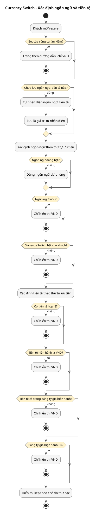
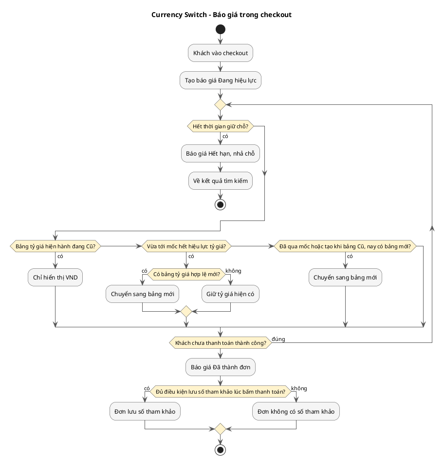
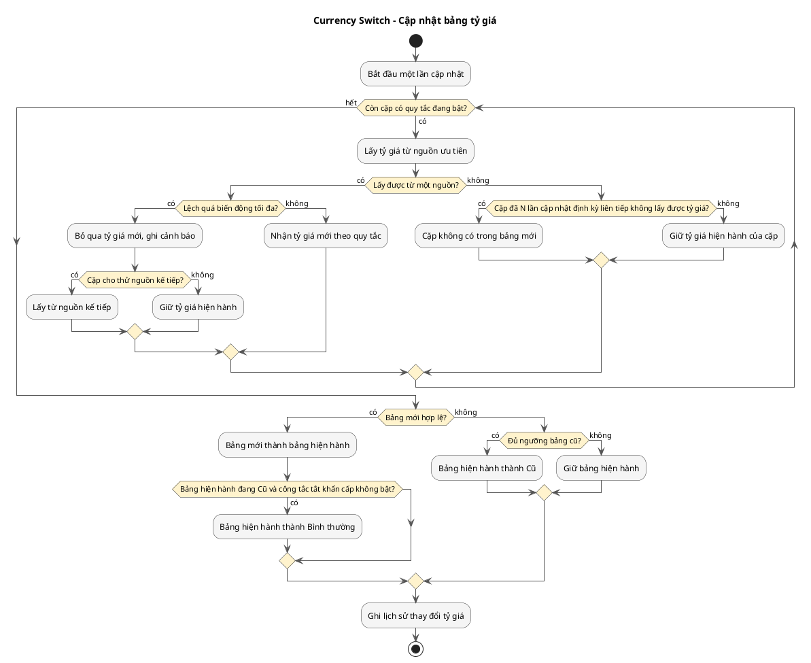

# Vexere - Currency Switch PRD

---

## 1. Document Info

### 1.1 Version History

| Version | Last Updated | Modified By | Change Summary |
|---------|--------------|-------------|----------------|

### 1.2 References

| Document | Link | PIC |
|----------|------|-----|
| Jira Epic | | |
| Figma (master file) | | |
| Technical design (Dev) | | |
| Tracking plan (Data) | | |
| BRD - Currency Switch (Multi-currency Display & Settlement) | | |
| Timeline Dev | | |
| PRD - Currency Switch v0.1 (bản gốc, 09 Oct 2026) | | Nguyễn Đức Anh Tuấn (PO) |

---

## 2. Feature Overview

### 2.1 Problem Statement / Context

**Context**

- Hiện tại: khách dùng UI ngoại ngữ chỉ thấy giá bằng VND, và địa danh vẫn là tiếng Việt có dấu (suy ra từ mục tiêu của PRD v0.1).
- Khoảng trống: không có số tham khảo theo tiền tệ của khách; cách viết số tiền chưa thống nhất giữa các trang và platform; tìm điểm đón trả phải gõ tiếng Việt; khách chưa được báo rõ rằng mình bị trừ bằng VND và ngân hàng có thể áp tỷ giá, phí riêng.
- Động lực kinh doanh: Vexere muốn khách quốc tế hoàn thành đơn nhiều hơn trên UI ngoại ngữ, mà không phát sinh rủi ro pháp lý, tài chính hay khiếu nại mới, và không làm giảm kết quả của UI tiếng Việt.

**Known constraints**

- Đổi currency không tạo server call cho search result.
- Mọi số tiền đi qua một formatter dùng chung trên web và app; còn UI hoặc component format tiền ngoài formatter dùng chung thì không pass.
- Component search widget dùng lại được cho các ngôn ngữ thêm sau qua config, không sửa code.

**Problem Statement**

- **User problem:** Khách quốc tế dùng UI ngoại ngữ của Vexere phải tự quy đổi giá VND sang tiền nước mình, gặp địa danh và nội dung tiếng Việt có dấu, nên khó đọc giá, khó tìm điểm đón trả và dễ bất ngờ khi số tiền bị trừ trên sao kê khác với số họ nghĩ.
- **Business problem:** Vexere muốn tăng tỷ lệ hoàn thành đơn và conversion của khách quốc tế trên UI ngoại ngữ, nhưng việc hiển thị ngoại tệ không được phát sinh rủi ro pháp lý, tài chính hay khiếu nại mới (khiếu nại "giá khác số bị trừ", hoàn tiền, chargeback) và không được làm giảm conversion của UI tiếng Việt.

---

### 2.2 Job to Be Done (JTBD)

**Khách inbound xem giá**

Khi xem giá chuyến xe tại Việt Nam trên UI ngoại ngữ, tôi muốn thấy giá bằng tiền tệ của mình bên cạnh VND, để tôi có thể ước lượng chi phí mà không phải tự quy đổi.

**Khách inbound sắp thanh toán**

Khi sắp thanh toán, tôi muốn biết chính xác số VND sẽ bị trừ và việc ngân hàng có thể áp tỷ giá, phí riêng, để tôi có thể xem sao kê ngân hàng mà không bị bất ngờ.

**Khách inbound không đọc được tiếng Việt**

Khi tìm và đặt vé mà không đọc được tiếng Việt, tôi muốn đọc toàn bộ trang và địa danh bằng ngôn ngữ của mình hoặc chữ Latin không dấu, để tôi có thể tự tìm chuyến và đặt vé mà không cần hỏi ai.

**Khách quay lại hoặc khách mở link chia sẻ**

Khi quay lại Vexere hoặc mở một link được chia sẻ, tôi muốn thấy ngay ngôn ngữ và tiền tệ phù hợp mà không phải chọn lại, để tôi có thể xem giá ngay.

**Người chia sẻ link Vexere (marketing, affiliate)**

Khi chia sẻ link Vexere cho khách của một thị trường, tôi muốn link mở trang bằng ngôn ngữ và tiền tệ tôi chỉ định, để tôi có thể cho người nhận thấy đúng thông tin tôi muốn.

**Nhân viên CSKH**

Khi khách khiếu nại "giá khác số bị trừ", tôi muốn xem đúng những gì khách đã thấy trên đơn, để tôi có thể xử lý khiếu nại bằng bằng chứng.

**Kế toán và Finance analyst**

Khi xuất hoá đơn và lập báo cáo doanh thu, tôi muốn mọi số liệu được ghi nhận bằng VND, để tôi có thể báo cáo mà không bị lẫn số tham khảo.

**PO**

Khi mở thêm thị trường hoặc khi có sự cố, tôi muốn bật ngôn ngữ, tiền tệ và tắt tính năng mà không cần phát hành bản mới, để tôi có thể mở rộng an toàn và dừng ngay khi có rủi ro.

**Nhân viên vận hành tỷ giá**

Khi thêm cặp tiền hoặc khi có sự cố về tỷ giá, tôi muốn quản lý quy tắc tỷ giá và nguồn tỷ giá mà không cần Dev, để tôi có thể giữ số tham khảo dựa trên tỷ giá đúng và ổn định.

---

### 2.3 Goals

1. Khách quốc tế hoàn thành đơn nhiều hơn trên UI ngoại ngữ, với tỷ lệ chuyển tốt hơn ở từng bước, từ kết quả tìm kiếm tới thanh toán.
2. Khách quốc tế thấy số tham khảo bằng tiền tệ của mình bên cạnh VND ở các bề mặt có giá của đợt này, trừ các bề mặt còn chờ kết luận của Legal, nên tự đặt vé được mà không phải tự quy đổi.
3. Không phát sinh rủi ro pháp lý, tài chính hay khiếu nại mới từ việc hiển thị ngôn ngữ và ngoại tệ, và không làm giảm kết quả của UI tiếng Việt.

---

### 2.4 Success Metrics

| Type | Metric | How it is measured | Baseline | Target | Owner |
|------|--------|--------------------|----------|--------|-------|
| Primary | Tỷ lệ hoàn thành đơn trên UI ngoại ngữ (North-star) | Số đơn thanh toán thành công chia cho số phiên có xem kết quả tìm kiếm trên UI ngoại ngữ, vertical Bus, tính theo tuần | Trung bình 4 tuần trước khi bật tính năng cho Bus | Tăng so với baseline; mức cụ thể TBD, PO đặt sau khi đo baseline | PO |
| Secondary | Conversion UI ngoại ngữ | Tỷ lệ chuyển giữa các bước trên UI ngoại ngữ, vertical Bus, theo tuần: kết quả tìm kiếm → chọn chuyến và chỗ → checkout → thanh toán thành công | Trung bình 4 tuần trước khi bật tính năng cho Bus | Tăng so với baseline ở từng bước; mức cụ thể TBD, PO đặt sau khi đo baseline | PO |
| Guardrail | Tỷ lệ hoàn thành đơn trên UI VI | Số đơn thanh toán thành công chia cho số phiên có xem kết quả tìm kiếm trên UI tiếng Việt, vertical Bus, tính theo tuần | Trung bình 4 tuần trước khi bật tính năng cho Bus | Không giảm | PO |
| Guardrail | Ticket CSKH "giá khác số bị trừ" | Số ticket CSKH phân loại "giá khác số bị trừ" trên 1,000 đơn UI ngoại ngữ, theo tuần | Trung bình 4 tuần trước khi bật tính năng cho Bus | Không tăng | Trưởng nhóm CSKH |
| Guardrail | Tỷ lệ hoàn và chargeback đơn UI ngoại ngữ | Số đơn UI ngoại ngữ bị hoàn tiền hoặc chargeback chia cho số đơn UI ngoại ngữ thanh toán thành công, theo tháng | Trung bình 3 tháng trước khi bật tính năng cho Bus | Không tăng | Finance |

---

### 2.5 Glossary

| Term | Meaning in this PRD | Not to be confused with |
|------|---------------------|-------------------------|
| Khách inbound | Khách quốc tế dùng UI ngoại ngữ của Vexere | Việt kiều dùng UI VI ở nước ngoài |
| UI ngoại ngữ | Giao diện Vexere ở bất kỳ ngôn ngữ nào khác tiếng Việt | — |
| Tiền thanh toán (settlement) | Đơn vị tiền thật sự bị trừ khi thanh toán | Tiền tệ tham khảo |
| Tiền tệ tham khảo | Tiền tệ khách chọn để xem giá quy đổi; chỉ để tham khảo | Tiền thanh toán |
| Số tham khảo | Số tiền quy đổi sang tiền tệ tham khảo | Số tiền ngân hàng thực trừ hoặc hoàn vào thẻ |
| Tổng tham khảo | Số tham khảo của tổng tiền đơn | Tổng các dòng breakdown quy đổi riêng |
| Hiển thị kép | Số VND và số tham khảo trên cùng một dòng, dạng "số chính : số phụ" | — |
| Số chính / số phụ | Số được nhấn mạnh và số đi kèm trong hiển thị kép | — |
| Chế độ thứ bậc hiển thị | Cài đặt quyết định số nào là số chính | — |
| Nhóm Browse / nhóm Pay | Hai nhóm bề mặt của chế độ thứ bậc theo nhóm | — |
| Ngôn ngữ hiện hành / tiền tệ hiện hành | Ngôn ngữ, tiền tệ đang dùng để hiển thị, xác định theo thứ tự ưu tiên | Ngôn ngữ đặt vé |
| Phạm vi tiền tệ của ngôn ngữ | Các tiền tệ một ngôn ngữ khai báo, kèm một tiền tệ chính | Danh sách tiền tệ chọn được |
| Danh sách tiền tệ chọn được | Các tiền tệ khách chọn được trên picker của ngôn ngữ hiện hành | Phạm vi tiền tệ của ngôn ngữ |
| Tiền tệ chính của ngôn ngữ | Tiền tệ mặc định khai báo cho một ngôn ngữ | Tiền tệ của quốc gia nơi khách truy cập |
| Tiền tệ mặc định | Tiền tệ dùng khi các bước trước của thứ tự ưu tiên chưa cho tiền tệ nào | — |
| Ngôn ngữ dự phòng | Ngôn ngữ dùng khi ngôn ngữ cần dùng chưa được bật | — |
| Lựa chọn chủ động | Ngôn ngữ hoặc tiền tệ khách tự chọn trên picker | Giá trị tự nhận diện |
| Giá trị tự nhận diện | Ngôn ngữ, tiền tệ Vexere tự xác định cho khách mới | Lựa chọn chủ động |
| Tham số trên link | Ngôn ngữ, tiền tệ chỉ định trong link web hoặc deep link app, chỉ cho phiên đó | Ngôn ngữ trong đường dẫn |
| Ngôn ngữ trong đường dẫn | Phần ngôn ngữ trong địa chỉ trang web, ví dụ /en-US/ | Tham số trên link |
| Phiên | Khoảng thời gian khách dùng Vexere liên tục; phiên kết thúc khi khách không thao tác trong 30 phút, hoặc khi khách đóng trình duyệt hay đóng hẳn app, và lần mở hoặc thao tác kế tiếp bắt đầu phiên mới (giả định) | — |
| Bảng tỷ giá | Tập tỷ giá của mọi cặp tiền tạo ra trong một lần cập nhật | Quy tắc tỷ giá |
| Bảng tỷ giá hiện hành | Bảng tỷ giá hợp lệ mới nhất; trạng thái Bình thường hoặc Cũ | Bảng tỷ giá của báo giá |
| Cũ (stale) | Trạng thái của bảng tỷ giá hiện hành khi quá lâu không cập nhật được, hoặc khi bật công tắc tắt khẩn cấp | Bảng tỷ giá không hợp lệ |
| Ngưỡng bảng cũ (N) | Số lần cập nhật định kỳ lỗi liên tiếp để bảng tỷ giá hiện hành thành Cũ | — |
| Quy tắc tỷ giá | Cấu hình tỷ giá cho một cặp tiền XXX/VND | Bảng tỷ giá |
| Tỷ giá gốc / tỷ giá theo quy tắc | Tỷ giá lấy từ nguồn / tỷ giá sau buffer và làm tròn | — |
| Buffer | Phần trăm cộng thêm vào tỷ giá gốc | Phí quy đổi, Vexere không thu |
| Nguồn chính / nguồn dự phòng | Nguồn tỷ giá dùng trước / dùng khi nguồn trước lỗi | — |
| Biến động tối đa/ngày | Mức lệch tối đa giữa tỷ giá gốc mới và tỷ giá gốc hiện hành mà quy tắc chấp nhận | — |
| Báo giá | Bản chốt giá tạo khi khách vào checkout; trạng thái Đang hiệu lực, Hết hạn, Đã thành đơn | Bảng tỷ giá |
| Mốc hết hiệu lực tỷ giá của báo giá | Thời điểm tỷ giá của báo giá cần làm mới | Mốc hết giữ chỗ |
| Thời gian giữ chỗ | Khoảng thời gian chỗ được giữ trong lúc thanh toán, theo tính năng giữ chỗ hiện có | — |
| Ngôn ngữ đặt vé | Ngôn ngữ UI lúc thanh toán, lưu trên đơn | Ngôn ngữ hiện hành |
| Disclaimer | Câu lưu ý giá tham khảo chỉ để tham khảo | Payment Notice |
| Payment Notice | Thông báo số VND chính xác sẽ bị trừ: bản đầy đủ ở checkout, bản rút gọn ở màn thanh toán | Disclaimer |
| Địa danh không dấu | Tên địa danh đã bỏ dấu tiếng Việt | Tên bản địa theo từng ngôn ngữ (ngoài phạm vi) |
| Currency Switch | Tính năng này; bật tắt theo vertical × platform | Công tắc tắt khẩn cấp |
| Công tắc tắt khẩn cấp | Cách đưa mọi bề mặt về chỉ VND bằng cách chuyển bảng tỷ giá hiện hành sang Cũ | Tắt Currency Switch |
| Nhóm bật / nhóm tắt | Hai nhóm khách khi Currency Switch bật ở tỷ lệ traffic dưới 100% | — |
| Vertical | Ngành hàng của Vexere, ví dụ Bus | — |
| Platform | Kênh sử dụng: web desktop, mobile web, app | — |
| Mã ISO | Mã tiền tệ 3 chữ cái theo ISO 4217 | Ký hiệu tiền tệ như $, ¥ |
| BU | Bộ phận kinh doanh cấu hình ngôn ngữ, tiền tệ được bật | — |
| Nhân viên vận hành tỷ giá | Người quản lý quy tắc tỷ giá trên công cụ cấu hình tỷ giá | — |
| Công cụ cấu hình tỷ giá | Màn "Cấu hình tỷ giá" trên công cụ cấu hình nội bộ VEX-CONFIG | — |
| Trang SEO landing | Trang đích từ công cụ tìm kiếm, có giá hiển thị kép | Landing page do CMS tạo (ngoài phạm vi) |
| Dòng giảm giá | Mọi dòng mang giá trị âm trên breakdown của đơn: voucher, khuyến mãi, kể cả khoản giảm theo phương thức thanh toán đã áp vào đơn | Bề mặt giới thiệu payment promotion ngoài breakdown (ngoài phạm vi) |
| Currency Switch bật cho khách | Vertical × platform khách dùng đang bật Currency Switch và, khi tỷ lệ traffic dưới 100%, khách thuộc nhóm bật | Nhóm tắt, hoặc vertical × platform đang tắt |

---

## 3. Feature Specifications

### 3.1 General Rules

Chỉ những quy tắc là nền tảng của cả tính năng, áp dụng cho nhiều epic. Quy tắc chỉ một epic hoặc một story dùng nằm ngay tại epic hoặc story đó.

Quy ước cho cột Ví dụ trong cả PRD: số viết như trên UI EN (dấu phẩy ngăn nghìn, dấu chấm thập phân); tỷ giá là số VND cho 1 đơn vị ngoại tệ. Ngôn ngữ, tiền tệ trong ví dụ là giá trị mẫu; ngôn ngữ, tiền tệ nào được bật do BU cấu hình. Lúc ra mắt VND là số chính trên mọi bề mặt, nên ví dụ hiển thị viết dạng "467,000 VND : ~USD 17.92".

**Thanh toán và hiển thị**

| Quy tắc | Ví dụ |
|---------|-------|
| Tiền thanh toán (settlement) luôn là VND cho mọi khách, trên mọi ngôn ngữ và mọi platform. Tiền tệ tham khảo chỉ để hiển thị, không dùng trong giao dịch, hoá đơn, đối soát hay báo cáo doanh thu. | Khách dùng UI KO, chọn KRW: thấy 470,300 VND : ~KRW 24,818 và bị trừ đúng 470,300 VND. |
| Hiển thị kép một dòng: mọi bề mặt có giá trong phạm vi đợt này (Trang kết quả tìm kiếm, Trang tìm nhà xe, Trang chi tiết chuyến, Sơ đồ ghế, Checkout, Màn thanh toán, Email xác nhận và vé điện tử, My bookings, Thông tin hoàn tiền của đơn, Trang SEO landing, Back office đơn hàng) (giả định) hiển thị số tham khảo và số VND trên cùng một dòng, dạng "số chính : số phụ". Ngoại tệ khi ở vị trí số phụ có tiền tố "~". Số nào là số chính theo chế độ thứ bậc hiển thị. | 467,000 VND : ~USD 17.92 |
| Chế độ thứ bậc hiển thị: một cài đặt có 2 chế độ, đổi được mà không cần phát hành bản mới, bởi người có quyền theo phân quyền hiện có của hệ thống. (1) VND là số chính trên mọi bề mặt. (2) Theo nhóm: nhóm Browse (kết quả tìm kiếm, tìm nhà xe, chi tiết chuyến, chọn ghế, lịch giá, bộ lọc và thanh trượt giá, nhãn giảm giá, trang SEO landing) lấy ngoại tệ làm số chính; nhóm Pay (checkout, thanh toán, email xác nhận, My bookings, hoàn tiền, back office) lấy VND làm số chính. Chế độ lúc ra mắt: (1) VND là số chính trên mọi bề mặt (giả định). | Chế độ (1): kết quả tìm kiếm 467,000 VND : ~USD 17.92; checkout 470,300 VND : ~USD 18.05. Chế độ (2): kết quả tìm kiếm USD 17.92 : 467,000 VND; checkout 470,300 VND : ~USD 18.05. |
| Không bề mặt nào hiện ngoại tệ mà thiếu số VND. Ngoại lệ: giá trị biên khách chọn trên bộ lọc và thanh trượt giá là giá trị nhập, không phải giá, nên chỉ hiển thị số tham khảo dạng xấp xỉ "~" (giả định). | Ô giá không bao giờ chỉ có "~USD 17.92"; luôn kèm 467,000 VND. Thanh trượt giá hiển thị biên "~USD 20.00", không kèm VND. |
| Khi tiền tệ hiện hành là VND (UI VI, hoặc khách chọn VND), chỉ hiển thị VND, không có số tham khảo. Quy tắc này áp cho giá đang xem; số tham khảo đã lưu trên đơn vẫn hiển thị trên email xác nhận, My bookings và số tiền hoàn, trừ khi xem trên UI VI (giả định). | UI EN, khách chọn VND: 467,000 VND, không có ~USD. |

**Quy đổi**

| Quy tắc | Ví dụ |
|---------|-------|
| Tỷ giá dùng để quy đổi là tỷ giá của cặp tiền XXX/VND trong bảng tỷ giá đang dùng: bảng tỷ giá hiện hành, bảng tỷ giá của báo giá trong checkout, hoặc bảng tỷ giá lưu trên đơn sau khi đặt. Tỷ giá là số VND cho 1 đơn vị ngoại tệ, lấy theo quy tắc tỷ giá của cặp đó và cài đặt Có/Không áp buffer vào số tham khảo của cặp đó. | Giá trị mẫu: 1 USD = 26,054 VND; 1 KRW = 18.95 VND. |
| Công thức quy đổi. Tổng tham khảo = làm tròn(tổng VND sau giảm giá / tỷ giá). Mỗi dòng dương của breakdown (vé, phí, bảo hiểm, dịch vụ thêm) quy đổi và làm tròn độc lập: dòng tham khảo = làm tròn(VND của dòng / tỷ giá), trừ dòng gánh phần chênh do làm tròn để breakdown cộng khớp total. Làm tròn half-up (nửa lên, xa số 0) tới số lẻ của tiền tệ theo bảng số lẻ cố định của Vexere. | 1 USD = 26,054 VND: total 470,300 VND → 18.051 → ~USD 18.05; dòng vé 467,000 VND → 17.924 → ~USD 17.92. |

**Bảng tỷ giá**

| Quy tắc | Ví dụ |
|---------|-------|
| Tỷ giá được cập nhật mỗi 2 giờ, và ngay sau khi một quy tắc tỷ giá được tạo, sửa, hoặc khi bấm làm mới trên công cụ cấu hình tỷ giá. Mỗi lần cập nhật tạo một bảng tỷ giá thống nhất, ghi nguồn và thời điểm bản tin của từng cặp. Bảng hợp lệ mới nhất là bảng tỷ giá hiện hành. Mọi giá trên cùng một trang dùng cùng một bảng tỷ giá; trang mở hoặc tải lại sau khi có bảng tỷ giá hiện hành mới dùng bảng mới; trang đang mở không tự đổi số tham khảo khi có bảng mới (giả định). Trong checkout, tỷ giá theo bảng tỷ giá của báo giá. Một cặp không lấy được tỷ giá từ nguồn nào nhưng bảng mới vẫn hợp lệ: bảng mới giữ tỷ giá hiện hành của cặp đó; tới lần cập nhật định kỳ thứ N liên tiếp không lấy được (N là ngưỡng bảng cũ), cặp đó không có trong bảng mới. | Giá trị mẫu: lịch cập nhật 08:00, 10:00, 12:00; quy tắc USD/VND được sửa lúc 10:15 → cập nhật ngay lúc 10:15 và tạo bảng mới; lần cập nhật định kỳ kế tiếp lúc 12:00. Khách mở trang kết quả lúc 11:55 (bảng 10:00) rồi tải lại lúc 12:05 (bảng 12:00 đã thành bảng hiện hành) → số tham khảo trên trang tính theo bảng 12:00. |
| Bảng tỷ giá chỉ hợp lệ khi có đủ tiền tệ chính của mọi ngôn ngữ đang bật. | Giá trị mẫu: KO đang bật, tiền tệ chính KRW; lần cập nhật không lấy được KRW/VND từ nguồn nào → bảng đó không hợp lệ, bảng hiện hành giữ nguyên. |
| Bảng tỷ giá hiện hành bị coi là cũ (stale) khi, kể từ lần gần nhất tạo được bảng hợp lệ, N lần cập nhật định kỳ liên tiếp không tạo được bảng hợp lệ (N là ngưỡng bảng cũ). Lần cập nhật ngay sau khi tạo, sửa quy tắc tỷ giá hoặc khi bấm làm mới không được tính vào N. N áp dụng cho cả bảng tỷ giá (giả định), do nhân viên vận hành tỷ giá đặt trên công cụ cấu hình tỷ giá; không có mặc định; bắt buộc đặt trước ngày ra mắt (giả định). Ngày nguồn không công bố bản tin (cuối tuần, lễ) không tính là lần lỗi. Khi mọi nguồn lỗi, giữ bảng hiện hành cho tới ngưỡng này. | Giá trị mẫu: N = 3, cập nhật mỗi 2 giờ → khoảng 6 giờ không có bảng mới thì bảng hiện hành thành Cũ. |

**Legal và dữ liệu cũ**

| Quy tắc | Ví dụ |
|---------|-------|
| Trong khi Legal chưa kết luận cho màn thanh toán, email xác nhận, My bookings và số tiền hoàn, bốn bề mặt này chỉ hiển thị VND (giả định). Trong thời gian này, đơn vẫn lưu số tham khảo nếu checkout của báo giá đã hiển thị số tham khảo; khi Legal kết luận cho phép một bề mặt, bề mặt đó hiển thị số tham khảo đã lưu của đơn, kể cả đơn thanh toán trong thời gian chờ; email đã gửi không đổi (giả định). | Legal chưa kết luận cho màn thanh toán → màn thanh toán chỉ hiện 470,300 VND; checkout đã hiện 470,300 VND : ~USD 18.05 → đơn vẫn lưu ~USD 18.05; sau đó Legal cho phép My bookings → đơn này hiện 470,300 VND : ~USD 18.05 trên My bookings. |
| Dữ liệu cũ lúc ra mắt: đơn đặt trước khi ra mắt không có số tham khảo; email, My bookings và hoàn tiền của các đơn này chỉ hiển thị VND trên mọi UI (giả định). | Đơn đặt một ngày trước ra mắt, xem My bookings trên UI EN sau ra mắt → chỉ 470,300 VND. |

**Nội dung thông báo**

| Quy tắc | Ví dụ |
|---------|-------|
| Nội dung thông báo viết bằng tiếng Anh trong PRD này là bản EN và giữ nguyên tiếng Anh. Bản dịch theo từng ngôn ngữ UI do đội dịch thuật cung cấp và Legal duyệt theo quy trình riêng. | — |
| Chỗ chèn số tiền trong nội dung thông báo chỉ chứa số đã định dạng; mã tiền nằm sẵn trong câu, để không bị lặp mã. | "You will be charged exactly {số tiền VND} VND" hiển thị "… exactly 470,300 VND", không phải "VND VND 470,300". |

**Trạng thái của bảng tỷ giá hiện hành**

| Từ | Khi | Điều kiện | Sang | Kèm theo |
|----|-----|-----------|------|----------|
| Bình thường | Một lần cập nhật định kỳ không tạo được bảng tỷ giá hợp lệ | Đã đủ ngưỡng bảng cũ: N lần cập nhật định kỳ liên tiếp không tạo được bảng hợp lệ | Cũ | — |
| Bình thường | Người có quyền (theo phân quyền hiện có của hệ thống) bật công tắc tắt khẩn cấp | — | Cũ | Công tắc tắt khẩn cấp vận hành ở đâu, bằng cách nào: TBD, Dev / Tech Lead ghi trong Technical design. |
| Cũ | Một lần cập nhật tạo được bảng tỷ giá hợp lệ | Công tắc tắt khẩn cấp không bật (giả định) | Bình thường | Bảng mới thành bảng tỷ giá hiện hành. |
| Cũ | Người có quyền (theo phân quyền hiện có của hệ thống) tắt công tắc tắt khẩn cấp | Chưa đủ ngưỡng bảng cũ: N lần cập nhật định kỳ liên tiếp không tạo được bảng hợp lệ | Bình thường | Bảng tỷ giá hợp lệ mới nhất tiếp tục là bảng tỷ giá hiện hành (giả định). Công tắc tắt khẩn cấp vận hành ở đâu, bằng cách nào: TBD, Dev / Tech Lead ghi trong Technical design. |

| Trạng thái | Khi vào trạng thái này |
|------------|------------------------|
| Cũ | Mọi bề mặt chỉ hiển thị VND, không dùng tỷ giá của bảng cũ, kể cả báo giá đang mở, kèm thông báo giá tham khảo tạm thời không có. Đơn thanh toán thành công trong thời gian này chỉ lưu số tham khảo khi, lúc khách bấm nút thanh toán, màn thanh toán đang hiển thị số tham khảo cho khách, hoặc màn thanh toán chỉ hiển thị VND vì đang chờ kết luận của Legal nhưng checkout của báo giá đã hiển thị số tham khảo. Số tham khảo đã lưu trên đơn vẫn hiển thị trên email xác nhận, My bookings và số tiền hoàn, trừ khi xem trên UI VI (giả định). Trang khách đang mở, gồm cả trang kết quả tìm kiếm và checkout, chuyển sang chỉ hiển thị VND ngay khi bảng thành Cũ, không chờ khách tải lại trang (giả định); nếu không làm được ngay, độ trễ tối đa: TBD, Dev / Tech Lead ghi trong Technical design, PO duyệt. Đây là ngoại lệ của quy tắc trang đang mở không tự đổi số tham khảo khi có bảng mới. Khi bảng trở lại Bình thường, trang khách đang mở hiện lại số tham khảo khi khách mở hoặc tải lại trang, trừ Checkout, Bước nhập thông tin hành khách và Màn thanh toán: các trang này hiện lại số tham khảo ngay, theo bảng tỷ giá của báo giá (giả định). |

**Khi nào khách chỉ thấy VND**

| Tình huống | Khách thấy gì, điều gì xảy ra |
|------------|-------------------------------|
| Bảng tỷ giá đang tải | Ô giá hiện khung chờ (skeleton) cho tới khi có bảng tỷ giá; không ô nào hiện ngoại tệ mà thiếu VND. |
| Số tham khảo tạm thời không có: bảng tỷ giá hiện hành đang Cũ, kể cả khi bật công tắc tắt khẩn cấp; tiền tệ của khách không có trong bảng tỷ giá hiện hành; không có ứng viên tiền tệ mặc định nào hợp lệ, tức không ứng viên nào (tiền tệ của quốc gia nơi khách truy cập, tiền tệ chính của ngôn ngữ, với EN là USD) thuộc phạm vi tiền tệ của ngôn ngữ | Mọi giá chỉ hiển thị VND, không có số tham khảo; thông báo "Reference prices in {mã tiền tệ} are temporarily unavailable. Prices are shown in VND." hiện một lần mỗi trang, cạnh bảng giá; khi không có ứng viên tiền tệ mặc định nào hợp lệ, thông báo "Reference prices are temporarily unavailable. Prices are shown in VND." (nội dung đề xuất) hiện thay cho thông báo trên (giả định). Khách vẫn tìm chuyến, đặt vé và thanh toán bằng VND như bình thường. Số tham khảo đã lưu trên các đơn đã đặt vẫn hiển thị trên email xác nhận và My bookings, theo tỷ giá lúc đặt. |
| Currency Switch đang tắt cho vertical Bus trên platform khách đang dùng, hoặc khách thuộc nhóm tắt trong khi Currency Switch bật ở tỷ lệ traffic dưới 100% | Mọi giá chỉ hiển thị VND, không có số tham khảo. Không có picker tiền tệ; picker ngôn ngữ, UI ngoại ngữ, địa danh không dấu và search widget vẫn như khi bật. Không hiện: disclaimer giá tham khảo chỉ để tham khảo, thông tin nguồn tỷ giá tham khảo, thông báo giá tham khảo tạm thời không có, Payment Notice bản đầy đủ ở checkout và bản rút gọn ở màn thanh toán. Vẫn hiện như khi bật: dòng báo khách sẽ trả bằng VND ở checkout, nút thanh toán ghi số VND và câu khách đồng ý giao dịch được xử lý bằng VND ở màn thanh toán (giả định). Back office đơn hàng vẫn hiển thị thông tin tiền tệ đã lưu của đơn (giả định). |
| Tiền tệ hiện hành là VND: UI VI, hoặc khách chọn VND | Mọi giá chỉ hiển thị VND, không có số tham khảo; trên UI VI không có picker tiền tệ. Số tham khảo đã lưu trên các đơn đã đặt vẫn hiển thị trên email xác nhận và My bookings khi khách chọn VND trên UI ngoại ngữ; xem trên UI VI thì chỉ hiển thị VND. |
| Đơn không có số tham khảo: đơn đặt trước khi ra mắt hoặc không đủ điều kiện lưu số tham khảo lúc thanh toán; hoặc email xác nhận, My bookings, số tiền hoàn đang chờ kết luận của Legal | Email xác nhận, My bookings và số tiền hoàn của đơn chỉ hiển thị VND trên mọi UI. Back office đơn hàng hiển thị "không có số tham khảo" ở phần thông tin tiền tệ của đơn khi đơn không có số tham khảo (đơn đặt trước khi ra mắt hoặc không đủ điều kiện lưu số tham khảo). |

---

### 3.2 Process Diagrams

**Xác định ngôn ngữ và tiền tệ khi khách mở Vexere**

**Báo giá trong checkout**

**Cập nhật bảng tỷ giá**

---

### 3.3 Feature Epics & User Stories

#### Epic 1: Nền tảng

Số tiền, địa danh và ô tìm kiếm đọc được trên mọi ngôn ngữ UI.

##### US-01 - Số tiền hiển thị theo một quy ước thống nhất

Là khách đặt vé trên Vexere, tôi muốn mọi số tiền trên mọi trang và mọi platform được viết theo cùng một quy ước của ngôn ngữ tôi đang dùng, để tôi không đọc nhầm giá.

**Quy tắc**

| Quy tắc | Ví dụ |
|---------|-------|
| Số lẻ của mỗi tiền tệ theo bảng cố định của Vexere; bảng này thắng số lẻ chuẩn ISO 4217 khi hai bên khác nhau (ISO 4217 cho IDR, TWD 2 số lẻ). 0 số lẻ: VND, JPY, KRW, IDR, TWD. 2 số lẻ: USD, EUR, SGD, THB, CNY. 3 số lẻ: BHD, KWD, OMR. Tiền tệ không có trong bảng dùng số lẻ chuẩn ISO 4217 của tiền tệ đó. | Giá trị mẫu: 467,000 VND với 1 TWD = 820 VND → 569.51 → TWD 570; với 1 KWD = 85,000 VND → 5.4941 → KWD 5.494; AUD không có trong bảng → 2 số lẻ theo ISO 4217. |
| Làm tròn half-up (nửa lên, xa số 0) tới số lẻ của tiền tệ theo bảng số lẻ của Vexere. Mọi nơi hiển thị dùng cùng một quy tắc làm tròn. | 17.925 → 17.93; 17.924 → 17.92; −2,464.5 → −2,465. |
| Mọi số tiền luôn kèm mã ISO 4217 3 chữ cái, không dùng ký hiệu tiền tệ, trên mọi ngôn ngữ, để tránh nhầm ¥ giữa JPY và CNY. | USD 19.96, CNY 127.95; không viết $19.96 hay ¥127.95. |
| Số VND định dạng theo ngôn ngữ UI, mã VND đứng sau số. Mã ngoại tệ đứng trước số. Mỗi ngôn ngữ chỉ có một cách viết số VND trên toàn UI, mọi platform. | EN và VI: 520,000 VND. Ngoại tệ: USD 17.92. Không viết "VND 520,000". |

**Acceptance Criteria**

- AC1 (Happy): Trên mọi màn hình của story và mọi platform được hỗ trợ (web desktop, mobile web, app), mỗi số tiền hiển thị kèm mã ISO của tiền tệ, không số tiền nào dùng ký hiệu tiền tệ (VD: USD 19.96, không viết $19.96).
- AC2 (Happy): Mỗi số VND được viết theo cách viết số của ngôn ngữ UI đang dùng, với mã VND đứng sau số (VD: trên UI EN là 520,000 VND).
- AC3 (Happy): Mỗi số ngoại tệ hiển thị có mã tiền đứng trước số (VD: USD 17.92).
- AC4 (Happy): Trong cùng một ngôn ngữ UI, cùng một số VND được viết giống hệt nhau trên mọi màn hình của story và mọi platform được hỗ trợ (web desktop, mobile web, app).
- AC5 (Happy): Mỗi số tiền hiển thị đúng số lẻ của tiền tệ đó theo bảng số lẻ của Vexere (VD: TWD 570 không có số lẻ, KWD 5.494 có 3 số lẻ).
- AC6 (Alternative): Nếu tiền tệ tham khảo không có trong bảng số lẻ của Vexere, số tham khảo hiển thị theo số lẻ chuẩn ISO 4217 của tiền tệ đó (VD: AUD có 2 số lẻ).
- AC7 (Happy): Nếu kết quả quy đổi chưa làm tròn có nhiều chữ số thập phân hơn số lẻ của tiền tệ, số tham khảo hiển thị được làm tròn half-up (nửa lên, xa số 0) tới số lẻ đó theo quy tắc làm tròn chung. VD: 17.925 → 17.93; −2,464.5 → −2,465.

##### US-02 - Địa danh không dấu trên UI ngoại ngữ

Là khách inbound, tôi muốn đọc tên bến xe, trạm dừng, điểm đón trả ở dạng không dấu, để tôi đọc và gõ được tên điểm đón mà không cần bàn phím tiếng Việt.

**Quy tắc**

| Quy tắc | Ví dụ |
|---------|-------|
| Địa danh trên UI ngoại ngữ (Phase 1): mọi địa danh Bus (bến xe, trạm dừng, điểm đón trả) được chuẩn hoá thành không dấu, dùng chung cho mọi ngôn ngữ ngoại ngữ, kể cả ngôn ngữ thêm sau. Tên bản địa theo từng ngôn ngữ cho Top 50 điểm đến nằm ngoài phạm vi đợt này. | UI EN, KO, TH đều hiện "Ben xe Mien Dong". |
| Cách chuẩn hoá không dấu: bỏ dấu tiếng Việt và chuyển "đ/Đ" thành "d/D". | "Đà Lạt" → "Da Lat"; "Bến xe Miền Đông" → "Ben xe Mien Dong". |

**Acceptance Criteria**

- AC1 (Happy): Trong khi khách dùng UI ngoại ngữ, mọi địa danh Bus (bến xe, trạm dừng, điểm đón trả) hiển thị dạng không dấu (VD: "Ben xe Mien Dong") trên mọi màn hình có địa danh, gồm trang kết quả tìm kiếm, trang chi tiết chuyến, checkout, My bookings, trang SEO landing và search widget.
- AC2 (Happy): Nếu email xác nhận và vé điện tử được gửi bằng một ngoại ngữ, mọi địa danh Bus trong đó hiển thị dạng không dấu.
- AC3 (Happy): Tên không dấu của mỗi địa danh đúng bằng tên tiếng Việt của địa danh đó sau khi bỏ dấu và chuyển "đ/Đ" thành "d/D" (VD: "Đà Lạt" → "Da Lat").
- AC4 (Happy): Cùng một địa danh hiển thị cùng một tên không dấu trên mọi ngôn ngữ ngoại ngữ đang bật và mọi platform được hỗ trợ (web desktop, mobile web, app) (VD: UI EN, KO, TH đều hiện "Ben xe Mien Dong").
- AC5 (Alternative): Nếu khách dùng một ngôn ngữ ngoại ngữ được bật sau ngày ra mắt, địa danh Bus hiển thị cùng tên không dấu như trên các ngôn ngữ ngoại ngữ khác.
- AC6 (Alternative): Trong khi khách dùng UI VI (địa danh không dấu chỉ áp cho UI ngoại ngữ), địa danh vẫn hiển thị bằng tiếng Việt có dấu như hiện tại (VD: "Bến xe Miền Đông").

##### US-03 - Search widget đa ngôn ngữ

Là khách inbound, tôi muốn tìm chuyến bằng ngôn ngữ của mình, để tôi bắt đầu đặt vé mà không phải đọc tiếng Việt.

**Acceptance Criteria**

- AC1 (Happy): Trên mọi platform được hỗ trợ (web desktop, mobile web, app), nhãn, chữ gợi ý trong ô nhập và thông báo lỗi của search widget hiển thị bằng ngôn ngữ UI khách đang dùng.
- AC2 (Happy): Khi khách gõ tên một địa danh Bus bằng chữ Latin không dấu, danh sách gợi ý hiện địa danh đó ở dạng không dấu (VD: "Ben xe Mien Dong", không phải "Bến xe Miền Đông").
- AC3 (Happy): Sau khi khách chọn một gợi ý, ô điểm đi hoặc điểm đến hiển thị tên không dấu của địa danh đã chọn.
- AC4 (Happy): Khi khách bấm tìm, trang kết quả tìm kiếm mở bằng đúng ngôn ngữ UI khách đang dùng (trên web, ngôn ngữ của trang theo ngôn ngữ trong đường dẫn, VD: /en-US/ → EN).
- AC5 (Alternative): Nếu BU bật thêm một ngôn ngữ ngoại ngữ trong cấu hình sau ngày ra mắt, nhãn, chữ gợi ý trong ô nhập và thông báo lỗi của search widget hiển thị bằng ngôn ngữ đó sau khi ngôn ngữ được bật, mà không cần phát hành bản mới.
- AC6 (Error): Nếu không có địa danh nào khớp với nội dung khách gõ, danh sách gợi ý hiện thông báo không tìm thấy địa danh phù hợp bằng ngôn ngữ UI: "No matching places. Try another name or check the spelling." (nội dung đề xuất).

##### US-23 - Gợi ý nhập tên hành khách bằng chữ Latin

Là khách inbound, tôi muốn biết phải nhập tên hành khách bằng chữ Latin như trên hộ chiếu, để tôi không bị báo lỗi khi nhập tên.

**Acceptance Criteria**

- AC1 (Happy): Trong khi khách dùng UI ngoại ngữ, mỗi ô tên hành khách ở bước nhập thông tin hành khách luôn hiện, bằng ngôn ngữ UI, dòng gợi ý nhập tên bằng chữ Latin "Enter your name in Latin letters, as shown on your passport.", có sẵn trước khi khách bắt đầu nhập.
- AC2 (Error): Nếu tên hành khách có ký tự không hợp lệ theo quy tắc ký tự hiện có của hệ thống, lỗi inline dưới ô tên hiện thông báo lỗi hiện có của hệ thống khi tên hành khách có ký tự không hợp lệ (giữ nội dung hiện có), hiển thị bằng ngôn ngữ UI.
- AC3 (Alternative): Trong khi khách dùng UI VI, ô tên hành khách không hiện dòng gợi ý nhập tên bằng chữ Latin ở AC1 và hoạt động như hiện tại.

#### Epic 2: Chọn ngôn ngữ và tiền tệ

Khách thấy ngay ngôn ngữ và tiền tệ phù hợp, và đổi được khi muốn.

**Quy tắc của epic**

| Quy tắc | Ví dụ |
|---------|-------|
| Ngôn ngữ và tiền tệ là hai danh sách riêng, kèm bảng quốc gia → tiền tệ. Ngôn ngữ, tiền tệ nào được bật và bảng quốc gia → tiền tệ do BU cấu hình, theo phân quyền hiện có của hệ thống, không cần phát hành bản mới. Ngôn ngữ dự phòng là EN: dùng khi ngôn ngữ cần dùng không có trong danh sách đang bật. | Giá trị mẫu (cấu hình ví dụ của PRD gốc): ngôn ngữ VI, EN, ZH, KO, TH; bảng quốc gia → tiền tệ có VN → VND, US → USD, KR → KRW, TW → TWD. Trình duyệt ưu tiên ja, JA chưa bật → EN. |
| Phạm vi tiền tệ của ngôn ngữ: mỗi ngôn ngữ khai báo danh sách tiền tệ được dùng và một tiền tệ chính, do BU cấu hình. Danh sách tiền tệ chọn được của ngôn ngữ = tiền tệ của ngôn ngữ ∩ tiền tệ đang bật ∩ tiền tệ có trong bảng tỷ giá hiện hành, luôn có VND, kể cả với ngôn ngữ chỉ khai báo một tiền tệ (giả định). Picker tiền tệ chỉ cho chọn trong danh sách tiền tệ chọn được. Mỗi tiền tệ trong phạm vi tiền tệ của ngôn ngữ cần một quy tắc tỷ giá đang bật. Ngôn ngữ VI chỉ có VND. Muốn xem tiền tệ ngoài phạm vi tiền tệ của ngôn ngữ, khách chuyển sang ngôn ngữ tương ứng hoặc EN. | Giá trị mẫu: ZH: CNY, TWD (chính CNY); KO: KRW, USD (chính KRW); TH: THB, USD (chính THB); EN: mọi tiền tệ đang bật, gồm VND; VI: VND. Danh sách tiền tệ chọn được của ZH: CNY, TWD, VND; quy tắc TWD/VND bị tắt, nên TWD không còn trong bảng tỷ giá từ lần cập nhật ngay sau khi tắt → CNY, VND (TWD không phải tiền tệ chính của ngôn ngữ nào, nên bảng mới vẫn hợp lệ, vì bảng tỷ giá chỉ cần có đủ tiền tệ chính của mọi ngôn ngữ đang bật). |
| Tiền tệ mặc định, xét theo thứ tự, chỉ nhận ứng viên thuộc phạm vi tiền tệ của ngôn ngữ: (1) tiền tệ của quốc gia nơi khách truy cập theo bảng quốc gia → tiền tệ (web: theo vị trí truy cập; app: theo vùng của thiết bị); (2) tiền tệ chính của ngôn ngữ; (3) với EN: USD. Không ứng viên nào hợp lệ thì chỉ hiển thị VND, như khi số tham khảo tạm thời không có. | EN ở Mỹ → USD; EN ở Việt Nam → VND (đổi được trên picker); EN ở Pháp → EUR nếu đang bật, không thì USD; ZH ở Đài Loan → TWD; ZH ở Việt Nam → CNY; KO ở Mỹ → USD; KO ở Hàn Quốc hoặc Việt Nam → KRW. |
| Thứ tự ưu tiên xác định ngôn ngữ và tiền tệ (xác định riêng từng giá trị, cùng một thứ tự): (1) thao tác của khách trong phiên; (2) tham số trên link, và trên web là ngôn ngữ trong đường dẫn của trang (giả định), chỉ cho phiên đó, không lưu; (3) lựa chọn chủ động gần nhất giữa hồ sơ và thiết bị; (4) giá trị tự nhận diện lần đầu; (5) mặc định: ngôn ngữ dự phòng EN cho ngôn ngữ, tiền tệ mặc định cho tiền tệ. Ngôn ngữ được xác định trước; ở các bước (1) đến (3), tiền tệ phải thuộc phạm vi tiền tệ của ngôn ngữ hiện hành hoặc là VND; ở bước (4), tiền tệ phải thuộc phạm vi tiền tệ của ngôn ngữ hiện hành; không thì xét ứng viên kế tiếp; ở bước (5), xét các ứng viên theo thứ tự của tiền tệ mặc định. Với ngôn ngữ VI, tiền tệ là VND, vì ngôn ngữ VI chỉ có VND. Giá trị tự nhận diện không phải lựa chọn chủ động. Một phiên kết thúc khi khách không thao tác trong 30 phút, hoặc khi khách đóng trình duyệt hay đóng hẳn app; lần mở hoặc thao tác kế tiếp bắt đầu phiên mới (giả định). | Khách đã lưu chủ động EN + USD, mở link chỉ định KO + KRW → phiên đó là KO + KRW; phiên sau quay lại EN + USD. Khách dùng UI KO chọn VND trên picker → KO + VND (VND luôn chọn được); khách mới dùng KO, truy cập từ Việt Nam → KO + KRW (tiền tệ mặc định: VND không thuộc phạm vi tiền tệ của KO). Khách đã lưu chủ động EN mở trên web link /ko-KR/… không có tham số ngôn ngữ → phiên đó KO (giả định); phiên sau mở đường dẫn không có ngôn ngữ → dẫn tới /en-US/…. Khách được tự nhận diện EN + VND ở Việt Nam (theo bảng quyết định cho khách mới), đổi sang KO → VND tự nhận diện bị bỏ qua → KO + KRW (tiền tệ mặc định), như khách mới dùng KO ở Việt Nam; quay lại EN → EN + VND (tiền tệ đã lưu bị bỏ qua không bị xoá). |
| Trên web, ngôn ngữ của trang theo ngôn ngữ trong đường dẫn (ví dụ /en-US/). Đường dẫn không có ngôn ngữ thì tự nhận diện và dẫn tới đường dẫn có ngôn ngữ tương ứng. Khách quay lại (không thuộc diện tự nhận diện) mở đường dẫn không có ngôn ngữ thì được dẫn tới đường dẫn của ngôn ngữ xác định theo thứ tự ưu tiên xác định ngôn ngữ, tiền tệ (giả định). Bot của công cụ tìm kiếm không bị tự nhận diện và luôn nhận giá VND. Bot của công cụ tìm kiếm mở đường dẫn không có ngôn ngữ được dẫn tới đường dẫn VI tương ứng (giả định). Trên web, khi ngôn ngữ chỉ định trên link khác ngôn ngữ trong đường dẫn của link, trang được dẫn tới đường dẫn của ngôn ngữ chỉ định trên link (giả định). | Mở /en-US/ → EN. Khách mới ở Hàn Quốc mở đường dẫn không có ngôn ngữ, trình duyệt ưu tiên ko → dẫn tới /ko-KR/. Bot tìm kiếm mở /en-US/ → trang EN, giá chỉ VND. Bot mở đường dẫn không có ngôn ngữ → đường dẫn VI, giá chỉ VND. Link /en-US/… chỉ định KO → dẫn tới /ko-KR/…. |
| Lưu lựa chọn: ngôn ngữ và tiền tệ lưu riêng; mỗi giá trị kèm đánh dấu là lựa chọn chủ động hay tự nhận diện và thời điểm chọn. Sau tự nhận diện, cả hai được lưu là giá trị tự nhận diện; phiên sau dùng lại, không tự nhận diện lại. Khách đổi trên picker → lưu là lựa chọn chủ động kèm thời điểm, đồng bộ lên hồ sơ nếu đã đăng nhập. Guest lưu trên thiết bị; khách đã đăng nhập lưu cả trên hồ sơ để giữ qua các thiết bị. Tham số trên link không được lưu vào thiết bị hay hồ sơ. Khách mới mở Vexere lần đầu từ link có chỉ định ngôn ngữ: ngôn ngữ của link được lưu là giá trị tự nhận diện, nên phiên sau mở bằng ngôn ngữ đó cho tới khi khách chủ động chọn ngôn ngữ khác (giả định). | Guest lần đầu được tự nhận diện EN + USD (tự nhận diện); đổi sang EUR lúc 10:00 → EUR chủ động, 10:00; hôm sau mở lại → EN + EUR, không tự nhận diện lại. |
| Khi một ngôn ngữ hoặc tiền tệ bị tắt: lựa chọn đã lưu không bị xoá, chỉ bị bỏ qua tới khi được bật lại; ngôn ngữ bị tắt thì dùng ngôn ngữ dự phòng EN; tiền tệ bị tắt thì dùng ứng viên kế tiếp theo thứ tự ưu tiên xác định ngôn ngữ, tiền tệ (giả định). | Giá trị mẫu: khách đã lưu TH + THB; TH bị tắt → EN, tiền tệ xác định lại theo thứ tự ưu tiên; TH bật lại → TH + THB. |

##### US-05 - Chọn ngôn ngữ

Là khách inbound, tôi muốn chọn ngôn ngữ hiển thị của Vexere, để tôi đặt vé bằng ngôn ngữ mình đọc được.

**Quy tắc**

| Quy tắc | Ví dụ |
|---------|-------|
| Đổi ngôn ngữ thì tiền tệ được xác định lại cho ngôn ngữ mới, theo thứ tự ưu tiên xác định ngôn ngữ, tiền tệ. | Khách ở Hàn Quốc đang EN + EUR, đổi sang KO → EUR ngoài phạm vi KO → KRW. |

**Acceptance Criteria**

- AC1 (Happy): Trên mọi platform được hỗ trợ (web desktop, mobile web, app), picker ngôn ngữ chỉ liệt kê các ngôn ngữ BU đang bật (VD: đang bật VI, EN, ZH, KO, TH → picker có đúng năm ngôn ngữ này).
- AC2 (Happy): Picker ngôn ngữ hiển thị ngôn ngữ hiện hành là ngôn ngữ đang được chọn. Ngôn ngữ hiện hành lấy theo thứ tự ưu tiên: thao tác của khách trong phiên > tham số trên link (trên web, cùng bậc với ngôn ngữ trong đường dẫn) > lựa chọn chủ động gần nhất > giá trị tự nhận diện lần đầu > ngôn ngữ dự phòng. VD: khách đã lưu chủ động EN mở link chỉ định KO → picker hiện KO đang được chọn.
- AC3 (Happy): Sau khi khách chọn một ngôn ngữ khác trên picker, giao diện Vexere hiển thị bằng ngôn ngữ vừa chọn.
- AC4 (Happy): Trên web, sau khi khách chọn một ngôn ngữ khác, trang chuyển tới đường dẫn của ngôn ngữ vừa chọn (VD: đang ở /en-US/…, chọn KO → chuyển tới /ko-KR/…).
- AC5 (Happy): Sau khi khách đổi ngôn ngữ, số tham khảo hiển thị bằng tiền tệ được xác định lại cho ngôn ngữ mới.
- AC6 (Alternative): Nếu khách đổi ngôn ngữ ở checkout hoặc bước nhập thông tin hành khách, nơi vẫn đổi được ngôn ngữ, tiền tệ (màn thanh toán thì không), số VND của báo giá giữ nguyên (VD: báo giá 470,300 VND vẫn là 470,300 VND).
- AC7 (Error): Nếu ngôn ngữ đã lưu của khách đang bị BU tắt, Vexere hiển thị bằng ngôn ngữ dự phòng (VD: đã lưu TH, TH bị tắt → EN).
- AC8 (Happy): Hệ thống ghi nhận ngôn ngữ UI của từng phiên để đo tỷ lệ hoàn thành đơn trên UI ngoại ngữ, tỷ lệ chuyển giữa các bước trên UI ngoại ngữ và tỷ lệ hoàn thành đơn trên UI VI.

##### US-06 - Tiền tệ theo ngôn ngữ

Là khách inbound, tôi muốn thấy số tham khảo bằng tiền tệ gắn với ngôn ngữ tôi đọc, để tôi không phải tự cấu hình thêm.

**Quy tắc**

| Quy tắc | Ví dụ |
|---------|-------|
| Picker tiền tệ của EN có nhóm Gợi ý gồm, theo thứ tự: tiền tệ của quốc gia, tiền tệ khách đã chọn trước đây, tiền tệ của các đơn đã thanh toán, USD; tối đa 4, không trùng. Sau đó là nhóm Tất cả, xếp A–Z theo mã ISO. Cả hai nhóm chỉ gồm tiền tệ thuộc danh sách tiền tệ chọn được. | Giá trị mẫu: khách EN ở Hàn Quốc, trước đây chọn EUR, có đơn đã thanh toán với tiền tệ tham khảo USD → Gợi ý: KRW, EUR, USD (USD không lặp). Tất cả: AUD, CNY, EUR, JPY, KRW, ... |

**Acceptance Criteria**

- AC1 (Happy): Nếu khách chưa có tiền tệ hợp lệ nào từ thao tác trong phiên, link, lựa chọn đã lưu hay tự nhận diện, số tham khảo hiển thị bằng tiền tệ mặc định của ngôn ngữ hiện hành: tiền tệ của quốc gia khách nếu ngôn ngữ có tiền tệ đó, không thì tiền tệ chính của ngôn ngữ. VD: EN ở Mỹ → USD; KO ở Việt Nam → KRW.
- AC2 (Happy): Trên mọi platform được hỗ trợ (web desktop, mobile web, app), picker tiền tệ chỉ liệt kê danh sách tiền tệ chọn được của ngôn ngữ hiện hành: các tiền tệ của ngôn ngữ đó đang bật và có trong bảng tỷ giá hiện hành, luôn kèm VND (VD: ZH → CNY, TWD, VND).
- AC3 (Happy): Ở mọi ngôn ngữ UI có picker tiền tệ, picker hiển thị dòng ghi chú cho biết đây là tiền hiển thị, không phải tiền thanh toán: "Display currency only. You will be charged in VND." (nội dung đề xuất).
- AC4 (Happy): Trong khi ngôn ngữ hiện hành là EN, ngôn ngữ duy nhất có nhóm tiền tệ gợi ý, picker tiền tệ hiện nhóm Gợi ý trước nhóm Tất cả. Nhóm Gợi ý có tối đa 4 tiền tệ không trùng, theo thứ tự: tiền tệ của quốc gia, tiền tệ khách đã chọn trước đây, tiền tệ của các đơn đã thanh toán, USD; nhóm Tất cả xếp A–Z theo mã ISO. VD: khách EN ở Hàn Quốc, trước đây chọn EUR → Gợi ý: KRW, EUR, USD.
- AC5 (Happy): Sau khi khách chọn một tiền tệ khác trên picker, mọi giá trên trang hiển thị số tham khảo bằng tiền tệ vừa chọn.
- AC6 (Happy): Ở trang kết quả tìm kiếm, sau khi khách đổi tiền tệ, toàn bộ giá trên trang cập nhật theo tiền tệ mới trong dưới 200 ms.
- AC7 (Alternative): Nếu ngôn ngữ hiện hành là ngôn ngữ khác VI và chỉ khai báo một tiền tệ, picker tiền tệ cho chọn tiền tệ đó hoặc VND, vì VND luôn có trong danh sách tiền tệ chọn được.
- AC8 (Alternative): Nếu khách đổi tiền tệ ở checkout hoặc bước nhập thông tin hành khách, nơi vẫn đổi được ngôn ngữ, tiền tệ (màn thanh toán thì không), số VND của báo giá giữ nguyên (VD: đổi USD → KRW, báo giá vẫn là 470,300 VND).
- AC9 (Alternative): Nếu khách đổi tiền tệ ở checkout hoặc bước nhập thông tin hành khách, nơi vẫn đổi được ngôn ngữ, tiền tệ (màn thanh toán thì không), số tham khảo theo tiền tệ mới được quy đổi bằng chính bảng tỷ giá mà báo giá đang giữ (VD: 470,300 VND : ~USD 18.05 thành 470,300 VND : ~KRW 24,818).
- AC10 (Error): Nếu tiền tệ đã lưu của khách đang bị BU tắt, Vexere bỏ qua tiền tệ đó và dùng tiền tệ hợp lệ kế tiếp trong thứ tự ưu tiên xác định ngôn ngữ, tiền tệ. VD: khách EN ở Mỹ đã chọn EUR, EUR bị tắt → USD.
- AC11 (Happy): Ở trang kết quả tìm kiếm, sau khi khách đổi tiền tệ, kết quả tìm kiếm vẫn hiển thị mà khách không phải tìm lại chuyến.
- AC12 (Happy): Trong khi picker tiền tệ hiện nhóm tiền tệ gợi ý và nhóm tất cả tiền tệ, mỗi nhóm có tiêu đề cho biết đó là nhóm gợi ý hay nhóm tất cả tiền tệ: "Suggested" cho nhóm gợi ý, "All currencies" cho nhóm tất cả tiền tệ (nội dung đề xuất).

##### US-07 - Lưu lại các lựa chọn

Là khách quay lại Vexere, tôi muốn ngôn ngữ, tiền tệ đã chọn được giữ qua các phiên, các thiết bị, để tôi không phải chọn lại.

**Quy tắc**

| Quy tắc | Ví dụ |
|---------|-------|
| Khi giá trị trên thiết bị và trên hồ sơ khác nhau (xét riêng ngôn ngữ và tiền tệ): lựa chọn chủ động thắng giá trị tự nhận diện; hai lựa chọn chủ động thì cái mới hơn thắng và được đồng bộ lên hồ sơ khi đăng nhập; hai giá trị tự nhận diện thì hồ sơ thắng. | Thiết bị USD chủ động lúc 10:00 hôm nay, hồ sơ EUR chủ động hôm qua → đăng nhập → USD, hồ sơ cập nhật USD. Thiết bị KRW tự nhận diện, hồ sơ USD chủ động → USD. Thiết bị VND tự nhận diện, hồ sơ KRW tự nhận diện → KRW. |
| Tiền tệ đã lưu bị bỏ qua theo thứ tự ưu tiên xác định ngôn ngữ, tiền tệ vì nằm ngoài phạm vi tiền tệ của ngôn ngữ hiện hành thì không bị xoá, chỉ bị bỏ qua cho tới khi khách quay về ngôn ngữ có phạm vi chứa nó. | EN + RUB → chuyển KO → KRW (RUB ngoài phạm vi KO) → quay lại EN → RUB. |

**Acceptance Criteria**

- AC1 (Happy): Sau khi guest đổi ngôn ngữ hoặc tiền tệ trên picker, lần sau mở Vexere trên cùng thiết bị (trên web: đường dẫn không có phần ngôn ngữ như /en-US/), Vexere dùng đúng giá trị vừa chọn, vì lựa chọn chủ động được lưu trên thiết bị và đứng trên giá trị tự nhận diện. VD: tự nhận diện EN + USD, đổi sang EUR → hôm sau mở lại là EN + EUR.
- AC2 (Happy): Sau khi khách đã đăng nhập đổi ngôn ngữ hoặc tiền tệ trên picker, khi đăng nhập trên thiết bị khác khách thấy đúng giá trị vừa chọn, vì lựa chọn được lưu cả trên hồ sơ và là lựa chọn chủ động mới nhất nên thắng giá trị trên thiết bị kia. Ngoại lệ trên web: xem AC7.
- AC3 (Alternative): Nếu ngôn ngữ hoặc tiền tệ trên thiết bị khác với trên hồ sơ lúc khách đăng nhập, Vexere dùng giá trị thắng: lựa chọn chủ động thắng giá trị tự nhận diện; hai lựa chọn chủ động thì cái mới hơn thắng; hai giá trị tự nhận diện thì hồ sơ thắng. VD: thiết bị KRW tự nhận diện, hồ sơ USD chủ động → USD; thiết bị VND tự nhận diện, hồ sơ KRW tự nhận diện → KRW. Ngoại lệ trên web: xem AC7.
- AC4 (Alternative): Nếu lựa chọn trên thiết bị thắng khi khách đăng nhập, lựa chọn đó được cập nhật lên hồ sơ, nên lần sau đăng nhập trên thiết bị khác khách cũng thấy nó. VD: thiết bị USD chủ động hôm nay, hồ sơ EUR chủ động hôm qua → USD trên mọi thiết bị. Ngoại lệ trên web: xem AC7.
- AC5 (Alternative): Nếu khách chuyển sang ngôn ngữ có phạm vi tiền tệ không chứa tiền tệ đã lưu rồi quay lại ngôn ngữ có phạm vi chứa nó, số tham khảo hiển thị lại bằng tiền tệ đã lưu.
- AC6 (Error): Nếu ngôn ngữ hoặc tiền tệ đã lưu đang bị BU tắt, lựa chọn đó không bị mất: khi được bật lại, Vexere dùng lại đúng lựa chọn đã lưu (VD: đã lưu TH + THB, TH bị tắt rồi bật lại → TH + THB).
- AC7 (Alternative): Nếu khách đăng nhập trên web khi trang đang ở đường dẫn của một ngôn ngữ khác với ngôn ngữ thắng giữa thiết bị và hồ sơ, trang vẫn hiển thị bằng ngôn ngữ của đường dẫn, vì trên web ngôn ngữ trong đường dẫn được xếp cùng bậc với tham số trên link, trên mọi lựa chọn đã lưu (VD: trang đang ở /ko-KR/…, hồ sơ là EN chủ động → trang vẫn KO).
- AC8 (Alternative): Nếu khách đã đăng nhập trên web và trang đang theo ngôn ngữ của đường dẫn thay cho lựa chọn thắng giữa thiết bị và hồ sơ, như ở AC7, thì ở phiên kế tiếp mở đường dẫn không có phần ngôn ngữ, Vexere dùng ngôn ngữ và tiền tệ thắng đó, vì ngôn ngữ trong đường dẫn không được lưu. VD: phiên trước ở /ko-KR/…, hồ sơ EN + USD chủ động → phiên sau EN + USD.

##### US-08 - Ngôn ngữ và tiền tệ phù hợp ngay lần đầu mở Vexere

Là khách lần đầu vào Vexere, tôi muốn thấy sẵn ngôn ngữ, tiền tệ phù hợp, để tôi không phải tìm cách đổi trước khi xem giá.

**Quy tắc**

| Quy tắc | Ví dụ |
|---------|-------|
| Tự nhận diện cho khách mới: chỉ chạy khi khách chưa có ngôn ngữ, tiền tệ đã lưu và chưa có hồ sơ (ngoại lệ: hồ sơ, thiết bị có từ trước khi ra mắt mà chưa có ngôn ngữ, tiền tệ đã lưu vẫn được tự nhận diện ở lần mở đầu tiên sau ra mắt); không chạy với bot công cụ tìm kiếm; trên app chạy ở lần mở đầu tiên. Ngôn ngữ: web theo tham số ngôn ngữ trên link > ngôn ngữ trong đường dẫn > ngôn ngữ ưu tiên đầu tiên của trình duyệt; app theo ngôn ngữ thiết bị; không khớp ngôn ngữ nào đang bật (theo các ngôn ngữ trình duyệt, thiết bị mà mỗi ngôn ngữ khai báo nhận) → ngôn ngữ dự phòng EN. Tiền tệ: theo thứ tự xác định tiền tệ mặc định; không xác định được quốc gia thì bỏ qua bước (1) của thứ tự đó (tiền tệ của quốc gia nơi khách truy cập). Không xác định được cả ngôn ngữ của trình duyệt hoặc thiết bị lẫn quốc gia nơi khách truy cập → EN + USD. Kết quả được lưu là giá trị tự nhận diện. | Web, trình duyệt ưu tiên th, truy cập từ Thái Lan → TH + THB. App, thiết bị dùng ja (JA chưa bật), ở Úc → EN + AUD nếu đang bật, không thì USD. Không xác định được ngôn ngữ lẫn quốc gia → EN + USD. |
| Bảng quyết định cho khách mới (quốc gia / ngôn ngữ trình duyệt hoặc thiết bị → ngôn ngữ, tiền tệ), theo quy tắc tự nhận diện cho khách mới và thứ tự xác định tiền tệ mặc định: VN / vi → VI, VND (không có picker tiền tệ); VN / en → EN, VND (expat, khách quốc tế tại VN; đổi được sang tiền tệ khác); VN / zh, ko, th → ZH, KO, TH với CNY, KRW, THB; US / en → EN, USD; CN / zh-CN → ZH, CNY; TW / zh-TW → ZH (giản thể), TWD nếu đang bật, không thì CNY; KR / ko → KO, KRW; TH / th → TH, THB; KR / en → EN, KRW (EN lấy tiền tệ theo quốc gia); JP / ja (chưa có trong cấu hình) → EN, JPY nếu đang bật, không thì USD; AU / en → EN, AUD nếu đang bật, không thì USD; FR, DE / fr, de → EN, EUR nếu đang bật, không thì USD; ngoài VN / vi → VI, VND (Việt kiều); không xác định / không xác định → EN, USD; US / ko → KO, USD (USD thuộc phạm vi KO). | Mọi dòng là giá trị mẫu theo cấu hình ví dụ của PRD gốc; ngôn ngữ, tiền tệ thực tế theo cấu hình của BU. |
| Hồ sơ và thiết bị có từ trước khi ra mắt: khách chưa có ngôn ngữ, tiền tệ đã lưu, cả trên thiết bị lẫn trên hồ sơ, được tự nhận diện như khách mới ở lần mở Vexere đầu tiên trên thiết bị đó sau ngày ra mắt, kể cả khi khách đã có hồ sơ hoặc đã mở app trước ngày ra mắt; kết quả được lưu là giá trị tự nhận diện (giả định). Ngôn ngữ khách đã chọn và Vexere đã lưu trên hồ sơ hoặc trên app trước ngày ra mắt, nếu có, được coi là lựa chọn chủ động và khách đó không được tự nhận diện; tiền tệ xác định theo thứ tự ưu tiên xác định ngôn ngữ, tiền tệ (giả định). | Khách có tài khoản từ trước, cài app trước ra mắt, thiết bị dùng vi, ở Việt Nam → lần mở app đầu tiên sau ra mắt: VI + VND (theo bảng quyết định cho khách mới), không rơi về ngôn ngữ dự phòng EN. Khách đã chọn EN trên app trước ra mắt, thiết bị dùng vi, ở Mỹ → lần mở app đầu tiên sau ra mắt: EN + USD (tiền tệ mặc định), không tự nhận diện sang VI. |
| Mỗi ngôn ngữ khai báo các ngôn ngữ trình duyệt, thiết bị mà nó nhận, kể cả các biến thể theo vùng; BU cấu hình cùng danh sách ngôn ngữ, theo phân quyền hiện có của hệ thống. Ngôn ngữ trình duyệt hoặc thiết bị khớp với ngôn ngữ đang bật đã khai báo nó. | Giá trị mẫu: ZH nhận tiếng Trung mọi vùng (Trung Quốc, Đài Loan, Hồng Kông); EN nhận tiếng Anh mọi vùng (Mỹ, Anh, Úc); KO nhận tiếng Hàn. Trình duyệt tiếng Trung (Đài Loan) → ZH; trình duyệt tiếng Nhật, chưa ngôn ngữ nào khai báo → EN (ngôn ngữ dự phòng). |

**Acceptance Criteria**

- AC1 (Happy): Nếu khách mới (chưa có ngôn ngữ, tiền tệ đã lưu và chưa có hồ sơ) mở Vexere lần đầu, giao diện hiển thị bằng ngôn ngữ Vexere tự nhận diện cho khách, khớp bảng quyết định cho khách mới (VD: ở Hàn Quốc, trình duyệt tiếng Hàn → KO).
- AC2 (Happy): Nếu khách mới (chưa có ngôn ngữ, tiền tệ đã lưu và chưa có hồ sơ) mở Vexere lần đầu, số tham khảo hiển thị bằng tiền tệ mặc định của ngôn ngữ tự nhận diện, khớp bảng quyết định cho khách mới. VD: EN ở Mỹ → USD; KO ở Việt Nam → KRW.
- AC3 (Happy): Nếu khách mới mở trên web một đường dẫn không có ngôn ngữ, tức không có phần như /en-US/, trang chuyển tới đường dẫn của ngôn ngữ Vexere tự nhận diện cho khách (VD: khách mới ở Hàn Quốc, trình duyệt ưu tiên tiếng Hàn → /ko-KR/).
- AC4 (Alternative): Nếu ngôn ngữ của trình duyệt hoặc thiết bị không khớp ngôn ngữ nào đang bật, giao diện hiển thị bằng ngôn ngữ dự phòng (VD: trình duyệt ưu tiên tiếng Nhật, JA chưa bật → EN).
- AC5 (Error): Nếu không xác định được cả ngôn ngữ của trình duyệt hoặc thiết bị lẫn quốc gia của khách mới, Vexere mở bằng EN + USD.
- AC6 (Happy): Nếu khách đã được tự nhận diện quay lại (trên web: đường dẫn không có phần ngôn ngữ như /en-US/) mà chưa chủ động chọn gì, Vexere dùng lại ngôn ngữ và tiền tệ tự nhận diện lần đầu, không nhận diện lại, kể cả khi truy cập từ quốc gia khác. VD: lần đầu ở Mỹ được EN + USD, lần sau mở từ Việt Nam vẫn EN + USD.
- AC7 (Alternative): Nếu trang được mở bởi bot của công cụ tìm kiếm, trang hiển thị theo ngôn ngữ của đường dẫn, không bị tự nhận diện (VD: bot mở /en-US/ → trang EN).
- AC8 (Alternative): Nếu trang được mở bởi bot của công cụ tìm kiếm, giá chỉ hiển thị VND.
- AC9 (Alternative): Nếu khách đã có hồ sơ hoặc đã dùng app từ trước khi ra mắt nhưng chưa có ngôn ngữ, tiền tệ đã lưu, lần đầu mở Vexere sau ra mắt, Vexere tự nhận diện cho khách như với khách mới và mở bằng cặp ngôn ngữ, tiền tệ tự nhận diện đó (VD: thiết bị dùng tiếng Việt, ở Việt Nam → VI + VND).
- AC10 (Alternative): Nếu bot của công cụ tìm kiếm mở một đường dẫn không có ngôn ngữ, trang được dẫn tới đường dẫn VI tương ứng, không bị tự nhận diện.
- AC11 (Alternative): Nếu ngôn ngữ trình duyệt hoặc thiết bị của khách mới là một biến thể theo vùng mà một ngôn ngữ đang bật đã khai báo, giao diện hiển thị bằng ngôn ngữ đó.
- AC12 (Alternative): Nếu khách đã chọn ngôn ngữ và Vexere đã lưu ngôn ngữ đó trên app trước ngày ra mắt, lần đầu mở app sau ra mắt, giao diện hiển thị bằng ngôn ngữ đó chứ không theo ngôn ngữ thiết bị, vì nó được coi là lựa chọn chủ động, đứng trên giá trị tự nhận diện. VD: đã chọn EN trước ra mắt, thiết bị tiếng Việt → EN.

##### US-09 - Ngôn ngữ và tiền tệ chỉ định qua link

Là người chia sẻ link Vexere (marketing, affiliate), tôi muốn link của tôi mở trang Vexere bằng ngôn ngữ, tiền tệ tôi chỉ định, để người nhận thấy đúng thông tin tôi muốn.

**Quy tắc**

| Quy tắc | Ví dụ |
|---------|-------|
| Tham số tiền tệ trên link khác VND nằm ngoài phạm vi tiền tệ của ngôn ngữ hiện hành thì bị bỏ qua; tiền tệ được xác định theo ứng viên kế tiếp trong thứ tự ưu tiên xác định ngôn ngữ, tiền tệ. | Link chỉ định KO + JPY → JPY bị bỏ qua → KO + tiền tệ theo ứng viên kế tiếp, ví dụ KRW. |

**Acceptance Criteria**

- AC1 (Happy): Nếu người nhận mở link web có chỉ định ngôn ngữ và tiền tệ, trang mở bằng đúng ngôn ngữ và tiền tệ đó, vì tham số trên link chỉ đứng sau thao tác của khách trong phiên (VD: link chỉ định KO + KRW → trang mở bằng KO + KRW).
- AC2 (Happy): Nếu người nhận mở deep link app có chỉ định ngôn ngữ và tiền tệ, app mở bằng đúng ngôn ngữ và tiền tệ đó, vì tham số trên link chỉ đứng sau thao tác của khách trong phiên.
- AC3 (Alternative): Nếu người nhận là khách quay lại đã lưu lựa chọn chủ động khác với link, phiên mở từ link vẫn dùng ngôn ngữ và tiền tệ của link, vì tham số trên link được ưu tiên hơn lựa chọn chủ động đã lưu (VD: đã lưu chủ động EN + USD, mở link chỉ định KO + KRW → phiên đó là KO + KRW).
- AC4 (Alternative): Nếu người nhận đổi ngôn ngữ hoặc tiền tệ trên picker trong phiên mở từ link, Vexere dùng giá trị vừa đổi thay cho giá trị của link, vì thao tác của khách trong phiên được ưu tiên cao nhất.
- AC5 (Alternative): Nếu người nhận đã có ngôn ngữ, tiền tệ đã lưu, phiên kế tiếp không mở từ link (trên web: đường dẫn không có phần ngôn ngữ như /en-US/) quay về các giá trị đã lưu, vì tham số trên link chỉ dùng cho phiên đó và không được lưu. VD: đã lưu EN + USD, mở link KO + KRW → phiên sau lại EN + USD. Nếu người nhận là khách mới mở Vexere lần đầu từ link, ngôn ngữ của link được lưu làm giá trị tự nhận diện.
- AC6 (Alternative): Nếu người nhận đã đăng nhập, ngôn ngữ và tiền tệ trên hồ sơ không đổi theo giá trị của link.
- AC7 (Error): Nếu tiền tệ trên link bị bỏ qua vì không phải VND và không thuộc phạm vi tiền tệ của ngôn ngữ hiện hành, số tham khảo hiển thị bằng tiền tệ hợp lệ kế tiếp trong thứ tự ưu tiên xác định ngôn ngữ, tiền tệ. VD: khách mới ở Hàn Quốc mở link chỉ định KO + JPY → JPY bị bỏ qua → KO + KRW.
- AC8 (Error): Nếu ngôn ngữ chỉ định trên link chưa được BU bật, trang mở bằng ngôn ngữ dự phòng (VD: link chỉ định JA, JA chưa bật → EN).
- AC9 (Alternative): Nếu ngôn ngữ chỉ định trên link web khác ngôn ngữ trong đường dẫn của link, trang mở bằng ngôn ngữ chỉ định trên link, ở đường dẫn của ngôn ngữ đó (VD: link /en-US/… chỉ định KO → trang KO ở /ko-KR/…).
- AC10 (Alternative): Nếu khách quay lại đã lưu lựa chọn chủ động khác mở trên web một link có ngôn ngữ trong đường dẫn nhưng không có tham số ngôn ngữ, trang mở bằng ngôn ngữ của đường dẫn, vì trên web ngôn ngữ trong đường dẫn đứng cùng bậc với tham số trên link, trên lựa chọn đã lưu. VD: đã lưu chủ động EN, mở link /ko-KR/… → trang KO.

#### Epic 3: Hiển thị kép

Khách thấy số tham khảo bên cạnh số VND ở mọi bước có giá.

##### US-10 - Thấy số tham khảo và số VND ở mọi bước

Là khách inbound, tôi muốn thấy đồng thời số tham khảo và số VND phải trả ở bất kỳ bước nào có giá, để tôi luôn biết số thật sẽ bị trừ.

**Quy tắc**

| Quy tắc | Ví dụ |
|---------|-------|
| Voucher, khuyến mãi và mọi dòng giảm giá luôn lấy VND làm số chính, ở cả hai chế độ thứ bậc hiển thị: (1) VND là số chính trên mọi bề mặt và (2) theo nhóm. | Chế độ (2) theo nhóm: dòng voucher có số chính là −46,700 VND, số phụ là số USD quy đổi. Khoản giảm theo phương thức thanh toán −20,000 VND (giá trị mẫu) trên breakdown cũng có số chính là −20,000 VND. |
| Nguồn tỷ giá không hiện trên giao diện chính; được công bố cho khách qua tooltip thông tin tỷ giá tham khảo và mục tỷ giá tham khảo của Điều khoản: tên nguồn, loại tỷ giá, thời điểm cập nhật của bảng tỷ giá đang dùng (bảng tỷ giá hiện hành, bảng tỷ giá của báo giá trong checkout, hoặc bảng tỷ giá lưu trên đơn sau khi đặt). | Tooltip: nguồn FXRatesAPI, loại spot, cập nhật lúc 10:00 ngày 19/10/2026. |

**Acceptance Criteria**

- AC1 (Happy): Trên mọi bề mặt có giá dành cho khách trong phạm vi đợt này, mỗi giá được hiển thị kép trên cùng một dòng, luôn gồm số VND và số tham khảo bằng tiền tệ hiện hành, không bao giờ chỉ có ngoại tệ (VD: 467,000 VND : ~USD 17.92).
- AC2 (Happy): Trong khi chế độ thứ bậc hiển thị là chế độ (1) "VND là số chính trên mọi bề mặt", mọi giá có số VND ở vị trí số chính và số tham khảo ở vị trí số phụ (VD: 467,000 VND : ~USD 17.92).
- AC3 (Alternative): Trong khi chế độ thứ bậc hiển thị là chế độ (2) "theo nhóm", bề mặt nhóm Browse (xem và chọn chuyến) lấy số tham khảo làm số chính, bề mặt nhóm Pay (checkout, thanh toán, sau khi đặt) lấy VND làm số chính. VD: kết quả tìm kiếm USD 17.92 : 467,000 VND; checkout 470,300 VND : ~USD 18.05.
- AC4 (Alternative): Trong khi chế độ thứ bậc hiển thị là chế độ (2) "theo nhóm", số tiền của voucher, khuyến mãi và mọi dòng giảm giá vẫn lấy VND làm số chính trên mọi bề mặt, kể cả các bề mặt xem và chọn chuyến, nơi các giá khác lấy số tham khảo làm số chính.
- AC5 (Happy): Số phụ có cỡ chữ nhỏ hơn và màu xám so với số chính (gợi ý cho Design: khoảng 70% cỡ chữ của số chính).
- AC6 (Alternative): Ở ô giá nhỏ (ví dụ lịch giá theo ngày, sơ đồ ghế), giá dùng biến thể gọn chỉ giảm cỡ chữ, vẫn hiển thị đủ số VND và số tham khảo.
- AC7 (Happy): Trên mỗi trang có số tham khảo, disclaimer nhắc giá ngoại tệ chỉ để tham khảo, khách trả bằng VND ("Prices in {mã tiền tệ} are for reference only. You will be charged in VND.") hiện đúng một lần, cạnh bảng giá, không lặp ở từng giá; cách thể hiện theo thiết kế của Design cho từng UI.
- AC8 (Happy): Trên mọi trang có số tham khảo, khách mở được tooltip (i) cạnh disclaimer giá tham khảo ở AC7 và thấy nguồn, loại tỷ giá và thời điểm cập nhật của bảng tỷ giá đang dùng cho giá trên trang: bảng hiện hành, bảng của báo giá ở checkout, hoặc bảng lưu trên đơn sau khi đặt. Tooltip ghi: "Reference rates: {nguồn tỷ giá}, {loại tỷ giá}, updated {thời điểm cập nhật của bảng tỷ giá}. See Terms for details."
- AC9 (Happy): Từ tooltip thông tin tỷ giá tham khảo ở AC8, khách mở được mục tỷ giá tham khảo của Điều khoản, nơi hiển thị phần công bố do Legal soạn, gồm: nguồn chính, nguồn dự phòng, loại tỷ giá, tần suất cập nhật, cách làm tròn.
- AC10 (Happy): Cùng một giá (ví dụ cùng một dòng breakdown của cùng một đơn) hiển thị cùng một số tham khảo ở mọi nơi hiển thị, kể cả email và back office (yêu cầu số tham khảo nhất quán giữa các nơi), và trên mọi platform được hỗ trợ (web desktop, mobile web, app).
- AC11 (Alternative): Trong khi màn thanh toán còn chờ kết luận của Legal, màn thanh toán chỉ hiển thị VND, không có số tham khảo.

##### US-11 - Breakdown cộng đúng bằng total

Là khách inbound, tôi muốn các dòng breakdown cộng lại đúng bằng total quy đổi, để tôi tin giá không bị cộng sai.

**Quy tắc**

| Quy tắc | Ví dụ |
|---------|-------|
| Mọi tính toán nghiệp vụ (voucher %, mức trần, phí) tính bằng VND trước, rồi mới quy đổi kết quả sang tiền tệ tham khảo. | Voucher 10% trên vé 467,000 VND = −46,700 VND, rồi mới quy đổi; không tính 10% trên số USD. |
| Breakdown luôn cộng khớp total. Đơn có dòng giảm giá: dòng giảm giá gánh phần chênh do làm tròn; giảm giá tham khảo = tổng tham khảo − tổng các dòng dương − tổng các dòng giảm giá khác. Có nhiều dòng giảm giá thì dòng có giá trị tuyệt đối lớn nhất gánh chênh, các dòng giảm giá khác quy đổi độc lập theo công thức quy đổi chung: làm tròn(VND của dòng / tỷ giá). | 1 KRW = 18.95 VND: vé 467,000 VND → 24,643.80 → 24,644; phí dịch vụ 50,000 VND → 2,638.52 → 2,639; total 470,300 VND → 24,817.94 → 24,818; voucher 10% −46,700 VND → 24,818 − 24,644 − 2,639 = −2,465 (quy đổi độc lập sẽ là −2,464). Kiểm tra: 24,644 + 2,639 − 2,465 = 24,818. |
| Đơn không có dòng giảm giá: phần chênh do làm tròn (tổng tham khảo − tổng các dòng dương) cộng vào dòng có giá trị VND lớn nhất. | 1 USD = 26,054 VND: vé chặng 1 467,000 VND → 17.92; phí dịch vụ 50,000 VND → 1.92; vé chặng 2 517,000 VND → 19.84; total 1,034,000 VND → 39.687 → 39.69. Chênh 39.69 − (17.92 + 1.92 + 19.84) = +0.01 cộng vào vé chặng 2 → 19.85. Kiểm tra: 17.92 + 1.92 + 19.85 = 39.69. |
| Đơn nhiều vé: mỗi dòng breakdown là thành tiền của dòng (đơn giá × số lượng) rồi mới quy đổi. Sơ đồ ghế và chi tiết chuyến quy đổi theo đơn giá. | 1 USD = 26,054 VND: breakdown 2 vé × 467,000 VND = 934,000 VND → 35.849 → ~USD 35.85; sơ đồ ghế hiện ~USD 17.92 mỗi ghế (2 × 17.92 = 35.84 khác 35.85 là đúng quy tắc). |

**Acceptance Criteria**

- AC1 (Happy): Trên mọi bề mặt hiển thị breakdown (checkout, màn thanh toán, email xác nhận và vé điện tử, My bookings), số tham khảo của các dòng breakdown cộng khớp số tham khảo của total.
- AC2 (Happy): Số tham khảo của total là số VND của total quy đổi theo tỷ giá rồi làm tròn half-up tới số lẻ của tiền tệ tham khảo. VD: 1 USD = 26,054 VND, total 470,300 VND → 18.051 → ~USD 18.05.
- AC3 (Happy): Số tham khảo của dòng voucher theo %, dòng có mức trần và dòng phí được quy đổi từ số VND đã tính của chính dòng đó, trừ dòng gánh phần chênh do làm tròn theo AC4, AC5.
- AC4 (Alternative): Nếu đơn có dòng giảm giá, phần chênh do làm tròn được dồn vào dòng giảm giá có giá trị tuyệt đối lớn nhất, các dòng giảm giá khác quy đổi độc lập, và breakdown vẫn cộng khớp total. VD: total ~KRW 24,818 = vé 24,644 + phí 2,639 − voucher 2,465.
- AC5 (Alternative): Nếu đơn không có dòng giảm giá, phần chênh do làm tròn (tổng tham khảo − tổng các dòng dương) được cộng vào dòng có giá trị VND lớn nhất, và breakdown vẫn cộng khớp total. VD: vé chặng 1 17.92 + phí 1.92 + vé chặng 2 (517,000 VND, dòng lớn nhất) 19.84 = 39.68, total ~USD 39.69 → chênh +0.01 cộng vào vé chặng 2 thành 19.85.
- AC6 (Alternative): Nếu đơn có nhiều vé, dòng vé trên breakdown hiển thị số tham khảo quy đổi từ thành tiền VND của cả dòng, nên có thể khác tổng các số tham khảo theo đơn giá trên sơ đồ ghế.
- AC7 (Happy): Email xác nhận và My bookings hiển thị breakdown và total với số tham khảo lúc đặt đã lưu trên đơn, không tính lại theo tỷ giá về sau (VD: đơn đặt ở 1 USD = 26,054 VND vẫn hiện 470,300 VND : ~USD 18.05 khi tỷ giá hôm nay là 26,500).

##### US-12 - Lọc chuyến theo tiền tệ tham khảo

Là khách inbound, tôi muốn lọc chuyến theo khoảng giá bằng tiền tệ đã chọn, để tôi tìm chuyến trong ngân sách.

**Quy tắc**

| Quy tắc | Ví dụ |
|---------|-------|
| Lọc giá theo tiền tệ tham khảo: giá trị biên khách chọn bằng tiền tệ tham khảo được quy ngược về VND và so sánh bằng VND, nới thêm nửa đơn vị nhỏ nhất của tiền tệ tham khảo (theo số lẻ của tiền tệ, ví dụ USD 0.01, KRW 1) ở hai đầu, để chuyến hiển thị đúng bằng giá trị biên vẫn được giữ. Biên trên VND = (biên trên + 0.5 × đơn vị) × tỷ giá. Biên dưới VND = (biên dưới − 0.5 × đơn vị) × tỷ giá. Chuyến được giữ khi biên dưới VND ≤ giá VND < biên trên VND. Khi khách đổi tiền tệ tham khảo trong khi đang lọc theo khoảng giá, biên trên VND và biên dưới VND đã tính được giữ, nên danh sách chuyến không đổi; giá trị biên hiển thị lại bằng tiền tệ mới, quy đổi từ biên VND và làm tròn half-up tới số lẻ của tiền tệ mới (giả định). | 1 USD = 26,054 VND. Lọc ≤ USD 20: biên trên = 20.005 × 26,054 = 521,210.27 VND → giữ chuyến 521,100 VND (~USD 20.00), loại chuyến 521,250 VND (~USD 20.01). Lọc ≥ USD 15: biên dưới = 14.995 × 26,054 = 390,679.73 VND → giữ chuyến 390,700 VND (~USD 15.00). Giá trị mẫu 1 USD = 26,000 VND, lọc ≤ USD 20: biên trên = 20.005 × 26,000 = 520,130 VND → chuyến 520,130 VND (~USD 20.01) bị loại. Đang lọc USD 15 đến USD 20 (biên VND 390,679.73 đến 521,210.27), đổi sang KRW với 1 KRW = 18.95 VND → biên hiển thị ~KRW 20,616 đến ~KRW 27,504; danh sách chuyến không đổi. |

**Acceptance Criteria**

- AC1 (Happy): Trên trang kết quả tìm kiếm, khách chọn được giá trị biên của khoảng giá trên bộ lọc và thanh trượt giá bằng tiền tệ tham khảo hiện hành.
- AC2 (Happy): Giá trị biên trên bộ lọc và thanh trượt giá hiển thị có tiền tố "~", mã ISO đứng trước số, đúng số lẻ của tiền tệ và không kèm số VND. VD: ~USD 20.00.
- AC3 (Happy): Sau khi khách áp dụng khoảng giá, danh sách chỉ còn các chuyến có biên dưới VND ≤ giá VND < biên trên VND, trong đó mỗi biên được nới thêm nửa đơn vị nhỏ nhất của tiền tệ tham khảo rồi nhân tỷ giá. VD: 1 USD = 26,054 VND, lọc ≤ USD 20 → biên trên 20.005 × 26,054 = 521,210.27 VND → giữ chuyến 521,100 VND, loại chuyến 521,250 VND.
- AC4 (Alternative): Nếu một chuyến có số tham khảo hiển thị đúng bằng giá trị biên khách đã chọn, chuyến đó vẫn có trong kết quả lọc.
- AC5 (Alternative): Nếu không chuyến nào được giữ theo khoảng giá đã chọn, trang kết quả hiển thị trạng thái không có chuyến hiện có của trang kết quả tìm kiếm.
- AC6 (Alternative): Nếu khách đổi tiền tệ tham khảo trong khi đang lọc theo khoảng giá, bộ lọc giữ khoảng giá đã chọn và hiển thị giá trị biên bằng tiền tệ mới.
- AC7 (Alternative): Nếu khách đổi tiền tệ tham khảo trong khi đang lọc theo khoảng giá, danh sách chuyến giữ nguyên như trước khi đổi.

#### Epic 4: Checkout

Khách biết chính xác số VND sẽ bị trừ, và số tham khảo không đổi bất ngờ trong lúc thanh toán.

**Quy tắc của epic**

| Quy tắc | Ví dụ |
|---------|-------|
| Số VND giữ cố định trong một báo giá: trước màn thanh toán, đổi ngôn ngữ hoặc tiền tệ chỉ đổi tiền tệ tham khảo; tỷ giá vẫn lấy từ bảng tỷ giá của báo giá; số VND và thời điểm hết giữ chỗ không đổi. | Báo giá 470,300 VND, bảng tỷ giá có 1 USD = 26,054 VND và 1 KRW = 18.95 VND. Đổi USD → KRW: 470,300 VND : ~USD 18.05 thành 470,300 VND : ~KRW 24,818; số VND vẫn 470,300. |
| Ngôn ngữ và tiền tệ đổi được từ trang kết quả tìm kiếm tới bước nhập thông tin hành khách; ở màn thanh toán thì không đổi được. | Ở bước nhập thông tin: đổi USD → KRW được. Ở màn thanh toán: không đổi được. |

**Vòng đời báo giá**

| Từ | Khi | Điều kiện | Sang | Kèm theo |
|----|-----|-----------|------|----------|
| — | Khách vào checkout | — | Đang hiệu lực | Báo giá giữ cố định: số VND; bảng tỷ giá hiện hành mới nhất; mốc hết hiệu lực tỷ giá = lần cập nhật định kỳ kế tiếp; mốc hết giữ chỗ theo thời gian giữ chỗ hiện có. Ví dụ (giá trị mẫu): vào checkout lúc 09:40, lịch cập nhật 08:00, 10:00 → tỷ giá của báo giá hết hiệu lực lúc 10:00. |
| Đang hiệu lực | Tới mốc hết hiệu lực tỷ giá của báo giá | Chỗ vẫn còn được giữ và đã có bảng tỷ giá hợp lệ (có đủ tiền tệ chính của mọi ngôn ngữ đang bật) mới hơn | Đang hiệu lực | Báo giá chuyển sang bảng tỷ giá hiện hành mới nhất; mốc hết hiệu lực tỷ giá mới = lần cập nhật định kỳ kế tiếp; số VND và mốc hết giữ chỗ không đổi; không chặn thanh toán. |
| Đang hiệu lực | Tới mốc hết hiệu lực tỷ giá của báo giá | Chỗ vẫn còn được giữ và chưa có bảng tỷ giá hợp lệ mới | Đang hiệu lực | Báo giá giữ tỷ giá hiện có trong khi chưa có bảng tỷ giá hợp lệ mới, tối đa cho tới khi bảng tỷ giá hiện hành thành Cũ; không chặn thanh toán (giả định). |
| Đang hiệu lực | Một bảng tỷ giá hợp lệ mới thành bảng tỷ giá hiện hành, kể cả lúc bảng đang Cũ trở lại Bình thường nhờ một lần cập nhật tạo được bảng hợp lệ | Chỗ vẫn còn được giữ, và đã qua mốc hết hiệu lực tỷ giá của báo giá hoặc báo giá được tạo trong khi bảng tỷ giá hiện hành đang Cũ | Đang hiệu lực | Như khi tới mốc hết hiệu lực tỷ giá và đã có bảng hợp lệ mới hơn: báo giá chuyển sang bảng tỷ giá hiện hành mới nhất; mốc hết hiệu lực tỷ giá mới = lần cập nhật định kỳ kế tiếp; số VND và mốc hết giữ chỗ không đổi; không chặn thanh toán (giả định). Ví dụ (giá trị mẫu): bảng tỷ giá hiện hành Cũ từ 10:00; báo giá tạo lúc 10:30 (mốc hết hiệu lực tỷ giá 12:00) chỉ hiển thị VND; lúc 11:00 bấm làm mới tạo được bảng hợp lệ → báo giá chuyển sang bảng 11:00 ngay, không giữ bảng cũ tới 12:00. |
| Đang hiệu lực | Hết thời gian giữ chỗ | — | Hết hạn | — |
| Đang hiệu lực | Khách thanh toán thành công | — | Đã thành đơn | Đơn lưu số VND của báo giá và ngôn ngữ đặt vé (ngôn ngữ UI lúc thanh toán). Nếu đơn đủ điều kiện lưu số tham khảo (lúc khách bấm nút thanh toán, màn thanh toán đang hiển thị số tham khảo, hoặc chỉ hiển thị VND vì đang chờ Legal nhưng checkout đã hiển thị số tham khảo), đơn lưu thêm: tiền tệ tham khảo, số tham khảo tính theo bảng tỷ giá của báo giá lúc khách bấm nút thanh toán, tỷ giá và nguồn tỷ giá của bảng tỷ giá dùng để tính số tham khảo đó, nhóm hiển thị Browse/Pay theo chế độ thứ bậc hiển thị, phiên bản, ngôn ngữ và thời điểm disclaimer giá tham khảo được hiển thị cho khách. |

| Trạng thái | Khi vào trạng thái này |
|------------|------------------------|
| Hết hạn | Chỗ được nhả; báo giá không còn dùng được; khách phải chọn lại chuyến để có báo giá mới. |

##### US-13 - Thông báo thanh toán rõ ràng

Là khách inbound ở checkout, tôi muốn thấy rõ số VND chính xác sẽ bị trừ cùng lưu ý về tỷ giá của ngân hàng, để tôi không bất ngờ khi xem sao kê.

**Quy tắc**

| Quy tắc | Ví dụ |
|---------|-------|
| Bản dịch Payment Notice (bản đầy đủ ở checkout, bản rút gọn ở màn thanh toán) của một ngôn ngữ chưa được duyệt thì hiển thị bản EN. | Bản dịch TH của Payment Notice chưa được duyệt → khách dùng UI TH thấy Payment Notice bản EN. |

**Acceptance Criteria**

- AC1 (Happy): Trong khi khách dùng UI ngoại ngữ, ở checkout, ngay dưới tổng tiền có một dòng báo khách sẽ thanh toán bằng VND: "You'll pay in VND".
- AC2 (Happy): Ở checkout, hộp Payment Notice bản đầy đủ báo số VND chính xác sẽ bị trừ, số tham khảo chỉ để tham khảo và ngân hàng có thể áp tỷ giá, phí riêng, với số VND của báo giá và số tham khảo giống hệt tổng tham khảo ở dòng total. Nội dung: "Payment Notice: You will be charged exactly {số tiền VND} VND. The converted amount (~{mã tiền tệ} {số tham khảo}) is for reference only. Your issuing bank may apply its own exchange rate and international transaction fees." (vị trí mã tiền: mã ngoại tệ đứng trước số, mã VND đứng sau số; giả định). VD: total 470,300 VND : ~USD 18.05 → hộp hiện 470,300 VND và ~USD 18.05.
- AC3 (Happy): Ở màn thanh toán, Payment Notice rút gọn hiện thành một dòng ngay trên nút thanh toán, báo số VND chính xác sẽ bị trừ và số tiền bằng tiền tệ tham khảo chỉ để tham khảo, với số VND của báo giá, không đổi dù khách đã đổi ngôn ngữ hay tiền tệ. Nội dung: "You will be charged exactly {số tiền VND} VND. {mã tiền tệ} amounts are for reference only."
- AC4 (Happy): Trong khi khách dùng UI ngoại ngữ, ở màn thanh toán, nút thanh toán có nhãn bằng ngôn ngữ UI kèm số VND sẽ trả: "Pay {số tiền VND} VND"; số VND là số của báo giá, định dạng theo ngôn ngữ UI, mã VND đứng sau số. VD: "Pay 520,000 VND".
- AC5 (Happy): Trong khi khách dùng UI ngoại ngữ, ở màn thanh toán, ngay dưới nút thanh toán có một dòng báo rằng bấm nút là đồng ý giao dịch được xử lý bằng VND: "By clicking Pay, you agree that your transaction will be processed in VND."
- AC6 (Happy): Ở màn thanh toán, khách bấm nút thanh toán là thanh toán được, không có ô tick đồng ý nào phải chọn trước.
- AC7 (Alternative): Ở màn thanh toán, picker ngôn ngữ và picker tiền tệ chỉ đọc, vì ngôn ngữ và tiền tệ chỉ đổi được tới bước nhập thông tin hành khách: khách thấy ngôn ngữ hiện hành và nhãn cho biết giá đang hiện bằng tiền tệ nào, "Prices in {mã tiền tệ}", nhưng không đổi được.
- AC8 (Alternative): Nếu khách đổi tiền tệ ở một bước trước màn thanh toán, hộp Payment Notice ở checkout hiện số tham khảo bằng tiền tệ mới, còn số VND của báo giá giữ nguyên. VD: đổi USD → KRW: ~USD 18.05 thành ~KRW 24,818; số VND vẫn 470,300.
- AC9 (Alternative): Nếu bản dịch Payment Notice của ngôn ngữ UI chưa được duyệt, hộp Payment Notice bản đầy đủ ở checkout và dòng Payment Notice rút gọn ở màn thanh toán hiện bằng bản EN.
- AC10 (Alternative): Trong khi checkout hoặc màn thanh toán chỉ hiển thị VND, vì số tham khảo tạm thời không có, tiền tệ hiện hành là VND hoặc Legal chưa kết luận cho màn thanh toán, màn đó không hiện hộp Payment Notice bản đầy đủ hay dòng Payment Notice rút gọn (giả định).
- AC11 (Alternative): Trong khi khách dùng UI VI, checkout và màn thanh toán không hiện dòng báo khách sẽ thanh toán bằng VND hay dòng báo bấm nút là đồng ý giao dịch xử lý bằng VND, và nút thanh toán giữ nhãn hiện tại thay vì nhãn kèm số VND sẽ trả (giả định).

##### US-14 - Tỷ giá tham khảo được làm mới khi quá hạn

Là khách inbound đang thanh toán, tôi muốn số tham khảo được cập nhật theo tỷ giá mới mà không bị chặn thanh toán, để tôi tiếp tục đặt vé mà không mất thời gian điền lại thông tin.

**Acceptance Criteria**

- AC1 (Happy): Trong khi tỷ giá của báo giá còn hiệu lực (chưa tới mốc hết hiệu lực tỷ giá của báo giá) và báo giá không được tạo lúc bảng tỷ giá hiện hành đang Cũ, số tham khảo của cùng một tiền tệ ở checkout và màn thanh toán giữ nguyên theo bảng tỷ giá của báo giá, kể cả khi đã có bảng tỷ giá hiện hành mới hơn. VD: vào checkout lúc 09:40, quy tắc tỷ giá được sửa lúc 09:50 tạo bảng mới → số tham khảo vẫn giữ tới mốc 10:00.
- AC2 (Happy): Nếu tới mốc hết hiệu lực tỷ giá của báo giá và đã có bảng hợp lệ mới hơn, báo giá chuyển sang bảng tỷ giá hiện hành mới nhất, và checkout cùng màn thanh toán hiển thị số tham khảo theo bảng đó. VD: vào checkout lúc 09:40 → lúc 10:00 số tham khảo đổi theo bảng mới nhất.
- AC3 (Happy): Nếu báo giá đã chuyển sang bảng tỷ giá mới, khi tới mốc hết hiệu lực tỷ giá hoặc ngay khi có bảng tỷ giá hợp lệ mới mà báo giá đang chờ, khách vẫn ở bước đang làm và không phải nhập lại thông tin hành khách đã nhập.
- AC4 (Happy): Nếu tổng tham khảo khách đang thấy thay đổi khi báo giá chuyển sang bảng tỷ giá mới, lúc tới mốc hết hiệu lực tỷ giá hoặc ngay khi có bảng tỷ giá hợp lệ mới mà báo giá đang chờ, hiện toast báo tỷ giá tham khảo vừa được cập nhật: "Reference rate updated to the bank's latest session."
- AC5 (Happy): Dù báo giá đã chuyển sang bảng tỷ giá mới hay đang giữ tỷ giá hiện có vì chưa có bảng hợp lệ mới, khách bấm nút thanh toán là thanh toán được, không có bước xác nhận lại giá.
- AC6 (Happy): Nếu khách bấm nút thanh toán sau khi báo giá đã chuyển sang bảng tỷ giá mới và thanh toán thành công, My bookings của đơn hiển thị số tham khảo theo bảng mới đó, vì đơn lưu số tham khảo theo bảng tỷ giá của báo giá lúc khách bấm nút thanh toán.
- AC7 (Alternative): Nếu tổng tham khảo không đổi khi tới mốc hết hiệu lực tỷ giá của báo giá, dù báo giá đã chuyển sang bảng tỷ giá mới nhất hay giữ tỷ giá hiện có vì chưa có bảng tỷ giá hợp lệ mới, không có toast báo tỷ giá tham khảo vừa được cập nhật.
- AC8 (Error): Nếu tới mốc hết hiệu lực tỷ giá của báo giá mà chưa lấy được bảng tỷ giá hợp lệ mới, số tham khảo vẫn hiển thị theo tỷ giá hiện có của báo giá.
- AC9 (Error): Nếu hết thời gian giữ chỗ khi khách đang ở checkout, bước nhập thông tin hành khách hoặc màn thanh toán, nên báo giá hết hạn, khách được đưa về trang kết quả tìm kiếm để chọn lại chuyến, vì chỗ đã được nhả và báo giá cũ không còn dùng được.
- AC10 (Error): Nếu khách được đưa về trang kết quả tìm kiếm vì hết thời gian giữ chỗ làm báo giá hết hạn, trang kết quả tìm kiếm hiện popup báo thời gian giữ chỗ đã hết và khách cần chọn lại chuyến: "Your seat hold has expired. Please select your trip again." (giả định).
- AC11 (Alternative): Nếu báo giá đang giữ tỷ giá hiện có sau mốc hết hiệu lực vì chưa có bảng hợp lệ mới, thì ngay khi một bảng hợp lệ mới thành bảng tỷ giá hiện hành, báo giá chuyển sang bảng đó và checkout cùng màn thanh toán hiển thị số tham khảo theo bảng mới.
- AC12 (Alternative): Nếu khách bấm nút thanh toán khi màn thanh toán đang hiển thị số tham khảo, rồi báo giá chuyển sang bảng tỷ giá mới trong lúc thanh toán còn đang xử lý, My bookings của đơn vẫn hiển thị đúng tổng tham khảo ở màn thanh toán lúc bấm nút, vì đơn giữ số tham khảo của lúc bấm nút. VD: bấm nút lúc 09:59 thấy ~USD 18.05, thanh toán xong lúc 10:01 sau khi đổi bảng → đơn vẫn ~USD 18.05.
- AC13 (Alternative): Nếu báo giá được tạo lúc bảng tỷ giá hiện hành đang Cũ và bảng trở lại Bình thường khi chỗ vẫn còn được giữ, báo giá chuyển ngay sang bảng hợp lệ mới, không chờ mốc hết hiệu lực tỷ giá, nên checkout và màn thanh toán hiển thị số tham khảo theo bảng mới đó. VD: báo giá tạo lúc 10:30 khi bảng đang Cũ, lúc 11:00 có bảng hợp lệ → số tham khảo theo bảng 11:00 ngay.

#### Epic 5: Sau khi đặt

Đơn đã đặt giữ đúng số tham khảo khách đã thấy; hoá đơn, đối soát và doanh thu chỉ dùng VND.

**Quy tắc của epic**

| Quy tắc | Ví dụ |
|---------|-------|
| Khi lưu đơn, số tham khảo lưu trên đơn là kết quả quy đổi số VND của báo giá bằng bảng tỷ giá của báo giá tại lúc khách bấm nút thanh toán của lần thanh toán thành công (giả định), theo cùng công thức quy đổi, cách làm tròn và cách tính breakdown của số tham khảo. | Báo giá 470,300 VND, bảng tỷ giá của báo giá có 1 USD = 26,054 VND → đơn lưu 470,300 / 26,054 = 18.051 → ~USD 18.05. Giá trị mẫu: khách bấm nút thanh toán lúc 09:59 khi bảng tỷ giá của báo giá có 1 USD = 26,054 VND; thanh toán thành công lúc 10:01, sau khi báo giá đã chuyển sang bảng tỷ giá mới có 1 USD = 26,300 VND → đơn vẫn lưu ~USD 18.05. |
| Đơn chỉ lưu số tham khảo khi, lúc khách bấm nút thanh toán, màn thanh toán đang hiển thị số tham khảo cho khách, hoặc màn thanh toán chỉ hiển thị VND vì đang chờ kết luận của Legal nhưng checkout của báo giá đã hiển thị số tham khảo; nếu không, đơn không có số tham khảo (giả định). | Màn thanh toán chỉ hiển thị VND vì bảng tỷ giá hiện hành đang Cũ → đơn không có số tham khảo. Màn thanh toán chờ kết luận của Legal, checkout đã hiển thị 470,300 VND : ~USD 18.05 → đơn vẫn lưu ~USD 18.05. Khách bấm nút thanh toán lúc 09:59 khi màn thanh toán hiển thị 470,300 VND : ~USD 18.05; bảng tỷ giá hiện hành thành Cũ lúc 10:00; thanh toán thành công lúc 10:01 → đơn vẫn lưu ~USD 18.05. |

##### US-15 - Đơn đã đặt giữ số tham khảo lúc đặt

Là khách đã đặt vé, tôi muốn email xác nhận, My bookings hiện số tham khảo theo tỷ giá lúc đặt, để số tôi thấy khớp với lúc thanh toán.

**Quy tắc**

| Quy tắc | Ví dụ |
|---------|-------|
| Email xác nhận và My bookings hiển thị số tham khảo theo tỷ giá lúc đặt, vĩnh viễn, lấy từ đơn, không tính lại. Đổi ngôn ngữ hoặc tiền tệ sau khi đặt không làm đổi tiền tệ và số tham khảo của đơn cũ. Ngoại lệ: xem trên UI VI thì chỉ hiển thị VND. Số tham khảo của đơn vẫn hiển thị khi bảng tỷ giá hiện hành đang Cũ hoặc khi tiền tệ hiện hành là VND trên UI ngoại ngữ, vì đây là số đã lưu, không quy đổi lại (giả định). | Đơn đặt ở 1 USD = 26,054 VND vẫn hiện 470,300 VND : ~USD 18.05 khi tỷ giá hôm nay là 26,500 (tính lại sẽ ra ~USD 17.75). Khách đổi sang KRW → đơn cũ vẫn ~USD 18.05. |
| Email xác nhận và vé điện tử gửi bằng ngôn ngữ UI tại thời điểm thanh toán; ngôn ngữ này được lưu trên đơn là ngôn ngữ đặt vé. Ngôn ngữ đặt vé là VI thì email, vé điện tử không có ngoại tệ. Thông báo trên app gửi theo ngôn ngữ hiện tại của khách. | Thanh toán trên UI KO, sau đó đổi app sang EN → email, vé điện tử bằng KO; thông báo app bằng EN. |

**Acceptance Criteria**

- AC1 (Happy): Nếu khách thanh toán thành công, báo giá chuyển sang trạng thái Đã thành đơn.
- AC2 (Happy): My bookings hiển thị đơn với số VND kèm số tham khảo đã lưu lúc đặt, bằng tiền tệ tham khảo lưu trên đơn (VD: 470,300 VND : ~USD 18.05).
- AC3 (Happy): Email xác nhận của đơn hiển thị số VND kèm số tham khảo đã lưu lúc đặt, bằng tiền tệ tham khảo lưu trên đơn (VD: 470,300 VND : ~USD 18.05).
- AC4 (Happy): Nếu màn thanh toán đang hiển thị số tham khảo lúc khách bấm nút thanh toán, email xác nhận và My bookings hiển thị số tham khảo giống hệt tổng tham khảo ở màn thanh toán lúc đó, kể cả khi tỷ giá đổi trước khi thanh toán xong. VD: bấm nút khi màn hiện ~USD 18.05 → email và My bookings đều ~USD 18.05.
- AC5 (Alternative): Nếu bảng tỷ giá hiện hành đã đổi sau khi đặt, do tỷ giá đã được cập nhật, My bookings vẫn hiển thị số tham khảo lúc đặt của đơn, không tính lại theo bảng mới (VD: đơn đặt ở 1 USD = 26,054 VND vẫn hiện ~USD 18.05 dù tỷ giá hôm nay là 26,500).
- AC6 (Alternative): Nếu sau khi đặt khách đổi sang một tiền tệ khác VND, hoặc đổi sang một ngôn ngữ khác VI, đơn cũ trên My bookings vẫn hiển thị tiền tệ tham khảo và số tham khảo lúc đặt, kể cả khi khách chọn VND trên UI ngoại ngữ.
- AC7 (Alternative): Trong khi khách xem My bookings trên UI VI, đơn chỉ hiển thị số VND.
- AC8 (Happy): Email xác nhận và vé điện tử của đơn được gửi bằng ngôn ngữ đặt vé, tức ngôn ngữ UI lúc khách thanh toán.
- AC9 (Alternative): Nếu ngôn ngữ đặt vé là VI, email xác nhận và vé điện tử chỉ có số VND.
- AC10 (Alternative): Nếu khách đổi ngôn ngữ trên app sau khi thanh toán, thông báo trên app về đơn dùng ngôn ngữ mới.
- AC11 (Alternative): Nếu đơn được thanh toán khi màn thanh toán chỉ hiện VND vì còn chờ Legal, nhưng checkout đã hiện số tham khảo nên đơn vẫn lưu số này, thì sau khi Legal cho phép My bookings, My bookings hiển thị đơn với số tham khảo đã lưu. VD: checkout đã hiện 470,300 VND : ~USD 18.05 → My bookings hiện đúng số này.

##### US-16 - Hoàn tiền theo tỷ giá ngày mua

Là khách được hoàn tiền, tôi muốn thấy số hoàn bằng VND kèm số tham khảo theo tỷ giá ngày mua, để tôi nắm được số tiền được hoàn.

**Quy tắc**

| Quy tắc | Ví dụ |
|---------|-------|
| Hoàn tiền: số hoàn bằng VND là số chính; số tham khảo của số hoàn quy đổi theo bảng tỷ giá lưu trên đơn (bảng của báo giá lúc mua), với tiền tệ tham khảo của đơn, theo cùng công thức quy đổi số tham khảo (làm tròn số VND chia tỷ giá), và được lưu cùng bản ghi hoàn tiền. Không cần khách đồng ý. Ngoại lệ: xem trên UI VI thì số hoàn chỉ hiển thị VND. Số tham khảo của số hoàn vẫn hiển thị khi bảng tỷ giá hiện hành đang Cũ hoặc khi tiền tệ hiện hành là VND trên UI ngoại ngữ (giả định). | Đơn mua ở 1 USD = 26,054 VND, hoàn 423,270 VND (giá trị mẫu) → 16.246 → 423,270 VND : ~USD 16.25, dù tỷ giá ngày hoàn là 26,500. |

**Acceptance Criteria**

- AC1 (Happy): Thông tin hoàn tiền của đơn hiển thị số hoàn bằng VND làm số chính, kèm số tham khảo bằng tiền tệ tham khảo của đơn (VD: 423,270 VND : ~USD 16.25).
- AC2 (Happy): Nếu tỷ giá hiện hành ngày hoàn đã khác lúc mua, số tham khảo của số hoàn vẫn quy đổi theo bảng tỷ giá lưu trên đơn. VD: mua ở 1 USD = 26,054 VND, hoàn 423,270 VND → ~USD 16.25, dù tỷ giá ngày hoàn là 26,500.
- AC3 (Happy): Trong khi số hoàn hiển thị kèm số tham khảo, ngay cạnh số hoàn có ghi chú giải thích số tham khảo tính theo tỷ giá lúc đặt, còn số tiền về thẻ tuỳ tỷ giá của ngân hàng ngày hoàn: "You will be refunded {số tiền hoàn VND} VND. The {mã tiền tệ} amount is based on the reference rate at booking. The amount credited to your card depends on your bank's exchange rate on the refund date."
- AC4 (Happy): Số hoàn và số tham khảo của số hoàn hiển thị cho khách mà không có bước nào yêu cầu khách đồng ý.
- AC5 (Happy): Số tham khảo của số hoàn được lưu lại cùng lần hoàn nên giống hệt nhau mỗi lần khách xem lại và trên mọi platform, vì cùng một giá phải có cùng một số tham khảo ở mọi nơi hiển thị.
- AC6 (Alternative): Nếu sau khi đặt khách đổi sang một tiền tệ khác VND, hoặc đổi sang một ngôn ngữ khác VI, số tham khảo của số hoàn vẫn dùng tiền tệ tham khảo của đơn, kể cả khi khách chọn VND trên UI ngoại ngữ.
- AC7 (Alternative): Trong khi khách xem thông tin hoàn tiền trên UI VI, số hoàn chỉ hiển thị VND.

##### US-17 - Thông tin tiền tệ của đơn cho CSKH

Là nhân viên CSKH, tôi muốn xem tiền tệ, số tham khảo, tỷ giá, thông báo khách đã thấy trên từng đơn, để tôi xử lý ticket "giá khác số bị trừ" bằng bằng chứng.

**Acceptance Criteria**

- AC1 (Happy): Back office đơn hàng hiển thị tiền tệ tham khảo và số tham khảo mà đơn đã lưu lúc khách thanh toán thành công.
- AC2 (Happy): Back office đơn hàng hiển thị tỷ giá và nguồn tỷ giá đã dùng để tính số tham khảo của đơn, như đơn đã lưu lúc khách thanh toán thành công.
- AC3 (Happy): Back office đơn hàng hiển thị nhóm hiển thị Browse/Pay đã lưu trên đơn lúc khách thanh toán thành công, tức chế độ thứ bậc hiển thị áp dụng cho đơn lúc đó: VND là số chính trên mọi bề mặt, hay theo nhóm Browse/Pay.
- AC4 (Happy): Back office đơn hàng hiển thị phiên bản, ngôn ngữ và thời điểm khách được hiển thị disclaimer cho biết giá ngoại tệ chỉ để tham khảo, như đơn đã lưu lúc khách thanh toán thành công.
- AC5 (Happy): Số tiền của đơn trên back office hiển thị kép, số VND và số tham khảo trên cùng một dòng (VD: 470,300 VND : ~USD 18.05), số chính theo chế độ thứ bậc hiển thị, mà ở cả hai chế độ back office đều lấy VND làm số chính.
- AC6 (Happy): Số tham khảo của đơn trên back office giống hệt số trên email xác nhận và My bookings của cùng đơn, vì cùng một giá phải có cùng một số tham khảo ở mọi nơi hiển thị.
- AC7 (Alternative): Nếu đơn được thanh toán khi màn thanh toán chỉ hiện VND vì còn chờ Legal, nhưng checkout đã hiện số tham khảo nên đơn vẫn lưu số này, back office đơn hàng hiển thị tiền tệ tham khảo và số tham khảo đã lưu của đơn.

##### US-18 - Hoá đơn và báo cáo doanh thu theo VND

Là kế toán của Vexere, tôi muốn hoá đơn VAT và mọi số liệu doanh thu của đơn được ghi nhận bằng VND, để tôi báo cáo doanh thu mà không bị lẫn số tham khảo.

**Quy tắc**

| Quy tắc | Ví dụ |
|---------|-------|
| Vexere không thu phí quy đổi ngoại tệ. | Đơn 470,300 VND, tiền tệ tham khảo USD: khách trả 470,300 VND, không có dòng phí quy đổi. |
| Hoá đơn VAT luôn bằng VND; số ngoại tệ không xuất hiện trong chỉ tiêu tính thuế. | Đơn 470,300 VND, tiền tệ tham khảo USD: hoá đơn VAT chỉ ghi 470,300 VND. |
| Mọi số liệu doanh thu được ghi nhận bằng số tiền VND; số tham khảo chỉ là thông tin phụ đi kèm. | Đơn 470,300 VND : ~USD 18.05: doanh thu ghi 470,300 VND; USD 18.05 chỉ là thông tin phụ. |

**Acceptance Criteria**

- AC1 (Happy): Hoá đơn VAT của một đơn có số tham khảo được xuất bằng VND, không có số ngoại tệ trong chỉ tiêu tính thuế.
- AC2 (Happy): Hoá đơn VAT của đơn không có dòng phí quy đổi ngoại tệ.
- AC3 (Happy): Đối soát thanh toán của một đơn có số tham khảo dùng số tiền VND khách đã thanh toán, vì khách luôn trả bằng VND còn số tham khảo chỉ để hiển thị (VD: khách thấy 470,300 VND : ~KRW 24,818 và bị trừ đúng 470,300 VND → đối soát dùng 470,300 VND).
- AC4 (Happy): Báo cáo doanh thu ghi nhận đơn có số tham khảo bằng số tiền VND của đơn.
- AC5 (Alternative): Nếu đơn đã lưu tiền tệ tham khảo và số tham khảo lúc khách thanh toán thành công, hai thông tin này chỉ đi kèm là thông tin phụ trong số liệu doanh thu, không được cộng vào chỉ tiêu doanh thu nào.
- AC6 (Alternative): Nếu hai đơn cùng số VND nhưng khác tiền tệ tham khảo, hoặc một đơn không có số tham khảo vì không đủ điều kiện lưu số này (VD: lúc khách bấm nút thanh toán, màn thanh toán chỉ hiện VND vì bảng tỷ giá đang Cũ), hai đơn có cùng số liệu trên hoá đơn VAT, đối soát và báo cáo doanh thu, vì các số liệu này chỉ dùng VND.
- AC7 (Alternative): Nếu đơn được hoàn tiền, với số hoàn bằng VND là số chính, kèm số tham khảo, số hoàn được ghi nhận trong đối soát và báo cáo doanh thu bằng số VND của số hoàn, vì số tham khảo chỉ để hiển thị (VD: hoàn 423,270 VND : ~USD 16.25 → ghi nhận 423,270 VND).

#### Epic 6: Vận hành

PO, BU và nhân viên vận hành tỷ giá bật, tắt và cấu hình tính năng mà không cần phát hành bản mới.

**Quy tắc của epic**

| Quy tắc | Ví dụ |
|---------|-------|
| Nguồn tỷ giá cấu hình theo từng cặp tiền trên công cụ cấu hình tỷ giá; hiện có 2 nguồn: FXRatesAPI và ExchangeRate-API. Nguồn có số ưu tiên nhỏ nhất là nguồn chính, các nguồn còn lại là dự phòng; nguồn bị tắt thì bỏ qua. Mỗi cặp lấy từ nguồn ưu tiên cao nhất đang bật; nguồn lỗi hoặc thiếu cặp thì lấy nguồn kế tiếp. | Giá trị mẫu: USD/VND: 1. FXRatesAPI, 2. ExchangeRate-API. FXRatesAPI lỗi → lấy USD/VND từ ExchangeRate-API. |
| Quy tắc tỷ giá: mỗi cặp tiền XXX/VND có một quy tắc gồm buffer %, đơn vị làm tròn (VND), biến động tối đa/ngày (%), danh sách nguồn theo thứ tự ưu tiên và trạng thái bật/tắt. Mọi giá trị do nhân viên vận hành tỷ giá đặt cho từng cặp trên công cụ cấu hình tỷ giá. Buffer và đơn vị làm tròn bắt buộc nhập; biến động tối đa/ngày để trống là không giới hạn. Tỷ giá theo quy tắc = tỷ giá gốc × (1 + buffer), làm tròn half-up tới đơn vị làm tròn của quy tắc; đơn vị làm tròn áp vào tỷ giá, tức số VND cho 1 đơn vị ngoại tệ (giả định). | Giá trị mẫu, buffer 2%: USD gốc 25,899 × 1.02 = 26,416.98, đơn vị làm tròn 1 VND → 26,417. THB gốc 772.44 × 1.02 = 787.8888, đơn vị làm tròn 0.01 VND → 787.89. |
| Khi tỷ giá mới bị bỏ qua vì lệch quá biến động tối đa/ngày của quy tắc, có thử nguồn kế tiếp theo thứ tự ưu tiên hay không: cài đặt Có/Không cho từng cặp tiền, do nhân viên vận hành tỷ giá chọn trên công cụ cấu hình tỷ giá. Không có mặc định; bắt buộc chọn khi quy tắc có biến động tối đa/ngày (giả định). | Giá trị mẫu: FXRatesAPI trả tỷ giá gốc 1 USD = 27,000 VND, bị bỏ qua. Có → thử ExchangeRate-API, trả 26,100 (lệch 0.18% so với tỷ giá gốc hiện hành 26,054) → dùng 26,100. Không → giữ 26,054. |
| Mọi thay đổi tỷ giá và quy tắc tỷ giá được ghi lại: giá trị, nguồn, thời điểm, người hoặc hệ thống thực hiện. Lịch sử này được lưu tối thiểu 24 tháng. | Giá trị mẫu: lần cập nhật 10:00 ghi USD/VND 26,054, nguồn FXRatesAPI, hệ thống thực hiện. Nhân viên sửa buffer USD/VND từ 2% sang 1.5% lúc 10:15 → ghi người sửa, 10:15, 2%, 1.5%. |
| Tiền tệ chính của mọi ngôn ngữ đang bật luôn có quy tắc tỷ giá đang bật: không tắt được quy tắc tỷ giá của tiền tệ chính của một ngôn ngữ đang bật; không bật được một ngôn ngữ khi tiền tệ chính của ngôn ngữ đó chưa có quy tắc tỷ giá đang bật; không đổi tiền tệ chính của một ngôn ngữ đang bật sang tiền tệ chưa có quy tắc tỷ giá đang bật. Muốn tắt quy tắc đó, BU đổi tiền tệ chính của ngôn ngữ hoặc tắt ngôn ngữ trước (giả định). | Giá trị mẫu: KO đang bật, tiền tệ chính KRW → tắt quy tắc KRW/VND bị từ chối. BU bật JA với tiền tệ chính JPY khi chưa có quy tắc JPY/VND đang bật → bị từ chối. Tắt quy tắc TWD/VND được, vì TWD không phải tiền tệ chính của ngôn ngữ nào. |

##### US-19 - Bảng tỷ giá thống nhất

Là nhân viên vận hành tỷ giá, tôi muốn có một bảng tỷ giá thống nhất được cập nhật định kỳ từ các nguồn đã cấu hình, để số tham khảo khách thấy luôn dựa trên tỷ giá đúng và nhất quán trên mỗi trang.

**Quy tắc**

| Quy tắc | Ví dụ |
|---------|-------|
| Loại tỷ giá: spot. Nguồn dự phòng phải dùng cùng loại tỷ giá; nếu khác thì ghi rõ khác biệt trong bảng tỷ giá. | USD/VND lấy từ ExchangeRate-API (dự phòng) → bảng tỷ giá ghi nguồn và loại tỷ giá của cặp đó; khác spot thì ghi rõ khác biệt. |
| Biến động tối đa/ngày: tỷ giá gốc mới của một cặp lệch so với tỷ giá gốc hiện hành của cặp đó quá mức biến động tối đa/ngày của quy tắc thì bị bỏ qua; giữ tỷ giá hiện hành và ghi lại một cảnh báo tỷ giá bị bỏ qua cho cặp đó, gồm thời điểm, tỷ giá gốc bị bỏ qua, nguồn và mức lệch; cảnh báo còn hiệu lực tới lần cập nhật kế tiếp nhận được tỷ giá của cặp, và hiển thị cho nhân viên vận hành tỷ giá trên danh sách quy tắc tỷ giá (giả định). Để trống là không giới hạn. Mức lệch = giá trị tuyệt đối của (tỷ giá gốc mới − tỷ giá gốc hiện hành) / tỷ giá gốc hiện hành; cả hai là tỷ giá gốc, trước buffer và trước làm tròn (giả định). | Giá trị mẫu, biến động tối đa 3%, tỷ giá gốc hiện hành 26,054: tỷ giá gốc mới 27,000 → lệch 3.63% → bỏ qua, giữ 26,054. Mới 26,500 → lệch 1.71% → nhận. |
| Khi một lần cập nhật không lấy được tỷ giá của một cặp từ nguồn nào nhưng bảng mới vẫn hợp lệ, tức vẫn có đủ tiền tệ chính của mọi ngôn ngữ đang bật, bảng mới giữ tỷ giá hiện hành của cặp đó, kèm nguồn và thời điểm bản tin cũ. Sau N lần cập nhật định kỳ liên tiếp không lấy được tỷ giá của cặp đó (N là ngưỡng bảng cũ), cặp đó không có trong bảng mới; khách đang dùng tiền tệ đó thấy như khi quy tắc tỷ giá của cặp bị tắt, tức chỉ thấy VND kèm thông báo giá tham khảo tạm thời không có (giả định). | Giá trị mẫu, N = 3: lần 10:00 và 12:00 không lấy được TWD/VND → hai bảng mới giữ tỷ giá TWD/VND của bảng 08:00; lần 14:00 vẫn không lấy được (lần thứ 3) → bảng 14:00 không có TWD; khách đang dùng TWD thấy VND kèm thông báo giá tham khảo bằng TWD tạm thời không có. |

**Acceptance Criteria**

- AC1 (Happy): Nếu một lần cập nhật định kỳ tạo được bảng tỷ giá hợp lệ, tức có đủ tiền tệ chính của mọi ngôn ngữ đang bật, bảng đó thành bảng tỷ giá hiện hành, và trên danh sách quy tắc tỷ giá mọi cặp có quy tắc đang bật hiện tỷ giá, nguồn và thời điểm bản tin của bảng mới.
- AC2 (Happy): Trên danh sách quy tắc tỷ giá, nguồn hiện ở tỷ giá hiện tại của mỗi cặp là nguồn đang bật có ưu tiên cao nhất lấy được tỷ giá của cặp đó (VD: USD/VND ưu tiên 1. FXRatesAPI, 2. ExchangeRate-API → hiện FXRatesAPI).
- AC3 (Alternative): Nếu nguồn chính của một cặp, tức nguồn đang bật có ưu tiên cao nhất, lỗi hoặc thiếu cặp đó, danh sách quy tắc tỷ giá hiện ở tỷ giá hiện tại của cặp nguồn dự phòng đã cung cấp tỷ giá, là nguồn đang bật kế tiếp theo thứ tự ưu tiên (VD: FXRatesAPI lỗi → USD/VND hiện ExchangeRate-API).
- AC4 (Happy): Trên cùng một trang, mọi giá dùng cùng một bảng tỷ giá, nên cùng một số VND hiển thị cùng một số tham khảo ở mọi chỗ có giá.
- AC5 (Alternative): Nếu tỷ giá gốc mới của một cặp lệch quá biến động tối đa/ngày của quy tắc và cặp đó đặt thử nguồn kế tiếp là Không, bảng mới giữ tỷ giá hiện hành của cặp, và danh sách quy tắc tỷ giá vẫn hiện tỷ giá, nguồn và thời điểm bản tin cũ của cặp. VD: biến động tối đa 3%, tỷ giá gốc hiện hành 26,054, tỷ giá gốc mới 27,000 → lệch 3.63% → giữ 26,054.
- AC6 (Alternative): Nếu tỷ giá mới của một cặp bị bỏ qua vì lệch quá biến động tối đa/ngày và cặp đó đặt thử nguồn kế tiếp là Có, bảng mới lấy tỷ giá của cặp từ nguồn kế tiếp theo thứ tự ưu tiên, và danh sách quy tắc tỷ giá hiện nguồn được dùng. VD: FXRatesAPI trả 27,000, bị bỏ qua → ExchangeRate-API trả 26,100 → dùng 26,100.
- AC7 (Alternative): Nếu tỷ giá mới của một cặp bị bỏ qua vì lệch quá biến động tối đa/ngày, danh sách quy tắc tỷ giá hiện cảnh báo tỷ giá bị bỏ qua ở dòng của cặp đó, kèm thời điểm, tỷ giá gốc bị bỏ qua, nguồn và mức lệch.
- AC8 (Error): Nếu một lần cập nhật không tạo được bảng tỷ giá hợp lệ, tức bảng thiếu tiền tệ chính của một ngôn ngữ đang bật, kể cả khi mọi nguồn đều lỗi, mà số lần cập nhật định kỳ liên tiếp không tạo được bảng tỷ giá hợp lệ chưa đạt ngưỡng bảng cũ (VD: N = 3, mới 2 lần liên tiếp), số tham khảo khách thấy không đổi.
- AC9 (Error): Nếu số lần cập nhật định kỳ liên tiếp không tạo được bảng tỷ giá hợp lệ đạt ngưỡng bảng cũ (VD: N = 3 và cập nhật mỗi 2 giờ → khoảng 6 giờ không có bảng mới), bảng tỷ giá hiện hành chuyển sang Cũ.
- AC10 (Alternative): Nếu các lần cập nhật không tạo được bảng tỷ giá hợp lệ rơi vào ngày nguồn không công bố bản tin, như cuối tuần hay ngày lễ, bảng tỷ giá hiện hành không chuyển sang Cũ vì những lần đó, do những ngày này không tính là lần lỗi.
- AC11 (Alternative): Nếu bảng tỷ giá hiện hành chuyển từ Cũ sang Bình thường, tức một lần cập nhật tạo được bảng hợp lệ khi công tắc tắt khẩn cấp không bật, trang có giá khách mở hoặc tải lại sau đó hiện lại số tham khảo.
- AC12 (Happy): Mỗi lần cập nhật, tỷ giá mới của từng cặp được ghi vào lịch sử thay đổi tỷ giá (VD: lần cập nhật 10:00 ghi USD/VND 26,054, nguồn FXRatesAPI, hệ thống thực hiện).
- AC13 (Error): Nếu một lần cập nhật không tạo được bảng tỷ giá hợp lệ, tức bảng thiếu tiền tệ chính của một ngôn ngữ đang bật (VD: KO đang bật mà không lấy được KRW/VND từ nguồn nào), bảng tỷ giá hiện hành được giữ nên tỷ giá hiện tại của mọi cặp trên danh sách quy tắc tỷ giá không đổi.
- AC14 (Alternative): Nếu khách mở hoặc tải lại một trang có giá sau khi có bảng tỷ giá hiện hành mới, số tham khảo trên trang đó tính theo bảng mới.
- AC15 (Alternative): Trong khi khách đang ở một trang có giá, nếu có bảng tỷ giá hiện hành mới, số tham khảo trên trang đó không tự đổi.
- AC16 (Alternative): Nếu một lần cập nhật không lấy được tỷ giá của một cặp từ nguồn nào nhưng bảng mới vẫn hợp lệ, danh sách quy tắc tỷ giá vẫn hiện tỷ giá, nguồn và thời điểm bản tin cũ của cặp đó.
- AC17 (Error): Nếu một cặp không lấy được tỷ giá từ nguồn nào trong N lần cập nhật định kỳ liên tiếp, N là ngưỡng bảng cũ, bảng tỷ giá mới không có cặp đó và tiền tệ đó biến khỏi picker tiền tệ, vì picker chỉ có tiền tệ trong bảng tỷ giá hiện hành. VD: N = 3, lần thứ 3 không lấy được TWD/VND → picker của ZH chỉ còn CNY, VND.
- AC18 (Alternative): Nếu bảng tỷ giá hiện hành chuyển từ Cũ sang Bình thường nhờ có lại bảng hợp lệ khi khách đang mở trang kết quả tìm kiếm, trang đó vẫn chỉ hiển thị VND như lúc bảng còn Cũ, tới khi khách tải lại trang.

##### US-20 - Thêm ngôn ngữ hoặc tiền tệ bằng cấu hình

Là PO, tôi muốn bật thêm ngôn ngữ, tiền tệ mới bằng cấu hình, để tôi mở thị trường mới mà không phụ thuộc lịch phát hành.

**Quy tắc**

| Quy tắc | Ví dụ |
|---------|-------|
| Một ngôn ngữ chỉ được bật khi bản dịch của ngôn ngữ đó đã được đưa lên hệ thống. | Bản dịch JA chưa được đưa lên → không bật được JA. |
| Mọi thay đổi cấu hình ngôn ngữ, tiền tệ và bảng quốc gia → tiền tệ được ghi lịch sử: người thực hiện, thời điểm, giá trị cũ, giá trị mới. | Giá trị mẫu: đổi tiền tệ chính của ZH từ CNY sang TWD → lịch sử ghi người đổi, thời điểm, CNY, TWD. |
| Ai được bật, tắt ngôn ngữ và tiền tệ; sửa phạm vi tiền tệ của ngôn ngữ và bảng quốc gia → tiền tệ; khai báo ngôn ngữ trình duyệt, thiết bị mà mỗi ngôn ngữ nhận: theo phân quyền hiện có của hệ thống; PRD này không định nghĩa lại. | — |

**Acceptance Criteria**

- AC1 (Happy): Trên trang tạo bản dịch, bản dịch cho một ngôn ngữ mới được tạo từ bản EN (en-US), cho cả web và app (luồng đề xuất, chờ Dev / Tech Lead xác nhận).
- AC2 (Happy): Trên trang xem trước bản dịch, PO xem trước được UI web và app với bản dịch mới trước khi bật ngôn ngữ đó (luồng đề xuất, chờ Dev / Tech Lead xác nhận).
- AC3 (Alternative): Trong khi bản dịch của ngôn ngữ mới đã được đưa lên hệ thống nhưng ngôn ngữ đó chưa được bật trong danh sách ngôn ngữ do BU cấu hình, khách không thấy ngôn ngữ đó trên picker ngôn ngữ.
- AC4 (Happy): Sau khi một ngôn ngữ đã có bản dịch trên hệ thống được bật trong danh sách ngôn ngữ do BU cấu hình, ngôn ngữ đó xuất hiện trên picker ngôn ngữ ở mọi platform Vexere hỗ trợ (web desktop, mobile web, app) mà không cần phát hành bản mới.
- AC5 (Error): Nếu bản dịch của một ngôn ngữ chưa được đưa lên hệ thống, ngôn ngữ đó không bật được và vẫn không xuất hiện trên picker ngôn ngữ.
- AC6 (Happy): Nếu một tiền tệ mới vào danh sách tiền tệ chọn được của một ngôn ngữ, tức tiền tệ đó thuộc phạm vi tiền tệ của ngôn ngữ, đang bật và có trong bảng tỷ giá hiện hành, tiền tệ đó xuất hiện trên picker tiền tệ của ngôn ngữ đó mà không cần phát hành bản mới.
- AC7 (Error): Nếu một tiền tệ đã được bật nhưng bảng tỷ giá hiện hành chưa có cặp của nó (VD: cặp đó chưa có quy tắc tỷ giá đang bật), tiền tệ đó chưa xuất hiện trên picker tiền tệ, vì picker chỉ cho chọn tiền tệ có trong bảng tỷ giá hiện hành.
- AC8 (Happy): Mỗi thay đổi cấu hình ngôn ngữ, tiền tệ, phạm vi tiền tệ của ngôn ngữ và bảng quốc gia → tiền tệ được ghi vào lịch sử thay đổi cấu hình (VD: đổi tiền tệ chính của ZH từ CNY sang TWD → lịch sử ghi người đổi, thời điểm, CNY, TWD).
- AC9 (Error): Nếu người thực hiện bật, tắt ngôn ngữ, tiền tệ hoặc sửa phạm vi tiền tệ, bảng quốc gia → tiền tệ mà không có quyền làm việc đó, thao tác không được thực hiện theo phân quyền hiện có của hệ thống, và cấu hình đang có giữ nguyên.
- AC10 (Error): Nếu tiền tệ chính của một ngôn ngữ chưa có quy tắc tỷ giá đang bật, ngôn ngữ đó không bật được và vẫn không xuất hiện trên picker ngôn ngữ.

##### US-21 - Bật tắt và ramp tính năng

Là PO, tôi muốn bật tắt Currency Switch theo từng vertical × platform và đổi chế độ thứ bậc hiển thị, để tôi ramp an toàn, tắt ngay khi có sự cố và đổi cách hiển thị giá mà không phụ thuộc lịch phát hành.

**Quy tắc**

| Quy tắc | Ví dụ |
|---------|-------|
| Currency Switch bật tắt theo từng vertical × platform (web desktop, mobile web, app); tỷ lệ traffic được tăng dần mà không cần phát hành bản mới. PO bật tắt và ramp theo phân quyền hiện có của hệ thống. Lúc ra mắt: chỉ vertical Bus. | Giá trị mẫu: Bus × app: 10% traffic → 50% → 100%; Bus × web desktop: tắt. |
| Khi tắt Currency Switch cho một vertical × platform: mọi bề mặt của vertical × platform đó chuyển về chỉ hiển thị VND ngay khi tắt (nếu không làm được ngay, độ trễ tối đa: TBD, Dev / Tech Lead ghi trong Technical design, PO duyệt), kể cả khi khách đang ở checkout, bước nhập thông tin hành khách hoặc màn thanh toán, và My bookings; số tham khảo đã lưu trên đơn được giữ và hiện lại khi bật lại; email đã gửi không đổi (giả định). Trong lúc tắt, khách thấy như khi Currency Switch đang tắt cho khách: mọi giá chỉ hiển thị VND và không có picker tiền tệ. | Tắt Bus × app lúc 14:00: khách đang ở checkout trên app thấy 470,300 VND, không còn ~USD 18.05. Đơn đặt lúc 13:00 vẫn giữ ~USD 18.05 trên đơn và hiện lại khi bật lại. |
| Checkout đang dở lúc ra mắt: báo giá tạo trước khi bật tính năng tiếp tục chỉ hiển thị VND tới khi xong đơn (giả định). | Báo giá tạo lúc 13:58, tính năng bật lúc 14:00 → checkout đó vẫn chỉ VND; đơn không có số tham khảo. |
| Trong khi Currency Switch bật cho một vertical × platform ở tỷ lệ traffic dưới 100%, mỗi khách thuộc cố định một nhóm, nhóm bật (thấy số tham khảo) hoặc nhóm tắt (như khi tắt Currency Switch), qua mọi trang và mọi phiên trên cùng thiết bị; sau khi đăng nhập, nhóm theo hồ sơ của khách. Khi tỷ lệ tăng, khách đang ở nhóm bật vẫn ở nhóm bật; khách mới vào nhóm bật khi đang có báo giá Đang hiệu lực được xử lý như checkout đang dở lúc ra mắt. Khi tỷ lệ giảm, khách rời nhóm bật được xử lý như khi tắt Currency Switch (giả định). | Giá trị mẫu: Bus × app 10% → khách A thuộc nhóm bật thấy ~USD trên mọi trang và mọi phiên trên điện thoại của mình; tăng lên 50% → A vẫn thấy ~USD; khách B vào nhóm bật khi đang ở checkout → checkout đó vẫn chỉ VND. |
| Ai được bật tắt và ramp Currency Switch theo vertical × platform; bật, tắt công tắc tắt khẩn cấp: theo phân quyền hiện có của hệ thống; PRD này không định nghĩa lại. | — |
| Ai được đổi chế độ thứ bậc hiển thị: theo phân quyền hiện có của hệ thống; PRD này không định nghĩa lại. | — |

**Acceptance Criteria**

- AC1 (Happy): Sau khi PO bật Currency Switch cho một vertical × platform (VD: Bus × app), khách dùng UI ngoại ngữ với tiền tệ tham khảo khác VND trên vertical × platform đó thấy giá hiển thị kép, số VND và số tham khảo trên cùng một dòng (VD: 467,000 VND : ~USD 17.92), mà không cần phát hành bản mới.
- AC2 (Happy): Bật hoặc tắt Currency Switch cho một vertical × platform không làm đổi trạng thái của các vertical × platform khác.
- AC3 (Happy): Trong khi Currency Switch bật cho một vertical × platform ở một tỷ lệ traffic (VD: Bus × app ở 10%), chỉ phần khách thuộc tỷ lệ đó thấy số tham khảo; khách còn lại chỉ thấy VND, như khi Currency Switch đang tắt.
- AC4 (Happy): Sau khi PO đổi tỷ lệ traffic của một vertical × platform, tỷ lệ mới có hiệu lực mà không cần phát hành bản mới.
- AC5 (Happy): Sau khi PO tắt Currency Switch cho một vertical × platform (đề xuất), mọi bề mặt của vertical × platform đó chỉ hiển thị VND, như khi Currency Switch đang tắt, ngay khi tắt, kể cả trang khách đang mở như checkout, màn thanh toán và My bookings, mà không cần phát hành bản mới. VD: tắt Bus × app lúc 14:00 → khách đang ở checkout trên app thấy 470,300 VND, không còn ~USD 18.05.
- AC6 (Alternative): Nếu Currency Switch được bật lại cho vertical × platform đó, đơn đã lưu số tham khảo trước khi tắt hiện lại số tham khảo lúc đặt trên My bookings, đúng số đã lưu trên đơn, không tính lại theo tỷ giá mới (VD: đơn đặt lúc 13:00 với ~USD 18.05 hiện lại ~USD 18.05).
- AC7 (Alternative): Nếu khách đã vào checkout trước khi Currency Switch được bật cho vertical × platform đó (đề xuất), checkout đó giữ cách hiển thị như trước khi bật cho tới khi xong đơn.
- AC8 (Happy): Sau khi một người được cấp quyền bật tắt công tắc tắt khẩn cấp bật công tắc này, bảng tỷ giá hiện hành chuyển sang Cũ mà không cần phát hành bản mới.
- AC9 (Alternative): Nếu công tắc tắt khẩn cấp được tắt khi chưa đủ ngưỡng bảng cũ, bảng tỷ giá hiện hành trở lại Bình thường với bảng hợp lệ mới nhất và số tham khảo hiện lại mà không cần phát hành bản mới: ngay trên checkout, bước nhập thông tin hành khách và màn thanh toán đang mở; các trang khác khi khách mở hoặc tải lại.
- AC10 (Error): Nếu người thực hiện bật tắt Currency Switch, đổi tỷ lệ traffic hoặc bật tắt công tắc tắt khẩn cấp mà không có quyền làm việc đó, thao tác không được thực hiện theo phân quyền hiện có của hệ thống, và trạng thái đang có giữ nguyên.
- AC11 (Happy): Trong khi Currency Switch bật ở tỷ lệ traffic dưới 100% và tỷ lệ không giảm, một guest đã thấy số tham khảo vẫn thấy số tham khảo ở mọi trang và mọi phiên sau đó trên cùng thiết bị (VD: Bus × app ở 10% rồi tăng lên 50% → guest đó vẫn thấy ~USD trên điện thoại của mình).
- AC12 (Happy): Sau khi một người được cấp quyền đổi chế độ thứ bậc hiển thị đổi chế độ, tức đổi số nào là số chính trên từng bề mặt (VD: từ VND là số chính trên mọi bề mặt sang theo nhóm → kết quả tìm kiếm hiện USD 17.92 : 467,000 VND), các bề mặt có giá hiển thị số chính theo chế độ mới mà không cần phát hành bản mới.
- AC13 (Error): Nếu người thực hiện đổi chế độ thứ bậc hiển thị mà không có quyền làm việc đó, việc đổi không được thực hiện theo phân quyền hiện có của hệ thống, và chế độ đang có giữ nguyên.
- AC14 (Alternative): Nếu công tắc tắt khẩn cấp được tắt khi đã đủ ngưỡng bảng cũ, tức đã N lần cập nhật định kỳ liên tiếp không có bảng hợp lệ, các bề mặt vẫn chỉ hiển thị VND như khi số tham khảo tạm thời không có, tới khi một lần cập nhật tạo được bảng hợp lệ và đưa bảng tỷ giá hiện hành về Bình thường.
- AC15 (Alternative): Nếu khách đăng nhập trong khi Currency Switch bật ở tỷ lệ traffic dưới 100%, khách thuộc nhóm bật hoặc nhóm tắt theo hồ sơ của mình, nên việc khách có thấy số tham khảo hay không giống nhau trên mọi thiết bị khách đăng nhập.
- AC16 (Alternative): Nếu tỷ lệ traffic giảm và khách rời nhóm bật, tức nhóm thấy số tham khảo, khách chỉ thấy VND, như khi Currency Switch đang tắt.
- AC17 (Alternative): Trong khi công tắc tắt khẩn cấp đang bật và giữ bảng tỷ giá hiện hành ở Cũ, kể cả khi một lần cập nhật tạo được bảng tỷ giá hợp lệ (bảng chỉ trở lại Bình thường khi công tắc không bật), các bề mặt có giá vẫn chỉ hiển thị VND, như khi số tham khảo tạm thời không có.
- AC18 (Alternative): Nếu khách đang mở trang kết quả tìm kiếm hoặc checkout khi công tắc tắt khẩn cấp được bật, trang đó chuyển sang chỉ hiển thị VND kèm thông báo "Reference prices in {mã tiền tệ} are temporarily unavailable. Prices are shown in VND.", như khi số tham khảo tạm thời không có, ngay khi bảng thành Cũ mà khách không cần tải lại trang.

##### US-22 - Cấu hình tỷ giá trên công cụ

Là nhân viên vận hành tỷ giá, tôi muốn quản lý quy tắc tỷ giá quy đổi sang VND trên công cụ cấu hình tỷ giá, để tôi thêm cặp tiền, đổi nguồn tỷ giá hoặc tắt một cặp mà không cần Dev.

**Quy tắc**

| Quy tắc | Ví dụ |
|---------|-------|
| Buffer của quy tắc tỷ giá có áp vào số tham khảo hay không: cài đặt Có/Không cho từng cặp tiền, do nhân viên vận hành tỷ giá chọn trên công cụ cấu hình tỷ giá. Không có mặc định; bắt buộc chọn khi tạo quy tắc (giả định). Có: quy đổi bằng tỷ giá theo quy tắc, sau buffer. Không: quy đổi bằng tỷ giá gốc. | Giá trị mẫu, USD gốc 25,899, buffer 2%: Có → 470,300 / 26,417 = 17.803 → ~USD 17.80. Không → 470,300 / 25,899 = 18.159 → ~USD 18.16. |
| Quy tắc tỷ giá bị tắt thì cặp tiền đó không còn trong bảng tỷ giá từ lần cập nhật ngay sau khi tắt. Khách đang dùng tiền tệ đó chỉ thấy VND, như khi số tham khảo tạm thời không có; tiền tệ hiện hành không được xác định lại theo cách chọn tiền tệ mặc định. Tiền tệ đã chọn của khách không bị xoá, và được dùng lại khi cặp có lại trong bảng tỷ giá; khác với tiền tệ bị BU tắt, khách không bị chuyển sang tiền tệ khác (giả định). Quy tắc của tiền tệ chính của một ngôn ngữ đang bật không tắt được. | Giá trị mẫu: tắt quy tắc TWD/VND → khách ZH đang dùng TWD chỉ thấy VND kèm thông báo tỷ giá tạm thời không có; bật lại quy tắc, bảng tỷ giá có lại TWD → khách đó thấy lại ~TWD. |
| Dữ liệu nhập của quy tắc tỷ giá: mã tiền bắt buộc, mã ISO 4217 3 ký tự, không sửa được sau khi tạo; tiền quy đổi sang mặc định VND, không sửa được; buffer bắt buộc, nhập theo % hoặc bps (chọn một); trạng thái bật/tắt; đơn vị làm tròn bắt buộc; biến động tối đa/ngày tuỳ chọn; buffer áp vào số tham khảo hay không (Có/Không) bắt buộc chọn; thử nguồn kế tiếp khi tỷ giá mới bị bỏ qua hay không (Có/Không) bắt buộc chọn khi có nhập biến động tối đa/ngày (giả định); mỗi nguồn có số ưu tiên bắt buộc, không trùng, và trạng thái bật/tắt. | Mã tiền "US" (2 ký tự) bị từ chối; buffer 2% tương đương 200 bps; hai nguồn cùng ưu tiên 1 bị từ chối. Lưu quy tắc mà chưa chọn buffer có áp vào số tham khảo hay không → bị từ chối. |
| Mỗi cặp tiền chỉ có một quy tắc tỷ giá; tạo quy tắc cho cặp đã có thì bị từ chối. | Đã có quy tắc USD/VND → tạo thêm quy tắc USD/VND bị từ chối. |
| Ai được tạo, sửa, bật tắt quy tắc tỷ giá và từng nguồn; đặt các giá trị của quy tắc và ngưỡng bảng cũ; làm mới tỷ giá trên công cụ cấu hình tỷ giá: theo phân quyền hiện có của hệ thống; PRD này không định nghĩa lại. | — |

**Acceptance Criteria**

- AC1 (Happy): Danh sách quy tắc tỷ giá hiện mỗi quy tắc với: ID, cặp tiền, buffer, các nguồn theo thứ tự ưu tiên, tỷ giá hiện tại theo quy tắc kèm tỷ giá gốc, nguồn và thời điểm cập nhật, người và thời điểm sửa gần nhất, trạng thái. VD: buffer 2%, đơn vị làm tròn 1 VND, tỷ giá gốc 25,899 → tỷ giá theo quy tắc 26,417.
- AC2 (Happy): Trên danh sách quy tắc tỷ giá, lọc theo mã tiền hoặc theo trạng thái (Tất cả, Đang bật, Đang tắt) chỉ hiện các quy tắc khớp bộ lọc.
- AC3 (Happy): Từ nút thêm cấu hình tỷ giá trên danh sách quy tắc tỷ giá, nhân viên vận hành tỷ giá nhập trên form tạo, sửa quy tắc tỷ giá một quy tắc có dữ liệu đúng yêu cầu nhập cho một cặp tiền chưa có quy tắc, và sau khi lưu, quy tắc tỷ giá mới của cặp đó xuất hiện trong danh sách quy tắc tỷ giá.
- AC4 (Error): Nếu dữ liệu nhập trên form tạo, sửa quy tắc tỷ giá không đúng yêu cầu nhập (VD: mã tiền US chỉ có 2 ký tự), quy tắc không được lưu và dưới từng trường sai hiện lỗi inline nêu trường đó cần nhập theo yêu cầu nào: "{tên trường}: {yêu cầu của trường}" (nội dung đề xuất).
- AC5 (Error): Nếu tạo quy tắc cho một cặp tiền đã có quy tắc, quy tắc không được tạo và form tạo, sửa quy tắc tỷ giá hiện lỗi inline ở trường mã tiền báo cặp tiền đã có quy tắc: "rule đã tồn tại", kèm link sang quy tắc đó (giả định).
- AC6 (Alternative): Bấm link trong lỗi báo cặp tiền đã có quy tắc mở quy tắc đang có của cặp đó trên form tạo, sửa quy tắc tỷ giá.
- AC7 (Happy): Trên form sửa quy tắc tỷ giá, các trường không sửa được sau khi tạo, gồm mã tiền và tiền quy đổi sang (VND), hiển thị ở dạng chỉ đọc.
- AC8 (Happy): Sau khi lưu một quy tắc vừa tạo hoặc vừa sửa, một lần cập nhật tỷ giá chạy ngay, không chờ lịch định kỳ; nếu lần đó tạo được bảng hợp lệ, tức có đủ tiền tệ chính của mọi ngôn ngữ đang bật, danh sách quy tắc tỷ giá hiện tỷ giá hiện tại của cặp với thời điểm cập nhật mới. VD: sửa quy tắc USD/VND lúc 10:15 → cập nhật lúc 10:15.
- AC9 (Happy): Bấm làm mới tỷ giá trên danh sách quy tắc tỷ giá thực hiện ngay một lần cập nhật tỷ giá, không chờ lịch cập nhật định kỳ; khi lần đó tạo được bảng hợp lệ, tức có đủ tiền tệ chính của mọi ngôn ngữ đang bật, danh sách hiện tỷ giá hiện tại theo bảng mới.
- AC10 (Happy): Sau khi đổi số ưu tiên hoặc bật, tắt một nguồn của một cặp trên form tạo, sửa quy tắc tỷ giá, danh sách quy tắc tỷ giá hiện cho cặp đó nguồn được dùng theo cấu hình mới, tức nguồn đang bật có ưu tiên cao nhất lấy được tỷ giá (VD: tắt FXRatesAPI của USD/VND → hiện ExchangeRate-API).
- AC11 (Happy): Trên form tạo, sửa quy tắc tỷ giá, nhân viên vận hành tỷ giá chọn và lưu được cho một cặp cài đặt buffer có áp vào số tham khảo hay không.
- AC12 (Happy): Trong khi quy tắc có nhập biến động tối đa/ngày, trên form tạo, sửa quy tắc tỷ giá nhân viên vận hành tỷ giá chọn và lưu được cho một cặp cài đặt Có/Không cho việc thử nguồn kế tiếp khi tỷ giá mới bị bỏ qua vì lệch quá mức đó.
- AC13 (Happy): Trên danh sách quy tắc tỷ giá, nhân viên vận hành tỷ giá đặt và lưu được ngưỡng bảng cũ cho cả bảng tỷ giá, tức số lần cập nhật định kỳ liên tiếp không tạo được bảng hợp lệ thì bảng tỷ giá hiện hành thành Cũ (VD: N = 3 và cập nhật mỗi 2 giờ → khoảng 6 giờ không có bảng mới thì bảng thành Cũ).
- AC14 (Alternative): Nếu nhân viên vận hành tỷ giá tắt quy tắc của một cặp, cặp đó ra khỏi bảng tỷ giá từ lần cập nhật ngay sau, và từ lúc đó tiền tệ đó không còn trên picker tiền tệ, vì picker chỉ có tiền tệ trong bảng tỷ giá hiện hành. VD: tắt quy tắc TWD/VND → picker của ZH chỉ còn CNY, VND.
- AC15 (Alternative): Nếu một quy tắc đang tắt được bật lại, tiền tệ đó xuất hiện lại trên picker tiền tệ khi một lần cập nhật tỷ giá sau đó đưa cặp đó trở lại bảng tỷ giá hiện hành, vì picker chỉ cho chọn tiền tệ có trong bảng này.
- AC16 (Happy): Mỗi lần tạo, sửa, bật, tắt một quy tắc hoặc một nguồn được ghi vào lịch sử thay đổi quy tắc tỷ giá (VD: sửa buffer USD/VND từ 2% sang 1.5% lúc 10:15 → ghi người sửa, 10:15, 2%, 1.5%).
- AC17 (Error): Nếu người thực hiện tạo, sửa, bật tắt quy tắc hoặc nguồn, đặt ngưỡng bảng cũ hay làm mới tỷ giá mà không có quyền làm việc đó, thao tác không được thực hiện theo phân quyền hiện có của hệ thống, và cấu hình đang có giữ nguyên.
- AC18 (Happy): Sau khi cài đặt buffer có áp vào số tham khảo hay không của một cặp được đổi, số tham khảo của tiền tệ đó quy đổi theo cài đặt mới, bằng tỷ giá của cặp trong bảng tỷ giá tạo sau đó (VD: 470,300 VND, USD gốc 25,899, buffer 2%: đổi từ Có sang Không → từ ~USD 17.80 thành ~USD 18.16).
- AC19 (Happy): Trên form sửa quy tắc tỷ giá, nhân viên vận hành tỷ giá sửa và lưu được các trường sửa được sau khi tạo, tức mọi trường trừ mã tiền và tiền quy đổi sang.
- AC20 (Error): Nếu nhân viên vận hành tỷ giá tắt quy tắc của tiền tệ chính của một ngôn ngữ đang bật (VD: KO đang bật, tiền tệ chính KRW, tắt quy tắc KRW/VND), quy tắc vẫn bật và một lỗi inline cho biết vì sao không tắt được hiện cạnh công tắc trạng thái, trên danh sách quy tắc tỷ giá hoặc form tạo, sửa quy tắc tỷ giá nơi thao tác: "Không tắt được quy tắc: {mã tiền tệ} là tiền tệ chính của ngôn ngữ {tên ngôn ngữ} đang bật. Đổi tiền tệ chính hoặc tắt ngôn ngữ trước." (nội dung đề xuất).

---

### 3.4 Non-Functional Requirements

Chỉ các yêu cầu áp dụng cho cả tính năng. Mục tiêu của riêng một story nằm trong acceptance criteria của story đó.

| Expectation | Target |
|-------------|--------|
| Cùng một giá (cùng một dòng breakdown, total hoặc số hoàn của cùng một báo giá hoặc cùng một đơn) hiển thị cùng một số tham khảo ở mọi nơi hiển thị: web, app, email, back office | 0 lệch |
| Nền tảng hỗ trợ | Web desktop, mobile web, app |

---

### 3.5 Screens

| Screen | Purpose | Design |
|--------|---------|--------|
| Trang kết quả tìm kiếm | Xem, lọc và chọn chuyến; gồm lịch giá theo ngày, bộ lọc và thanh trượt giá, nhãn giảm giá; giá hiển thị kép | [Figma](https://www.figma.com/design/1RYUvb5oQmcrqtH8BToFg8?node-id=2-2) (wireframe) |
| Trang tìm nhà xe | Tìm nhà xe; giá hiển thị kép | [Figma](https://www.figma.com/design/1RYUvb5oQmcrqtH8BToFg8?node-id=3-11) (wireframe) |
| Trang chi tiết chuyến | Xem chi tiết chuyến và điểm đón trả; giá hiển thị kép, số tham khảo quy đổi theo đơn giá | [Figma](https://www.figma.com/design/1RYUvb5oQmcrqtH8BToFg8?node-id=3-47) (wireframe) |
| Sơ đồ ghế | Chọn ghế, giường; giá từng ghế, giường hiển thị kép, số tham khảo quy đổi theo đơn giá | [Figma](https://www.figma.com/design/1RYUvb5oQmcrqtH8BToFg8?node-id=3-84) (wireframe) |
| Checkout | Breakdown phí (phí dịch vụ, phí thanh toán, bảo hiểm, dịch vụ thêm), voucher và khuyến mãi, total; thông báo thanh toán bằng VND | [Figma](https://www.figma.com/design/1RYUvb5oQmcrqtH8BToFg8?node-id=3-141) (wireframe) |
| Bước nhập thông tin hành khách | Nhập thông tin hành khách; còn đổi được ngôn ngữ, tiền tệ (màn thanh toán thì không) | [Figma](https://www.figma.com/design/1RYUvb5oQmcrqtH8BToFg8?node-id=3-185) (wireframe) |
| Màn thanh toán | Thanh toán bằng VND; Payment Notice rút gọn, nút thanh toán | [Figma](https://www.figma.com/design/1RYUvb5oQmcrqtH8BToFg8?node-id=3-226) (wireframe) |
| Email xác nhận và vé điện tử | Xác nhận đơn theo ngôn ngữ đặt vé, kèm số tham khảo lúc đặt | [Figma](https://www.figma.com/design/1RYUvb5oQmcrqtH8BToFg8?node-id=5-36) (wireframe) |
| My bookings | Xem đơn đã đặt với số tham khảo lúc đặt | [Figma](https://www.figma.com/design/1RYUvb5oQmcrqtH8BToFg8?node-id=5-57) (wireframe) |
| Số tiền hoàn (thông tin hoàn tiền của đơn) | Xem số tiền hoàn bằng VND kèm số tham khảo theo tỷ giá ngày mua | [Figma](https://www.figma.com/design/1RYUvb5oQmcrqtH8BToFg8?node-id=5-84) (wireframe) |
| Trang SEO landing | Trang đích từ công cụ tìm kiếm; giá hiển thị kép | [Figma](https://www.figma.com/design/1RYUvb5oQmcrqtH8BToFg8?node-id=5-109) (wireframe) |
| Picker ngôn ngữ (web và app) | Chọn ngôn ngữ UI | [Figma](https://www.figma.com/design/1RYUvb5oQmcrqtH8BToFg8?node-id=5-139) (wireframe) |
| Picker tiền tệ (web và app) | Chọn tiền tệ tham khảo trong danh sách tiền tệ chọn được của ngôn ngữ | [Figma](https://www.figma.com/design/1RYUvb5oQmcrqtH8BToFg8?node-id=5-165) (wireframe) |
| Search widget (web desktop, mobile web, app) | Tìm chuyến theo ngôn ngữ UI, địa danh không dấu | [Figma](https://www.figma.com/design/1RYUvb5oQmcrqtH8BToFg8?node-id=5-207) (wireframe) |
| Back office đơn hàng (CSKH) | Xem thông tin tiền tệ của từng đơn | [Figma](https://www.figma.com/design/1RYUvb5oQmcrqtH8BToFg8?node-id=6-55) (wireframe) |
| Công cụ cấu hình tỷ giá - danh sách quy tắc (Home / Fx Conversion Rule) | Xem, lọc quy tắc tỷ giá; làm mới tỷ giá; mở form thêm quy tắc; đặt ngưỡng bảng cũ cho cả bảng tỷ giá (giả định); bật, tắt quy tắc bằng công tắc trạng thái | [Figma](https://www.figma.com/design/1RYUvb5oQmcrqtH8BToFg8?node-id=6-129) (wireframe) |
| Công cụ cấu hình tỷ giá - form tạo, sửa quy tắc | Tạo, sửa quy tắc tỷ giá và nguồn của một cặp tiền | [Figma](https://www.figma.com/design/1RYUvb5oQmcrqtH8BToFg8?node-id=6-218) (wireframe) |
| Trang tạo bản dịch cho ngôn ngữ mới (web và app) (đề xuất) | Tạo bản dịch của ngôn ngữ mới từ bản EN (en-US) | [Figma](https://www.figma.com/design/1RYUvb5oQmcrqtH8BToFg8?node-id=6-294) (wireframe) |
| Trang xem trước bản dịch (web và app) (đề xuất) | Xem trước UI với bản dịch mới trước khi bật ngôn ngữ | [Figma](https://www.figma.com/design/1RYUvb5oQmcrqtH8BToFg8?node-id=6-317) (wireframe) |
| Điều khoản (T&C) - mục tỷ giá tham khảo | Công bố thông tin tỷ giá tham khảo | [Figma](https://www.figma.com/design/1RYUvb5oQmcrqtH8BToFg8?node-id=5-247) (wireframe) |

---

*Document generated using the PRD template renderer.*
