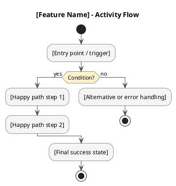
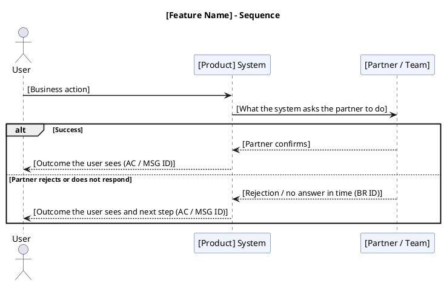

# Diagram Writer Skill

Draw business-level diagram code based on user selection. Diagrams show who does what and
what happens next, in language PO, BA, Dev, and QC all read the same way. They never show how
the system is built: the system is one participant, with no internal services, APIs, or data
stores. Labels follow `knowledge-base/product-language/SKILL.md`: when called from the PRD
pipeline, a label names a rule or outcome in words and cites its ID (for example "Paid within hold
time? (BR-03)"), never the rule's value or the message wording, which live only in the PRD's tables.

If the feature context is already known (for example from a PRD session), skip context
questions and go straight to drawing.
When called from the PRD pipeline, generate every requested diagram type and return code
blocks only, with no offer or follow-up text.

---

## Input Contract

When called by the PRD pipeline, the caller provides:

| Field | Type | Notes |
|-------|------|-------|
| `diagram_type` | `BPMN` / `Activity Diagram` / `Sequence Diagram` | One value per requested diagram. |
| `feature_name` | string | Feature or process name. |
| `actors` | string[] | People or roles involved. |
| `parties` | string[] | Partners, other teams, or existing features named in the input (business-level). Never internal technical components. |
| `happy_path` | string[] | Ordered successful-flow steps, each with the AC or BR ID it comes from when called from the PRD pipeline. |
| `edge_cases` | string[] | Alternative, failure, timeout, validation, or permission scenarios, each with the AC, CB, or BR ID that defines it when called from the PRD pipeline. |

If `diagram_type` is provided by the caller, do not ask the user to choose again.

**Branches in a PRD pipeline call (all diagram types):** draw only the alternative and failure branches
that the given AC, CB, and BR define, labelled with their IDs. Never add a branch to fill a skeleton.
If an outcome the flow needs is not defined, leave the branch out; the drafting step raises it as an
Open Question.

---

## Workflow

### Step 1 - Select diagram type (if not already specified)

If `diagram_type` or `Diagram_Requirements` is already provided by the orchestrator, skip this question and proceed. Otherwise, ask the user to choose one:

- **BPMN** - who does what across actors, the system, and partners
- **Activity Diagram** - branching business logic with happy and error paths
- **Sequence Diagram** - the order of interactions between actors, the system, and partners

Present the choice briefly.

### Step 2 - Gather context (if not already known)

Ask only what is still missing:

- What feature or process should the diagram cover?
- Who are the actors, and which partners or other teams are involved?
- What is the happy path? Are there any key decisions or error cases?

### Step 3 - Draw

Generate the diagram using the rules below. Output the code block immediately with no preamble.
If this is a standalone diagram request, you may offer to draw the other diagram types for
the same feature after the code block. If this is a PRD pipeline call, output only the
requested code block or blocks.

---

## BPMN - bpmn.io XML

Output a ` ```xml ` fenced block containing valid BPMN 2.0 XML.

**Required structure:**
`<collaboration>` pool -> `<process>` with `<laneSet>` -> one `<lane>` per actor, system, or partner ->
all flow elements with `<flowNodeRef>` -> `<sequenceFlow>` for every connection ->
`<bpmndi:BPMNDiagram>` with `<dc:Bounds>` per shape and `<di:waypoint>` per edge.

**Lanes:** one lane per actor or role, one lane for the system (named after the product, as a
single black box), and one lane per partner or team named in the input. Never split the system
into frontend, backend, or internal services.

**Labels:** task names are business actions in the user's language (for example "Choose seats",
"Confirm payment", "Notify operator"), never API calls or technical operations. Gateways name the
rule and cite its ID (for example "Within hold time? (BR-03)").

**Standard sizes:**

- `task`: 120x80 px
- `startEvent` / `endEvent`: 36x36 px
- `exclusiveGateway`: 50x50 px
- Pool label column: 30 px (lanes start at pool.x + 30, lane.width = pool.width - 30)
- Lane heights: actor lanes 120-130 px, system lane 200-220 px, each partner lane >= 100 px

**Layout rules:**

- Align tasks that communicate across lanes vertically to keep edges clean.
- Layout grid:
  - Pool origin: `x=160`, `y=80`.
  - Lane origin: `x=190`, `y=pool.y + cumulative lane heights`.
  - First task in a lane: `x=240`, `y=lane.y + (lane.height - 80) / 2`.
  - Horizontal stride between tasks: `150 px`.
  - Edge waypoints: source right midpoint -> target left midpoint.
  - Increase pool width before compressing tasks; do not overlap shapes.
- Encode all XML special characters in attributes: `&` -> `&amp;`, `<` -> `&lt;`, `>` -> `&gt;`, `"` -> `&quot;`, `'` -> `&apos;`.

**Skeleton:**

```xml
<?xml version="1.0" encoding="UTF-8"?>
<definitions xmlns="http://www.omg.org/spec/BPMN/20100524/MODEL"
             xmlns:bpmndi="http://www.omg.org/spec/BPMN/20100524/DI"
             xmlns:dc="http://www.omg.org/spec/DD/20100524/DC"
             xmlns:di="http://www.omg.org/spec/DD/20100524/DI"
             id="Definitions_1" targetNamespace="http://bpmn.io/schema/bpmn">
  <collaboration id="Collaboration_1">
    <participant id="Pool_1" name="[Feature] Process" processRef="Process_1" />
  </collaboration>
  <process id="Process_1" isExecutable="false">
    <laneSet id="LaneSet_1">
      <lane id="Lane_User" name="[Actor]">
        <flowNodeRef>StartEvent_1</flowNodeRef>
        <!-- add flowNodeRefs for all elements in this lane -->
      </lane>
      <lane id="Lane_System" name="[Product] System">
        <!-- flowNodeRefs -->
      </lane>
      <lane id="Lane_Partner" name="[Partner / Team]">
        <!-- flowNodeRefs; omit this lane if no partner is involved -->
      </lane>
    </laneSet>
    <!-- declare all elements: startEvent, task, exclusiveGateway, endEvent -->
    <!-- declare all sequenceFlows -->
  </process>
  <bpmndi:BPMNDiagram id="BPMNDiagram_1">
    <bpmndi:BPMNPlane id="BPMNPlane_1" bpmnElement="Collaboration_1">
      <!-- BPMNShape for pool, each lane, each element (dc:Bounds) -->
      <!-- BPMNEdge for each flow (di:waypoint) -->
    </bpmndi:BPMNPlane>
  </bpmndi:BPMNDiagram>
</definitions>
```

---

## Activity Diagram - PlantUML

Output a ` ```plantuml ` fenced block.

**Rules:**

- PRD pipeline call: include the happy path and the branches allowed by the rule above.
- Standalone request: include the happy path, at least 1 alternative branch, and at least 1 error or
  exception branch.
- Step labels must stay under 8 words, written as business actions or outcomes. No swimlanes.
- Conditions are business questions (for example "Seat still available? (BR-04)", "Paid within hold time? (BR-03)"), never technical checks. In a PRD pipeline call, cite the rule ID instead of its value.
- Use `if / then / else / endif`. Nested conditions are allowed.

**Skeleton:**



---

## Sequence Diagram - PlantUML

Output a ` ```plantuml ` fenced block.

**Rules:**

- Participants: the actors, the system as one participant (named after the product), and only the partners or teams named in the input. Never internal services, databases, or technical components.
- `->` for an action or request (solid), `-->` for the result (dashed).
- Label every arrow with a business action or outcome in plain words (for example "Request seat hold", "Seats held (BR-03)"). Never HTTP methods, endpoints, status codes, or payloads.
- Wrap success versus failure paths in `alt / else / end`. Label what the user sees in each with a short outcome name and its AC or MSG ID (for example "Booking failed (MSG-05)"), never the message wording.

**Skeleton:**


